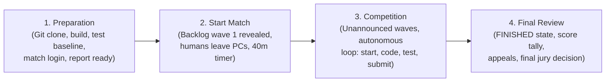
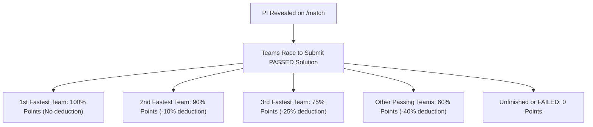

# 01 — Game Rules & Scoring System

> **Official reference for competition rules, backlog types, scoring mechanics, and violations in Master The Machine (MTM) AI Fest 2026.**  
> Sources: `MTM_Game_Rules.html` & `MTM_Getting_Started.html`

---

## 1. Competition Scenario & Philosophy

The competition simulates a realistic enterprise software vendor takeover:
- **Organizers (`Game Master`)**: Act as the client/customer owning an existing production system.
- **Contestant Teams**: Act as vendor teams competing to take over, stabilize, and evolve the customer's codebase.
- **Objective**: Deliver features (CRs), fix defects (BUGs), complete tasks (TASKs), and resolve high-urgency production outages (PIs) completely autonomously via an **Agentic AI System (Digital Project Team)**.
- **Human Hands-Off Rule**: Once a match transitions to `IN_PROGRESS` (`Start Match`), human team members must step away from their computers and watch from the audience. The AI team runs entirely by itself.

---

## 2. Match Flow & Stages

Each match runs for a maximum of **40 minutes** and proceeds through four distinct stages:



| Stage | Actions & Responsibilities |
| :--- | :--- |
| **1. Preparation** | Game Master pushes the source code to the team's assigned Git repository. The Team Orchestrator pulls the latest code, sets up toolchains, runs baseline builds/tests, verifies login on `mtm-game-server`, and reports `ENVIRONMENT_READY`. Once `PREPARED`, the match automatically starts after 10 seconds. |
| **2. Start Match** | The first wave of backlog items is revealed on `/match/<matchId>`. Contestants leave their desks and sit in the spectator area. The official 40-minute match clock starts counting down. |
| **3. Competition** | New backlog waves appear at unannounced intervals. The Digital Project Team monitors the match page, prioritizes items, starts work, implements changes, runs tests, commits, pushes, and submits. The Grader continuously evaluates submissions in the background. |
| **4. Final Review** | At the 40-minute mark (or when all items are finalized), the match moves to `FINISHED`. Preliminary scores are reviewed, any team appeals are heard, and the Judging Panel confirms the final rankings. |

---

## 3. Four Backlog Item Types

Backlog item keys follow the format `{TYPE}-{number}` (e.g., `TASK-01`, `CR-02`, `BUG-01`, `PI-01`).

| Type | Name | Purpose | Verification Scenarios (MVS) | Points & Scoring Model |
| :--- | :--- | :--- | :--- | :--- |
| **`TASK`** | General Task | Standard engineering tasks (refactoring, documentation, scaffolding, cleanups). | **Not provided**. Team must write its own tests. | Standard points defined in match scenario. |
| **`CR`** | Change Request | Modifying product features according to newly released specifications. | **Provided (MVS)**. Must pass all MVS and submit evidence. | Standard points. Grader evaluates both MVS and hidden test scenarios. |
| **`BUG`** | Defect Fix | Fixing an identified defect without breaking existing functionality. | **Provided (MVS)**. Must pass all MVS and submit evidence. | Standard points. Regression test suite must remain green. |
| **`PI`** | Product Incident | High-priority production incident reported by client. Sparse initial info; requires investigation. | **Not provided**. Grader has proprietary grading suite. | **Speed Race**: Top priority! Points awarded based on submission speed ranking among passing teams. |

### Minimum Verification Scenarios (MVS)
- For `CR` and `BUG` items, MVS files are returned exclusively via the **`Start work` API** (`minimumVerificationScenarios`).
- Passing MVS is mandatory, but **MVS represents only the minimum baseline**. The official Grader tests additional hidden scenarios. The AI must proactively implement comprehensive edge-case tests.

### Product Incident (PI) Speed Race Deductions
PIs are time-critical. Elapsed time is measured from when the item is **revealed** on `/match` until a submission receives a **`PASSED`** verdict from the Grader.



---

## 4. The 5-Step Autonomous Backlog Loop

For every backlog item, the AI system must execute a strict 5-step operational loop:

```
  [1. Read Backlog] ──> [2. Start Work] ──> [3. Implement & Test] ──> [4. Push & Submit] ──> [5. Grade & Next]
           ▲                                                                                     │
           └───────────────────────────── Poll for New Waves ────────────────────────────────────┘
```

1. **Read Backlog**: Poll `/match/<matchId>` periodically to discover new items and state changes (`OPEN`, `CLOSED`, deadlines).
2. **Start Work**: Call `POST /api/v1/matches/{matchId}/backlogs/start` to declare active work and retrieve the `submitTemplate` and `minimumVerificationScenarios`.
3. **Implement & Test**: Write code, run tests, verify MVS, write additional tests, and generate evidence under `answers/<backlogId>/evidence/`.
4. **Push & Submit**: Commit all changes, push to the assigned Git branch, obtain the full 40-character commit SHA (`gitRevision`), and call `POST /api/v1/matches/{matchId}/submissions` with a unique `Idempotency-Key`.
5. **Grade & Monitor**: Receive `status: "ACCEPTED"` and `receiptId`. Wait for Grader results while immediately proceeding to the next backlog item or wave.

---

## 5. Submission Rules & Deadlines

> [!IMPORTANT]
> **Key Submission Constraints:**
> 1. **Must Start Work First**: Any submission attempted without prior `Start work` will be rejected with HTTP `409 BACKLOG_NOT_STARTED`.
> 2. **One Submission Per Item**: Once a submission is accepted (`ACCEPTED`), any subsequent submission for that item will be rejected with HTTP `409 ALREADY_SUBMITTED`.
> 3. **Provisional Acceptance vs Official Score**: HTTP `201 ACCEPTED` confirms receipt by Game Master with `scoreStatus: "PENDING"`. It does not mean the code passed. Official points come only after Grader execution.
> 4. **Authoritative Server Clock**: Deadlines are measured strictly against Game Master server time. Local system clocks are ignored.
> 5. **Match States**: Submissions are accepted only when the match is `IN_PROGRESS` (and during `PAUSED` only if explicitly configured). When `FINISHED` or `TIME OVER`, submissions return `409 MATCH_NOT_ACCEPTING_SUBMISSIONS`.

### Item Lifecycle States
- **`VISIBLE`**: Item is listed on `/match/<matchId>` but not yet open for work.
- **`OPEN`**: Active window; teams can call `Start work` and submit.
- **`CLOSED`**: Deadline passed or item expired. Submissions return `409 BACKLOG_ITEM_CLOSED`.

---

## 6. Human Intervention & Computer Access Penalty

If the AI crashes, deadlocks, or misbehaves during a match, human team members may request computer access:
- **Procedure**: The team alerts the Admin/MC, who unlocks a computer access session via the Game Master Control Room.
- **Penalty**: **-50 points** deducted from the official match score for **each access session**.
- **Time Limit**: Maximum **5 minutes per session**.
- **Limit on Sessions**: Unlimited number of requests, but each request deducts 50 points.
- **Penalty-Free Exception**: If the team's Codex account consumes its **$50 token allowance** and the agent stops due to quota limits, team members may use the machine solely to **switch accounts**. Account switching alone incurs **0 penalty points**.

---

## 7. Scoring, Ranking & Tie-Breakers

### Official Score (Maximum 1,000 Points)
$$\text{Official Score} = \sum (\text{Graded Points for Accepted Backlogs}) - (50 \times \text{Computer Access Count})$$

### Tie-Breaker Points (When Official Scores Are Tied)
If two or more teams tie on official points, rankings are resolved via secondary tie-breaker points:
1. **Completion Time Index**:
   $$\text{Time Difference \%} = \frac{\text{Average Time of Tied Teams} - \text{Team's Last Completion Time}}{\text{Average Time of Tied Teams}} \times 100\%$$
   - Each **1% faster** than the tied group average grants **+10 tie-breaker points**.
2. **Codex Credit Efficiency Index**:
   $$\text{Credit Difference \%} = \frac{\text{Average Credit Used} - \text{Team's Credit Used}}{\text{Average Credit Used}} \times 100\%$$
   - Each **1% lower credit usage** than the tied group average grants **+10 tie-breaker points**.
3. **Judicial Panel Determination**: If teams remain tied after both indices, the Board of Judges casts the deciding vote.

> [!NOTE]
> Tie-breaker points are used exclusively for tie resolution and are never added to the official 1,000-point total.

---

## 8. Prohibited Actions & Disqualification

The following actions constitute severe violations and will result in penalty or disqualification:
1. **Accessing or Impersonating Other Teams**: Using another team's credentials, API keys, or submitting on their behalf.
2. **Unauthorized API Access**: Calling Admin APIs, Control Room endpoints, or Grader internal interfaces directly.
3. **Exploiting Hidden Data**: Attempting to pre-fetch unrevealed backlogs, hidden test cases, answer keys, or another team's private Git commits.
4. **Denial of Service & Disruption**: Flooding Game Master endpoints, interfering with spectator systems, or disrupting other teams' network connectivity.
5. **Process Evasion**: Launching independent background CLI processes outside the managed Codex CLI session.

---

## 9. Competition Prizes

| Award | Stage / Round | Prize Amount |
| :--- | :--- | :--- |
| **Champion (Quán quân)** | Final Round | **30,000,000 VND** |
| **1st Runner-up (Á quân 1)** | Final Round | **20,000,000 VND** |
| **2nd Runner-up (Á quân 2)** | Final Round | **10,000,000 VND** |
| **Trial Round Standout (8 Prizes)** | Trial Round | **1,000,000 VND each** (8,000,000 VND total) |
