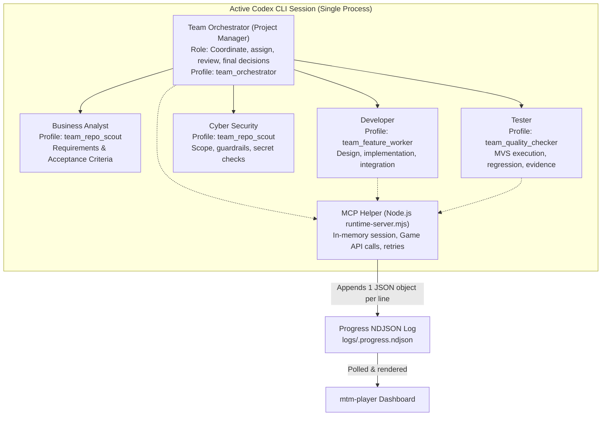

# 03 — Team Orchestrator Technical Guide

> **Architecture, lifecycle sequence, MCP Helper runtime, logging schemas, and guardrails for the Digital Project Team.**  
> Source: `team-orchestrator-technical-guide.html` (Guide v0.5.1)

---

## 1. System Role & Internal Architecture

The Team Orchestrator acts as the **Project Manager** coordinating four specialist roles. In the MTM Player runtime, this is implemented as an autonomous agent tree executing inside a single Codex CLI session.



### Specialist Profiles Mapping
While conceptual roles are PM, BA, Dev, Sec, and Tester, the current `mtm-player` runtime manifest enforces four registered profile identifiers:
1. `team_orchestrator`: Root Project Manager agent.
2. `team_repo_scout`: Source exploration, requirements breakdown (BA), and guardrail validation (Security).
3. `team_feature_worker`: Core implementation, refactoring, and fixes (Developer).
4. `team_quality_checker`: Test authoring, MVS execution, and evidence collection (Tester).

> [!CAUTION]
> **Subagent Execution Rule (MUST NOT)**:
> The Team Orchestrator may spawn subagents **only through the provider's native mechanism within the active CLI session**. It **MUST NOT** launch additional independent CLI processes (e.g., launching new `codex`, `claude`, or `app-server` processes). Any unauthorized process creation will be detected by `mtm-player` and result in immediate termination of the agent tree.

---

## 2. Directory Layout & Root Paths

### Source Package Structure vs. Installed Workspace Structure

```text
Source Package (team-orchestrator-pack/)
├── package.json                       # Must define "name": "team-sdlc-pack"
├── team-pack-info.json                # Fixed 4-field identity manifest
├── team-runtime.json                  # Manifest specifying codex provider
├── install.ps1                        # PowerShell installation script
├── agents/                            # Role profile declarations (.toml)
│   ├── team-orchestrator.toml
│   ├── team-repo-scout.toml
│   ├── team-feature-worker.toml
│   └── team-quality-checker.toml
├── skills/                            # Operational strategy instructions
│   ├── team-orchestrator/SKILL.md
│   ├── game-preparation/SKILL.md
│   └── team-recovery/SKILL.md
├── bin/
│   └── runtime-server.mjs             # MCP Helper server
├── src/
│   └── runtime-session.mjs            # In-memory session & state manager
├── contracts/
│   └── progress-event.schema.json     # Schema for progress log events
├── scripts/
│   ├── install.mjs
│   └── check-distribution.mjs
└── README.md
```

```text
Installed Target Workspace (<TeamWorkspace>/, e.g. D:/mtm/CPL/)
├── matches/
│   └── <matchId>/                     # checkoutRoot (contains .git/)
│       └── <repository.folder>/       # matchRoot (assigned source folder)
│           ├── src/
│           ├── challenge/             # Original problem statements
│           └── answers/
│               └── <backlogId>/
│                   ├── submit.json    # Materialized submission answer
│                   └── evidence/      # Verification test logs & outputs
├── team-sdlc-pack/
│   ├── runtime/                       # Immutable installed payload
│   └── logs/                          # <matchId>.progress.ndjson
├── .mtm/
│   ├── team-runtime.json
│   └── team-pack-info.json
├── .codex/
│   ├── agents/                        # Copied agent profiles
│   └── config.toml                    # Absolute path to runtime-server.mjs
└── .agents/
    └── skills/                        # Copied skill instructions
```

### Checkout Root vs. Match Root
- **`checkoutRoot`** (`<TeamWorkspace>/matches/<matchId>`): Root of the local Git clone containing the `.git/` metadata directory.
- **`matchRoot`** (`checkoutRoot/<repository.folder>`): The specific subfolder assigned for the match. All code editing, testing, answer generation, and evidence generation must occur strictly inside `matchRoot`.
- **Answers Destination Rule**: Materialize answers only at `matchRoot/answers/<backlogId>/submit.json`. Evidence must be placed only at `matchRoot/answers/<backlogId>/evidence/`.

---

## 3. Required Manifests & Identity

### `team-pack-info.json` (Required 4-Field Identity)
MUST be placed at package root and synchronized with `.mtm/team-pack-info.json`:
```json
{
  "schemaVersion": 1,
  "version": "1.0.0",
  "teamId": "CPL",
  "teamName": "CPL Team"
}
```
- `schemaVersion`: Integer `1`.
- `version`: Matches `version` in `package.json` and `team-runtime.json`.
- `teamId`: Official registered team code (not a UUID). Starts with alphanumeric character.
- `teamName`: Official registered team display name.

### `team-runtime.json`
```json
{
  "schemaVersion": 1,
  "kind": "mtm-team-runtime",
  "name": "team-sdlc-pack",
  "version": "1.0.0",
  "protocolVersion": 4,
  "provider": "codex",
  "entrypoint": {
    "rootAgentType": "team_orchestrator"
  }
}
```

---

## 4. Node.js MCP Helper Runtime

The MCP Helper (`runtime-server.mjs`) exposes tools over standard I/O (JSON-RPC 2.0). It acts as the secure intermediary between the LLM and the competition infrastructure.

### Tools to Implement
1. **`configure_session(descriptor, modelPolicy?)`**: Validates session parameters, working directories, and origins. In preparation, derives paths from working directory; in game start, replaces bearer client while preserving verified match session.
2. **`login_match()`**: Authenticates cookie session on `mtm-game-server` using username and password. Returns safe status without leaking credentials.
3. **`refresh_match()`**: Fetches current match view from `/match/<matchId>`. Verifies team identity, assigned repository, and discovers new backlog items.
4. **`start_work(backlogItemKey)`**: Invokes `POST /backlogs/start`. Emits `GAME_MASTER_API` events, caches templates and MVS files, and creates answer directories.
5. **`submit_work(clientSubmissionId, backlogItemKey, gitRevision, answer)`**: Invokes `POST /submissions`. Manages `Idempotency-Key`, logs `GAME_MASTER_API` events, and returns official receipts.
6. **`report_progress(event)`**: Enriches the event with `schemaVersion: 1` and `playerSessionId`, validates against `contracts/progress-event.schema.json`, and appends to `<matchId>.progress.ndjson`.
7. **`wait_for_update(timeoutMs)`**: Performs bounded serial polling (max 55,000 ms) on `/match/<matchId>` and returns when changes occur or timeout expires.

---

## 5. From Spawn to Match End: 23-Step Lifecycle Sequence

```text
mtm-player             Orchestrator            mtm-game-server         Assigned Git          Progress Log
    │                       │                         │                     │                      │
 1. │── Spawn Agent ───────>│                         │                     │                      │
    │                       │── 2. Log ORCHESTRATOR_STARTED ──────────────────────────────────────>│
    │                       │── 3. Verify & Checkout ──────────────────────>│                      │
    │                       │── 4. Baseline Build & Tests ────────────────────────────────────────>│
    │                       │── 5. Login Session ────>│                     │                      │
    │                       │── 6. Open /match/ID ───>│                     │                      │
    │                       │── 7. Log ENVIRONMENT_READY ─────────────────────────────────────────>│
    │<─ 8. Report Ready ────│                         │                     │                      │
 9. │── Prep Complete ───────────────────────────────>│                     │                      │
10. │── Authorize Backlog ─>│                         │                     │                      │
    │                       │── 11. Read /match/ID ──>│                     │                      │
    │                       │── 12. Log DISCOVERED ───────────────────────────────────────────────>│
    │                       │── 13. POST /start ─────>│                     │                      │
    │                       │── 14. Log IN_PROGRESS ──────────────────────────────────────────────>│
    │                       │── 15. Code & Run Tests (MVS)                  │                      │
    │                       │── 16. Git Commit & Push ─────────────────────>│                      │
    │                       │── 17. POST /submissions>│                     │                      │
    │                       │<─ 18. Return Receipt ───│                     │                      │
    │                       │── 19. Log SUBMITTED ────────────────────────────────────────────────>│
20. │── Pause / End ───────>│                         │                     │                      │
    │                       │── 21. Stop Workers & Log ORCHESTRATOR_ENDED ────────────────────────>│
22. │── Resume (New Agent) >│                         │                     │                      │
    │                       │── 23. Log ORCHESTRATOR_RESTARTED ───────────────────────────────────>│
```

### Detailed Sequence Steps

1. **Spawn**: `mtm-player` launches the `team_orchestrator` agent via Codex CLI, passing team info, match ID, repository URL, Git read credentials, and allowed origins. Marker: `PREPARE_GAME_V2`.
2. **`ORCHESTRATOR_STARTED`**: Orchestrator immediately appends `ORCHESTRATOR_STARTED` to `<matchId>.progress.ndjson`.
3. **Checkout Source**: Clones repository, checks out assigned branch and folder into `checkoutRoot`. Appends `PREPARATION_STATUS` for `GIT_AUTH` and `REPOSITORY`.
4. **Environment Setup & Build**: Verifies toolchain, installs locked dependencies, runs build and baseline tests. Appends `PREPARATION_STATUS` for `ENVIRONMENT` and `BUILD`.
5. **Login to Game Server**: Authenticates with username and password against Game Master URL.
6. **Open Match Page**: Explicitly visits `https://masterthemachine.tech/match/<matchId>`. Verifies repository and backlog assignment.
7. **`ENVIRONMENT_READY`**: Appends `MATCH_LOGIN` completed, then writes the `ENVIRONMENT_READY` event containing commit revision SHA, `build: "PASS"`, and `matchLogin: "PASS"`.
8. **Report Readiness**: Agent signals ready to `mtm-player`.
9. **Preparation Complete**: `mtm-player` notifies `mtm-game-server` that team is `PREPARED`. Practice match auto-starts after 10 seconds.
10. **Authorize Backlog Work**: When match reaches `IN_PROGRESS`, `mtm-player` sends `START_GAME_V4` containing bearer API token and match paths.
11. **Read Backlog**: Orchestrator loads `/match/<matchId>` to fetch initial wave.
12. **Backlog Sync & Discovery**: Appends `GAME_START_STATUS` (`BACKLOG_SYNC`), followed by `BACKLOG_STATUS` (`status: "DISCOVERED"`) for every discovered item.
13. **Start Work API**: Calls `POST /api/v1/matches/{matchId}/backlogs/start` for the highest priority item. Logs `GAME_MASTER_API` (`REQUESTED` / `SUCCEEDED`).
14. **Log Working State**: Upon 201/200 response, appends `BACKLOG_STATUS` (`status: "IN_PROGRESS"`) and `BACKLOG_TESTS` (`status: "NOT_RUN"`).
15. **Implement & Test**: Specialist agents edit source, run tests, verify MVS, and write evidence to `answers/<backlogId>/evidence/`. Progress log records `BACKLOG_TESTS` (`RUNNING` -> `PASSED`/`FAILED`).
16. **Commit & Push**: Commits source, answer template (`answers/<backlogId>/submit.json`), and evidence to Git remote. Obtains full commit SHA.
17. **Submit API**: Calls `POST /api/v1/matches/{matchId}/submissions` with unique `Idempotency-Key`.
18. **Receive Receipt**: Game Master returns HTTP 201 with `receiptId` and `status: "ACCEPTED"`.
19. **Log Submitted State**: Appends `BACKLOG_STATUS` (`status: "SUBMITTED"`, full `revision` SHA, and official `receiptId`). Repeats loop for next item.
20. **Pause / Finish Signal**: `mtm-player` sends `MATCH_PAUSED_V1` or `MATCH_ENDED_V1`.
21. **Stop & Preserve**: Orchestrator immediately stops API calls, background tests, and Git commands. On match end, appends `ORCHESTRATOR_ENDED`.
22. **Resume**: On resume, `mtm-player` launches a fresh replacement agent with `RESUME_GAME_V1`.
23. **`ORCHESTRATOR_RESTARTED`**: Replacement agent appends `ORCHESTRATOR_RESTARTED`, reconciles log and Git history, and skips already accepted items.

---

## 6. Progress Log NDJSON Event Schemas

The progress log file is located at:
$$\text{Path} = \text{TeamWorkspace}/\text{team-sdlc-pack}/\text{logs}/<\text{matchId}>.\text{progress.ndjson}$$

Every event must be appended as a **single UTF-8 line** without overwriting existing lines.

### Common Envelope Fields
Every event object must include:
- `"schemaVersion": 1`
- `"playerSessionId": "<session-id>"`
- `"type": "<EVENT_TYPE>"`

### 1. `ORCHESTRATOR_STARTED`
```json
{"schemaVersion":1,"playerSessionId":"session-01","type":"ORCHESTRATOR_STARTED","summary":"Orchestrator started."}
```

### 2. `PREPARATION_STATUS`
- `stage`: `"GIT_AUTH"` | `"REPOSITORY"` | `"ENVIRONMENT"` | `"BUILD"` | `"MATCH_LOGIN"` | `"PREPARE_COMPLETE"`
- `status`: `"IN_PROGRESS"` | `"COMPLETED"` | `"BLOCKED"` | `"FAILED"`
```json
{"schemaVersion":1,"playerSessionId":"session-01","type":"PREPARATION_STATUS","stage":"GIT_AUTH","status":"COMPLETED","summary":"Git access verified."}
```

### 3. `ENVIRONMENT_READY`
```json
{
  "schemaVersion": 1,
  "playerSessionId": "session-01",
  "type": "ENVIRONMENT_READY",
  "requestId": "req-prep-01",
  "repository": {
    "url": "https://github.com/lqdung863/mtm-cpl.git",
    "branch": "main",
    "folder": "TISTL6MV"
  },
  "revision": "0123456789abcdef0123456789abcdef01234567",
  "build": "PASS",
  "matchLogin": "PASS"
}
```

### 4. `BACKLOG_STATUS`
- `status`: `"DISCOVERED"` | `"IN_PROGRESS"` | `"COMPLETED"` | `"SUBMITTED"` | `"BLOCKED"` | `"FAILED"`
```json
{
  "schemaVersion": 1,
  "playerSessionId": "session-01",
  "type": "BACKLOG_STATUS",
  "backlogId": "TASK-01",
  "title": "Refactor customer module",
  "status": "SUBMITTED",
  "summary": "Submitted task with passing unit tests.",
  "revision": "0123456789abcdef0123456789abcdef01234567",
  "receiptId": "6f1c2a40-54d8-4a46-b722-4fdc2b307f54"
}
```

### 5. `BACKLOG_TESTS`
- `status`: `"NOT_RUN"` | `"RUNNING"` | `"PASSED"` | `"FAILED"`
```json
{
  "schemaVersion": 1,
  "playerSessionId": "session-01",
  "type": "BACKLOG_TESTS",
  "backlogId": "TASK-01",
  "status": "PASSED",
  "required": 4,
  "executed": 4,
  "passed": 4,
  "failed": 0,
  "skipped": 0,
  "summary": "All 4 required test cases passed."
}
```

### 6. `GAME_MASTER_API`
- `phase`: `"REQUESTED"` | `"SUCCEEDED"` | `"FAILED"`
```json
{
  "schemaVersion": 1,
  "playerSessionId": "session-01",
  "type": "GAME_MASTER_API",
  "operation": "submit_work",
  "backlogId": "TASK-01",
  "method": "POST",
  "origin": "https://masterthemachine.tech",
  "path": "/api/v1/matches/8c0e1b22-1111-4222-8333-444444444444/submissions",
  "phase": "SUCCEEDED",
  "httpStatus": 201,
  "requestId": "req_sub_01",
  "summary": "Submission accepted by Game Master."
}
```

### 7. `BLOCKER_OPENED` & `BLOCKER_RESOLVED`
```json
{"schemaVersion":1,"playerSessionId":"session-01","type":"BLOCKER_OPENED","blockerId":"blk-01","backlogId":"CR-02","summary":"Missing upstream API documentation."}
{"schemaVersion":1,"playerSessionId":"session-01","type":"BLOCKER_RESOLVED","blockerId":"blk-01","summary":"Resolved via fallback mock adapter."}
```

### 8. `ORCHESTRATOR_ENDED` & `ORCHESTRATOR_RESTARTED`
```json
{"schemaVersion":1,"playerSessionId":"session-01","type":"ORCHESTRATOR_ENDED","status":"COMPLETED","summary":"Match concluded."}
{"schemaVersion":1,"playerSessionId":"session-02","type":"ORCHESTRATOR_RESTARTED","attempt":2,"phase":"GAME","reason":"SESSION_RECONNECT","summary":"Reconnected."}
```

---

## 7. Guardrails Against Competition Violations

| Area | Guardrail Rule | Forbidden Action (Violation) |
| :--- | :--- | :--- |
| **Workspace Isolation** | Access only `<matchRoot>` for code/tests and designated `<matchId>.progress.ndjson` for logs. | Attempting to read sibling match folders, competitor workspaces, or internal `mtm-player` state. |
| **Git Operations** | Standard clone, commit, and push only to the assigned branch. | Force pushing (`git push -f`), rewriting public history, or pushing to non-assigned remotes. |
| **Network & API** | Call only authorized endpoints on Game Master using Match UUID. | Calling undocumented Admin or Grader APIs; scraping unrevealed items. |
| **Credential Security** | Keep passwords and API keys strictly in MCP Helper memory. | Committing tokens to Git, printing tokens to stdout, or passing tokens as command-line arguments. |
| **Model Compliance** | Use only models listed in `allowedModels` from input. | Overriding or proxying through non-approved LLMs. |
| **Process Control** | All subagents must remain inside the native Codex CLI session. | Spawning detached background CLI processes or independent terminal sessions. |
| **Telemetry Integrity** | Emit schema-compliant progress events with actual test counts. | Reporting `SUBMITTED` without an official receipt ID or reporting `PASSED` without running tests. |
