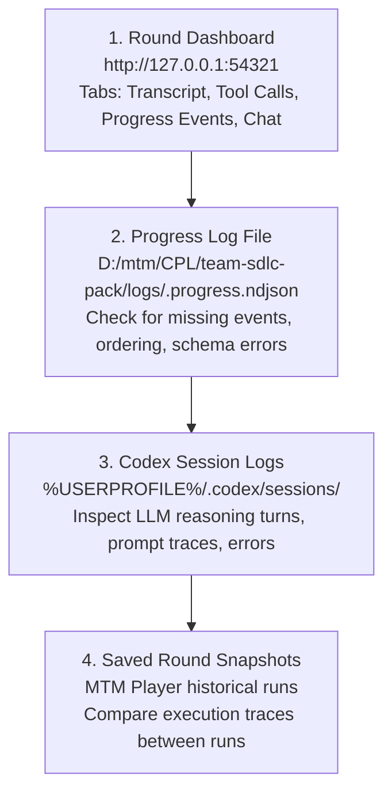

# 04 — Setup, Installation & Debugging Guide

> **Practical guide for setting up MTM Player, modifying the team pack, running practice matches, and troubleshooting.**  
> Sources: `MTM_Getting_Started.html` & `team-orchestrator-technical-guide.html`

---

## 1. Prerequisites Checklist

Ensure your competition workstation meets all requirements before match day:

- [x] **Operating System**: Windows 10/11 with **PowerShell 7+** (`pwsh --version`).
- [x] **Codex CLI**: Installed and authenticated (`codex --version`). Verify that active login matches the authorized competition license ($50 credit).
- [x] **Node.js**: Node.js runtime installed (`node --version`, v24.12.0 or modern LTS).
- [x] **Team Workspace Directory**: Dedicated folder, e.g., `D:\mtm\CPL`.
- [x] **Script Execution Policy**: Permission to run PowerShell scripts:
  ```powershell
  Set-ExecutionPolicy -Scope Process -ExecutionPolicy Bypass
  ```
- [x] **Game Master Credentials**:
  - `LOGIN_USERNAME`: `CPL_digital_cuder`
  - `LOGIN_PASSWORD`: `8a7#amQ!`
  - `TEAM_API_KEY`: `gm_live_bad8fd2e_piJOMs0zyyLybcs-fS_xc03JHzCgJi1-`
  - `TEAM_ID`: `CPL`
  - `PRACTICE_MATCH_ID`: `TISTL6MV`
- [x] **Git Repository Access**: GitHub access granted to `https://github.com/lqdung863/mtm-cpl`.

---

## 2. Installing and Running MTM Player

MTM Player is a **portable** application requiring no external browser plugins or complex installation:

```text
Player Directory Layout (e.g. D:\mtm-player-app-0.5.1\)
├── mtm-player.exe       # Core Player executable
├── node.exe             # Portable Node.js binary (downloaded into this folder)
└── app/                 # Player frontend and management assets
```

### Installation Steps

1. **Extract Player**:
   Unzip the official `mtm-player-<version>.zip` package provided by the organizers.
2. **Isolate Folder**:
   Copy the entire `player-app` directory (containing `mtm-player.exe` and `app/`) into a dedicated directory named after the version (e.g., `D:\mtm-player-app-0.5.1`).
   > [!WARNING]
   > Maintain separate directories for each version. Never mix `app/` assets or `node.exe` between different Player versions.
3. **Place `node.exe`**:
   Download the standalone Windows `node.exe` (v24.12.0) from [https://nodejs.org/dist/v24.12.0/win-x64/node.exe](https://nodejs.org/dist/v24.12.0/win-x64/node.exe) and place it directly into your `mtm-player-app-<version>` folder alongside `mtm-player.exe`.
4. **Launch Player**:
   Run `mtm-player.exe` without any arguments.
5. **Access Management Console**:
   The player will automatically open your default browser to:
   ```
   http://127.0.0.1:54321/manage
   ```
   Verify health status at `http://127.0.0.1:54321/health`.

> [!TIP]
> Always stop MTM Player using the **Stop** button in the web management UI. Do not terminate the process forcefully.

---

## 3. Sample Pack Customization Exercises

The sample pack (`team-orchestrator-pack`) is only a scaffold. Contestant teams must customize the pack through three essential exercises:

### Exercise 1: Update Team Identity
Open `team-orchestrator-pack/team-pack-info.json` and set your team credentials:
```json
{
  "schemaVersion": 1,
  "version": "1.0.0",
  "teamId": "CPL",
  "teamName": "CPL Team"
}
```
*Note: `teamId` is the team code, not a UUID.*

### Exercise 2: Configure Developer Profile Instructions
Open `team-orchestrator-pack/agents/team-developer.toml` (or `team-feature-worker.toml`) and provide concise developer guidelines:
```toml
name = "team_developer"
description = "Developer: implements backlog items."
developer_instructions = """
1. Read the task specifications and acceptance criteria provided by the Project Manager.
2. Edit source code strictly within the assigned matchRoot folder.
3. Execute relevant unit and integration tests before signaling completion.
4. Return modified file paths, test commands executed, and test pass/fail results.
"""
```

### Exercise 3: Formulate Orchestrator Strategy Skills
Open `team-orchestrator-pack/skills/team-orchestrator/SKILL.md` and define prioritization and retry policies:
```markdown
---
name: team-orchestrator
description: Coordinates the team during an MTM match.
---

## Prioritization Matrix
1. **PI First**: If a Product Incident appears, immediately preempt current work and allocate all resources to PI.
2. **Nearest Deadlines**: Next, prioritize items whose deadlines are closing soonest.
3. **CR / BUG**: Work on CRs and BUGs that provide MVS verification.
4. **TASK**: Process regular tasks when higher-priority queues are empty.

## Execution Rules
- Always call `start_work` before modifying any files.
- Run tests and pass all MVS before pushing.
- Commit all changes and verify push before invoking `submit_work`.
- Never terminate the session when backlog is empty; poll `/match` periodically for unannounced waves.
```

---

## 4. Installing the Team Pack into Workspace

Once modifications are complete, install the pack into the target workspace:

```powershell
# Run the PowerShell installer
pwsh -NoProfile -File .\team-orchestrator-pack\install.ps1 -TeamWorkspace "D:\mtm\CPL"

# Run the distribution verifier
node .\team-orchestrator-pack\scripts\check-distribution.mjs --team-workspace "D:\mtm\CPL"
```

> [!IMPORTANT]
> - Re-run the installation script whenever you modify files in the team pack.
> - **Never install or reinstall into a workspace while a live match round is currently running.**

---

## 5. Running a Practice Match Step-by-Step

```mermaid
sequenceDiagram
    autonumber
    actor Team as Contestant Operator
    participant Player as MTM Player UI (/manage)
    participant Agent as Team Orchestrator (Codex)
    participant GM as Game Master (/match)
    participant Spec as Spectator Screen

    Team->>Player: Enter workspace path "D:\mtm\CPL" & click "Load team pack"
    Player-->>Team: Verifies Team ID "CPL", Name, and Version
    Team->>Player: Click "Initialize Match", enter "TISTL6MV", select Model, click "Initialize"
    Player->>Agent: Spawns agent (PREPARE_GAME_V2)
    Agent->>Agent: Clones repo, builds, sets up environment
    Agent->>GM: Verifies match login session
    Agent->>Player: Appends ENVIRONMENT_READY to progress log
    Player->>GM: Sends Preparation Complete (PREPARED)
    Note over GM,Agent: 10-second countdown expires; Match starts!
    GM-->>Agent: Backlog wave 1 opens
    Agent->>Agent: Autonomously starts, codes, tests, and submits
    Team->>GM: Views Backlog on /match/TISTL6MV
    Team->>Spec: Views Battle Dashboard on /spectator/TISTL6MV
    Note over Team,GM: After match concludes, click "Re-match" to reset practice match
```

1. **Open Management Page**: Navigate to `http://127.0.0.1:54321/manage`.
2. **Load Team Pack**: Enter `D:\mtm\CPL` and click **Load team pack**. Confirm that `Team ID`, `Team Name`, and `Version` display correctly.
3. **Initialize Match**:
   - Click **Initialize Match**.
   - Enter your Game Master team account credentials.
   - Enter Practice Match ID: `TISTL6MV`.
   - Select the target Codex model (e.g. `gpt-5.3-codex`).
   - Click **Initialize**.
4. **Monitor Preparation**: Watch the round dashboard. The Orchestrator will check out the repo, build dependencies, test the baseline, and log in to the match portal.
5. **Automatic Start**: Once the agent writes `ENVIRONMENT_READY`, the round dashboard updates to `PREPARED`. After 10 seconds, the practice match auto-starts.
6. **Spectate & Review**:
   - Track Backlog: Open `https://masterthemachine.tech/match/TISTL6MV`.
   - Track Live Leaderboard: Open `https://masterthemachine.tech/spectator/TISTL6MV`.
7. **Re-matching**: When the practice round concludes, open `https://masterthemachine.tech/match/TISTL6MV` and click **Re-match** to reset the match state for another run.

---

## 6. The 4-Location Debugging Framework

When an agent stalls, fails, or behaves unexpectedly, inspect these four locations in order:



1. **Round Dashboard** (`http://127.0.0.1:54321`):
   - **Transcript Tab**: View full text output from the agent.
   - **Tool Tab**: Inspect MCP tool call parameters and responses.
   - **Progress Events Tab**: Check whether events are successfully recognized by `mtm-player`.
   - **Chat**: Send short corrective prompts to the agent if permitted during practice.
2. **Progress Log File** (`<TeamWorkspace>/team-sdlc-pack/logs/<matchId>.progress.ndjson`):
   - Open in an editor to verify that every event is on its own line and valid JSON.
   - Confirm required milestone events exist: `ORCHESTRATOR_STARTED` $\to$ `PREPARATION_STATUS` $\to$ `ENVIRONMENT_READY` $\to$ `BACKLOG_SYNC` $\to$ `BACKLOG_STATUS`.
3. **Codex Session Logs** (`%USERPROFILE%\.codex\sessions`):
   - Full transcript of model reasoning, internal tool execution, token usage, and system errors.
   - Essential for finding token quota exhaustion errors or tool timeout issues.
4. **Saved Round Snapshots**:
   - `mtm-player` persists dashboard state for completed rounds, allowing comparison of timing and tool call patterns across runs.

---

## 7. Common Symptoms & Diagnostic Matrix

| Symptom | Probable Cause | Diagnostic Check & Fix |
| :--- | :--- | :--- |
| **"Load team pack" fails** | Manifest mismatch or missing files. | Verify that `version` matches across `package.json`, `team-runtime.json`, and `team-pack-info.json`. Run `node .\scripts\check-distribution.mjs`. |
| **Preparation hangs indefinitely** | `ENVIRONMENT_READY` event was not emitted. | Inspect the progress log. Ensure all preparation stages (`GIT_AUTH`, `REPOSITORY`, `ENVIRONMENT`, `BUILD`, `MATCH_LOGIN`) completed and `ENVIRONMENT_READY` was appended with valid schema. |
| **Dashboard does not update backlog** | Events written to wrong file or invalid schema. | Check that MCP Helper is appending to the exact `progressLogFile` path provided in the session descriptor, and that `playerSessionId` is populated. |
| **Agent exits before new waves arrive** | Skill returned terminal result when queue emptied. | In `skills/team-orchestrator/SKILL.md`, enforce a continuous polling loop using `wait_for_update`. The agent must never terminate early while the match is `IN_PROGRESS`. |
| **Submit timeout / connection drop** | Transient network glitch. | Implement idempotency retry: re-send the identical `Idempotency-Key` and identical body. Do not generate a new UUID or key. |
| **Login session expired (401/403)** | Cookie session timed out. | Helper must catch 401 on `/match` reads, invoke `login_match()` to refresh cookies, and retry the read. |
| **Workspace folder moved or renamed** | Absolute MCP paths in `.codex/config.toml` broken. | Re-run `install.ps1` with the new workspace path to regenerate absolute MCP arguments, then reload the pack. |
| **Agent runs but makes no progress** | Codex $50 license quota exhausted. | Inspect `%USERPROFILE%\.codex\sessions` for 429 quota errors. If quota is hit, take human computer access to switch to a backup account (no score deduction). |
