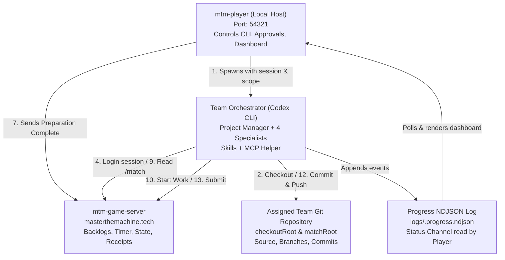

# Master The Machine (MTM) — Team Pack & Game Master Documentation

> **Official competition documentation summary for AI Fest 2026: Master The Machine.**  
> Source: [https://masterthemachine.tech/docs](https://masterthemachine.tech/docs)

---

## 📌 Document Overview

This directory contains the comprehensive, structured technical summary of the Master The Machine (MTM) Game Master documentation, rules, machine-to-machine APIs, orchestrator technical guide, and setup instructions.

| Document | Topic | Description |
| :--- | :--- | :--- |
| **[01_GAME_RULES_AND_SCORING.md](file:///d:/mtm/docs/01_GAME_RULES_AND_SCORING.md)** | **Rules & Scoring** | 40-minute match flow, 1,000 max points, 4 backlog types (`TASK`, `CR`, `BUG`, `PI`), MVS verification, speed race for PI, computer access penalties (-50 pts), tie-breakers, and prohibited actions. |
| **[02_DIGITAL_CUDER_API.md](file:///d:/mtm/docs/02_DIGITAL_CUDER_API.md)** | **Digital Cuder API** | Machine-to-machine HTTP REST APIs for `Start work` and `Submit`, Bearer token auth, UUID path parameters, idempotency keys, request/response schemas, retry semantics, and full error code dictionary. |
| **[03_TEAM_ORCHESTRATOR_TECHNICAL_GUIDE.md](file:///d:/mtm/docs/03_TEAM_ORCHESTRATOR_TECHNICAL_GUIDE.md)** | **Technical Guide** | Team Orchestrator architecture (PM + 4 specialists), Node.js MCP Helper runtime, mandatory `<matchId>.progress.ndjson` logging, 23-step lifecycle sequence, guardrails, and packaging specifications. |
| **[04_SETUP_AND_DEBUGGING_GUIDE.md](file:///d:/mtm/docs/04_SETUP_AND_DEBUGGING_GUIDE.md)** | **Setup & Debugging** | Prerequisites (PowerShell 7, Codex CLI, Node.js), MTM Player portable installation, team pack modification exercises, Practice Match execution, and the 4-location debugging framework. |

---

## 🏛️ System Architecture

The MTM competition architecture connects five key entities via structured communication channels:



### Key Components

1. **`mtm-game-server` (`https://masterthemachine.tech`)**:
   - Manages matches, reveals backlog waves, tracks official time, accepts submissions, and issues official receipts.
   - Hosts the match management UI (`/match/<matchId>`) and spectator screen (`/spectator/<matchId>`).
2. **`mtm-player` (Local Desktop App)**:
   - Portable Windows executable (`mtm-player.exe`) running locally on `http://127.0.0.1:54321`.
   - Loads the team pack, initializes rounds, spawns and monitors the Codex CLI process, and renders the round dashboard.
3. **`Team Orchestrator` (The Contestant's AI Team)**:
   - Autonomous Digital Project Team running inside a single Codex CLI session.
   - Implements a Project Manager orchestrator coordinating 4 roles (Business Analyst, Developer, Cyber Security, Tester) via skills and a Node.js MCP Helper.
4. **`Assigned Git Repository`**:
   - Hosted Git repository where the contestant team clones code, makes fixes, runs tests, and pushes commits.
   - Submission requires pushing a commit and submitting its full 40-character Git SHA.
5. **`Progress Log` (`<matchId>.progress.ndjson`)**:
   - The single business status channel between the Orchestrator and `mtm-player`.
   - Every state change, API call, test execution, and blocker must be appended as valid NDJSON matching `contracts/progress-event.schema.json`.

---

## 🔑 Team Environment & Credentials Mapping

From `.env` at workspace root:

| Environment Variable | Configured Value | Purpose |
| :--- | :--- | :--- |
| `GM_BASE_URL` / `GAME_MASTER_BASE_URL` | `https://masterthemachine.tech` | Game Master base URL |
| `TEAM_ID` | `CPL` | Official registered team code |
| `LOGIN_USERNAME` | `CPL_digital_cuder` | Username for `/match` web session login |
| `LOGIN_PASSWORD` | `8a7#amQ!` | Password for web session login |
| `TEAM_API_KEY` | `gm_live_bad8fd2e_piJOMs0zyyLybcs-fS_xc03JHzCgJi1-` | Bearer token for `Start work` & `Submit` APIs |
| `DOCS_URL` | `https://masterthemachine.tech/docs` | Documentation portal |
| `TEAM_REPO_URL` | `https://github.com/lqdung863/mtm-cpl` | Assigned team Git repository |
| `PRACTICE_MATCH_ID` | `TISTL6MV` | 8-character ID for practice match runs |

---

## ⚡ Quick Start Checklist

1. **Verify Environment**:
   ```powershell
   pwsh --version   # Must be PowerShell 7+
   codex --version  # Codex CLI must be authenticated
   node --version   # Node.js LTS (v24.12.0 recommended)
   ```
2. **Install Team Pack**:
   ```powershell
   pwsh -NoProfile -File .\team-orchestrator-pack\install.ps1 -TeamWorkspace "D:\mtm\CPL"
   node .\team-orchestrator-pack\scripts\check-distribution.mjs --team-workspace "D:\mtm\CPL"
   ```
3. **Launch MTM Player**:
   - Start `mtm-player.exe`.
   - Open `http://127.0.0.1:54321/manage`.
   - Click **Load team pack** with workspace `D:\mtm\CPL`.
   - Click **Initialize Match**, input Practice Match ID `TISTL6MV`, select model, and start.
