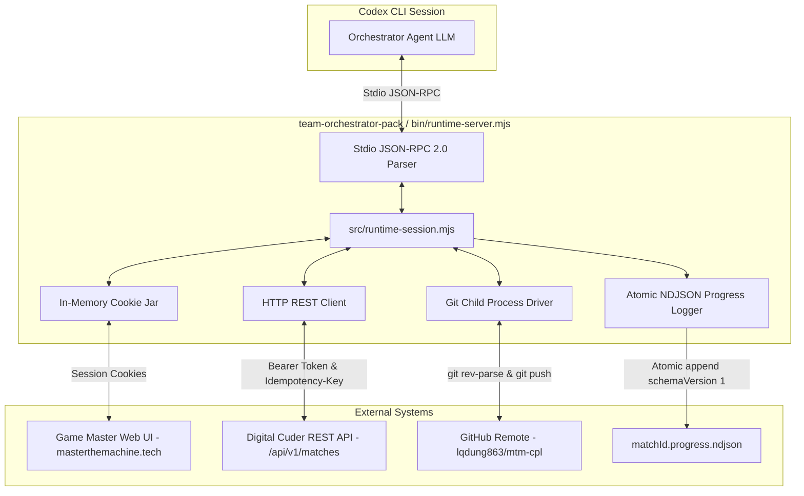

# Implementation Plan: MTM MCP Helper Component & Deployment Harness

## Overview
This plan specifies the implementation of the **MCP Helper Component** (`bin/runtime-server.mjs` and `src/runtime-session.mjs`) for the `team-orchestrator-pack`, along with the configuration, deployment scripts, and automated test harness.

All implementations strictly adhere to the **5 Approved Decisions**:
1. **0 External Dependencies**: Pure Node.js Standard Library (`node:http`, `node:https`, `node:crypto`, `node:child_process`, `node:fs`, `node:readline`).
2. **Automated Git Verification**: Automatic `git rev-parse HEAD` resolution and push verification in `submit_work`.
3. **Dual-Auth Architecture**: In-memory cookie jar for web session (`/match/<id>`) and Bearer client for REST APIs (`/api/v1/...`).
4. **Automated Telemetry**: Transparent `GAME_MASTER_API (REQUESTED / SUCCEEDED / FAILED)` and `BACKLOG_STATUS` logging inside the helper.
5. **7-Tool Suite**: `configure_session`, `login_match`, `refresh_match`, `start_work`, `submit_work`, `report_progress`, `wait_for_update`.

---

## Architecture Diagram



---

## Proposed Changes & Deliverables

### Component 1: MCP Core Runtime (`src/runtime-session.mjs`)
- **State Management**:
  - `matchId` (UUID vs 8-char resolution).
  - `playerSessionId`, `teamId`, `teamApiKey`.
  - Stored credentials: `username`, `password`.
  - Directories: `workingDirectory`, `checkoutRoot`, `matchRoot`, `progressLogFile`.
  - `cookieJar`: Stored cookies map (`session_id`, `cf_clearance`, etc.).
  - `backlogRegistry`: Cache of discovered backlog items and active task states.
- **Network Engine**:
  - `request(url, options)`: Wrapper around `node:https` and `node:http`.
  - `fetchWeb(path)`: Injects cookie headers, extracts `Set-Cookie`, follows redirects. Auto-retries with `login_match()` on 401/403.
  - `fetchApi(path, options)`: Injects `Authorization: Bearer <TEAM_API_KEY>`, generates and tracks `Idempotency-Key`.
- **Git Engine**:
  - `resolveGitSha(checkoutRoot)`: Runs `git rev-parse HEAD`.
  - `ensurePushed(checkoutRoot, branch)`: Checks unpushed commits and uncommitted changes; executes `git push origin <branch>`.
- **Telemetry Logger**:
  - `appendProgress(event)`: Validates mandatory fields (`schemaVersion: 1`, `playerSessionId`, `type`, `summary`), formats single-line JSON, appends synchronously with UTF-8 encoding.
  - Transparent telemetry: Automatically emits `GAME_MASTER_API (REQUESTED)` before API calls and `GAME_MASTER_API (SUCCEEDED / FAILED)` with `durationMs` and HTTP status.
- **The 7 Tool Implementations**:
  1. `configure_session(descriptor, modelPolicy)`: Configures working directories, credentials, paths, and replaces bearer tokens across phases.
  2. `login_match()`: Submits credentials to Game Master login endpoint, populates cookie jar, returns safe status.
  3. `refresh_match()`: Reads `/match/<matchId>`, parses backlog items, auto-emits `BACKLOG_STATUS (DISCOVERED)`.
  4. `start_work(backlogItemKey)`: Calls `POST /backlogs/start`, emits `GAME_MASTER_API`, creates answers folder, writes initial `submit.json`, logs `BACKLOG_STATUS (IN_PROGRESS)`.
  5. `submit_work(backlogItemKey, answer, artifactUrls)`: Verifies git status, resolves full 40-char SHA, calls `POST /submissions` with `gitRevision` at body root, logs `BACKLOG_STATUS (SUBMITTED)`.
  6. `report_progress(event)`: Public endpoint for custom events (`PREPARATION_STATUS`, `ENVIRONMENT_READY`, `BACKLOG_TESTS`, etc.).
  7. `wait_for_update(timeoutMs)`: Bounded polling loop on `/match/<matchId>` returning when backlog changes occur.

---

### Component 2: MCP Stdio Server (`bin/runtime-server.mjs`)
- Uses `node:readline` on `process.stdin` and writes JSON-RPC 2.0 to `process.stdout`.
- All internal logging, errors, and traces routed to `console.error` (stderr) to prevent stdio framing corruption.
- Handles MCP protocol handshake:
  - `initialize`: Responds with protocol version `2024-11-05` and server capabilities.
  - `tools/list`: Returns schemas for all 7 tools.
  - `tools/call`: Dispatches to `src/runtime-session.mjs`, wraps results in `{ content: [{ type: "text", text: JSON.stringify(result) }] }`.
  - Robust error boundary: Catches uncaught exceptions and returns standard MCP error responses without killing the server.

---

### Component 3: Codex Integration & Configuration (`config/codex.toml`)
- Configures MCP server definition:
  ```toml
  [mcp_servers.mtm_helper]
  command = "node"
  args = ["<TeamWorkspace>/team-sdlc-pack/bin/runtime-server.mjs"]
  ```

---

### Component 4: Deployment & Validation Scripts
- **`scripts/install.mjs` & `install.ps1`**:
  - Copies all pack files into target workspace (`<TeamWorkspace>/team-sdlc-pack/`).
  - Resolves `<TeamWorkspace>` dynamically to replace placeholder paths in `codex.toml` with absolute paths.
  - Verifies presence of `node.exe` and directory structure.
- **`scripts/check-distribution.mjs`**:
  - Verifies that all files declared in `package.json` exist and are non-empty.
  - Verifies `team-pack-info.json` and `team-runtime.json` conformance.
- **`test/test-mcp-server.mjs` (Local Offline Test)**:
  - Spawns `node bin/runtime-server.mjs` as a child process.
  - Simulates Codex MCP client sending `initialize`, `tools/list`, and `tools/call` for `configure_session` and `report_progress`.
  - Asserts that NDJSON progress log is correctly created and formatted.
  - Runs in ~1 second with $0 credit usage.

---

## Verification Plan

### Automated Offline Tests
1. **Distribution Check**:
   ```powershell
   node scripts/check-distribution.mjs
   ```
   *Expected Output*: Exit code 0, all files verified.
2. **MCP Stdio Server Protocol Test**:
   ```powershell
   node test/test-mcp-server.mjs
   ```
   *Expected Output*:
   - Successfully negotiates JSON-RPC `initialize`.
   - Returns 7 tools from `tools/list`.
   - Successfully executes `configure_session` and `report_progress`.
   - Generated NDJSON file contains valid `schemaVersion: 1` and `playerSessionId`.
3. **Installer Test**:
   ```powershell
   .\install.ps1 -TargetWorkspace "d:\mtm\test-install"
   ```
   *Expected Output*: Deploys clean pack, resolves absolute path in `codex.toml`.

### Manual / Integration Verification
- Verify that no external npm packages are imported (static AST check).
- Verify that standard output only emits valid JSON-RPC frames.
- Verify Git SHA extraction logic against current git repository.

---

## Implementation Steps & Sequence

1. **Step 1**: Implement `src/runtime-session.mjs` with networking, Git automation, progress logging, and the 7 tools.
2. **Step 2**: Implement `bin/runtime-server.mjs` with stdio JSON-RPC 2.0 loop and tool dispatching.
3. **Step 3**: Implement `config/codex.toml` with `mtm_helper` MCP server registration.
4. **Step 4**: Implement `scripts/install.mjs` and `install.ps1` for workspace deployment and path expansion.
5. **Step 5**: Implement `scripts/check-distribution.mjs` for package integrity verification.
6. **Step 6**: Implement `test/test-mcp-server.mjs` and execute offline verification.

