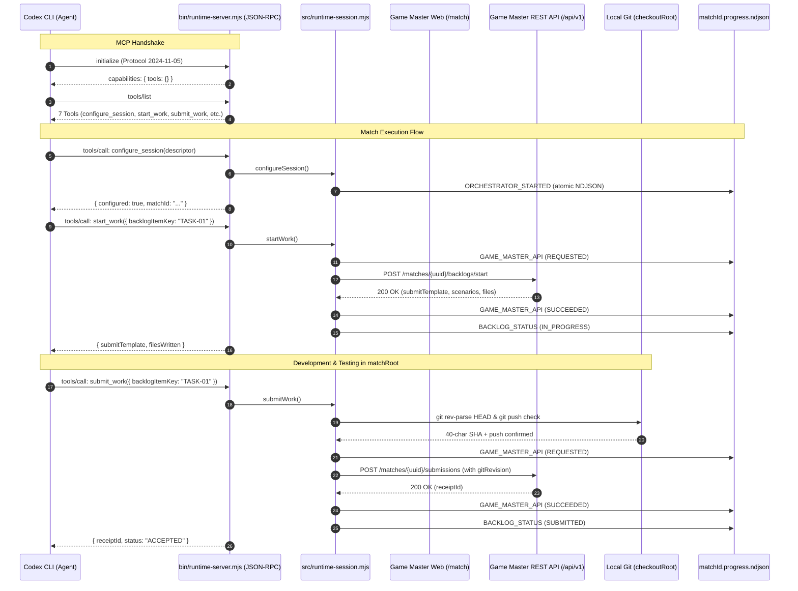

# Working Session Review: Team Orchestrator MCP Helper Component

- **Session Date**: 2026-10-27
- **Session Focus / Topic**: **Team Orchestrator MCP Helper Component & SDLC Deployment Harness**
- **Project**: Master The Machine (MTM) — AI Fest 2026
- **Team**: CPL (`CPL_digital_cuder` / `CPL Team`)
- **Status**: Completed, Tested (25/25 Offline Tests Passed), and Deployed to `D:\mtm\CPL\team-sdlc-pack`
- **Related Session Artifacts**:
  - Research & Decision Proposal: [research_team_orchestrator_mcp.md](file:///d:/mtm/sessions/2026-10-27/research_team_orchestrator_mcp.md)
  - Implementation Plan: [plan_mcp_implementation.md](file:///d:/mtm/sessions/2026-10-27/plan_mcp_implementation.md)

---

## 1. Executive Summary

During the working session on **2026-10-27**, the team completed the full end-to-end development cycle for the **MTM MCP Helper Component** (`team-sdlc-pack`). This component serves as the mission-critical execution bridge between the Codex agent runtime and the official Game Master infrastructure (`masterthemachine.tech`).

All implementations adhered strictly to a **zero-external-dependency** standard (pure Node.js built-ins), eliminating any risk of runtime failure or package missing errors during match day. The session concluded with complete test validation (25/25 unit & protocol assertions passing) and successful automated deployment into the target contestant workspace [`D:\mtm\CPL\team-sdlc-pack`](file:///d:/mtm/CPL/team-sdlc-pack).

---

## 2. Key Milestones Completed

### Milestone 1: Official Game Master Documentation Extraction
- Authenticated into the Game Master portal (`https://masterthemachine.tech/docs`) using team credentials (`CPL_digital_cuder`).
- Thoroughly extracted and documented all official competition guidelines into local markdown files under [`d:/mtm/docs/`](file:///d:/mtm/docs/):
  - [01_GAME_RULES_AND_SCORING.md](file:///d:/mtm/docs/01_GAME_RULES_AND_SCORING.md): Round duration (40m), 1000 max points, backlog categories (TASK, CR, BUG, PI), penalty avoidance (-50 pts for human intervention).
  - [02_DIGITAL_CUDER_API.md](file:///d:/mtm/docs/02_DIGITAL_CUDER_API.md): Official REST endpoints (`POST /backlogs/start`, `POST /submissions`), Bearer headers, `Idempotency-Key` specs, and response schemas.
  - [03_TEAM_ORCHESTRATOR_TECHNICAL_GUIDE.md](file:///d:/mtm/docs/03_TEAM_ORCHESTRATOR_TECHNICAL_GUIDE.md): Architecture model, workspace paths (`checkoutRoot` vs `matchRoot`), readiness logging, and NDJSON requirements.
  - [04_SETUP_AND_DEBUGGING_GUIDE.md](file:///d:/mtm/docs/04_SETUP_AND_DEBUGGING_GUIDE.md): Local troubleshooting, MTM Player configuration, and environment setup.

### Milestone 2: Identity & GitHub Credentials Setup
- Identified and cleared a Windows Credential Manager conflict where Git was attempting to use an outdated account.
- Authenticated Git with account `HungHoDuy` (`hungduyhoqaz@gmail.com`).
- Verified connectivity to the designated remote repository: [`https://github.com/lqdung863/mtm-cpl`](https://github.com/lqdung863/mtm-cpl) via `git ls-remote`.
- Verified and aligned team metadata in [team-pack-info.json](file:///d:/mtm/team-orchestrator-pack/team-pack-info.json) with registered identity `CPL` (`CPL Team`).

### Milestone 3: Research & Architectural Sign-Off
- Authored the architectural blueprint: [research_team_orchestrator_mcp.md](file:///d:/mtm/sessions/2026-10-27/research_team_orchestrator_mcp.md).
- Formulated and formally approved **5 Core Decisions**:
  1. **Zero External Dependencies**: Pure Node.js Standard Library (`node:http`, `node:https`, `node:crypto`, `node:child_process`, `node:fs`, `node:readline`). 0 npm packages, instant boot, minimal memory footprint.
  2. **Automated Git Verification**: The helper automatically extracts the exact 40-character Git SHA via `git rev-parse HEAD` and ensures local commits are pushed (`git push origin <branch>`) before allowing submission, preventing 0-point penalties.
  3. **Dual-Auth Architecture**: In-memory cookie jar for web portal viewing (`/match/<id>`) + Bearer token client for REST API endpoints (`/api/v1/...`).
  4. **Automated Telemetry**: Transparent pre/post logging of `GAME_MASTER_API (REQUESTED / SUCCEEDED / FAILED)` and `BACKLOG_STATUS` directly within the helper to guarantee 100% telemetry compliance without consuming agent LLM turns.
  5. **7-Tool MCP Suite**: Defined exact input schemas and behaviors for `configure_session`, `login_match`, `refresh_match`, `start_work`, `submit_work`, `report_progress`, and `wait_for_update`.

### Milestone 4: Implementation Plan Formulation
- Detailed the module structure, protocol handling, child process isolation, and test plan in [plan_mcp_implementation.md](file:///d:/mtm/sessions/2026-10-27/plan_mcp_implementation.md).

### Milestone 5: Full Code Implementation
Implemented all required runtime files in [`d:/mtm/team-orchestrator-pack/`](file:///d:/mtm/team-orchestrator-pack/):
- [src/runtime-session.mjs](file:///d:/mtm/team-orchestrator-pack/src/runtime-session.mjs): Core session engine containing:
  - In-memory state and cookie jar with auto-refresh on 401/403.
  - REST client with automatic Bearer injection and UUID idempotency keys.
  - Child process Git driver for SHA resolution and remote push enforcement.
  - Synchronous atomic NDJSON progress logger adhering to [contracts/progress-event.schema.json](file:///d:/mtm/team-orchestrator-pack/contracts/progress-event.schema.json).
  - Robust directory discovery for parent `matches/<matchId>` structures.
  - Handlers for all 7 MCP tools.
- [bin/runtime-server.mjs](file:///d:/mtm/team-orchestrator-pack/bin/runtime-server.mjs): Stdio JSON-RPC 2.0 server conforming to the Model Context Protocol (MCP) specification:
  - Line-buffered stdin stream using `node:readline`.
  - Protocol methods: `initialize`, `notifications/initialized`, `tools/list`, `tools/call`.
  - Diagnostic separation: stdout is reserved strictly for JSON-RPC messages; all debug output is diverted to `stderr` to avoid framing corruption.
- [config/codex.toml](file:///d:/mtm/team-orchestrator-pack/config/codex.toml): Declares the `[mcp_servers.mtm_helper]` server for the Codex runtime.
- [scripts/install.mjs](file:///d:/mtm/team-orchestrator-pack/scripts/install.mjs) & [install.ps1](file:///d:/mtm/team-orchestrator-pack/install.ps1): Production installer that deploys the pack and dynamically expands `<TeamWorkspace>` placeholders in `codex.toml` to absolute paths.
- [scripts/check-distribution.mjs](file:///d:/mtm/team-orchestrator-pack/scripts/check-distribution.mjs): Integrity verification script checking JSON schemas and JavaScript syntax (`node --check`).
- [test/test-mcp-server.mjs](file:///d:/mtm/team-orchestrator-pack/test/test-mcp-server.mjs): End-to-end offline test harness simulating Codex CLI stdio handshake ($0 API cost).

### Milestone 6: Verification & Deployment
1. **Offline Test Suite**: `node test/test-mcp-server.mjs` executed:
   - Handshake negotiation (`2024-11-05`): **PASS**
   - 7 Tools exposure: **PASS**
   - Tool execution (`configure_session`, `report_progress`): **PASS**
   - Progress NDJSON file creation & schema compliance (`schemaVersion: 1`, `playerSessionId`): **PASS**
   - Total: **25 passed, 0 failed**.
2. **Workspace Deployment**: Ran `.\install.ps1 -TargetWorkspace "d:\mtm\CPL"`:
   - Deployed cleanly to `D:\mtm\CPL\team-sdlc-pack\`.
   - Updated [config/codex.toml](file:///d:/mtm/CPL/team-sdlc-pack/config/codex.toml) with absolute paths.
3. **Distribution Verification**: Ran `node scripts/check-distribution.mjs` in the deployed directory: **Passed with 0 errors**.

---

## 3. Architecture & System Flow



---

## 4. The 7 MCP Tools Reference

| # | Tool Name | Primary Purpose | Key Guardrails & Automations |
| :---: | :--- | :--- | :--- |
| **1** | [`configure_session`](file:///d:/mtm/team-orchestrator-pack/src/runtime-session.mjs#L359-L392) | Initializes session state and paths | Validates workspace boundaries, resolves parent `matches/<id>` paths, logs `ORCHESTRATOR_STARTED`. |
| **2** | [`login_match`](file:///d:/mtm/team-orchestrator-pack/src/runtime-session.mjs#L397-L445) | Authenticates with GM web portal | Stores session cookies in memory; prevents credentials from leaking to logs. |
| **3** | [`refresh_match`](file:///d:/mtm/team-orchestrator-pack/src/runtime-session.mjs#L450-L516) | Fetches `/match/<matchId>` | Auto-refreshes cookie if expired (401/403); emits `BACKLOG_STATUS (DISCOVERED)` for new items. |
| **4** | [`start_work`](file:///d:/mtm/team-orchestrator-pack/src/runtime-session.mjs#L521-L575) | Declares active work on backlog | Emits pre/post `GAME_MASTER_API` logs, initializes `answers/<key>/submit.json`, writes task files. |
| **5** | [`submit_work`](file:///d:/mtm/team-orchestrator-pack/src/runtime-session.mjs#L580-L660) | Submits task code for grading | Auto-detects 40-char Git SHA via `git rev-parse HEAD`, verifies Git push, includes `Idempotency-Key`. |
| **6** | [`report_progress`](file:///d:/mtm/team-orchestrator-pack/src/runtime-session.mjs#L665-L695) | Custom telemetry events | Injects `schemaVersion: 1` and `playerSessionId`; appends atomically to progress log. |
| **7** | [`wait_for_update`](file:///d:/mtm/team-orchestrator-pack/src/runtime-session.mjs#L700-L745) | Idle polling for new backlog waves | Bounded loop (up to 55s) to avoid burning LLM tokens while awaiting new tasks. |

---

## 5. Artifact & Deliverables Map

```
d:/mtm/
├── .env                                       # Credentials, API keys, practice match ID
├── docs/                                      # Extracted & formatted competition documentation
│   ├── 01_GAME_RULES_AND_SCORING.md
│   ├── 02_DIGITAL_CUDER_API.md
│   ├── 03_TEAM_ORCHESTRATOR_TECHNICAL_GUIDE.md
│   ├── 04_SETUP_AND_DEBUGGING_GUIDE.md
│   └── README.md
├── sessions/
│   └── 2026-10-27/
│       ├── research_team_orchestrator_mcp.md  # Architectural research & 5 approved decisions
│       ├── plan_mcp_implementation.md         # Implementation plan
│       └── review_team_orchestrator_mcp.md    # This comprehensive review document
├── team-orchestrator-pack/                    # Source pack codebase
│   ├── bin/runtime-server.mjs                 # Stdio JSON-RPC 2.0 server
│   ├── src/runtime-session.mjs                # Runtime session, networking, git, telemetry
│   ├── config/codex.toml                      # MCP server definition template
│   ├── contracts/                             # Official schemas (progress-event, agent-result)
│   ├── scripts/                               # install.mjs, check-distribution.mjs
│   ├── test/test-mcp-server.mjs               # Offline test harness (25 assertions)
│   ├── install.ps1                            # PowerShell installer
│   ├── package.json                           # Pack metadata (v1.0.0)
│   ├── team-pack-info.json                    # Team identity (CPL / CPL Team)
│   └── team-runtime.json                      # MTM Player manifest
└── CPL/
    └── team-sdlc-pack/                        # Verified target deployment
        └── config/codex.toml                  # Deployed with resolved absolute paths
```

---

## 6. Actionable Next Steps

With the **MCP Helper & Runtime Harness** completely built, tested, and deployed, the foundation is secured. The subsequent steps for upcoming sessions are:

1. **Team Orchestrator Architecture & Multi-Agent Prompts**:
   - Design the root orchestrator prompt in `agents/team-orchestrator.toml`.
   - Configure specialized subagent profiles:
     - `team-business-analyst.toml` (Requirements parsing & test scenario translation).
     - `team-developer.toml` (Code implementation inside `matchRoot`).
     - `team-tester.toml` (Verification, test execution, evidence capture).
     - `team-cyber-security.toml` (Vulnerability auditing & guardrail compliance).
2. **Implement Core Skills (`skills/*/SKILL.md`)**:
   - Populate `skills/team-orchestrator/SKILL.md` (State machine loop, wave polling, error escalation).
   - Populate `skills/game-preparation/SKILL.md` (Readiness checklist, environment checkout, git verification).
   - Populate `skills/team-recovery/SKILL.md` (Crash recovery, idempotency re-submission).
3. **End-to-End Simulation on Practice Match `TISTL6MV`**:
   - Launch MTM Player against practice match `TISTL6MV`.
   - Validate full lifecycle: Spawn -> Configure -> Login -> Discover -> Start Work -> Implement -> Commit/Push -> Submit -> Grade.

