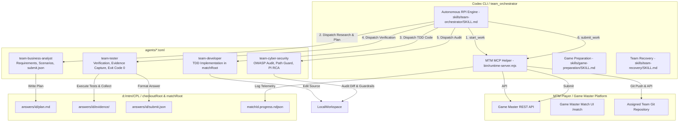

# Implementation Plan: HVE Core Inheritance for Team SDLC Pack

- **Session Date**: 2026-10-28
- **Project**: Master The Machine (MTM) — AI Fest 2026
- **Team**: CPL (`CPL_digital_cuder` / `CPL Team`)
- **Status**: Ready for Implementation (All 4 Decisions Approved)
- **Target Directories**:
  - Source Pack: [`d:/mtm/team-orchestrator-pack/`](file:///d:/mtm/team-orchestrator-pack/)
  - Target Deployment: [`d:/mtm/CPL/team-sdlc-pack/`](file:///d:/mtm/CPL/team-sdlc-pack/)

---

## 1. Overview & Objectives

This implementation plan defines the concrete steps to inherit and adapt the **Microsoft Hypervelocity Engineering (HVE) Core** framework into our **`team-sdlc-pack`**.

The implementation operationalizes the **4 Approved Decisions**:
1. **Selective Extraction**: Streamline HVE Core RPI, 4-Lens Review, and Security patterns into lean tournament skills and agent prompts (0 bloat, 0 external npm dependencies).
2. **Time-Budgeted Fallback**: Autonomous 4-Lens Review with a maximum of 2 retry iterations and a strict 8-minute task limit to protect the 40-minute contest clock.
3. **Answers-Aligned Tracking**: Persist task plans, execution logs, and verification evidence inside `<matchRoot>/answers/<id>/` as required by the Game Master grader.
4. **5-Agent HVE Persona Mapping**: Orchestrator (RPI Engine), BA (Requirements), Developer (Implementation), Tester (Evidence/Verification), and Security (OWASP & PI Triage).

---

## 2. Architecture & Data Flow



---

## 3. Deliverables & Detailed Component Specifications

### Component 1: Autonomous Tournament Skills (`skills/`)

#### 1.1. `skills/team-orchestrator/SKILL.md` (The Core Autonomous RPI Engine)
- **Role**: Master execution playbook for `team_orchestrator`.
- **Key Sections**:
  1. **Match Wave State Machine**:
     - Wave Discovery: Polls `refresh_match()`, tracks backlog wave states (`VISIBLE`, `OPEN`, `CLOSED`).
     - Prioritization Hierarchy:
       * **Priority 1: `PI` (Product Incident)** — Immediate preemption of non-critical tasks.
       * **Priority 2: Nearest Deadline** — Items with closing time windows.
       * **Priority 3: `CR` / `BUG`** — High value, bounded scope with explicit test criteria.
       * **Priority 4: `TASK`** — Standard backlog tasks.
  2. **The 4-Stage Autonomous RPI Loop**:
     - **Stage 1 (Research)**: Calls `start_work(id)`; inspects `submitTemplate` and `minimumVerificationScenarios`. For `BUG`/`PI`, inspects stack traces and reproduces failure with an isolated test script.
     - **Stage 2 (Plan)**: Scaffolds `<matchRoot>/answers/<id>/plan.md` using the standard 4-task template (`P01-T01` to `P01-T04`). Runs autonomous critique (ensures target files are strictly in `matchRoot`, checks MVS coverage).
     - **Stage 3 (Implement)**: Dispatches `team-developer` with instructions to implement minimal diffs, execute tests, and confirm green.
     - **Stage 4 (Review & Quality Gate)**: Dispatches `team-tester` and `team-cyber-security` to evaluate the 4 Lenses.
  3. **Autonomous 4-Lens Quality Gate**:
     - *Lens 1 (Functional)*: All automated tests pass (exit code 0).
     - *Lens 2 (Quality)*: Clean diffs, no syntax errors, no debug statements.
     - *Lens 3 (Security)*: No tokens/credentials in code, no command injection, no path traversal.
     - *Lens 4 (Submission)*: `submit.json` validated against template, evidence files present.
  4. **Time Budgeting & Fallback Policy**:
     - Maximum 8 minutes per backlog item.
     - If review fails: maximum 2 retry iterations (90s each).
     - If 8-minute limit expires: finalize best-effort `submit.json` and invoke `submit_work` to ensure non-zero score and protect remaining wave time.
  5. **Idle Polling**:
     - If all active items are submitted and match is still active: enter bounded `wait_for_update()` loop (up to 55s per cycle) awaiting subsequent waves. Never terminate early.

#### 1.2. `skills/game-preparation/SKILL.md` (Readiness & Environment Bootstrap)
- **Role**: Executed during match preparation / kickoff phase.
- **Key Sections**:
  1. **Pre-Flight Sanity Checklist**:
     - Verify Node.js runtime and Git availability.
     - Verify directory structure: `checkoutRoot` and `matchRoot` presence.
     - Verify remote Git authentication against assigned remote repository.
  2. **Session Initialization**:
     - Call `configure_session()` with initial player descriptor.
     - Call `login_match()` to establish authenticated web cookie session.
  3. **Readiness Telemetry**:
     - Emit `PREPARATION_STATUS` events for `GIT_AUTH`, `REPOSITORY`, and `RUNTIME_INITIALIZED`.
     - Emit `ENVIRONMENT_READY` upon completing all readiness checks.

#### 1.3. `skills/team-recovery/SKILL.md` (Self-Healing & Fault Tolerance)
- **Role**: Invoked when unhandled exceptions, network drops, or submission errors occur.
- **Key Sections**:
  1. **Idempotent Re-Submission**:
     - Uses persisted `Idempotency-Key` and `clientSubmissionId` from session to retry failed `POST /submissions` without duplicate penalties.
  2. **Git Conflict & Dirty State Rollback**:
     - If local Git workspace is in an unrecoverable state, resets uncommitted changes to `origin/<branch>` and reapplies task diff cleanly.
  3. **Web Session Cookie Re-Authentication**:
     - Automatically intercepts HTTP 401/403 on `/match` reads and executes silent re-login.

---

### Component 2: Specialized Agent Profiles (`agents/*.toml`)

All agent profiles will be expanded from empty stubs into production-grade TOML profiles declaring role-specific guidelines, tool access, and return contracts:

#### 2.1. `agents/team-orchestrator.toml`
- **Role**: Root agent (`entrypoint.rootAgentType`).
- **Prompt Directives**:
  - Autonomous coordinator persona.
  - Controls match clock, backlog queue, and MCP tools (`start_work`, `submit_work`, `report_progress`, `wait_for_update`).
  - Dispatches subtasks to BA, Dev, Tester, and Security agents.
  - Enforces the 8-minute time cap and 2-retry limit.

#### 2.2. `agents/team-business-analyst.toml`
- **Role**: Requirements and scenario analyzer.
- **Prompt Directives**:
  - Translates raw task descriptions into unambiguous acceptance criteria.
  - Decomposes `minimumVerificationScenarios` into concrete test assertions.
  - Authors the initial schema-compliant `answers/<id>/submit.json`.

#### 2.3. `agents/team-developer.toml`
- **Role**: TDD software engineer.
- **Prompt Directives**:
  - Strict write boundary: Only edit files inside `<matchRoot>`.
  - Minimal diff principle: Never refactor unrelated code; fix only what is specified.
  - Test-first implementation: Write or update the test first, verify failure, write fix, verify pass.
  - Returns modified file list, test commands, and pass status.

#### 2.4. `agents/team-tester.toml`
- **Role**: QA, verification, and evidence specialist.
- **Prompt Directives**:
  - Executes unit and integration test commands in child process.
  - Verifies exit code 0.
  - Captures terminal execution logs and writes them to `<matchRoot>/answers/<id>/evidence/test_output.txt`.
  - Verifies that `submit.json` contains valid values and no placeholder text.

#### 2.5. `agents/team-cyber-security.toml`
- **Role**: Security auditor and Incident Response specialist.
- **Prompt Directives**:
  - Performs static security audit of Git diffs before submission:
    * OWASP Top 10 check (injections, SSRF, XSS).
    * Secret leakage prevention (scans for API keys, passwords, bearer tokens).
    * Path boundary verification (ensures no `../` traversal outside `matchRoot`).
  - Incident Response lead: When item is a `PI` (Product Incident), conducts immediate triage, isolates root cause, and verifies regression test.

---

### Component 3: Testing & Verification Harness

#### 3.1. `test/test-orchestrator-skills.mjs`
- **Role**: Automated offline validation harness ($0 API cost).
- **Checks**:
  1. Validates TOML syntax of all 5 agent profiles in `agents/*.toml`.
  2. Validates frontmatter and markdown structure of all 3 skills in `skills/*/SKILL.md`.
  3. Verifies that all required MTM role names match `team-runtime.json` declarations.
  4. Simulates an end-to-end task workflow (Research ➔ Plan ➔ Implement ➔ Review ➔ Submit) through the MCP helper in stdio mode.

#### 3.2. Distribution & Deployment Check
- Updates [scripts/check-distribution.mjs](file:///d:/mtm/team-orchestrator-pack/scripts/check-distribution.mjs) to verify that all skill files and agent profiles are non-empty and syntactically valid.
- Re-runs [install.ps1](file:///d:/mtm/team-orchestrator-pack/install.ps1) to deploy the updated pack to [`d:/mtm/CPL/team-sdlc-pack`](file:///d:/mtm/CPL/team-sdlc-pack).

---

## 4. Implementation Steps & Sequencing

```
Step 1: Implement Core Skills in team-orchestrator-pack/skills/
        ├── skills/game-preparation/SKILL.md
        ├── skills/team-orchestrator/SKILL.md
        └── skills/team-recovery/SKILL.md
                             │
                             ▼
Step 2: Implement Agent Profiles in team-orchestrator-pack/agents/
        ├── agents/team-orchestrator.toml
        ├── agents/team-business-analyst.toml
        ├── agents/team-developer.toml
        ├── agents/team-tester.toml
        └── agents/team-cyber-security.toml
                             │
                             ▼
Step 3: Build Offline Validation Test Suite
        └── test/test-orchestrator-skills.mjs
                             │
                             ▼
Step 4: Execute Local Verification
        ├── node test/test-mcp-server.mjs
        ├── node test/test-orchestrator-skills.mjs
        └── node scripts/check-distribution.mjs
                             │
                             ▼
Step 5: Deploy to Target Workspace
        └── .\install.ps1 -TargetWorkspace "d:\mtm\CPL"
                             │
                             ▼
Step 6: Validate Distribution in Target Deployment (d:\mtm\CPL\team-sdlc-pack)
        └── node scripts/check-distribution.mjs
```

---

## 5. Verification Plan

| Phase | Test Command / Action | Success Criteria |
| :--- | :--- | :--- |
| **Skill & Agent Syntax** | `node test/test-orchestrator-skills.mjs` | All 5 TOML files parse cleanly; all 3 SKILL.md files have valid frontmatter and non-empty content. |
| **MCP Protocol Integrity** | `node test/test-mcp-server.mjs` | 25/25 assertions pass, confirming stdio JSON-RPC framing remains uncorrupted. |
| **Distribution Integrity** | `node scripts/check-distribution.mjs` | Exit code 0, 0 missing files, 0 syntax errors. |
| **Workspace Deployment** | `.\install.ps1 -TargetWorkspace "d:\mtm\CPL"` | Clean copy to `d:\mtm\CPL\team-sdlc-pack`, absolute paths expanded in `codex.toml`. |
| **Target Distribution** | `node d:\mtm\CPL\team-sdlc-pack\scripts\check-distribution.mjs` | Deployed pack verified with 0 errors. |

