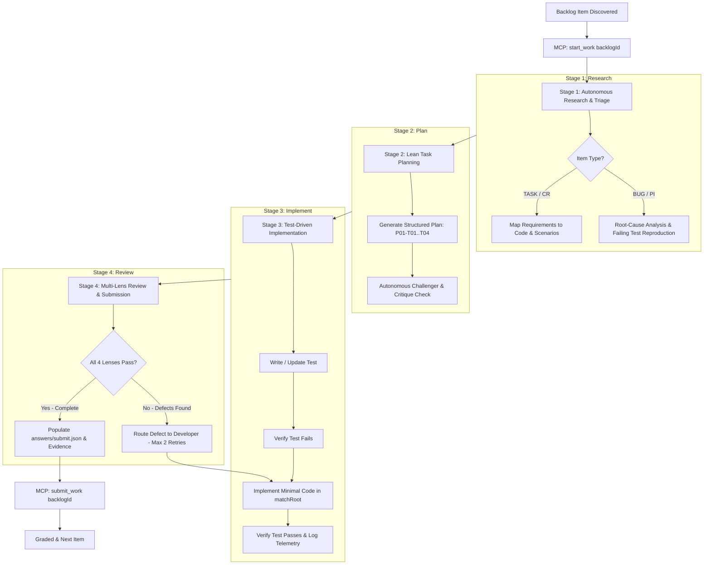

# Technical Research: Inheriting Microsoft HVE Core into Team SDLC Pack

- **Session Date**: 2026-10-28
- **Project**: Master The Machine (MTM) — AI Fest 2026
- **Team**: CPL (`CPL_digital_cuder` / `CPL Team`)
- **Focus**: **Inheriting and Adapting the Microsoft HVE Core Framework for `team-sdlc-pack`**
- **Repository Reference**: Local clone at [`d:/mtm/hve-core/`](file:///d:/mtm/hve-core/)
- **Status**: Decision Proposal & Architectural Research for User Review

---

## 1. Executive Summary & Objective

In this session, we investigate the **Microsoft Hypervelocity Engineering (HVE) Core** framework ([`microsoft/hve-core`](https://github.com/microsoft/hve-core)) and evaluate how its battle-tested agentic SDLC methodologies can be inherited, adapted, and streamlined into our **`team-sdlc-pack`** (`team-orchestrator-pack`).

While the user's initial thought highlighted the **RPI cycle** (Research, Plan, Implement, Review), our deep-dive into `d:/mtm/hve-core` reveals a substantially richer wealth of architectural assets:
1. **The RPI Lifecycle & Sub-Skills**: Research readiness, task-centered planning, independent critique (`rpi-plan-critique`), skeptical questioning (`rpi-challenger`), test-driven implementation (`rpi-implement`), and multi-lens reconciliation (`rpi-review`).
2. **Multi-Agent Roster & Separation of Concerns**: Specialized agents for Business Analysis (`prd-builder`, `requirements-author`), Planning (`functional-planner`), Code Implementation (`coding-standards`), Code Review (`code-review` with 5 perspectives), and Security Auditing (`security-reviewer`, `security-planner`).
3. **Shift-Left Security & Incident Response**: `owasp-top-10`, `secure-by-design`, `owasp-mcp`, and `incident-response` frameworks.
4. **Durable Context Engineering & Tracking**: Structured state persistence (`.tracking/`), preventing hallucinations and context degradation across LLM turn compactions.
5. **The "Competition Adaptation" Layer**: Transforming HVE Core's human-in-the-loop workflows into a **100% autonomous, high-velocity execution engine** optimized for the 40-minute, 0-human-intervention (-50 pt penalty) constraint of MTM AI Fest.

---

## 2. Deep Dive: What is Inside Microsoft HVE Core?

From our analysis of the local `hve-core` repository, HVE Core organizes its agentic architecture into **four core pillars**:

```
d:/mtm/hve-core/
├── .github/
│   ├── agents/                   # 15+ Custom Specialized Agents
│   │   ├── agentic-workflows.agent.md
│   │   ├── backlog-grooming.agent.md
│   │   ├── code-review (5 subagent perspectives)
│   │   ├── security-reviewer.agent.md
│   │   └── prd-builder / brd-builder / adr-creation
│   ├── skills/                   # Executable workflows & tools
│   │   ├── rpi/                  # Core RPI lifecycle skills
│   │   │   ├── rpi-research/     # Evidence collection & gap analysis
│   │   │   ├── rpi-plan/         # Task-centered plans (Pxx, Pxx-Txx)
│   │   │   ├── rpi-plan-critique/# Independent plan critique
│   │   │   ├── rpi-implement/    # TDD execution & change tracking
│   │   │   ├── rpi-review/       # Evidence reconciliation & outcome routing
│   │   │   ├── rpi-challenger/   # Skeptical assumption probing
│   │   │   └── rpi-walkthrough/  # Step-by-step artifact explanation
│   │   ├── coding-standards/     # Multi-perspective review & standards
│   │   ├── security/             # OWASP Top 10, MCP security, Secure-by-Design
│   │   ├── project-planning/     # Backlog execution, ADR, requirements
│   │   └── incident-response/    # Triage, containment, and post-incident
│   └── instructions/             # File-matching auto-injected guidelines
│       ├── coding-standards/     # Python, Bash, PowerShell, C#, Rust
│       ├── security/             # Security models, licensing, tracking
│       └── hve-core/             # Commit messages, git operations
└── docs/                         # Extensive architectural documentation
    ├── rpi/README.md             # Theoretical basis & lifecycle rules
    └── architecture/ai-artifacts.md # 4-tier prompt engineering model
```

### Key Principles of HVE Core:
1. **"AI carries the rules, humans keep the judgment"**: Rules, standards, and checklists are encoded directly into prompts and skills so AI adheres to them reliably.
2. **Context Engineering via Durable Artifacts**: Instead of relying on chat history (which gets compacted or lost), every phase writes durable, marker-addressed Markdown artifacts (`research.md`, `plan.md`, `changes.md`, `review.md`).
3. **Phase Separation & Constraint-Driven Thinking**: When an AI knows it cannot implement yet (during Research or Plan), it stops generating "plausible code" and starts optimizing for "verified truth" and clear acceptance criteria.

---

## 3. The Competition Problem: Why We Must Adapt HVE Core for MTM

HVE Core was originally built for enterprise software engineering (GitHub Copilot / VS Code / Azure DevOps / Jira) where:
- Humans review every PR and approve every stage.
- Tasks span days or weeks.
- Artifacts can be long, multi-page documents.

In **Master The Machine (MTM) — AI Fest 2026**, our operational reality is fundamentally different:

| Dimension | Enterprise HVE Core | MTM Tournament Environment |
| :--- | :--- | :--- |
| **Time Budget** | Hours to Days per task | **40 minutes total match! ~5–8 minutes per backlog item** |
| **Human Intervention** | Encouraged (Socratic coaching, manual PR gates) | **STRICTLY PENALIZED: -50 points per human intervention!** |
| **Backlog Dynamics** | Sprints & Jira/GitHub boards | **Dynamic waves of items: `TASK`, `CR`, `BUG`, `PI`** |
| **Execution Host** | VS Code / Copilot Chat / CLI | **Codex CLI + Custom Stdio MCP Server (`mtm_helper`)** |
| **Evaluation / Grading** | Human code review + CI/CD | **Automated Game Master Grader: tests, `submit.json`, pushed Git SHA** |
| **Artifact Overhead** | Multi-page PRDs, ADRs, and threat models | **Lean, high-density, machine-checkable execution artifacts** |

> [!IMPORTANT]
> **The Core Architectural Challenge**:  
> We must **preserve the cognitive rigor and quality guarantees** of HVE Core (verified truth, test-driven validation, security auditing) while **automating all human gates** and **compressing execution latency** into a hyper-fast, autonomous tournament loop.

---

## 4. Architectural Inheritance Blueprint: What We Will Inherit

We will inherit **5 distinct layers** from HVE Core into our `team-sdlc-pack`:

```
┌─────────────────────────────────────────────────────────────────────────────┐
│                       MTM AUTONOMOUS TOURNAMENT ENGINE                      │
│                (Adapted from Microsoft HVE Core Framework)                  │
└─────────────────────────────────────┬───────────────────────────────────────┘
                                      │
  ┌───────────────────────────────────┼───────────────────────────────────┐
  │                                   │                                   │
  ▼                                   ▼                                   ▼
┌──────────────────────┐    ┌──────────────────────┐    ┌──────────────────────┐
│  1. Autonomous RPI   │    │  2. Specialized Role │    │  3. Multi-Lens Code  │
│      Loop Engine     │    │      Delegation      │    │    Review & Gates    │
├──────────────────────┤    ├──────────────────────┤    ├──────────────────────┤
│ - Rapid Research (R) │    │ - Orchestrator (RPI) │    │ - Functional Lens    │
│ - Lean Plan (P)      │    │ - BA (Requirements) │    │ - Standards Lens     │
│ - TDD Implement (I)  │    │ - Developer (Code)   │    │ - Security Lens      │
│ - Evidence Review (R)│    │ - Tester (Evidence)  │    │ - Submission Lens    │
│ - Auto-Challenger    │    │ - Security (OWASP/PI)│    │ - Bounded Retry Loop │
└──────────────────────┘    └──────────────────────┘    └──────────────────────┘
  │                                   │                                   │
  └───────────────────────────────────┼───────────────────────────────────┘
                                      │
  ┌───────────────────────────────────┴───────────────────────────────────┐
  │                                                                       │
  ▼                                                                       ▼
┌──────────────────────────────────────────┐  ┌──────────────────────────────────────────┐
│  4. Incident Response Protocol (For PI)  │  │  5. Shift-Left Guardrails & Instructions │
├──────────────────────────────────────────┤  ├──────────────────────────────────────────┤
│ - Rapid Blast-Radius & RCA               │  │ - Secure-by-Design & OWASP MCP rules     │
│ - Containment -> Regression Test -> Fix  │  │ - Zero path-traversal outside matchRoot  │
│ - Post-Incident Evidence Logging         │  │ - Strict atomic Git commit conventions   │
└──────────────────────────────────────────┘  └──────────────────────────────────────────┘
```

---

### Layer 1: The Autonomous RPI Loop Engine
Instead of open-ended conversational phases, each backlog item (`TASK`, `CR`, `BUG`, `PI`) passes through a tightly bounded 4-stage pipeline:



#### Detailed Stage Breakdown:
1. **Autonomous Research (R)**:
   - Evaluates the payload returned by `start_work()`: `submitTemplate`, `minimumVerificationScenarios`, files written.
   - Searches `matchRoot` for matching handlers, configurations, and existing test suites.
   - For `BUG` and `PI`: immediately writes an isolated reproduction script/test that proves the failure before touching application code.
2. **Lean Task Planning (P)**:
   - Generates a compact plan inside `<matchRoot>/answers/<backlogId>/plan.md` with 4 fixed tasks:
     - `P01-T01 (BA/Test)`: Define acceptance assertions for all `minimumVerificationScenarios`.
     - `P01-T02 (Dev)`: Implement production fix/feature in `matchRoot`.
     - `P01-T03 (Test)`: Run automated test suite, capture stdout/stderr evidence into `evidence/`.
     - `P01-T04 (BA/Sec)`: Fill out `submit.json` and verify schema validity.
   - **Autonomous Critique**: Evaluates: Are any proposed changes outside `matchRoot`? Is any verification scenario missing? Is the time budget <= 7 minutes?
3. **Test-Driven Implementation (I)**:
   - Developer executes tasks strictly in sequence.
   - Uses atomic edits.
   - Emits `BACKLOG_TESTS (RUNNING)` and `BACKLOG_TESTS (PASSED / FAILED)` to progress log.
4. **Multi-Lens Review & Submission (R)**:
   - Runs the 4-Lens check before allowing `submit_work`.
   - Generates proof and receipt.

---

### Layer 2: Specialized Agent Roster Mapping
We map the 5 agents registered in our `team-sdlc-pack` directly to HVE Core's agent personas:

| MTM Agent Profile | HVE Core Source Archetype | Tournament Responsibilities |
| :--- | :--- | :--- |
| **`team-orchestrator`** | `RPI Agent` + `backlog-manager` | Manages match lifecycle, polls backlog waves via `refresh_match()`, tracks match clock (40m), invokes `start_work` and `submit_work`, dispatches subagents, handles error escalation. |
| **`team-business-analyst`** | `prd-builder` + `requirements-author` | Analyzes task description, translates `minimumVerificationScenarios` into concrete test assertions, authors the initial `submit.json` structure. |
| **`team-developer`** | `rpi-implement` + `coding-standards` | Implements minimal, bug-free code diffs in `matchRoot`, ensures zero breaking changes, writes passing unit tests. |
| **`team-tester`** | `rpi-review` + `pester/python-tests` | Runs test commands, captures terminal output into `<matchRoot>/answers/<id>/evidence/`, asserts test coverage, verifies `submit.json` formatting. |
| **`team-cyber-security`** | `security-reviewer` + `owasp-top-10` | Performs static diff audit (no secret leaks, no command injection, safe path traversal), leads RCA for Product Incidents (`PI`). |

---

### Layer 3: The 4-Lens Code Review Gate
Inspired by HVE Core's `code-review` skill (which uses perspective subagents: functional, standards, security, accessibility), we build an **Automated 4-Lens Pre-Submission Gate**:

1. **Lens 1: Functional Completeness**
   - Did the automated tests execute with exit code 0?
   - Is every scenario in `minimumVerificationScenarios` verified with concrete test assertions?
2. **Lens 2: Code Quality & Standards**
   - Are imports clean? Any stray `console.log`, syntax errors, or unused variables?
   - Did we modify ONLY files within `matchRoot`?
3. **Lens 3: Security & Guardrails (OWASP & Secure-by-Design)**
   - No hardcoded API keys, passwords, or tokens in source files or commits.
   - No arbitrary shell injection or path traversal (`../`) vulnerabilities.
4. **Lens 4: Contest Submission Integrity**
   - Does `<matchRoot>/answers/<id>/submit.json` exist, parse as valid JSON, and match the official `submitTemplate`?
   - Does `<matchRoot>/answers/<id>/evidence/` contain verification logs?
   - Is Git in a clean state, ready for `submit_work` to push and read `git rev-parse HEAD`?

**Remediation Rule**: If any lens fails, the orchestrator triggers a single, bounded re-implementation loop (maximum 2 retries, 90 seconds max) before falling back to partial submission to protect the match clock.

---

### Layer 4: Incident Response Protocol (Dedicated for `PI` Items)
Product Incidents (`PI`) are high-stakes, time-critical items in MTM. We inherit HVE Core's `incident-response` workflow:
1. **Triage & Classification**:
   - Extract symptom from incident description (e.g., service outage, 500 error, memory spike, data corruption).
2. **Blast Radius & Root Cause**:
   - Inspect recent commits or system logs to isolate the defect.
3. **Containment & Hotfix**:
   - Formulate minimal hotfix that restores availability without regressions.
4. **Regression Verification**:
   - Write a dedicated regression test case to prevent recurrence.
5. **Incident Artifact Generation**:
   - Document root cause and fix in evidence log for bonus contest evaluation points.

---

### Layer 5: Shift-Left Instructions & Reusable Standards
From HVE Core's `.github/instructions/`, we will adapt essential rule files into our pack's instructions/skills:
1. **`secure-by-design.md`**:
   - Strict path sandboxing: Every path must be validated to ensure it stays within `matchRoot`.
   - Safe subprocess execution: Never execute unsanitized string commands with `shell: true`.
2. **`clean-submissions.md`**:
   - Exact compliance with Game Master JSON schemas (`agent-result.schema.json`, `progress-event.schema.json`).
3. **`conventional-commits.md`**:
   - Standardized commit messages (`fix(TASK-01): resolve calculation bug`, `feat(CR-02): add export endpoint`) so graders and reviewers can easily trace changes.

---

## 5. Architectural Trade-Offs & Decisions for User Approval

We propose **4 Core Decisions** for structuring the HVE Core inheritance into `team-sdlc-pack`:

### Decision 1: Adaptation Strategy — "Selective Extraction" vs. "Full Package Copy"
- **Option A (Recommended): Selective Extraction & Tournament Streamlining**
  - Extract only the core RPI concepts, review lenses, security rules, and prompt archetypes into clean, zero-dependency Markdown skills and TOML agent configs in `team-sdlc-pack`.
  - **Pros**: Zero bloat, highly optimized for 40-minute matches, fits within Codex context limits, no unnecessary dependencies or complex VS Code extension hooks.
  - **Cons**: Requires custom prompt engineering to adapt HVE rules into tournament format.
- **Option B: Direct Copy of HVE Core Directory Structure**
  - Copy all `.github/` folders, Docusaurus docs, slide decks, and npm tools directly into the pack.
  - **Pros**: Direct copy-paste.
  - **Cons**: Extreme bloat (hundreds of MBs), incompatible tool definitions (Copilot-specific vs Codex CLI), confuses LLM context with irrelevant enterprise documentation.

### Decision 2: Autonomous Quality Gates — "Hard Fail-Closed" vs. "Time-Budgeted Fallback"
- **Option A (Recommended): Time-Budgeted Fallback with Self-Healing**
  - The agent attempts to fix review failures (max 2 iterations). If the clock exceeds 8 minutes for a task, it gracefully finalizes best-effort `submit.json` and submits rather than timing out and scoring 0.
  - **Pros**: Maximizes points, ensures all wave items get attempted, eliminates match runaway time.
  - **Cons**: Occasionally submits partial credit rather than perfection.
- **Option B: Strict Fail-Closed (Never submit unless 100% passing)**
  - Agent continues retrying until all tests pass or round ends.
  - **Pros**: High score on single task if solved.
  - **Cons**: High risk of burning entire 40-minute clock on one stubborn bug, scoring 0 on remaining waves.

### Decision 3: Context Tracking Storage — "In-Memory + Answers Directory"
- **Option A (Recommended): Store Task Tracking inside `<matchRoot>/answers/<id>/`**
  - Instead of a global `.copilot-tracking/`, store task plans and review notes in `<matchRoot>/answers/<id>/task-plan.md` and `evidence/`.
  - **Pros**: Aligns directly with MTM requirements (answers folder already required by Game Master), automatically clean per match, no clutter in team pack.
  - **Cons**: Answers directory must be created before planning starts (handled automatically by `start_work`).
- **Option B: Separate `.tracking/` folder in team pack root**
  - **Pros**: Centralized across matches.
  - **Cons**: Risk of leaking artifacts between consecutive matches; extra cleanup logic required.

### Decision 4: Agent Coordination — "Phased Skill Invocation inside Single Pack"
- **Option A (Recommended): Skill-Based Phasing with Subagent Profiles**
  - Root orchestrator activates skills in sequence (`game-preparation`, `team-orchestrator`, `team-recovery`) and delegates focused sub-tasks to subagents (`team-developer`, `team-tester`, `team-cyber-security`).
  - **Pros**: Conforms 100% to MTM Player manifest (`team-runtime.json` protocolVersion 4).
  - **Cons**: Requires thorough prompt tuning in `agents/*.toml`.

---

## 6. Summary Decision Table for User Approval

| # | Topic | Proposed Choice | Your Approval |
| :---: | :--- | :--- | :---: |
| **1** | **Inheritance Model** | **Selective Extraction**: Streamline HVE Core RPI, Review, Security & BA patterns into lean, tournament-ready skills & agent prompts (0 bloat). | [x] Approved |
| **2** | **Quality Gate Strategy** | **Time-Budgeted Fallback**: Autonomous 4-Lens Review with max 2 retries and strict 8-minute task limit to protect the 40-minute match clock. | [x] Approved |
| **3** | **Context Tracking** | **Answers-Aligned Tracking**: Persist task plans, logs, and evidence inside `<matchRoot>/answers/<id>/` as required by Game Master. | [x] Approved |
| **4** | **Subagent Roles** | **5-Agent HVE Mapping**: Orchestrator (RPI Engine), BA (Requirements), Dev (Implement), Tester (Verify/Evidence), Security (OWASP/PI). | [x] Approved |

---

## 7. Next Steps (Upon Approval)

1. Review and approve the 4 decision points above.
2. Formulate the **HVE Core Inheritance Implementation Plan** (`plan_hve_inheritance.md`).
3. Implement the phased skills in `d:/mtm/team-orchestrator-pack/skills/`:
   - `skills/team-orchestrator/SKILL.md` (The Autonomous RPI Engine & 4-Lens Review).
   - `skills/game-preparation/SKILL.md` (Environment bootstrap & readiness checks).
   - `skills/team-recovery/SKILL.md` (Self-healing, idempotency retry, crash prevention).
4. Update the agent prompts in `agents/*.toml` (`team-orchestrator`, `team-developer`, `team-tester`, `team-business-analyst`, `team-cyber-security`).
5. Run end-to-end dry run verification against practice match `TISTL6MV`.

