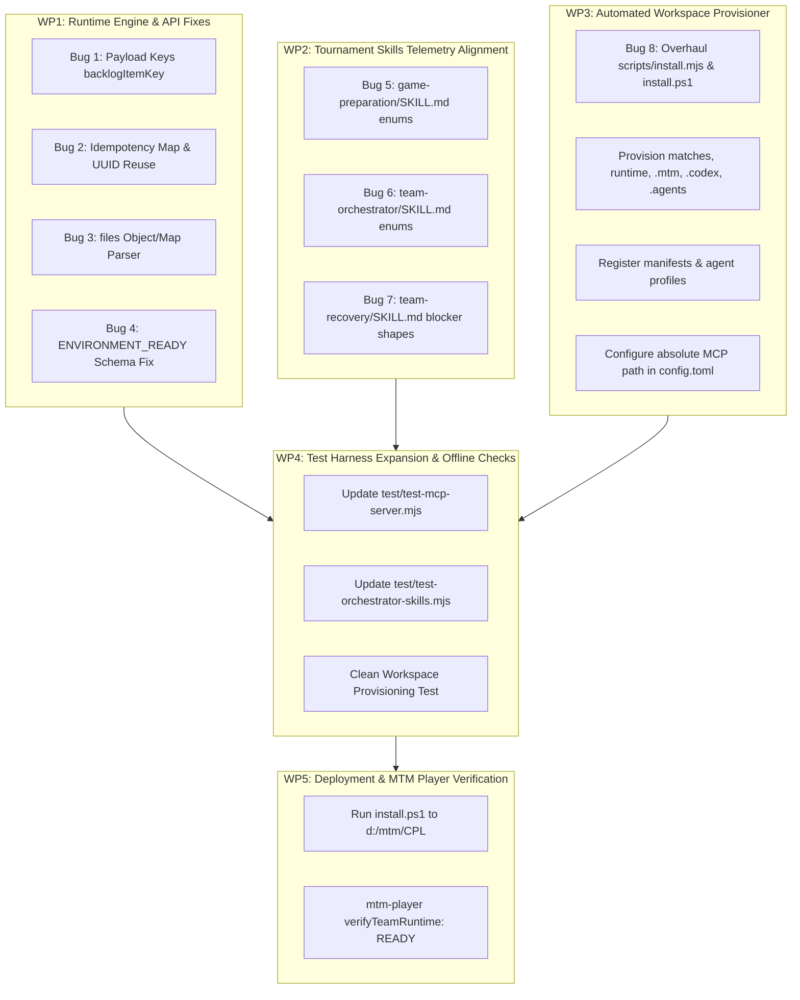

# Implementation Plan: 8-Bug Remediation & Automated Workspace Provisioning

- **Session Date**: 2026-10-28
- **Session Focus / Topic**: **End-to-End Bug Remediation, Telemetry Schema Alignment & Automated Workspace Provisioning**
- **Project**: Master The Machine (MTM) — AI Fest 2026
- **Team**: CPL (`CPL_digital_cuder` / `CPL Team`)
- **Status**: Approved for Planning — Ready for Code Execution
- **Related Session Artifacts**:
  - Technical Research & Proposal: [research_bug_remediation_and_workspace_layout.md](file:///d:/mtm/sessions/2026-10-28/research_bug_remediation_and_workspace_layout.md)
  - HVE Inheritance Review: [review_hve_core_inheritance.md](file:///d:/mtm/sessions/2026-10-28/review_hve_core_inheritance.md)
  - Prior Session Review: [review_team_orchestrator_mcp.md](file:///d:/mtm/sessions/2026-10-27/review_team_orchestrator_mcp.md)
  - Reference Specs:
    - [02_DIGITAL_CUDER_API.md](file:///d:/mtm/docs/02_DIGITAL_CUDER_API.md)
    - [03_TEAM_ORCHESTRATOR_TECHNICAL_GUIDE.md](file:///d:/mtm/docs/03_TEAM_ORCHESTRATOR_TECHNICAL_GUIDE.md)
    - [progress-event.schema.json](file:///d:/mtm/team-orchestrator-pack/contracts/progress-event.schema.json)

---

## 1. Overview & Objectives

This implementation plan defines the exact sequence of engineering actions required to eliminate all **8 identified bugs** in the **`team-sdlc-pack`** (`team-orchestrator-pack`).

Executing this plan transitions the team pack from its current **"NOT READY"** status to **"VERIFIED & READY FOR LIVE MATCH TESTING"**.

### Primary Objectives:
1. **API Protocol Conformity (Bugs #1, #2, #3)**: Align `start_work` and `submit_work` payloads with Game Master specification ([`02_DIGITAL_CUDER_API.md`](file:///d:/mtm/docs/02_DIGITAL_CUDER_API.md)), implement submission idempotency caching, and support dictionary-based file parsing.
2. **Telemetry Schema Rigor (Bugs #4, #5, #6, #7)**: Ensure 100% compliance with [`contracts/progress-event.schema.json`](file:///d:/mtm/team-orchestrator-pack/contracts/progress-event.schema.json), preventing `mtm-player` parser crashes on `ENVIRONMENT_READY`, `BACKLOG_TESTS`, `BACKLOG_STATUS`, and blocker events.
3. **Automated Workspace Provisioning (Bug #8)**: Redesign `scripts/install.mjs` and `install.ps1` to automatically scaffold and verify the complete contestant workspace layout (`matches/`, `runtime/`, `.mtm/`, `.codex/`, `.agents/skills/`), passing MTM Player's `verifyTeamRuntime` without manual intervention.
4. **Enhanced Test Harness & Offline Verification**: Expand offline test suites to assert all 8 remediations before touching competition endpoints.

---

## 2. Architecture & Sequencing Flow



---

## 3. Work Package Specifications

### Work Package 1: Runtime Session & API Protocol (`src/runtime-session.mjs`)

**Target File**: [`d:/mtm/team-orchestrator-pack/src/runtime-session.mjs`](file:///d:/mtm/team-orchestrator-pack/src/runtime-session.mjs)

#### Task 1.1: Fix Request Payload Field Names (Bug #1)
- **Lines 580–586 (`startWork`)**:
  - Replace `{ backlogId: backlogItemKey }` with `{ backlogItemKey }`.
- **Lines 695–702 (`submitWork`)**:
  - Replace `backlogId: backlogItemKey` with `backlogItemKey`.

#### Task 1.2: Implement Idempotency Caching on Submissions (Bug #2)
- **Lines 247–286 (`callGameMasterApi`)**:
  - Add optional parameter `explicitIdempotencyKey = null`.
  - If `explicitIdempotencyKey` is provided, set `headers['Idempotency-Key'] = explicitIdempotencyKey`. Otherwise, generate `crypto.randomUUID()`.
- **Lines 687–710 (`submitWork`)**:
  - Retrieve or create cached entry in `this.idempotencyMap`:
    ```javascript
    let submissionEntry = this.idempotencyMap.get(backlogItemKey);
    if (!submissionEntry) {
      submissionEntry = {
        clientSubmissionId: crypto.randomUUID(),
        idempotencyKey: crypto.randomUUID()
      };
      this.idempotencyMap.set(backlogItemKey, submissionEntry);
    }
    const { clientSubmissionId, idempotencyKey } = submissionEntry;
    ```
  - Pass `idempotencyKey` into `callGameMasterApi`.

#### Task 1.3: Support Map/Object in `startWork` Files Parser (Bug #3)
- **Lines 642–652 (`startWork`)**:
  - Replace `if (Array.isArray(data.files))` with robust handler supporting both `Map<String, String>` and array formats:
    ```javascript
    const filesWritten = [];
    if (data.files && typeof data.files === 'object') {
      const fileEntries = Array.isArray(data.files)
        ? data.files.map(f => [f.path, f.content])
        : Object.entries(data.files);

      for (const [relPath, content] of fileEntries) {
        if (relPath && content !== undefined) {
          const targetPath = path.resolve(matchRoot, relPath);
          fs.mkdirSync(path.dirname(targetPath), { recursive: true });
          fs.writeFileSync(targetPath, content, 'utf8');
          filesWritten.push(relPath);
        }
      }
    }
    ```

#### Task 1.4: Guard `summary` on `ENVIRONMENT_READY` in `appendProgress` (Bug #4)
- **Lines 88–101 (`appendProgress`)**:
  - Modify payload envelope construction:
    ```javascript
    const sanitizedSummary = String(event.summary || 'Progress event')
      .replace(/[\r\n\u0000]+/g, ' ')
      .trim()
      .slice(0, 240);

    const payload = {
      schemaVersion: 1,
      playerSessionId: this.playerSessionId,
      ...event
    };

    // ENVIRONMENT_READY strictly forbids summary under additionalProperties: false
    if (payload.type !== 'ENVIRONMENT_READY') {
      payload.summary = sanitizedSummary;
    }
    ```
  - Ensure any emission of `ENVIRONMENT_READY` contains all 8 required properties:
    `schemaVersion`, `playerSessionId`, `type`, `requestId`, `repository` (`url`, `branch`, `folder`), `revision`, `build: "PASS"`, `matchLogin: "PASS"`.

---

### Work Package 2: Tournament Skills Telemetry Alignment (`skills/`)

#### Task 2.1: Fix Telemetry Enums in `skills/game-preparation/SKILL.md` (Bug #5)
**Target File**: [`d:/mtm/team-orchestrator-pack/skills/game-preparation/SKILL.md`](file:///d:/mtm/team-orchestrator-pack/skills/game-preparation/SKILL.md)
- Replace invalid `status: VERIFIED` with `status: COMPLETED` on `GIT_AUTH` and `REPOSITORY`.
- Replace invalid `stage: RUNTIME_INITIALIZED` with `stage: ENVIRONMENT`, `status: COMPLETED`.
- Update `ENVIRONMENT_READY` documentation to reflect full 8-field schema without `summary`.

#### Task 2.2: Fix Telemetry Enums in `skills/team-orchestrator/SKILL.md` (Bug #6)
**Target File**: [`d:/mtm/team-orchestrator-pack/skills/team-orchestrator/SKILL.md`](file:///d:/mtm/team-orchestrator-pack/skills/team-orchestrator/SKILL.md)
- **Line 102**: Replace invalid `stage: "RUNNING"` on `BACKLOG_TESTS` with:
  ```json
  {
    "type": "BACKLOG_TESTS",
    "backlogId": "<backlogId>",
    "status": "RUNNING",
    "required": 0,
    "executed": 0,
    "passed": 0,
    "failed": 0,
    "skipped": 0,
    "summary": "Running verification tests for <backlogId>"
  }
  ```
- **Line 130**: Replace invalid `status: "PARTIALLY_RESOLVED"` with `status: "SUBMITTED"`.

#### Task 2.3: Fix Blocker Telemetry Shapes in `skills/team-recovery/SKILL.md` (Bug #7)
**Target File**: [`d:/mtm/team-orchestrator-pack/skills/team-recovery/SKILL.md`](file:///d:/mtm/team-orchestrator-pack/skills/team-recovery/SKILL.md)
- **Lines 65–79**:
  - Update `BLOCKER_OPENED`: Include required `blockerId: "blk-<uuid>"` and `backlogId: "<backlogId>"`; remove invalid `stage`.
  - Update `BLOCKER_RESOLVED`: Include required `blockerId: "blk-<uuid>"`; remove invalid `stage`.

---

### Work Package 3: Automated Workspace Provisioner (`scripts/install.mjs` & `install.ps1`)

**Target Files**:
- [`d:/mtm/team-orchestrator-pack/scripts/install.mjs`](file:///d:/mtm/team-orchestrator-pack/scripts/install.mjs)
- [`d:/mtm/team-orchestrator-pack/install.ps1`](file:///d:/mtm/team-orchestrator-pack/install.ps1)

#### Task 3.1: Redesign `scripts/install.mjs` into Full Workspace Provisioner (Bug #8)
Implement complete topology scaffolding in `install.mjs`:
1. **Directory Structure Creation**:
   - `<TargetWorkspace>/matches/` (required by `validateTeamWorkspaceLayout`)
   - `<TargetWorkspace>/.mtm/` (required by `discoverTeamRuntime`)
   - `<TargetWorkspace>/.codex/agents/` (required by `requiredRegistrationFiles` & Codex)
   - `<TargetWorkspace>/.agents/skills/` (required for Codex CLI skill loading)
   - `<TargetWorkspace>/team-sdlc-pack/runtime/` (immutable payload for `verifyInstalled`)
   - `<TargetWorkspace>/team-sdlc-pack/logs/` (NDJSON progress log storage)
2. **Payload Deployment**:
   - Recursively copy all pack files into `<TargetWorkspace>/team-sdlc-pack/runtime/`.
   - Sync root copy in `<TargetWorkspace>/team-sdlc-pack/` for local script accessibility.
3. **Registration File Sync**:
   - Copy `runtime/team-runtime.json` $\rightarrow$ `<TargetWorkspace>/.mtm/team-runtime.json`.
   - Copy `runtime/team-pack-info.json` $\rightarrow$ `<TargetWorkspace>/.mtm/team-pack-info.json`.
   - Copy `runtime/agents/*.toml` $\rightarrow$ `<TargetWorkspace>/.codex/agents/*.toml`.
   - Copy `runtime/skills/*` $\rightarrow$ `<TargetWorkspace>/.agents/skills/*`.
4. **Codex MCP Configuration**:
   - Resolve `<TeamWorkspace>` placeholder using forward-slash normalization.
   - Write configured `config.toml` to:
     * `<TargetWorkspace>/.codex/config.toml`
     * `<TargetWorkspace>/team-sdlc-pack/config/codex.toml`
     * `<TargetWorkspace>/team-sdlc-pack/runtime/config/codex.toml`
5. **In-Line Validation Gate**:
   - Verify that all copied files exist and are readable before exiting.

#### Task 3.2: Enhance `install.ps1`
- Add verbose logging showing provisioned directories.
- Ensure error exit codes bubble up cleanly to caller.

---

### Work Package 4: Offline Test Suite Expansion

**Target Files**:
- [`d:/mtm/team-orchestrator-pack/test/test-mcp-server.mjs`](file:///d:/mtm/team-orchestrator-pack/test/test-mcp-server.mjs)
- [`d:/mtm/team-orchestrator-pack/test/test-orchestrator-skills.mjs`](file:///d:/mtm/team-orchestrator-pack/test/test-orchestrator-skills.mjs)

#### Task 4.1: Expand Protocol Tests in `test-mcp-server.mjs`
Add automated unit assertions for:
1. `ENVIRONMENT_READY` logging without `summary` and validating cleanly against `contracts/progress-event.schema.json`.
2. `idempotencyMap` caching on `submitWork` repeated calls.
3. Object/Map `data.files` parsing and disk materialization in `startWork`.

#### Task 4.2: Expand Skill & Profile Tests in `test-orchestrator-skills.mjs`
Add automated validation for:
1. Checking that all telemetry snippets in `skills/*/SKILL.md` strictly match enum definitions in `progress-event.schema.json`.
2. Validating that no forbidden fields (such as `stage` on `BACKLOG_TESTS`) are recommended.

#### Task 4.3: Clean Workspace Installation Test
- Add automated verification script or command that creates a temporary directory (e.g. `d:/mtm/scratch/test-install-cpl`), runs `install.mjs`, and validates using MTM Player's `verifyTeamRuntime`.

---

### Work Package 5: Deployment & Target Verification

1. Run `powershell -ExecutionPolicy Bypass -File .\install.ps1 -TargetWorkspace "d:\mtm\CPL"`.
2. Run MTM Player's verification script against `d:\mtm\CPL`:
   ```powershell
   node -e "import('file:///d:/mtm/mtm-player-0.9.35-local-windows/app/src/bootstrap.mjs').then(b => { const l = b.validateTeamWorkspaceLayout('d:/mtm/CPL'); return import('file:///d:/mtm/mtm-player-0.9.35-local-windows/app/src/team-install.mjs').then(t => { const v = t.verifyTeamRuntime(l); console.log('VERIFIED:', v.runtime.status); }); });"
   ```
3. Assert that status is **`READY`**.

---

## 4. Detailed Implementation Step-by-Step

| Step | Action | Files Modified / Tested | Success Criteria |
| :---: | :--- | :--- | :--- |
| **1** | Fix Game Master payload names (`backlogItemKey`) | `src/runtime-session.mjs` | Payloads conform to `02_DIGITAL_CUDER_API.md`. |
| **2** | Implement submission idempotency caching | `src/runtime-session.mjs` | `idempotencyMap` reuses IDs on retry. |
| **3** | Support Map/Object in `startWork` files parser | `src/runtime-session.mjs` | Key-value files are written to disk. |
| **4** | Fix `ENVIRONMENT_READY` summary injection | `src/runtime-session.mjs` | `validateProgressEvent` returns valid without errors. |
| **5** | Update telemetry enums in tournament skills | `skills/game-preparation/SKILL.md`<br/>`skills/team-orchestrator/SKILL.md`<br/>`skills/team-recovery/SKILL.md` | All events pass schema checks. |
| **6** | Redesign `scripts/install.mjs` provisioner | `scripts/install.mjs`<br/>`install.ps1` | Creates complete workspace skeleton and registers files. |
| **7** | Expand offline test harnesses | `test/test-mcp-server.mjs`<br/>`test/test-orchestrator-skills.mjs` | 100% assertions pass (0 failures). |
| **8** | Test clean workspace provisioning | Clean scratch directory | `verifyTeamRuntime` passes on fresh folder. |
| **9** | Deploy to `d:/mtm/CPL` and verify | `d:/mtm/CPL` | Deployed pack verified with `status: READY`. |

---

## 5. Acceptance & Verification Matrix

| Verification Target | Test Execution Command | Expected Output |
| :--- | :--- | :--- |
| **Syntax & Distribution** | `node scripts/check-distribution.mjs` | `[SUCCESS] Distribution check passed with 0 errors.` |
| **Skills & Profiles Test** | `node test/test-orchestrator-skills.mjs` | All assertions pass; 0 failed. |
| **MCP Protocol Test** | `node test/test-mcp-server.mjs` | All protocol & schema assertions pass; 0 failed. |
| **Clean Workspace Test** | Automated installer test on clean scratch path | Provisioned layout passes `validateTeamWorkspaceLayout`. |
| **Target Workspace Deploy** | `powershell -File .\install.ps1 -TargetWorkspace "d:\mtm\CPL"` | `[SUCCESS] Team pack installed & workspace fully configured.` |
| **Player Runtime Verification** | Node runner invoking `mtm-player`'s `verifyTeamRuntime` | `{ action: 'VERIFIED', runtime: { status: 'READY' } }` |

---

## 6. Risk Mitigation & Rollback Strategy

1. **Non-Destructive Backups**: All source files in `team-orchestrator-pack` can be verified offline before deploying to `d:/mtm/CPL`.
2. **Zero API Cost**: All tests execute strictly offline via Node.js built-ins and stdio IPC ($0 OpenAI / Codex API cost).
3. **Workspace Isolation**: Testing the installer against a scratch folder (`d:/mtm/scratch/test-cpl`) ensures existing contestant directories are never disrupted during test development.

