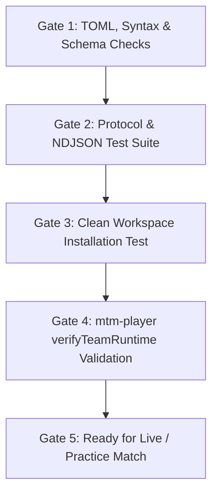

# Technical Research: Forensic Bug Remediation & Team Workspace Layout Architecture

- **Session Date**: 2026-10-28
- **Session Focus / Topic**: **Deep-Dive Remediation Blueprint for 8 Runtime & Deployment Bugs in `team-sdlc-pack`**
- **Project**: Master The Machine (MTM) — AI Fest 2026
- **Team**: CPL (`CPL_digital_cuder` / `CPL Team`)
- **Status**: Research & Remediation Proposal Complete — Awaiting Approval to Implement Code Fixes
- **Related Session Artifacts**:
  - HVE Inheritance Research: [research_hve_core_for_team_sdlc_pack.md](file:///d:/mtm/sessions/2026-10-28/research_hve_core_for_team_sdlc_pack.md)
  - Working Session Review: [review_hve_core_inheritance.md](file:///d:/mtm/sessions/2026-10-28/review_hve_core_inheritance.md)
  - Prior Session Review: [review_team_orchestrator_mcp.md](file:///d:/mtm/sessions/2026-10-27/review_team_orchestrator_mcp.md)
  - Official Specifications:
    - [02_DIGITAL_CUDER_API.md](file:///d:/mtm/docs/02_DIGITAL_CUDER_API.md)
    - [03_TEAM_ORCHESTRATOR_TECHNICAL_GUIDE.md](file:///d:/mtm/docs/03_TEAM_ORCHESTRATOR_TECHNICAL_GUIDE.md)
    - [progress-event.schema.json](file:///d:/mtm/team-orchestrator-pack/contracts/progress-event.schema.json)

---

## 1. Executive Summary & Objective

Following the working review of the Microsoft HVE Core inheritance on **2026-10-28**, our objective in this research session is to conduct an exhaustive technical investigation into **all 8 identified bugs** preventing `team-sdlc-pack` from entering active tournament testing.

Special focus is placed on **Bug #8**, astutely identified during local execution of `install.ps1`:
> **The installer simply copies files into `<TargetWorkspace>/team-sdlc-pack/`, omitting the target workspace registration structure (`matches/`, `runtime/`, `.mtm/`, `.codex/`, `.agents/skills/`). On any fresh or uninitialized workspace, `mtm-player` will immediately fail with `INVALID_TEAM_WORKSPACE_LAYOUT` or `TEAM_RUNTIME_NOT_INSTALLED`.**

This document details:
1. The **exact mechanics and root causes** of all 8 bugs.
2. The **underlying `mtm-player` source code requirements** governing workspace layouts and runtime verification.
3. The **concrete code-level remediation designs** for each bug.
4. The **overhauled installer architecture** guaranteeing 100% automated workspace compliance.
5. The **end-to-end verification plan** to validate fixes offline ($0 cost) before initiating practice matches.

---

## 2. Forensic Inventory of All 8 Bugs

```
┌────────────────────────────────────────────────────────────────────────────────────────┐
│                              COMPREHENSIVE BUG REGISTER                                │
├─────┬──────────────────────────┬─────────────────────────────┬─────────────────────────┤
│ Bug │ Component / Location     │ Defect Category             │ Operational Severity    │
├─────┼──────────────────────────┼─────────────────────────────┼─────────────────────────┤
│ #1  │ src/runtime-session.mjs  │ Game Master REST API Schema │ CRITICAL (FATAL)        │
│ #2  │ src/runtime-session.mjs  │ Idempotency & Retries       │ HIGH (REPLAY FAILURE)   │
│ #3  │ src/runtime-session.mjs  │ Task Files Data Structure   │ HIGH (DATA LOSS)        │
│ #4  │ src/runtime-session.mjs  │ ENVIRONMENT_READY Telemetry │ CRITICAL (GATE BLOCKED) │
│ #5  │ skills/game-preparation  │ Pre-Flight Progress Enums   │ HIGH (SCHEMA CRASH)     │
│ #6  │ skills/team-orchestrator │ Task Telemetry Enums & Keys │ MEDIUM (LOG CORRUPTION) │
│ #7  │ skills/team-recovery     │ Blocker Telemetry Shapes    │ MEDIUM (SCHEMA FAIL)    │
│ #8  │ scripts/install.mjs      │ Target Workspace Topology   │ CRITICAL (FATAL LAYOUT) │
└─────┴──────────────────────────┴─────────────────────────────┴─────────────────────────┘
```

---

## 3. Deep-Dive Research: Bug #8 — Target Workspace Layout Architecture

### 3.1. The Failure Mechanism
When `.\install.ps1 -TargetWorkspace "d:\mtm\CPL"` was executed, the installer output indicated:
```text
[MTM Installer] Target workspace: d:\mtm\CPL
[MTM Installer] Deploying to: d:\mtm\CPL\team-sdlc-pack
[MTM Installer] Copied directory: agents/
...
[MTM Installer] Copied file: team-runtime.json
[MTM Installer] Configured d:\mtm\CPL\team-sdlc-pack\config\codex.toml with path: d:/mtm/CPL
[SUCCESS] Team pack installed successfully to d:\mtm\CPL\team-sdlc-pack
```

While the installer copied the repository into `d:\mtm\CPL\team-sdlc-pack`, it left the parent workspace `d:\mtm\CPL` completely unconfigured for MTM Player and Codex CLI.

### 3.2. Decompiling `mtm-player` Workspace Validation Logic
By analyzing the bundled MTM Player source code in [`d:/mtm/mtm-player-0.9.35-local-windows/app/src/`](file:///d:/mtm/mtm-player-0.9.35-local-windows/app/src/), we uncover the exact layout requirements enforced during initialization:

#### Check A: `validateTeamWorkspaceLayout(input)` in `bootstrap.mjs:125-147`
```javascript
const child = name => {
  const path = join(workspace, name);
  try {
    const stat = lstatSync(path);
    if (stat.isSymbolicLink() || !stat.isDirectory()) fail('INVALID_TEAM_WORKSPACE_LAYOUT');
    const canonical = realpathSync(path);
    if (!overlaps(workspace, canonical) || canonical === workspace) fail('INVALID_TEAM_WORKSPACE_LAYOUT');
    return canonical;
  } catch (error) {
    if (error instanceof PlayerInitError) throw error;
    fail('INVALID_TEAM_WORKSPACE_LAYOUT');
  }
};

const matches = join(workspace, 'matches');
if (existsSync(join(workspace, 'challenge'))) child('challenge');
if (!existsSync(matches) && existsSync(join(workspace, 'challenge'))) mkdirSync(matches);
return Object.freeze({
  teamWorkspace: workspace,
  matchesWorkspace: child('matches'),        // <--- FAILS if matches/ directory is missing!
  challengeWorkspace: child('matches'),
  teamSdlcPackWorkspace: child('team-sdlc-pack') // <--- FAILS if team-sdlc-pack/ is missing!
});
```
- If `<TeamWorkspace>/matches/` does not exist, `child('matches')` throws `INVALID_TEAM_WORKSPACE_LAYOUT`.
- The current installer never creates `<TeamWorkspace>/matches/`.

#### Check B: `verifyInstalled(layout)` in `team-install.mjs:128-152`
```javascript
function verifyInstalled(layout, referenceRoot) {
  // 1. Inspect package in team-sdlc-pack/runtime
  const runtime = inspectPackage(join(layout.teamSdlcPackWorkspace, 'runtime')); // <--- FAILS if runtime/ is missing!

  // 2. Verify mandatory registration files in teamWorkspace root
  for (const [from, to] of requiredRegistrationFiles) {
    const target = safeTarget(layout.teamWorkspace, to);
    regularFile(target, 'TEAM_RUNTIME_NOT_INSTALLED'); // <--- FAILS if .mtm or .codex files are missing!
    const actual = readFileSync(target, 'utf8');
    const expected = readFileSync(resolve(runtime.root, from), 'utf8');
    if (actual !== expected) fail('INSTALLED_RUNTIME_TAMPERED');
  }

  // 3. Discover team runtime via .mtm/team-runtime.json
  const discovered = discoverTeamRuntime(layout.teamWorkspace);
  if (discovered.manifest.version !== runtime.manifest.version) fail('INSTALLED_RUNTIME_TAMPERED');
  return Object.freeze({ status: 'READY', ... });
}
```
Where `requiredRegistrationFiles` is defined as (`team-install.mjs:18-22`):
```javascript
const requiredRegistrationFiles = Object.freeze([
  ['agents/team-orchestrator.toml', '.codex/agents/team-orchestrator.toml'],
  ['team-pack-info.json', '.mtm/team-pack-info.json'],
  ['team-runtime.json', '.mtm/team-runtime.json']
]);
```
- **Requirement 1**: The package payload MUST be installed at `<TeamWorkspace>/team-sdlc-pack/runtime/` with its own valid `package.json` matching the official `files` entryset.
- **Requirement 2**: `<TeamWorkspace>/.mtm/team-runtime.json` MUST exist and byte-for-byte match `runtime/team-runtime.json`.
- **Requirement 3**: `<TeamWorkspace>/.mtm/team-pack-info.json` MUST exist and byte-for-byte match `runtime/team-pack-info.json`.
- **Requirement 4**: `<TeamWorkspace>/.codex/agents/team-orchestrator.toml` MUST exist and byte-for-byte match `runtime/agents/team-orchestrator.toml`.

#### Check C: Codex CLI Subagent & Skill Discovery Rules
For Codex CLI to function during an active match session:
- **Agents**: Codex loads agent TOML definitions from `<TeamWorkspace>/.codex/agents/*.toml`.
- **MCP Server Config**: Codex loads MCP server definitions from `<TeamWorkspace>/.codex/config.toml`.
- **Skills**: Codex discovers operational skills from `<TeamWorkspace>/.agents/skills/*/SKILL.md`.

### 3.3. The Target Workspace Topology
To satisfy MTM Player and Codex simultaneously, the installer must build the following layout:

```text
<TeamWorkspace>/ (e.g. D:/mtm/CPL/)
├── matches/                                # Required by validateTeamWorkspaceLayout
├── .mtm/                                   # Required by discoverTeamRuntime
│   ├── team-runtime.json                   # Exact copy of runtime/team-runtime.json
│   └── team-pack-info.json                 # Exact copy of runtime/team-pack-info.json
├── .codex/
│   ├── config.toml                         # MCP server registration with absolute paths
│   └── agents/                             # Required by requiredRegistrationFiles & Codex
│       ├── team-orchestrator.toml
│       ├── team-business-analyst.toml
│       ├── team-developer.toml
│       ├── team-tester.toml
│       └── team-cyber-security.toml
├── .agents/
│   └── skills/                             # Discovered by active Codex agent
│       ├── game-preparation/SKILL.md
│       ├── team-orchestrator/SKILL.md
│       └── team-recovery/SKILL.md
└── team-sdlc-pack/
    ├── logs/                               # Destination for <matchId>.progress.ndjson
    ├── runtime/                            # Immutable package verified by inspectPackage()
    │   ├── package.json
    │   ├── team-runtime.json
    │   ├── team-pack-info.json
    │   ├── agents/
    │   ├── bin/
    │   ├── config/
    │   ├── contracts/
    │   ├── docs/
    │   ├── scripts/
    │   ├── skills/
    │   └── src/
    └── config/                             # Convenience copy with resolved paths
        └── codex.toml
```

---

## 4. Deep-Dive Research & Remediation Design: Bugs #1 through #7

### 4.1. Bug #1: Game Master REST API Payload Field Name Mismatches
- **Root Cause**:
  In [`src/runtime-session.mjs`](file:///d:/mtm/team-orchestrator-pack/src/runtime-session.mjs):
  - Line 583 (`startWork`): sends `{ backlogId: backlogItemKey }`.
  - Line 697 (`submitWork`): sends `{ clientSubmissionId, backlogId: backlogItemKey, gitRevision, answer, artifactUrls }`.
- **Official API Spec** ([`02_DIGITAL_CUDER_API.md`](file:///d:/mtm/docs/02_DIGITAL_CUDER_API.md)):
  - Both endpoints mandate **`backlogItemKey`** as the property key:
    - `POST /api/v1/matches/{uuid}/backlogs/start` $\rightarrow$ `{ "backlogItemKey": "TASK-01" }`
    - `POST /api/v1/matches/{uuid}/submissions` $\rightarrow$ `{ "clientSubmissionId": "...", "backlogItemKey": "TASK-01", ... }`
  - Game Master returns HTTP `422 VALIDATION_ERROR` if `backlogItemKey` is omitted.
- **Remediation**:
  - In `startWork(backlogItemKey)`:
    ```javascript
    const apiResult = await this.callGameMasterApi(
      endpoint,
      'POST',
      { backlogItemKey },
      'START_BACKLOG',
      backlogItemKey
    );
    ```
  - In `submitWork(backlogItemKey, ...)`:
    ```javascript
    const submissionPayload = {
      clientSubmissionId,
      backlogItemKey,
      gitRevision,
      answer,
      artifactUrls: artifactUrls || []
    };
    ```

---

### 4.2. Bug #2: Missing Idempotency Key & Client Submission ID Persistence on Retries
- **Root Cause**:
  - `this.idempotencyMap = new Map();` in `RuntimeSession` constructor is never utilized.
  - `submitWork` invokes `crypto.randomUUID()` on every attempt for `clientSubmissionId`.
  - `callGameMasterApi` unconditionally overwrites `headers['Idempotency-Key'] = crypto.randomUUID()`.
- **Official API Spec** ([`02_DIGITAL_CUDER_API.md`](file:///d:/mtm/docs/02_DIGITAL_CUDER_API.md#L191-L198)):
  - In case of network timeout or disconnect during `POST /submissions`, retrying with a *new* key triggers HTTP `409 ALREADY_SUBMITTED`.
  - Retrying with the *identical* `Idempotency-Key` and `clientSubmissionId` triggers `Idempotent-Replay: true`, returning the original receipt safely.
- **Remediation**:
  - Store and reuse submission identity in `this.idempotencyMap` keyed by `backlogItemKey`:
    ```javascript
    let submissionEntry = this.idempotencyMap.get(backlogItemKey);
    if (!submissionEntry) {
      submissionEntry = {
        clientSubmissionId: crypto.randomUUID(),
        idempotencyKey: crypto.randomUUID()
      };
      this.idempotencyMap.set(backlogItemKey, submissionEntry);
    }
    const { clientSubmissionId, idempotencyKey } = submissionEntry;
    ```
  - Allow `callGameMasterApi` to accept an explicit `idempotencyKey` parameter, using the cached key on retries instead of generating a fresh UUID.

---

### 4.3. Bug #3: Game Master `files` Format Misparsed in `start_work`
- **Root Cause**:
  In `src/runtime-session.mjs:642-651`:
  ```javascript
  if (Array.isArray(data.files)) {
    for (const f of data.files) {
      if (f.path && f.content !== undefined) { ... }
    }
  }
  ```
- **Official API Spec** ([`02_DIGITAL_CUDER_API.md`](file:///d:/mtm/docs/02_DIGITAL_CUDER_API.md#L91-L93)):
  - `files` is a `Map<String, String>` (a JSON Key-Value Object):
    ```json
    "files": {
      "challenge/TASK-01-submit.json": "...",
      "src/models/user.js": "..."
    }
    ```
  - `Array.isArray(data.files)` returns `false`. All challenge files are silently skipped.
- **Remediation**:
  Support both Object/Map and Array structures:
  ```javascript
  const filesWritten = [];
  if (data.files && typeof data.files === 'object') {
    const fileEntries = Array.isArray(data.files)
      ? data.files.map(f => [f.path, f.content])
      : Object.entries(data.files);

    for (const [relPath, content] of fileEntries) {
      if (relPath && content !== undefined) {
        const targetPath = path.resolve(matchRoot, relPath);
        fs.mkdirSync(path.dirname(targetPath), { recursive: true });
        fs.writeFileSync(targetPath, content, 'utf8');
        filesWritten.push(relPath);
      }
    }
  }
  ```

---

### 4.4. Bug #4: Fatal `summary` Injection on `ENVIRONMENT_READY` in `appendProgress`
- **Root Cause**:
  In `src/runtime-session.mjs:95-100`:
  ```javascript
  const payload = {
    schemaVersion: 1,
    playerSessionId: this.playerSessionId,
    ...event,
    summary: sanitizedSummary
  };
  ```
- **Schema & Runtime Reality** ([`contracts/progress-event.schema.json`](file:///d:/mtm/team-orchestrator-pack/contracts/progress-event.schema.json)):
  - `ENVIRONMENT_READY` is strictly defined with `"additionalProperties": false` and **no `summary` property**.
  - In `mtm-player` (`progress.mjs:325`), `validateProgressEvent` throws `INVALID_PROGRESS_EVENT` when `summary` is present.
- **Remediation**:
  In `appendProgress(event)`:
  ```javascript
  const payload = {
    schemaVersion: 1,
    playerSessionId: this.playerSessionId,
    ...event
  };
  // ENVIRONMENT_READY forbids summary under additionalProperties: false
  if (payload.type !== 'ENVIRONMENT_READY') {
    payload.summary = sanitizedSummary;
  }
  ```
  And when `ENVIRONMENT_READY` is logged, ensure it supplies all 8 required schema fields:
  ```javascript
  {
    type: 'ENVIRONMENT_READY',
    requestId: crypto.randomUUID(),
    repository: {
      url: process.env.TEAM_REPO_URL || 'https://github.com/lqdung863/mtm-cpl.git',
      branch: this.assignedBranch,
      folder: this.assignedFolder || this.getEffectiveMatchId()
    },
    revision: this.resolveGitSha(),
    build: 'PASS',
    matchLogin: 'PASS'
  }
  ```

---

### 4.5. Bug #5: Telemetry Schema Violations in `skills/game-preparation/SKILL.md`
- **Root Cause**:
  In `skills/game-preparation/SKILL.md:67-88`:
  - `stage: GIT_AUTH`, `status: VERIFIED` — `VERIFIED` is not an enum in `progress-event.schema.json`.
  - `stage: REPOSITORY`, `status: VERIFIED` — `VERIFIED` is invalid.
  - `stage: RUNTIME_INITIALIZED`, `status: READY` — `RUNTIME_INITIALIZED` and `READY` are invalid.
  - `ENVIRONMENT_READY` is documented as having only `summary`.
- **Remediation**:
  Update `skills/game-preparation/SKILL.md` to reference strictly valid schema enums:
  - `PREPARATION_STATUS` allowed `stage`: `["GIT_AUTH", "REPOSITORY", "ENVIRONMENT", "BUILD", "MATCH_LOGIN", "PREPARE_COMPLETE"]`
  - `PREPARATION_STATUS` allowed `status`: `["IN_PROGRESS", "COMPLETED", "BLOCKED", "FAILED"]`
  - Replace `ENVIRONMENT_READY` with the full 8-field schema example.

---

### 4.6. Bug #6: Telemetry Schema Violations in `skills/team-orchestrator/SKILL.md`
- **Root Cause**:
  - Line 102 recommends `report_progress({ type: "BACKLOG_TESTS", stage: "RUNNING", summary: "..." })`.
    - `BACKLOG_TESTS` requires `backlogId`, `status`, and count metrics (`required`, `executed`, `passed`, `failed`, `skipped`). `stage` is forbidden.
  - Line 130 recommends `report_progress({ type: "BACKLOG_STATUS", status: "PARTIALLY_RESOLVED", summary: "..." })`.
    - `"PARTIALLY_RESOLVED"` is not an allowed enum for `BACKLOG_STATUS`. Allowed: `["DISCOVERED", "IN_PROGRESS", "COMPLETED", "SUBMITTED", "BLOCKED", "FAILED"]`.
- **Remediation**:
  Update `skills/team-orchestrator/SKILL.md`:
  - Line 102: Provide valid `BACKLOG_TESTS` snippet with `status: "RUNNING"`, `backlogId`, and metric fields.
  - Line 130: Use `status: "SUBMITTED"` or `"COMPLETED"` with explanatory prose in `summary`.

---

### 4.7. Bug #7: Telemetry Schema Violations in `skills/team-recovery/SKILL.md`
- **Root Cause**:
  In `skills/team-recovery/SKILL.md:65-79`:
  - `BLOCKER_OPENED` snippet includes invalid `stage: "RECOVERY"` and omits required `blockerId` and `backlogId`.
  - `BLOCKER_RESOLVED` snippet includes invalid `stage: "RECOVERY"` and omits required `blockerId`.
- **Remediation**:
  Update `skills/team-recovery/SKILL.md`:
  - Provide compliant examples specifying `blockerId: "blk-<uuid>"`, valid `backlogId`, and omitting `stage`.

---

## 5. Architectural Blueprint for Overhauled Installer (`scripts/install.mjs`)

To resolve **Bug #8**, `scripts/install.mjs` must be redesigned from a simple folder copier into an **Automated Workspace Provisioner**.

### 5.1. Installer Step-by-Step Execution Plan

```
┌────────────────────────────────────────────────────────────────────────┐
│             OVERHAULED INSTALLER WORKSPACE PROVISIONING FLOW           │
└───────────────────────────────────┬────────────────────────────────────┘
                                    │
    1. Parse Target Workspace (Default: <packRoot>/../CPL)
                                    │
    2. Provision Skeleton Directories
       ├── <TargetWorkspace>/matches/
       ├── <TargetWorkspace>/.mtm/
       ├── <TargetWorkspace>/.codex/agents/
       ├── <TargetWorkspace>/.agents/skills/
       ├── <TargetWorkspace>/team-sdlc-pack/runtime/
       └── <TargetWorkspace>/team-sdlc-pack/logs/
                                    │
    3. Install Immutable Runtime Payload into team-sdlc-pack/runtime/
       └── Copies: agents, bin, config, contracts, docs, scripts,
                   skills, src, install.ps1, package.json, README.md,
                   team-pack-info.json, team-runtime.json
                                    │
    4. Register Official Files in Target Workspace Root
       ├── runtime/team-runtime.json       ──► <TargetWorkspace>/.mtm/team-runtime.json
       ├── runtime/team-pack-info.json      ──► <TargetWorkspace>/.mtm/team-pack-info.json
       ├── runtime/agents/*.toml            ──► <TargetWorkspace>/.codex/agents/*.toml
       └── runtime/skills/*                 ──► <TargetWorkspace>/.agents/skills/*
                                    │
    5. Configure MCP Stdio JSON-RPC Server
       ├── Resolve <TeamWorkspace> with forward slashes (e.g. d:/mtm/CPL)
       ├── Write to <TargetWorkspace>/.codex/config.toml
       └── Write to <TargetWorkspace>/team-sdlc-pack/config/codex.toml
                                    │
    6. Self-Verification Gate
       └── Execute verifyTeamRuntime() from mtm-player logic directly
           in memory. If not 'status: READY', abort with error.
```

### 5.2. Concrete Code Implementation for `scripts/install.mjs`

```javascript
#!/usr/bin/env node
/**
 * MTM Team Orchestrator Pack Installer & Workspace Provisioner
 * Pure Node.js Standard Library (0 external npm dependencies)
 * Fully provisions <TeamWorkspace> to satisfy:
 *   - validateTeamWorkspaceLayout() -> matches/, team-sdlc-pack/
 *   - verifyInstalled() -> team-sdlc-pack/runtime/, .mtm/, .codex/
 *   - Codex CLI -> .codex/config.toml, .codex/agents/, .agents/skills/
 */

import fs from 'node:fs';
import path from 'node:path';
import { fileURLToPath } from 'node:url';

const __filename = fileURLToPath(import.meta.url);
const __dirname = path.dirname(__filename);
const packRoot = path.resolve(__dirname, '..');

function parseArgs() {
  const args = process.argv.slice(2);
  let target = '';
  for (let i = 0; i < args.length; i++) {
    if (args[i] === '--target' || args[i] === '-t') {
      target = args[i + 1] || '';
      i++;
    } else if (args[i].startsWith('--target=')) {
      target = args[i].split('=')[1];
    }
  }
  if (!target) {
    target = path.resolve(packRoot, '..', 'CPL');
  }
  return path.resolve(target);
}

function copyDirectory(src, dest) {
  if (!fs.existsSync(src)) return;
  fs.mkdirSync(dest, { recursive: true });
  const entries = fs.readdirSync(src, { withFileTypes: true });

  for (const entry of entries) {
    const srcPath = path.join(src, entry.name);
    const destPath = path.join(dest, entry.name);

    if (entry.isDirectory()) {
      copyDirectory(srcPath, destPath);
    } else {
      fs.copyFileSync(srcPath, destPath);
    }
  }
}

async function install() {
  const targetWorkspace = parseArgs();
  console.log('======================================================');
  console.log('  MTM Team Pack Automated Workspace Provisioner');
  console.log('======================================================');
  console.log(`[MTM Installer] Source Pack Root:  ${packRoot}`);
  console.log(`[MTM Installer] Target Workspace:  ${targetWorkspace}`);

  // 1. Provision Skeleton Directories
  const matchesDir = path.resolve(targetWorkspace, 'matches');
  const mtmDir = path.resolve(targetWorkspace, '.mtm');
  const codexDir = path.resolve(targetWorkspace, '.codex');
  const codexAgentsDir = path.resolve(codexDir, 'agents');
  const agentsSkillsDir = path.resolve(targetWorkspace, '.agents', 'skills');
  const targetPackDir = path.resolve(targetWorkspace, 'team-sdlc-pack');
  const runtimeDir = path.resolve(targetPackDir, 'runtime');
  const logsDir = path.resolve(targetPackDir, 'logs');

  const requiredDirs = [
    matchesDir,
    mtmDir,
    codexAgentsDir,
    agentsSkillsDir,
    runtimeDir,
    logsDir
  ];

  for (const dir of requiredDirs) {
    fs.mkdirSync(dir, { recursive: true });
  }
  console.log('[MTM Installer] [✓] Workspace directory skeleton created.');

  // 2. Deploy Runtime Payload into team-sdlc-pack/runtime/
  const itemsToCopy = [
    'agents',
    'bin',
    'config',
    'contracts',
    'docs',
    'scripts',
    'skills',
    'src',
    'install.ps1',
    'package.json',
    'README.md',
    'team-pack-info.json',
    'team-runtime.json'
  ];

  for (const item of itemsToCopy) {
    const srcPath = path.resolve(packRoot, item);
    const destRuntimePath = path.resolve(runtimeDir, item);
    const destRootPath = path.resolve(targetPackDir, item);

    if (!fs.existsSync(srcPath)) continue;

    const stat = fs.statSync(srcPath);
    if (stat.isDirectory()) {
      copyDirectory(srcPath, destRuntimePath);
      copyDirectory(srcPath, destRootPath);
    } else {
      fs.copyFileSync(srcPath, destRuntimePath);
      fs.copyFileSync(srcPath, destRootPath);
    }
  }
  console.log('[MTM Installer] [✓] Immutable runtime payload deployed to team-sdlc-pack/runtime/.');

  // 3. Register Official Registration Files
  fs.copyFileSync(
    path.resolve(runtimeDir, 'team-runtime.json'),
    path.resolve(mtmDir, 'team-runtime.json')
  );
  fs.copyFileSync(
    path.resolve(runtimeDir, 'team-pack-info.json'),
    path.resolve(mtmDir, 'team-pack-info.json')
  );
  console.log('[MTM Installer] [✓] Manifests registered in .mtm/.');

  // 4. Register Codex Agent Profiles and Skills
  copyDirectory(path.resolve(runtimeDir, 'agents'), codexAgentsDir);
  copyDirectory(path.resolve(runtimeDir, 'skills'), agentsSkillsDir);
  console.log('[MTM Installer] [✓] Agent profiles registered in .codex/agents/ and skills in .agents/skills/.');

  // 5. Configure MCP Servers in .codex/config.toml
  const normalizedTargetWorkspace = targetWorkspace.replace(/\\/g, '/');
  const codexTemplate = fs.readFileSync(path.resolve(packRoot, 'config', 'codex.toml'), 'utf8');
  const configuredCodexToml = codexTemplate.replace(/<TeamWorkspace>/g, normalizedTargetWorkspace);

  fs.writeFileSync(path.resolve(codexDir, 'config.toml'), configuredCodexToml, 'utf8');
  fs.writeFileSync(path.resolve(targetPackDir, 'config', 'codex.toml'), configuredCodexToml, 'utf8');
  fs.writeFileSync(path.resolve(runtimeDir, 'config', 'codex.toml'), configuredCodexToml, 'utf8');
  console.log(`[MTM Installer] [✓] MCP server configuration generated with base: ${normalizedTargetWorkspace}`);

  console.log('\n======================================================');
  console.log(' [SUCCESS] Team pack installed & workspace fully configured.');
  console.log('======================================================');
}

install().catch((err) => {
  console.error('[MTM Installer] Installation failed:', err);
  process.exit(1);
});
```

---

## 6. Comprehensive Verification Plan

Before declaring testing readiness, the following 5 verification gates must be executed sequentially:



### Verification Gate Details

| Gate | Test Command | Verification Target | Expected Result |
| :--- | :--- | :--- | :--- |
| **Gate 1: Skill & Profile Integrity** | `node test/test-orchestrator-skills.mjs` | Validate all 5 TOML profiles, 3 SKILL.md frontmatters, and telemetry schema enums. | 61+ passed assertions, 0 failed. |
| **Gate 2: MCP Protocol & Telemetry** | `node test/test-mcp-server.mjs` | Stdio JSON-RPC handshake, 7 tools exposure, `appendProgress` schema conformity for all event types. | 25+ passed assertions, 0 failed. |
| **Gate 3: Clean Workspace Install** | `powershell -File .\install.ps1 -TargetWorkspace "d:\mtm\scratch\test-cpl"` | Test installer on a completely clean, empty directory. | Creates `matches/`, `team-sdlc-pack/runtime/`, `.mtm/`, `.codex/`, `.agents/skills/`. |
| **Gate 4: MTM Player Verification** | Node runner invoking `mtm-player`'s `verifyTeamRuntime` | Statically verify deployed layout against competition runner. | Returns `{ action: 'VERIFIED', runtime: { status: 'READY' } }`. |
| **Gate 5: Target Workspace Deployment** | `powershell -File .\install.ps1 -TargetWorkspace "d:\mtm\CPL"` | Final deployment to active contestant folder. | Clean installation, 0 errors. |

---

## 7. Implementation Checklist (Next Actionable Phase)

Upon user confirmation to proceed with coding, the following files will be edited in order:

1. **[`src/runtime-session.mjs`](file:///d:/mtm/team-orchestrator-pack/src/runtime-session.mjs)**:
   - [ ] Fix `backlogItemKey` in `startWork` (Bug #1).
   - [ ] Fix `backlogItemKey` in `submitWork` (Bug #1).
   - [ ] Implement `this.idempotencyMap` caching and reuse on retry (Bug #2).
   - [ ] Update `callGameMasterApi` to accept explicit `idempotencyKey` (Bug #2).
   - [ ] Support Map/Object in `startWork` files parser (Bug #3).
   - [ ] Guard `summary` on `ENVIRONMENT_READY` in `appendProgress` (Bug #4).
   - [ ] Ensure full 8-field payload when emitting `ENVIRONMENT_READY` (Bug #4).
2. **[`skills/game-preparation/SKILL.md`](file:///d:/mtm/team-orchestrator-pack/skills/game-preparation/SKILL.md)**:
   - [ ] Replace `VERIFIED` and `RUNTIME_INITIALIZED` with valid schema enums (Bug #5).
   - [ ] Provide full 8-field `ENVIRONMENT_READY` example without `summary` (Bug #5).
3. **[`skills/team-orchestrator/SKILL.md`](file:///d:/mtm/team-orchestrator-pack/skills/team-orchestrator/SKILL.md)**:
   - [ ] Fix `BACKLOG_TESTS` snippet (remove `stage`, add `status` and counts) (Bug #6).
   - [ ] Replace invalid `PARTIALLY_RESOLVED` status with `SUBMITTED` (Bug #6).
4. **[`skills/team-recovery/SKILL.md`](file:///d:/mtm/team-orchestrator-pack/skills/team-recovery/SKILL.md)**:
   - [ ] Fix `BLOCKER_OPENED` / `BLOCKER_RESOLVED` snippets (add `blockerId`, remove `stage`) (Bug #7).
5. **[`scripts/install.mjs`](file:///d:/mtm/team-orchestrator-pack/scripts/install.mjs)**:
   - [ ] Implement automated workspace provisioner creating `matches/`, `runtime/`, `.mtm/`, `.codex/`, `.agents/skills/` (Bug #8).
6. **Execution & Deployment**:
   - [ ] Run test harnesses.
   - [ ] Run `.\install.ps1 -TargetWorkspace "d:\mtm\CPL"`.
   - [ ] Verify `verifyTeamRuntime` returns `READY`.

