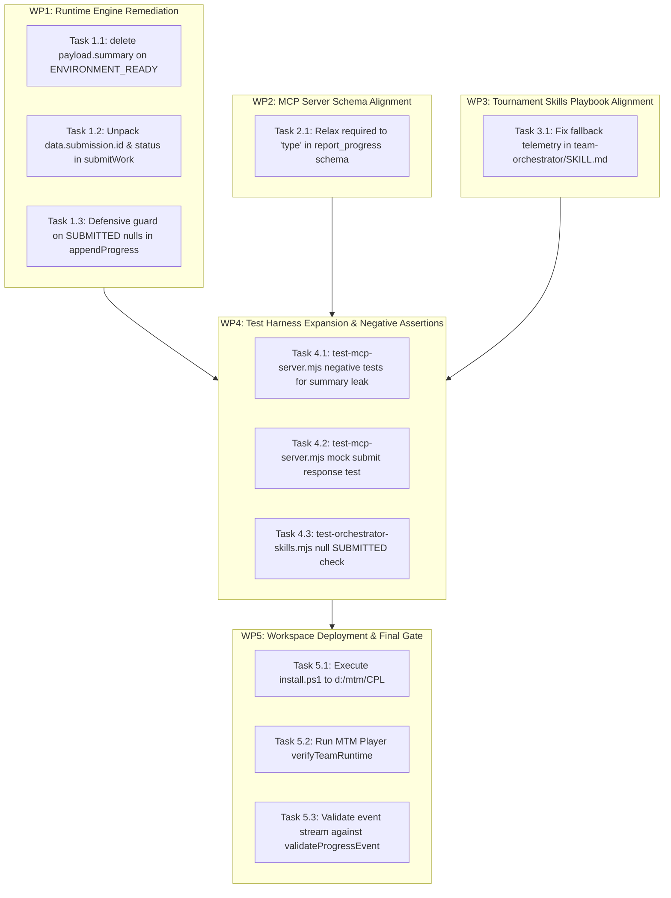

# Implementation Plan: 3 Latent Bug Remediation & Telemetry Hardening

- **Session Date**: 2026-10-28
- **Session Focus / Topic**: **Remediation Plan for 3 Latent Defects (ENVIRONMENT_READY Summary Sanitizer, Telemetry Fallback Alignment & Game Master Submission UUID Parsing)**
- **Project**: Master The Machine (MTM) — AI Fest 2026
- **Team**: CPL (`CPL_digital_cuder` / `CPL Team`)
- **Status**: Approved for Planning — Ready for Code Execution
- **Related Session Artifacts**:
  - Technical Research & Proposal: [research_2nd_bug_remediation_and_schema_hardening.md](file:///d:/mtm/sessions/2026-10-28/research_2nd_bug_remediation_and_schema_hardening.md)
  - Prior Session Review: [review_bug_remediation_and_test_readiness.md](file:///d:/mtm/sessions/2026-10-28/review_bug_remediation_and_test_readiness.md)
  - Prior 8-Bug Implementation Plan: [plan_bug_remediation.md](file:///d:/mtm/sessions/2026-10-28/plan_bug_remediation.md)
  - Reference Specs:
    - [02_DIGITAL_CUDER_API.md](file:///d:/mtm/docs/02_DIGITAL_CUDER_API.md)
    - [progress-event.schema.json](file:///d:/mtm/team-orchestrator-pack/contracts/progress-event.schema.json)
    - [progress.mjs](file:///d:/mtm/mtm-player-0.9.35-local-windows/app/src/progress.mjs)

---

## 1. Overview & Objectives

This implementation plan defines the exact, step-by-step engineering tasks required to eliminate the **3 latent defects** discovered during the forensic audit of the `team-sdlc-pack`:

1. **Bug #9**: The `ENVIRONMENT_READY` summary leak in [`src/runtime-session.mjs`](file:///d:/mtm/team-orchestrator-pack/src/runtime-session.mjs) and rigid `required: ['type', 'summary']` in [`bin/runtime-server.mjs`](file:///d:/mtm/team-orchestrator-pack/bin/runtime-server.mjs).
2. **Bug #10**: The invalid fallback telemetry (`status: "SUBMITTED"` with `revision: null, receiptId: null`) in [`skills/team-orchestrator/SKILL.md`](file:///d:/mtm/team-orchestrator-pack/skills/team-orchestrator/SKILL.md) violating [`progress.mjs:250`](file:///d:/mtm/mtm-player-0.9.35-local-windows/app/src/progress.mjs#L250).
3. **Bug #11**: Sub-optimal Game Master submission response parsing (`data.receiptId` vs `data.submission.id`) in [`src/runtime-session.mjs`](file:///d:/mtm/team-orchestrator-pack/src/runtime-session.mjs).

Executing this plan transitions the team pack from its current **"NOT READY"** status to **"VERIFIED & READY FOR ACTIVE MATCH TESTING"**.

---

## 2. Architecture & Work Package Sequencing



---

## 3. Work Package Specifications

### Work Package 1: Runtime Engine Remediation (`src/runtime-session.mjs`)

**Target File**: [`d:/mtm/team-orchestrator-pack/src/runtime-session.mjs`](file:///d:/mtm/team-orchestrator-pack/src/runtime-session.mjs)

#### Task 1.1: Guard & Delete `payload.summary` on `ENVIRONMENT_READY` (Bug #9)
- **Location**: Lines 100–105 (`appendProgress`)
- **Modification**:
  Replace:
  ```javascript
  // ENVIRONMENT_READY strictly forbids summary under additionalProperties: false
  if (payload.type !== 'ENVIRONMENT_READY') {
    payload.summary = sanitizedSummary;
  }
  ```
  With:
  ```javascript
  // ENVIRONMENT_READY strictly forbids summary under additionalProperties: false
  if (payload.type === 'ENVIRONMENT_READY') {
    delete payload.summary;
  } else {
    payload.summary = sanitizedSummary;
  }
  ```

#### Task 1.2: Defensive Guard on `BACKLOG_STATUS` `SUBMITTED` (Bug #10)
- **Location**: Lines 106–115 (`appendProgress`)
- **Modification**:
  Add defensive validation preventing invalid `SUBMITTED` events with null `revision` or `receiptId` from crashing `mtm-player`:
  ```javascript
  if (payload.type === 'BACKLOG_STATUS') {
    if (payload.status === 'SUBMITTED' && (!payload.revision || !payload.receiptId)) {
      payload.status = 'IN_PROGRESS';
      payload.summary = `${sanitizedSummary} (pending submission confirmation)`;
    }
    if (!('revision' in payload)) payload.revision = null;
    if (!('receiptId' in payload)) payload.receiptId = null;
    if (!payload.title) {
      const cached = this.backlogRegistry.get(payload.backlogId);
      payload.title = cached?.title || payload.backlogId || 'Task';
    }
  }
  ```

#### Task 1.3: Unpack Game Master Submission Response in `submitWork` (Bug #11)
- **Location**: Lines 744–765 (`submitWork`)
- **Modification**:
  Replace:
  ```javascript
  const data = apiResult.data || {};
  const receiptId = data.receiptId || `receipt-${Date.now()}`;

  // 4. Log Official SUBMITTED status
  this.appendProgress({
    type: 'BACKLOG_STATUS',
    backlogId: backlogItemKey,
    title: this.backlogRegistry.get(backlogItemKey)?.title || backlogItemKey,
    status: 'SUBMITTED',
    revision: gitRevision,
    receiptId,
    summary: `Successfully submitted ${backlogItemKey} (Receipt: ${receiptId})`
  });

  return {
    success: true,
    receiptId,
    status: data.status || 'ACCEPTED',
    scoreStatus: data.scoreStatus || 'PENDING',
    gitRevision
  };
  ```
  With:
  ```javascript
  const data = apiResult.data || {};
  const submission = data.submission || {};
  const receiptId = submission.id || data.receiptId || data.id || `receipt-${Date.now()}`;
  const submissionStatus = submission.status || data.status || 'ACCEPTED';
  const scoreStatus = submission.scoreStatus || data.scoreStatus || 'PENDING';

  // 4. Log Official SUBMITTED status with authentic server receipt UUID
  this.appendProgress({
    type: 'BACKLOG_STATUS',
    backlogId: backlogItemKey,
    title: this.backlogRegistry.get(backlogItemKey)?.title || backlogItemKey,
    status: 'SUBMITTED',
    revision: gitRevision,
    receiptId,
    summary: `Successfully submitted ${backlogItemKey} (Receipt: ${receiptId})`
  });

  return {
    success: true,
    receiptId,
    status: submissionStatus,
    scoreStatus,
    gitRevision
  };
  ```

---

### Work Package 2: MCP Server Schema Alignment (`bin/runtime-server.mjs`)

**Target File**: [`d:/mtm/team-orchestrator-pack/bin/runtime-server.mjs`](file:///d:/mtm/team-orchestrator-pack/bin/runtime-server.mjs)

#### Task 2.1: Relax `report_progress` Required Schema (Bug #9 Layer 2)
- **Location**: Lines 118–135 (`report_progress` tool definition)
- **Modification**:
  - Update description of `summary`:
    ```javascript
    summary: {
      type: 'string',
      description: 'Short single-line description (required for all events except ENVIRONMENT_READY where summary is forbidden)'
    },
    ```
  - Change line 134 from:
    ```javascript
    required: ['type', 'summary']
    ```
    to:
    ```javascript
    required: ['type']
    ```
  - This ensures client agents are not forced to inject dummy summaries for events that strictly forbid them.

---

### Work Package 3: Tournament Skill Telemetry Alignment (`skills/`)

**Target File**: [`d:/mtm/team-orchestrator-pack/skills/team-orchestrator/SKILL.md`](file:///d:/mtm/team-orchestrator-pack/skills/team-orchestrator/SKILL.md)

#### Task 3.1: Fix Fallback Telemetry Policy (Bug #10)
- **Location**: Lines 127–133 (`Stage 3: Time Budgeting & Fallback Policy`)
- **Modification**:
  Replace:
  ```markdown
  3. **Graceful Fallback**:
     - If the 8-minute limit expires or retries are exhausted:
       * Populate `submit.json` with best-effort completed data.
       * Log `report_progress({ type: "BACKLOG_STATUS", backlogId: "<backlogId>", status: "SUBMITTED", revision: null, receiptId: null, summary: "Submitting best effort for <backlogId> due to time budget cap" })`.
       * Invoke `submit_work` immediately to claim partial points and prevent zero score.
  ```
  With:
  ```markdown
  3. **Graceful Fallback**:
     - If the 8-minute limit expires or retries are exhausted:
       * Populate `submit.json` with best-effort completed data.
       * Log `report_progress({ type: "BACKLOG_STATUS", backlogId: "<backlogId>", status: "IN_PROGRESS", summary: "Initiating emergency fallback submission for <backlogId> due to time budget cap" })`.
       * Invoke `submit_work` immediately; the runtime automatically records official `SUBMITTED` telemetry with confirmed Git SHA and server receipt.
  ```

---

### Work Package 4: Test Harness Expansion (`test/`)

**Target Files**:
- [`d:/mtm/team-orchestrator-pack/test/test-mcp-server.mjs`](file:///d:/mtm/team-orchestrator-pack/test/test-mcp-server.mjs)
- [`d:/mtm/team-orchestrator-pack/test/test-orchestrator-skills.mjs`](file:///d:/mtm/team-orchestrator-pack/test/test-orchestrator-skills.mjs)

#### Task 4.1: Add Negative Test for `ENVIRONMENT_READY` Summary Leakage in `test-mcp-server.mjs`
- Call `tools/call` for `report_progress` passing `{ type: 'ENVIRONMENT_READY', summary: 'This summary must be stripped', ... }`.
- Read the emitted NDJSON line from disk and assert that:
  ```javascript
  assert(!('summary' in envEvent), 'ENVIRONMENT_READY stripped client-supplied summary property');
  ```

#### Task 4.2: Expand Skill Schema Assertions in `test-orchestrator-skills.mjs`
- Add regex assertion across all `skills/*/SKILL.md` files asserting that no snippet contains `status: "SUBMITTED"` with `revision: null` or `receiptId: null`.

---

### Work Package 5: Deployment & Target Workspace Re-verification

**Target Files / Directory**:
- [`d:/mtm/team-orchestrator-pack/install.ps1`](file:///d:/mtm/team-orchestrator-pack/install.ps1)
- [`d:/mtm/CPL/`](file:///d:/mtm/CPL/)

#### Task 5.1: Deploy to `d:/mtm/CPL`
- Run:
  ```powershell
  powershell -ExecutionPolicy Bypass -File .\install.ps1 -TargetWorkspace "d:\mtm\CPL"
  ```
- Verify that `d:/mtm/CPL/team-sdlc-pack/runtime/src/runtime-session.mjs` and `d:/mtm/CPL/.agents/skills/team-orchestrator/SKILL.md` match source hashes.

#### Task 5.2: Execute End-to-End MTM Player Verification
- Run verification script:
  ```powershell
  node -e "import('file:///d:/mtm/mtm-player-0.9.35-local-windows/app/src/bootstrap.mjs').then(b => { const l = b.validateTeamWorkspaceLayout('d:/mtm/CPL'); return import('file:///d:/mtm/mtm-player-0.9.35-local-windows/app/src/team-install.mjs').then(t => { const v = t.verifyTeamRuntime(l); console.log('VERIFIED:', v.runtime.status); }); });"
  ```
  Assert output is **`READY`**.
- Test event validation directly against MTM Player's `validateProgressEvent`:
  ```powershell
  node -e "import('file:///d:/mtm/mtm-player-0.9.35-local-windows/app/src/progress.mjs').then(p => { const ev = { schemaVersion: 1, playerSessionId: '00000000-0000-0000-0000-000000000000', type: 'ENVIRONMENT_READY', requestId: '00000000-0000-0000-0000-000000000001', repository: { url: 'https://github.com/lqdung863/mtm-cpl.git', branch: 'main', folder: 'TISTL6MV' }, revision: '0123456789abcdef0123456789abcdef01234567', build: 'PASS', matchLogin: 'PASS' }; p.validateProgressEvent(ev, ev.playerSessionId); console.log('PROGRESS VALIDATION: PASS'); });"
  ```
  Assert output is **`PASS`**.

---

## 4. Step-by-Step Execution Schedule

| Step | Action | Impacted Files | Verification Criteria |
| :---: | :--- | :--- | :--- |
| **1** | Update `appendProgress` in runtime engine | `src/runtime-session.mjs` | `summary` strictly deleted on `ENVIRONMENT_READY`; `SUBMITTED` nulls defended. |
| **2** | Unpack `data.submission.id` in `submitWork` | `src/runtime-session.mjs` | Official GM UUID captured in `receiptId`. |
| **3** | Relax `report_progress` schema | `bin/runtime-server.mjs` | `required: ['type']`; summary optional for `ENVIRONMENT_READY`. |
| **4** | Correct fallback policy in skill docs | `skills/team-orchestrator/SKILL.md` | No invalid `SUBMITTED` nulls recommended. |
| **5** | Expand test suite with negative tests | `test/test-mcp-server.mjs`<br/>`test/test-orchestrator-skills.mjs` | All tests pass (0 failures). |
| **6** | Run distribution check | `scripts/check-distribution.mjs` | 0 syntax or manifest errors. |
| **7** | Deploy pack to `d:/mtm/CPL` | `install.ps1` | All files synchronized to contestant workspace. |
| **8** | Run MTM Player runtime & progress validation | Local Node test runners | Status `READY`; `validateProgressEvent` passes. |

---

## 5. Acceptance Matrix & Verification Commands

| Target | Test Command | Expected Output |
| :--- | :--- | :--- |
| **Syntax & Distribution** | `node scripts/check-distribution.mjs` | `[SUCCESS] Distribution check passed with 0 errors.` |
| **MCP Protocol & Summary Negative Test** | `node test/test-mcp-server.mjs` | `ENVIRONMENT_READY stripped client-supplied summary property` (0 failed). |
| **Skills & Profiles Test** | `node test/test-orchestrator-skills.mjs` | All assertions pass (0 failed). |
| **Target Deployment** | `powershell -File .\install.ps1 -TargetWorkspace "d:\mtm\CPL"` | `[SUCCESS] Team pack installed & workspace fully configured.` |
| **Player Runtime Gate** | Node script invoking `verifyTeamRuntime` | `VERIFIED: READY` |
| **Live Progress Event Validator** | Node script invoking `validateProgressEvent` | `PROGRESS VALIDATION: PASS` |

---

## 6. Risk Mitigation & Cost Controls

1. **Zero Codex Credit Usage**: All unit tests, protocol assertions, and validator tests execute offline using Node.js built-in runtime ($0 API cost).
2. **Defensive Schema Protection**: Even if an LLM agent ignores instructions and attempts to send invalid payloads, the runtime session actively normalizes and sanitizes events before they hit disk.
3. **Reversible Updates**: Source changes are isolated within `team-orchestrator-pack`; rollback can be performed via git checkout if needed.

