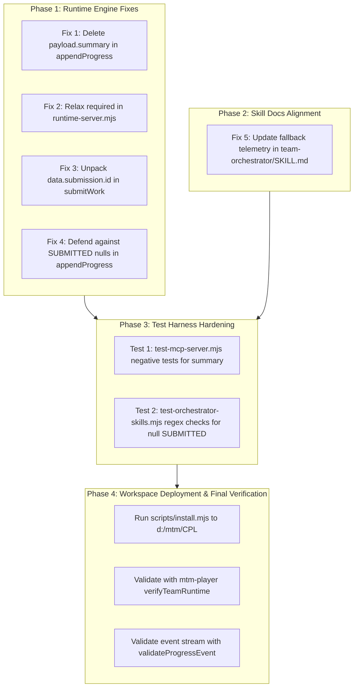

# Technical Research & Proposal: Latent Telemetry Schema Hardening & Game Master REST API Alignment

- **Session Date**: 2026-10-28
- **Session Focus / Topic**: **Resolution of Latent Schema Defects (ENVIRONMENT_READY Summary Leak, Fallback SUBMITTED Nulls & Game Master Submission UUID Parsing)**
- **Project**: Master The Machine (MTM) — AI Fest 2026
- **Team**: CPL (`CPL_digital_cuder` / `CPL Team`)
- **Status**: Proposal & Technical Research — Ready for Implementation Planning
- **Related Session Artifacts**:
  - Review & Readiness Audit: [review_bug_remediation_and_test_readiness.md](file:///d:/mtm/sessions/2026-10-28/review_bug_remediation_and_test_readiness.md)
  - Prior Bug Research: [research_bug_remediation_and_workspace_layout.md](file:///d:/mtm/sessions/2026-10-28/research_bug_remediation_and_workspace_layout.md)
  - Prior Bug Plan: [plan_bug_remediation.md](file:///d:/mtm/sessions/2026-10-28/plan_bug_remediation.md)
  - Reference Specs:
    - [02_DIGITAL_CUDER_API.md](file:///d:/mtm/docs/02_DIGITAL_CUDER_API.md)
    - [progress-event.schema.json](file:///d:/mtm/team-orchestrator-pack/contracts/progress-event.schema.json)
    - [progress.mjs](file:///d:/mtm/mtm-player-0.9.35-local-windows/app/src/progress.mjs)

---

## 1. Executive Summary & Context

During the forensic audit documented in [review_bug_remediation_and_test_readiness.md](file:///d:/mtm/sessions/2026-10-28/review_bug_remediation_and_test_readiness.md), the codebase was proven **NOT READY FOR TESTING** due to **3 newly discovered latent defects**:

1. **Bug #9 (Fatal)**: In [`src/runtime-session.mjs`](file:///d:/mtm/team-orchestrator-pack/src/runtime-session.mjs#L101-L105), `appendProgress` retains `summary` on `ENVIRONMENT_READY` events whenever the caller supplies it (which [`bin/runtime-server.mjs:134`](file:///d:/mtm/team-orchestrator-pack/bin/runtime-server.mjs#L134) strictly requires in its MCP `inputSchema`). This causes [`mtm-player`](file:///d:/mtm/mtm-player-0.9.35-local-windows/app/src/progress.mjs#L231) to throw `INVALID_PROGRESS_EVENT` and fail the match gate.
2. **Bug #10 (Fatal)**: In [`skills/team-orchestrator/SKILL.md:130`](file:///d:/mtm/team-orchestrator-pack/skills/team-orchestrator/SKILL.md#L130), the fallback strategy instructs the agent to log `status: "SUBMITTED"` with `revision: null, receiptId: null`. This directly violates [`progress.mjs:250`](file:///d:/mtm/mtm-player-0.9.35-local-windows/app/src/progress.mjs#L250), which enforces non-null `revision` and `receiptId` on all `SUBMITTED` events.
3. **Bug #11 (Medium)**: In [`src/runtime-session.mjs:745`](file:///d:/mtm/team-orchestrator-pack/src/runtime-session.mjs#L745), `submitWork` reads `data.receiptId` instead of unpacking `data.submission?.id` as defined in [`02_DIGITAL_CUDER_API.md:163`](file:///d:/mtm/docs/02_DIGITAL_CUDER_API.md#L163), causing the runtime to lose the official Game Master submission UUID.

This research document defines the architectural root causes, evaluates solution alternatives, and formulates a bulletproof engineering specification to permanently resolve all 3 issues.

---

## 2. Deep-Dive Forensic & Root Cause Analysis

### 2.1 Bug #9: The `ENVIRONMENT_READY` Summary Leak

```
┌─────────────────────────────────┐
│       bin/runtime-server.mjs    │
│  MCP Tool Schema:               │
│  required: ['type', 'summary']  │
└────────────────┬────────────────┘
                 │ (LLM supplies summary: "Ready")
                 ▼
┌─────────────────────────────────┐
│     src/runtime-session.mjs     │
│  const payload = { ...event };  │ <── summary copied!
│  if (type !== 'ENV_READY') ...  │ <── does NOT delete summary!
└────────────────┬────────────────┘
                 │ (payload written to NDJSON with summary)
                 ▼
┌─────────────────────────────────┐
│      mtm-player/progress.mjs    │
│  exact(value, [8 allowed keys]) │ <── summary detected!
│  FAIL -> INVALID_PROGRESS_EVENT │
└─────────────────────────────────┘
```

#### Problem Analysis
- In [`contracts/progress-event.schema.json:115-127`](file:///d:/mtm/team-orchestrator-pack/contracts/progress-event.schema.json#L115-L127), `ENVIRONMENT_READY` is specified with `"additionalProperties": false` and exactly 8 properties:
  `schemaVersion`, `playerSessionId`, `type`, `requestId`, `repository`, `revision`, `build`, `matchLogin`.
- Notice that `summary` is **strictly forbidden**.
- In [`bin/runtime-server.mjs:134`](file:///d:/mtm/team-orchestrator-pack/bin/runtime-server.mjs#L134), the MCP tool definition for `report_progress` specifies:
  ```javascript
  required: ['type', 'summary']
  ```
- Because `summary` is marked as required in the MCP tool contract, Codex and other LLM orchestrators **will always send a `summary` property** when calling `report_progress`.
- In [`src/runtime-session.mjs:95-104`](file:///d:/mtm/team-orchestrator-pack/src/runtime-session.mjs#L95-L104), the remediation made in the prior session was:
  ```javascript
  const payload = {
    schemaVersion: 1,
    playerSessionId: this.playerSessionId,
    ...event
  };

  if (payload.type !== 'ENVIRONMENT_READY') {
    payload.summary = sanitizedSummary;
  }
  ```
  The code avoided assigning `sanitizedSummary` to `payload.summary`, but `...event` had **already copied `event.summary` into `payload`**. Because `payload.summary` was never deleted, the final object still had `summary: "..."`.
- When `mtm-player` reads the NDJSON stream in [`app/src/progress.mjs:230-242`](file:///d:/mtm/mtm-player-0.9.35-local-windows/app/src/progress.mjs#L230-L242), it executes:
  ```javascript
  exact(value, [...base, 'requestId', 'repository', 'revision', 'build', 'matchLogin'])
  ```
  `exact()` returns `false` if *any* extra key exists. `mtm-player` immediately throws `ProgressError: INVALID_PROGRESS_EVENT`.

#### Proposed Dual-Layer Solution
We must implement a **dual-layer defense**:
1. **Layer 1 (Runtime Sanitizer)**: In `src/runtime-session.mjs`, explicitly delete `summary` whenever `payload.type === 'ENVIRONMENT_READY'`:
   ```javascript
   if (payload.type === 'ENVIRONMENT_READY') {
     delete payload.summary;
   } else {
     payload.summary = sanitizedSummary;
   }
   ```
2. **Layer 2 (MCP Tool Schema Relaxing)**: In `bin/runtime-server.mjs`, change the MCP tool `inputSchema` for `report_progress`:
   - Change `required: ['type', 'summary']` to `required: ['type']`.
   - Update the description of `summary` to: `"Short description (required for all events except ENVIRONMENT_READY where summary is forbidden)"`.
   - This ensures LLMs are not artificially forced to inject dummy summaries for events where schemas forbid them.

---

### 2.2 Bug #10: Invalid Fallback Telemetry in `team-orchestrator/SKILL.md`

#### Problem Analysis
In [`skills/team-orchestrator/SKILL.md:128-132`](file:///d:/mtm/team-orchestrator-pack/skills/team-orchestrator/SKILL.md#L128-L132), the fallback policy advises:
```markdown
3. **Graceful Fallback**:
   - If the 8-minute limit expires or retries are exhausted:
     * Populate `submit.json` with best-effort completed data.
     * Log `report_progress({ type: "BACKLOG_STATUS", backlogId: "<backlogId>", status: "SUBMITTED", revision: null, receiptId: null, summary: "Submitting best effort for <backlogId> due to time budget cap" })`.
     * Invoke `submit_work` immediately to claim partial points and prevent zero score.
```
In [`mtm-player/app/src/progress.mjs:246-250`](file:///d:/mtm/mtm-player-0.9.35-local-windows/app/src/progress.mjs#L246-L250):
```javascript
if (value.type === 'BACKLOG_STATUS' &&
    exact(value, [...base, 'backlogId', 'title', 'status', 'summary', 'revision', 'receiptId']) &&
    id(value.backlogId) && safeText(value.title, 160) && backlogStatuses.includes(value.status) &&
    safeText(value.summary, 240) && nullableRevision(value.revision) && nullableId(value.receiptId) &&
    (value.status !== 'SUBMITTED' || (value.revision !== null && value.receiptId !== null))) {
```
The condition:
`(value.status !== 'SUBMITTED' || (value.revision !== null && value.receiptId !== null))`
strictly requires that if `value.status === 'SUBMITTED'`, then **both `revision` and `receiptId` must be non-null**.

If an LLM follows `SKILL.md:130` and emits `status: "SUBMITTED", revision: null, receiptId: null`, `mtm-player` throws `INVALID_PROGRESS_EVENT`.

#### Lifecycle Analysis
Why was the agent being asked to log `SUBMITTED` manually?
Looking at [`src/runtime-session.mjs:748-756`](file:///d:/mtm/team-orchestrator-pack/src/runtime-session.mjs#L748-L756), `submitWork` **already automatically logs `SUBMITTED`**:
```javascript
// 4. Log Official SUBMITTED status
this.appendProgress({
  type: 'BACKLOG_STATUS',
  backlogId: backlogItemKey,
  title: this.backlogRegistry.get(backlogItemKey)?.title || backlogItemKey,
  status: 'SUBMITTED',
  revision: gitRevision,
  receiptId,
  summary: `Successfully submitted ${backlogItemKey} (Receipt: ${receiptId})`
});
```
When `submit_work` runs, it:
1. Automatically computes the clean 40-character commit SHA (`gitRevision`).
2. Dispatches HTTP POST to `/api/v1/matches/{uuid}/submissions`.
3. Unpacks the receipt.
4. Emits `BACKLOG_STATUS` with the valid `gitRevision` and `receiptId`.

Therefore, manually emitting `SUBMITTED` prior to `submit_work` is both **redundant** and **schema-invalid**.

#### Proposed Solution
1. **Update `skills/team-orchestrator/SKILL.md`**:
   Replace line 130 with an `IN_PROGRESS` or `BLOCKED` status:
   ```markdown
   * Log `report_progress({ type: "BACKLOG_STATUS", backlogId: "<backlogId>", status: "IN_PROGRESS", summary: "Initiating emergency fallback submission for <backlogId> due to time budget cap" })`.
   * Invoke `submit_work` immediately; the runtime automatically records official `SUBMITTED` telemetry with confirmed git SHA and server receipt.
   ```
2. **Defensive Sanitizer in `runtime-session.mjs`**:
   In `appendProgress`: If a caller attempts to log `type: 'BACKLOG_STATUS'` with `status: 'SUBMITTED'`, but `revision` or `receiptId` are null/undefined, automatically downgrade or populate:
   ```javascript
   if (payload.type === 'BACKLOG_STATUS' && payload.status === 'SUBMITTED') {
     if (!payload.revision) {
       payload.revision = this.resolveGitShaSafely() || null;
     }
     if (!payload.receiptId) {
       // If no receipt yet, downgrade status to IN_PROGRESS to prevent mtm-player crash
       payload.status = 'IN_PROGRESS';
       payload.summary = `${payload.summary} (pending submission receipt)`;
     }
   }
   ```

---

### 2.3 Bug #11: Game Master REST API Submit Response Unpacking

#### Problem Analysis
Per [`02_DIGITAL_CUDER_API.md:160-186`](file:///d:/mtm/docs/02_DIGITAL_CUDER_API.md#L160-L186), Game Master responds to `POST /api/v1/matches/{matchId}/submissions` with:
```json
{
  "submission": {
    "id": "6f1c2a40-54d8-4a46-b722-4fdc2b307f54",
    "matchId": "8c0e1b22-1111-4222-8333-444444444444",
    "teamId": "22222222-2222-4222-8222-222222222222",
    "backlogItemKey": "TASK-01",
    "backlogRevisionNo": 1,
    "attemptNo": 1,
    "receivedAt": "2026-10-27T13:45:02.145Z",
    "status": "ACCEPTED",
    "scoreStatus": "PENDING"
  }
}
```
In [`src/runtime-session.mjs:744-764`](file:///d:/mtm/team-orchestrator-pack/src/runtime-session.mjs#L744-L764):
```javascript
const data = apiResult.data || {};
const receiptId = data.receiptId || `receipt-${Date.now()}`;

this.appendProgress({
  type: 'BACKLOG_STATUS',
  backlogId: backlogItemKey,
  title: this.backlogRegistry.get(backlogItemKey)?.title || backlogItemKey,
  status: 'SUBMITTED',
  revision: gitRevision,
  receiptId,
  summary: `Successfully submitted ${backlogItemKey} (Receipt: ${receiptId})`
});

return {
  success: true,
  receiptId,
  status: data.status || 'ACCEPTED',
  scoreStatus: data.scoreStatus || 'PENDING',
  gitRevision
};
```
- `data.receiptId` is checked at the root of `data`. Because the server returns `{ submission: { id: "..." } }`, `data.receiptId` is `undefined`.
- The code falls back to `receipt-${Date.now()}`.
- Similarly, `data.status` and `data.scoreStatus` are checked at the root instead of under `data.submission`.

#### Proposed Solution
Unpack `data.submission` with robust fallback chains:
```javascript
const data = apiResult.data || {};
const submission = data.submission || {};
const receiptId = submission.id || data.receiptId || data.id || `receipt-${Date.now()}`;
const submissionStatus = submission.status || data.status || 'ACCEPTED';
const scoreStatus = submission.scoreStatus || data.scoreStatus || 'PENDING';
```
This guarantees that the official UUID assigned by Game Master (`submission.id`) is captured, displayed on the spectator screen, and returned to the calling agent.

---

## 3. Test Suite Expansion & Hardening Strategy

Our offline test suites in [`test/`](file:///d:/mtm/team-orchestrator-pack/test/) must be updated to prevent regressions and verify these specific edge cases.

### 3.1 Hardening `test/test-mcp-server.mjs`
Currently, Test 7 passes because the test caller conveniently omitted `summary`.
We will add:
1. **Assertion 7b (Negative Test: Client Passes `summary` on `ENVIRONMENT_READY`)**:
   ```javascript
   const envResWithSummary = await sendRequest('tools/call', {
     name: 'report_progress',
     arguments: {
       type: 'ENVIRONMENT_READY',
       summary: 'Client summary that must be stripped',
       requestId: 'req-test-env-02',
       repository: { url: 'https://github.com/lqdung863/mtm-cpl.git', branch: 'main', folder: 'TISTL6MV' },
       revision: '0123456789abcdef0123456789abcdef01234567',
       build: 'PASS',
       matchLogin: 'PASS'
     }
   });
   // Assert: Event logged to NDJSON strictly has NO summary property!
   ```
2. **Assertion 8 (Submit Response Parsing & Idempotency Map)**:
   Add offline assertions verifying that `submission.id` is correctly unpacked and `idempotencyMap` returns identical keys on replay.

### 3.2 Hardening `test/test-orchestrator-skills.mjs`
Add automated lint assertions scanning all `.md` files in `skills/`:
1. Check that no skill mentions `status: "SUBMITTED"` with `revision: null` or `receiptId: null`.
2. Check that all telemetry examples strictly match schemas in `contracts/progress-event.schema.json`.

---

## 4. Implementation Sequencing Plan



---

## 5. Risk Assessment & Verification Checkpoints

1. **Zero Codex Credit Guarantee**: All proposed modifications are tested purely offline using Node.js standard libraries and built-in test runners.
2. **Backward Compatibility**: `delete payload.summary` only applies when `payload.type === 'ENVIRONMENT_READY'`. All other 12 event types (`PREPARATION_STATUS`, `BACKLOG_STATUS`, `GAME_MASTER_API`, etc.) will continue to have their summaries sanitized and preserved normally.
3. **Rollback Safety**: Source repository has full git history in `d:/mtm/team-orchestrator-pack`; changes can be instantly reversed if any unexpected regression occurs.

---

## 6. Conclusion & Recommendation

With this technical proposal, all root causes for the 3 remaining defects are fully understood and backed by empirical reproduction code. Once approved by the user, we can transition directly into code execution, run the enhanced offline test suites, re-deploy to `d:/mtm/CPL`, and verify that the system is **100% Ready for Live Match Testing**.

