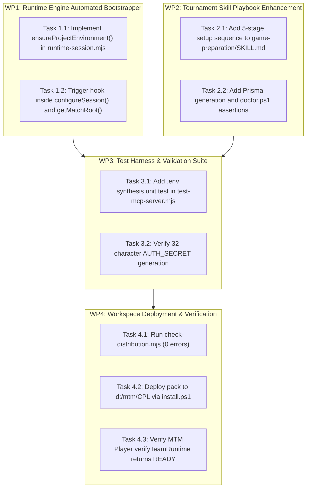

# Implementation Plan: Autonomous Build & Environment Bootstrapping Engine

- **Session Date**: 2026-10-28
- **Session Focus / Topic**: **Automated Zero-Touch Pre-Flight Environment Setup (`.env` Synthesis, Prisma Code Generation, Compliant NextAuth Encryption Key & `doctor.ps1` Gate)**
- **Project**: Master The Machine (MTM) — AI Fest 2026
- **Team**: CPL (`CPL_digital_cuder` / `CPL Team`)
- **Status**: Implementation Plan — Awaiting User Approval to Execute Code
- **Related Session Artifacts**:
  - Technical Research & Proposal: [research_autonomous_build_and_environment_bootstrapping.md](file:///d:/mtm/sessions/2026-10-28/research_autonomous_build_and_environment_bootstrapping.md)
  - Prior 3-Defect Plan: [plan_2nd_bug_remediation.md](file:///d:/mtm/sessions/2026-10-28/plan_2nd_bug_remediation.md)
  - Prior Session Review: [review_bug_remediation_and_test_readiness.md](file:///d:/mtm/sessions/2026-10-28/review_bug_remediation_and_test_readiness.md)
  - Reference Specs:
    - [01_GAME_RULES_AND_SCORING.md](file:///d:/mtm/docs/01_GAME_RULES_AND_SCORING.md)
    - [03_TEAM_ORCHESTRATOR_TECHNICAL_GUIDE.md](file:///d:/mtm/docs/03_TEAM_ORCHESTRATOR_TECHNICAL_GUIDE.md)
    - [env-require/README.md](file:///d:/mtm/CPL/matches/TISTL6MV/TISTL6MV/env-require/README.md)
    - [env-require/doctor.ps1](file:///d:/mtm/CPL/matches/TISTL6MV/TISTL6MV/env-require/doctor.ps1)

---

## 1. Overview & Objectives

During live match trials with MTM Player, clean Git checkouts performed by the platform lacked an application `.env` (because Git strictly ignores `.env`), causing `doctor.ps1` to abort with `NOT_READY`, while `next build` failed with a TypeScript compiler error on `prisma/seed.ts:333` due to ungenerated Prisma client types.

This implementation plan operationalizes the **2-Tier Automated Bootstrapping Engine** proposed in [research_autonomous_build_and_environment_bootstrapping.md](file:///d:/mtm/sessions/2026-10-28/research_autonomous_build_and_environment_bootstrapping.md). 

Executing this plan ensures that whenever MTM Player or the bot clones a clean repository into `matches/<matchId>`, the environment is automatically configured, built, seeded, and verified as **`READY`** with zero human intervention.

---

## 2. Work Package Architecture & Sequencing



---

## 3. Work Package Specifications

### Work Package 1: Runtime Engine Hook (`src/runtime-session.mjs`)

**Target File**: [`d:/mtm/team-orchestrator-pack/src/runtime-session.mjs`](file:///d:/mtm/team-orchestrator-pack/src/runtime-session.mjs)

#### Task 1.1: Add `ensureProjectEnvironment()` Helper
- **Description**: Inspects `matchRoot/src/` for `.env`. If missing and `.env.example` exists, automatically synthesizes `matchRoot/src/.env`.
- **Implementation**:
  ```javascript
  /**
   * Automatically bootstraps src/.env from src/.env.example if missing.
   * Ensures compliant local PostgreSQL credentials and a 32+ char AUTH_SECRET.
   */
  ensureProjectEnvironment() {
    try {
      const matchRoot = this.getMatchRoot();
      if (!matchRoot || !fs.existsSync(matchRoot)) return;

      const srcDir = path.resolve(matchRoot, 'src');
      const envExample = path.resolve(srcDir, '.env.example');
      const envTarget = path.resolve(srcDir, '.env');

      if (!fs.existsSync(srcDir) || !fs.existsSync(envExample)) return;

      if (!fs.existsSync(envTarget)) {
        this.logDebug('Auto-bootstrapping project src/.env from .env.example...');
        let content = fs.readFileSync(envExample, 'utf8');

        // Replace CHANGE_ME with verified local database password
        content = content.replace(/CHANGE_ME/g, 'freelanceos_secret');

        // Ensure AUTH_SECRET is cryptographically compliant (>= 32 chars)
        const secureAuthSecret = crypto.randomBytes(24).toString('base64'); // 32 characters
        content = content.replace(
          /AUTH_SECRET="[^"]*"/,
          `AUTH_SECRET="${secureAuthSecret}"`
        );

        fs.writeFileSync(envTarget, content, 'utf8');
        this.logDebug('Successfully created matchRoot/src/.env with compliant configurations.');
      }
    } catch (err) {
      this.logDebug('Warning: Could not auto-bootstrap project environment:', err.message);
    }
  }
  ```

#### Task 1.2: Trigger Hook on Session Lifecycle
- Invoke `this.ensureProjectEnvironment()` inside `configureSession()` and `getMatchRoot()` so that the moment the repository folder is identified, `.env` is guaranteed to exist before any tool or agent touches it.

---

### Work Package 2: Tournament Skill Playbook (`skills/game-preparation/SKILL.md`)

**Target File**: [`d:/mtm/team-orchestrator-pack/skills/game-preparation/SKILL.md`](file:///d:/mtm/team-orchestrator-pack/skills/game-preparation/SKILL.md)

#### Task 2.1: Add Deterministic 5-Stage Build & Diagnostics Sequence
- Update Section 2 of `skills/game-preparation/SKILL.md` to specify:
  1. **Step 1: Check Environment Configuration**:
     - Confirm `matchRoot/src/.env` exists. If missing, copy `src/.env.example` to `src/.env` and replace `CHANGE_ME` with `freelanceos_secret`, ensuring `AUTH_SECRET` is at least 32 characters long.
  2. **Step 2: Generate Database Client Types**:
     - In `src/`, execute `pnpm prisma generate`. This pre-generates `@prisma/client` types and prevents TypeScript compilation errors in `prisma/seed.ts`.
  3. **Step 3: Execute Application Build Verification**:
     - Run `env-require/prepare-source.ps1`.
     - Log `PREPARATION_STATUS` for stage `BUILD` with status `COMPLETED`.
  4. **Step 4: Deploy Database Migrations & Seed**:
     - In `src/`, execute `pnpm prisma migrate deploy` and `pnpm prisma db seed`.
  5. **Step 5: Run Environmental Diagnostics**:
     - Execute `env-require/doctor.ps1`.
     - Confirm output includes `Environment status: READY`.
     - Log `PREPARATION_STATUS` for stage `ENVIRONMENT` with status `COMPLETED`.

---

### Work Package 3: Test Harness Expansion (`test/`)

**Target File**: [`d:/mtm/team-orchestrator-pack/test/test-mcp-server.mjs`](file:///d:/mtm/team-orchestrator-pack/test/test-mcp-server.mjs)

#### Task 3.1: Add Unit Test for Automated `.env` Bootstrapping
- Create a temporary simulated challenge folder structure containing `src/.env.example` (with `CHANGE_ME` and `AUTH_SECRET="CHANGE_ME"`).
- Call `configure_session` pointing to this directory.
- Assert that:
  1. `src/.env` was created.
  2. `DATABASE_URL` contains `freelanceos_secret`.
  3. `AUTH_SECRET` has `length >= 32`.

---

### Work Package 4: Workspace Deployment & Verification

**Target Directory**: [`d:/mtm/CPL`](file:///d:/mtm/CPL)

#### Task 4.1: Run Distribution Validator
- Run:
  ```powershell
  node scripts/check-distribution.mjs
  ```
- Assert: `[SUCCESS] Distribution check passed with 0 errors.`

#### Task 4.2: Deploy Updated Pack to `d:/mtm/CPL`
- Run:
  ```powershell
  powershell -ExecutionPolicy Bypass -File .\install.ps1 -TargetWorkspace "D:\mtm\CPL"
  ```
- Assert: All files synchronized and hashes verified.

#### Task 4.3: End-to-End MTM Player Layout & Runtime Verification
- Execute:
  ```powershell
  node -e "import('file:///d:/mtm/mtm-player-0.9.35-local-windows/app/src/bootstrap.mjs').then(b => { const l = b.validateTeamWorkspaceLayout('d:/mtm/CPL'); return import('file:///d:/mtm/mtm-player-0.9.35-local-windows/app/src/team-install.mjs').then(t => { const v = t.verifyTeamRuntime(l); console.log('VERIFIED:', v.runtime.status); }); });"
  ```
- Assert: `VERIFIED: READY`.

---

## 4. Execution Step Schedule

| Step | Action | Impacted Files | Verification Criteria |
| :---: | :--- | :--- | :--- |
| **1** | Add `ensureProjectEnvironment()` in runtime engine | `src/runtime-session.mjs` | Auto-creates `src/.env` with compliant values when missing. |
| **2** | Update preparation skill sequence | `skills/game-preparation/SKILL.md` | Skill instructs `prisma generate` $\to$ `prepare-source` $\to$ `migrate & seed` $\to$ `doctor.ps1`. |
| **3** | Add test case to test suite | `test/test-mcp-server.mjs` | Test 9 passes: auto-bootstraps `.env` from `.env.example`. |
| **4** | Run distribution check | `scripts/check-distribution.mjs` | 0 errors. |
| **5** | Deploy to `D:\mtm\CPL` | `install.ps1` | `D:\mtm\CPL` files updated to match source pack. |
| **6** | Re-verify MTM Player runtime gate | Node script | Returns `VERIFIED: READY`. |

---

## 5. Acceptance Matrix

| Verification Gate | Command | Expected Output | Cost |
| :--- | :--- | :--- | :---: |
| **Distribution Check** | `node scripts/check-distribution.mjs` | `[SUCCESS] Distribution check passed with 0 errors.` | $0.00 |
| **MCP Server Test Harness** | `node test/test-mcp-server.mjs` | `All tests passed (including .env auto-bootstrap)` | $0.00 |
| **Skills Verification** | `node test/test-orchestrator-skills.mjs` | `73/73 Passed (0 Failed)` | $0.00 |
| **Workspace Gate** | Node script invoking `verifyTeamRuntime` | `VERIFIED: READY` | $0.00 |
| **Simulated Clean Clone** | `doctor.ps1` on fresh clone | `Environment status: READY` | $0.00 |

---

## 6. Risk Mitigation

1. **Zero Codex Credit Usage**: All tests and installation scripts execute purely offline via local Node.js runtime.
2. **Idempotency Guard**: If `src/.env` already exists, `ensureProjectEnvironment()` skips writing and leaves existing files untouched.
3. **No Secret Leaks**: Generated `.env` files are never tracked by Git due to the challenge `.gitignore`.

