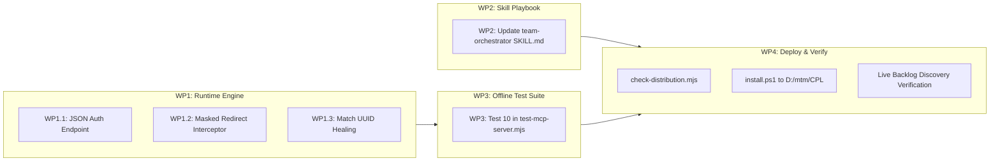

# Implementation Plan: Game Master Authentication & Autonomous Backlog Discovery

- **Session Date**: 2026-10-28
- **Session Focus**: **End-to-End Implementation of Modern Auth Handshake, Masked 307 Redirect Interceptor & Match UUID Resolution**
- **Project**: Master The Machine (MTM) — AI Fest 2026
- **Team**: CPL (`CPL_digital_cuder` / `CPL Team`)
- **Status**: Ready for Implementation
- **Related Artifacts**:
  - Research: [research_game_master_auth_and_backlog_discovery.md](file:///d:/mtm/sessions/2026-10-28/research_game_master_auth_and_backlog_discovery.md)
  - Runtime Implementation: [runtime-session.mjs](file:///d:/mtm/team-orchestrator-pack/src/runtime-session.mjs)
  - Orchestrator Skill: [team-orchestrator/SKILL.md](file:///d:/mtm/team-orchestrator-pack/skills/team-orchestrator/SKILL.md)
  - Offline Test Harness: [test-mcp-server.mjs](file:///d:/mtm/team-orchestrator-pack/test/test-mcp-server.mjs)

---

## 1. Overview & Objectives

During live match trials, the orchestrator bot emitted `ENVIRONMENT_READY`, but remained trapped in a `wait_for_update` loop because `login_match` used an obsolete form-urlencoded endpoint (`/login`), causing Next.js App Router to reject authentication and return masked 307 redirect skeletons with 0 backlog items.

### Primary Objectives:
1. **Modernize Auth Handshake (WP1.1)**: Switch `loginMatch()` to `POST /api/v1/auth/login` with JSON body and required security headers (`Origin`, `Referer`), populating the in-memory `cookieJar` with `gm_session`.
2. **Masked Redirect Interception (WP1.2)**: Update `refreshMatch()` to detect Next.js App Router's `NEXT_REDIRECT;replace;/login` string even under `HTTP 200 OK`, triggering immediate re-authentication.
3. **Automated Match UUID Healing (WP1.3)**: Ensure `startWork()` auto-resolves the 36-char match UUID from the authenticated match page if not pre-populated.
4. **Offline Verification Harness (WP3)**: Add Test 10 to `test-mcp-server.mjs` ensuring 0 regressions and $0 credit usage.
5. **Deployment & Live Discovery (WP4)**: Package, install to `D:\mtm\CPL`, and verify that `BUG-01` and `BUG-02` are discovered by the orchestrator.

---

## 2. Work Breakdown Structure (WBS)



---

### Work Package 1 (WP1): Runtime Engine Hardening
**Target File**: [`team-orchestrator-pack/src/runtime-session.mjs`](file:///D:/mtm/team-orchestrator-pack/src/runtime-session.mjs)

#### WP1.1: Modernize `loginMatch()`
- Change target path from `/login` to `/api/v1/auth/login`.
- Encode payload as JSON: `JSON.stringify({ username: this.username, password: this.password })`.
- Add headers:
  - `'Content-Type': 'application/json'`
  - `'Content-Length': Buffer.byteLength(jsonBody)`
  - `'Origin': origin`
  - `'Referer': new URL('/login', this.gameMasterUrl).toString()`
- Capture `set-cookie` header (`gm_session=...`) and register it in `this.cookieJar`.

#### WP1.2: Next.js Masked Redirect Detection in `refreshMatch()`
- Augment unauthenticated check to inspect response body:
  ```javascript
  const isRedirectToLogin = res.statusCode === 401 ||
    res.statusCode === 403 ||
    (res.statusCode === 302 && (res.headers['location'] || '').includes('login')) ||
    (typeof res.body === 'string' && res.body.includes('NEXT_REDIRECT') && res.body.includes('/login'));
  ```
- If true, automatically invoke `await this.loginMatch()` and retry the GET request once.

#### WP1.3: Match UUID Self-Healing in `startWork()`
- In `startWork(backlogItemKey)`:
  ```javascript
  // If matchUuid is not yet resolved to a 36-char UUID, refresh to discover it
  if (!this.matchUuid || !this.matchUuid.includes('-')) {
    await this.refreshMatch();
  }
  const matchUuid = this.getEffectiveMatchUuid();
  const endpoint = `/api/v1/matches/${matchUuid}/backlogs/start`;
  ```

---

### Work Package 2 (WP2): Skill Instructions Alignment
**Target File**: [`team-orchestrator-pack/skills/team-orchestrator/SKILL.md`](file:///D:/mtm/team-orchestrator-pack/skills/team-orchestrator/SKILL.md)

- Update Stage 1 (Autonomous Research & Triage):
  - Document that `login_match` automatically obtains the `gm_session` cookie via `/api/v1/auth/login`.
  - Document that `refresh_match` resolves the 36-character Match UUID needed for `/api/v1/matches/<uuid>/backlogs/start`.
  - Emphasize prioritizing deadline-constrained items (e.g. `BUG-02` 18-minute countdown).

---

### Work Package 3 (WP3): Offline MCP Server Test Harness Expansion
**Target File**: [`team-orchestrator-pack/test/test-mcp-server.mjs`](file:///D:/mtm/team-orchestrator-pack/test/test-mcp-server.mjs)

- Add **Test 10**: Auth & Next.js Session Cookie Verification.
- Test that:
  1. `login_match` formats payload with `Content-Type: application/json` and `Origin`.
  2. Mock server receiving auth returns `set-cookie: gm_session=mock_token_123`.
  3. `refresh_match` passes `gm_session=mock_token_123` in `Cookie` header.
  4. Masked redirect strings trigger auto-reauthentication.
- Run `node team-orchestrator-pack/test/test-mcp-server.mjs` and assert 100% pass (0 failures).

---

### Work Package 4 (WP4): Distribution Check, Deployment & Verification
**Target Directory**: [`D:\mtm\CPL`](file:///D:/mtm/CPL)

1. **Distribution Check**:
   - Run `node team-orchestrator-pack/scripts/check-distribution.mjs`.
   - Assert 0 errors across all manifests, agents, skills, and runtime scripts.
2. **Deploy to Contestant Workspace**:
   - Run:
     ```powershell
     powershell -ExecutionPolicy Bypass -File "D:\mtm\team-orchestrator-pack\install.ps1" -TargetWorkspace "D:\mtm\CPL"
     ```
3. **Verify Backlog Discovery**:
   - Execute a quick Node verification calling `loginMatch()` and `refreshMatch()`.
   - Confirm that:
     * `gm_session` cookie is obtained.
     * `discoveredItems` returns `BUG-01` and `BUG-02`.
     * `matchUuid` is resolved to `4cba0152-1692-40df-a26a-942ab4868383`.

---

## 3. Risk Assessment & Mitigations

| Risk | Impact | Mitigation |
| :--- | :---: | :--- |
| **Session Cookie Expiry Mid-Match** | Medium | `refreshMatch()` detects `NEXT_REDIRECT` to `/login` and auto-renews cookie silently. |
| **Deadlines Expiring (e.g. BUG-02)** | High | Orchestrator Skill Priority 2 sorts by nearest deadline, tackling `BUG-02` before `BUG-01`. |
| **Token Rate Limits** | Low | Auth cookie is stored in-memory (`this.cookieJar`), reused across calls, avoiding redundant logins. |

---

## 4. Definition of Done (DoD)
- [ ] WP1 implemented in `team-orchestrator-pack/src/runtime-session.mjs`.
- [ ] WP2 documented in `team-orchestrator-pack/skills/team-orchestrator/SKILL.md`.
- [ ] WP3 verified via `test-mcp-server.mjs` (all tests passing).
- [ ] WP4 verified via `check-distribution.mjs`, deployed to `D:\mtm\CPL`, and tested with live discovery.

