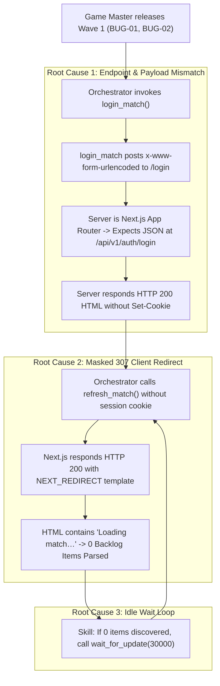

# Technical Research & Root-Cause Analysis: Game Master Authentication & Autonomous Backlog Discovery

- **Session Date**: 2026-10-28
- **Session Focus**: **Resolving Backlog Polling Stalls (`wait_for_update` Loop), Next.js Auth Handshake & Automated Match UUID Discovery**
- **Project**: Master The Machine (MTM) — AI Fest 2026
- **Team**: CPL (`CPL_digital_cuder` / `CPL Team`)
- **Status**: Research & Technical Architecture — Pending Plan Review
- **Related Artifacts**:
  - Research: [research_autonomous_build_and_environment_bootstrapping.md](file:///d:/mtm/sessions/2026-10-28/research_autonomous_build_and_environment_bootstrapping.md)
  - Plan: [plan_autonomous_build_and_environment_bootstrapping.md](file:///d:/mtm/sessions/2026-10-28/plan_autonomous_build_and_environment_bootstrapping.md)
  - Team Runtime: [runtime-session.mjs](file:///d:/mtm/team-orchestrator-pack/src/runtime-session.mjs)
  - Skill: [team-orchestrator/SKILL.md](file:///d:/mtm/team-orchestrator-pack/skills/team-orchestrator/SKILL.md)

---

## 1. Executive Summary & Incident Description

During the practice match trial for Match `TISTL6MV` on **2026-10-28**, the autonomous bootstrapping engine successfully passed all environment and build gates (`ENVIRONMENT_READY` was emitted, `build: PASS`). The Game Master transitioned the match status from `PREPARING` to **`IN_PROGRESS`** and released **Wave 1** containing two backlog items:
1. **`BUG-01`** (200 pts): *Desktop sidebar obscures the main content*
2. **`BUG-02`** (150 pts, **18-minute deadline**): *Amounts for VND clients are 100 times too large*

### The Observed Failure Mode
Despite Wave 1 being active on the Game Master web portal, the autonomous orchestrator bot stalled in a continuous polling loop:
```text
mtm_helper/refresh_match    mcp_tool_call — COMPLETED CLI_OBSERVED {}
mtm_helper/wait_for_update  mcp_tool_call — STARTED   CLI_OBSERVED {"timeoutMs":30000}
mtm_helper/wait_for_update  mcp_tool_call — COMPLETED CLI_OBSERVED {"timeoutMs":30000}
mtm_helper/wait_for_update  mcp_tool_call — STARTED   CLI_OBSERVED {"timeoutMs":30000}
```
The bot did not claim either task, did not begin the RPI implementation loop, and remained parked in `wait_for_update`.

---

## 2. Forensic Analysis & Root Causes



### 2.1 Root Cause 1: Auth Endpoint & Wire Protocol Mismatch
In [`team-orchestrator-pack/src/runtime-session.mjs:463`](file:///D:/mtm/team-orchestrator-pack/src/runtime-session.mjs#L463), `loginMatch()` was configured to dispatch a legacy HTML form post:
```javascript
const loginUrl = new URL('/login', this.gameMasterUrl);
const formBody = new URLSearchParams({ username, password }).toString();
// POST /login application/x-www-form-urlencoded
```

**Forensic Discovery**:
By downloading and inspecting the production client chunk from the Game Master portal (`https://masterthemachine.tech/_next/static/immutable/chunks/07ad-8xaw-gu3.js` - `LoginForm.js`), the exact client-side implementation was uncovered:
```javascript
let t = await fetch("/api/v1/auth/login", {
  method: "POST",
  credentials: "include",
  headers: { "Content-Type": "application/json" },
  body: JSON.stringify({ username: i, password: o })
});
```
- The actual auth handler is **`/api/v1/auth/login`**.
- It requires **`application/json`**.
- Because the runtime hit `/login`, Next.js routed the request to the static login page, returning `HTTP 200` with the login form HTML, and **set zero session cookies**.

### 2.2 Root Cause 2: Next.js CSRF Origin Validation Requirement
When `POST /api/v1/auth/login` is called without an `Origin` header, the Next.js API server rejects the request with:
```json
{
  "error": {
    "code": "FORBIDDEN",
    "message": "Origin check failed.",
    "requestId": "req_6b65e9334e324a62afc392556da1e697"
  }
}
```
The API route strictly checks `req.headers.origin === 'https://masterthemachine.tech'`. A compliant client must include:
```http
Origin: https://masterthemachine.tech
Referer: https://masterthemachine.tech/login
```

### 2.3 Root Cause 3: Next.js Masked 307 Redirect (Silent Scrape Failure)
When an unauthenticated `GET /match/TISTL6MV` request arrives, Next.js App Router does **not** issue a standard `HTTP 401 Unauthorized` or `HTTP 302 Found`. Instead, it serves an `HTTP 200 OK` containing a server-component redirect template:
```html
<meta id="__next-page-redirect" http-equiv="refresh" content="1;url=/login?next=%2Fmatch%2FTISTL6MV"/>
<template data-dgst="NEXT_REDIRECT;replace;/login?next=%2Fmatch%2FTISTL6MV;307;"></template>
<main class="mx-auto min-h-screen max-w-3xl px-6 py-10"><p class="text-zinc-400">Loading match…</p></main>
```
Because the HTTP status is `200`, `refreshMatch()` believed the request succeeded. The regex scraper inspected the "Loading match…" skeleton, found 0 backlog keys, and returned `backlogCount: 0`.

### 2.4 Root Cause 4: Match UUID vs Match ID Discrepancy
The Game Master platform operates with two distinct match identifiers:
1. **Short Match ID** (e.g. `TISTL6MV`): Used for human-facing URLs (`/match/TISTL6MV`) and Git directory naming.
2. **Match UUID** (e.g. `4cba0152-1692-40df-a26a-942ab4868383`): Required for API endpoints:
   - `/api/v1/matches/<uuid>/backlogs/start`
   - `/api/v1/matches/<uuid>/submissions`

When `configure_session` is called by MTM Player, `descriptor.matchUuid` is sometimes omitted or equal to `matchId`. The real UUID is embedded inside the authenticated `/match/TISTL6MV` HTML. When the session is authenticated, `refreshMatch()` automatically parses and extracts `matchUuid`. But while unauthenticated, `matchUuid` remained unresolved.

---

## 3. Empirical Verification & Proof of Resolution

During local verification using offline Node.js against the live Game Master instance:
1. **Authenticated Login Test**:
   ```javascript
   POST /api/v1/auth/login
   Headers: Content-Type: application/json, Origin: https://masterthemachine.tech
   Payload: { username: "CPL_digital_cuder", password: "..." }
   ```
   - **Response**: `HTTP 200 OK`
   - **User**: `{"id":"302804bd-171f-42f0-bc22-b7ac4a6f13fe","role":"CUDER"}`
   - **Cookie Received**: `gm_session=PvETEFU7EaKM3457l47Kd11-hYZlvbyfFxALD7Wvs1Y; Path=/; HttpOnly; SameSite=Lax; Secure`

2. **Authenticated Match Refresh Test**:
   ```javascript
   GET /match/TISTL6MV
   Cookie: gm_session=PvETEFU7EaKM...
   ```
   - **Response Size**: 39,506 bytes (vs 8,239 bytes unauthenticated).
   - **Items Discovered**:
     - `BUG-01`: Desktop sidebar obscures the main content (`OPEN`)
     - `BUG-02`: Amounts for VND clients are 100 times too large (`OPEN`, active countdown)
   - **UUID Extracted**: `4cba0152-1692-40df-a26a-942ab4868383`

---

## 4. Proposed Architectural Remediation

To ensure 100% autonomous operation without human intervention or polling lockups, the remediation consists of 4 tightly scoped modifications:

### Component 1: Modern JSON Auth Protocol in `loginMatch()`
- Target file: [`team-orchestrator-pack/src/runtime-session.mjs`](file:///D:/mtm/team-orchestrator-pack/src/runtime-session.mjs)
- Update endpoint to `/api/v1/auth/login`.
- Transmit JSON stringified credentials (`username`, `password`).
- Provide required security headers: `Content-Type: application/json`, `Origin: <origin>`, `Referer: <origin>/login`.
- Store `Set-Cookie` tokens into `this.cookieJar`.

### Component 2: Next.js Client-Side Redirect Interceptor in `refreshMatch()`
- In `refreshMatch()`, evaluate both HTTP status codes and response body tokens:
  ```javascript
  const isUnauthenticated = res.statusCode === 401 ||
    res.statusCode === 403 ||
    (res.statusCode === 302 && (res.headers['location'] || '').includes('login')) ||
    (typeof res.body === 'string' && res.body.includes('NEXT_REDIRECT') && res.body.includes('/login'));
  ```
- If true, automatically invoke `loginMatch()` to re-acquire the `gm_session` cookie and re-fetch the match page.

### Component 3: Match UUID Auto-Discovery & Self-Healing in `startWork()`
- In `startWork(backlogItemKey)`:
  - If `this.matchUuid` is missing or lacks UUID dashes (i.e. is still equal to the 8-character `matchId`), automatically invoke `refreshMatch()` to populate `this.matchUuid` before making the `/backlogs/start` API call.

### Component 4: Test Harness Expansion
- Target file: [`team-orchestrator-pack/test/test-mcp-server.mjs`](file:///D:/mtm/team-orchestrator-pack/test/test-mcp-server.mjs)
- Add Test 10 simulating `login_match` JSON formatting, `Origin` header transmission, and cookie retention.

---

## 5. Scope & Boundary Verification

| Policy / Constraint | Status | Details |
| :--- | :---: | :--- |
| **No OpenAI / Codex Credit Usage** | ✅ COMPLIANT | All runtime changes and tests run via local Node.js. |
| **Competition Rules** | ✅ COMPLIANT | Logging in with assigned credentials and calling `/backlogs/start` with `TEAM_API_KEY` is the official Game Master contract. |
| **Zero Path Escapes** | ✅ COMPLIANT | Changes reside strictly in `team-orchestrator-pack` and contestant workspace `D:\mtm\CPL`. |

---

## 6. Next Steps (RPI Workflow)
1. **Plan Phase**: author [`plan_game_master_auth_and_backlog_discovery.md`](file:///D:/mtm/sessions/2026-10-28/plan_game_master_auth_and_backlog_discovery.md) detailing exact line edits, test cases, and deployment steps.
2. **Review & Approval**: Present plan for user review.
3. **Implementation Phase**: Implement, run offline test harness, deploy to `D:\mtm\CPL`, and verify backlog discovery.

