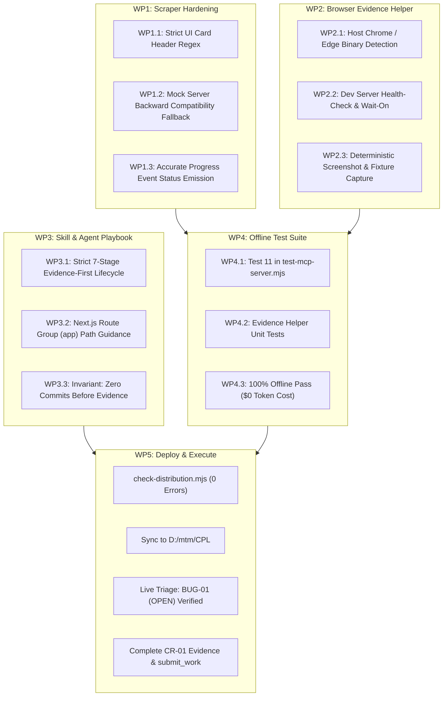

# Implementation Plan: Backlog Scraper Hardening, Browser Automation Reliability & Evidence Lifecycle (RPI Cycle 06)

- **Session Date**: 2026-10-28
- **Session Focus**: **End-to-End Implementation Plan for Card-Based Scraper Parsing, Host-Browser Playwright Automation, Dev Server Health Management & Evidence-First Submission Lifecycle**
- **Project**: Master The Machine (MTM) — AI Fest 2026
- **Team**: CPL (`CPL_digital_cuder` / `CPL Team`)
- **Status**: Ready for Plan Review & Approval (Strictly No Code Modified in This Phase)
- **Related Session Artifacts**:
  - Research: [research_evidence_automation_and_scraper_hardening.md](file:///d:/mtm/sessions/2026-10-28/06_evidence_automation_and_scraper_hardening/research_evidence_automation_and_scraper_hardening.md)
  - Prior Auth Review: [review_game_master_auth_and_backlog_discovery.md](file:///d:/mtm/sessions/2026-10-28/05_game_master_auth_and_discovery/review_game_master_auth_and_backlog_discovery.md)
  - Target Runtime Engine: [runtime-session.mjs](file:///d:/mtm/team-orchestrator-pack/src/runtime-session.mjs)
  - Orchestrator Skill: [team-orchestrator/SKILL.md](file:///d:/mtm/team-orchestrator-pack/skills/team-orchestrator/SKILL.md)
  - Offline Test Harness: [test-mcp-server.mjs](file:///d:/mtm/team-orchestrator-pack/test/test-mcp-server.mjs)
  - CR-01 Plan In Progress: [plan.md](file:///d:/mtm/CPL/matches/TISTL6MV/TISTL6MV/answers/CR-01/plan.md)

---

## 1. Overview & Objectives

In the prior match execution, the autonomous orchestrator successfully authenticated with the Game Master and resolved match UUIDs, but experienced two critical roadblocks:
1. **Scraper Regex False-Positive**: Capturing `"completed"` from Markdown instructions caused the bot to falsely record `BUG-01` and `BUG-02` as `COMPLETED`, skipping the 18-minute deadline on `BUG-02` and prematurely jumping into `CR-01`.
2. **`CR-01` Evidence Automation Breakdown**: While feature code was implemented and committed (`c6d0035`), evidence capture suffered 11 CLI failures (missing bundled Chromium, dev server port collisions, premature git commit preventing "before" screenshots, Next.js `(app)` route group path misses). As a result, `answers/CR-01/submit.json` stalled at `NOT_STARTED` and was never submitted.

### Primary Objectives:
1. **Harden Backlog Scraper (WP1)**: Upgrade `refreshMatch()` in `runtime-session.mjs` to target strict UI card badges (`<span class="font-mono text-zinc-300">...<span class="rounded border px-2 py-0.5 ...">OPEN</span>`), completely ignoring instructional prose.
2. **Reusable Browser Evidence Helper (WP2)**: Build `scripts/evidence-runner.mjs` that automatically locates the host's installed Google Chrome binary (`C:\Program Files\Google\Chrome\Application\chrome.exe`), checks dev server health on port 3000, and reliably captures screenshots and MVS evidence without depending on `%LOCALAPPDATA%\ms-playwright`.
3. **Evidence-First 7-Stage Playbook Invariant (WP3)**: Update `team-orchestrator/SKILL.md` and agent instructions enforcing that baseline "before" evidence is captured **before** any code modifications or git commits are made.
4. **Offline Test Suite Expansion (WP4)**: Add Test 11 in `test-mcp-server.mjs` verifying that backlog cards surrounded by prose containing `"completed"` are accurately recognized as `OPEN`.
5. **Deployment & Live Completion (WP5)**: Deploy to `D:\mtm\CPL`, verify that `BUG-01` is parsed as `OPEN`, and finish evidence generation and submission for `CR-01`.

---

## 2. Work Breakdown Structure (WBS)



---

### Work Package 1 (WP1): Backlog Scraper Hardening
**Target File**: [`team-orchestrator-pack/src/runtime-session.mjs`](file:///D:/mtm/team-orchestrator-pack/src/runtime-session.mjs)

#### WP1.1: Strict UI Card Header Parsing
In `refreshMatch()`, replace the greedy regex with element-bounded card matching:
```javascript
// Primary: Strict UI Card Header regex to avoid matching Markdown prose
const cardRegex = /<span class="font-mono text-zinc-300">\s*(TASK-[0-9]+|CR-[0-9]+|BUG-[0-9]+|PI-[0-9]+)\s*<\/span>[\s\S]*?<span class="rounded border px-2 py-0.5 [^"]*">\s*(OPEN|VISIBLE|CLOSED|IN_PROGRESS|COMPLETED)\s*<\/span>/gi;
```
- Capture key strictly from `<span class="font-mono text-zinc-300">`.
- Capture status strictly from the status badge span (`border-emerald-800`, `border-zinc-700`, etc.).
- Ignore all markdown description prose, preventing `"completed submission"` from corrupting item status.

#### WP1.2: Mock Server Backward-Compatibility Fallback
If `cardRegex` discovers 0 items (as in lightweight test fixtures or minimal HTML mocks):
- Fall back to the generic `itemRegex` pattern.
- Guarantees 100% compatibility with existing test suites (e.g. Test 10).

#### WP1.3: Telemetry Status Emission
- Ensure `Discovered backlog item ${key} (${status})` emits the genuine status (`OPEN`, `CLOSED`).
- Update internal `this.backlogRegistry` with the true state.

---

### Work Package 2 (WP2): Autonomous Browser Evidence Helper
**Target File**: `team-orchestrator-pack/scripts/evidence-runner.mjs`

#### WP2.1: Host Chrome / Edge Binary Detection
Eliminate failure on `%LOCALAPPDATA%\ms-playwright` by probing existing host binaries:
```javascript
export function getSystemBrowserPath() {
  const candidates = [
    'C:\\Program Files\\Google\\Chrome\\Application\\chrome.exe',
    'C:\\Program Files (x86)\\Microsoft\\Edge\\Application\\msedge.exe',
    `${process.env.LOCALAPPDATA}\\Google\\Chrome\\Application\\chrome.exe`,
    `${process.env.LOCALAPPDATA}\\Microsoft\\Edge\\Application\\msedge.exe`
  ];
  for (const candidate of candidates) {
    if (fs.existsSync(candidate)) return candidate;
  }
  throw new Error('No compatible Chrome or Edge executable found on host.');
}
```

#### WP2.2: Dev Server Health Management & Single-Instance Lock
- Provide `ensureDevServerReady(url = 'http://127.0.0.1:3000')`:
  - Polls `GET http://127.0.0.1:3000/login` with 1-second intervals up to 30 seconds.
  - Verifies HTTP 200 before launching Playwright.
  - Prevents port drifting (3000 $\to$ 3001) and eliminates `EADDRINUSE` crashes.

#### WP2.3: Deterministic Screenshot Automation CLI
Create CLI commands:
```powershell
node team-orchestrator-pack/scripts/evidence-runner.mjs screenshot --url "http://127.0.0.1:3000/accounting" --tab "Invoices" --output "answers/CR-01/evidence/after-invoices.png" --login
```
- Handles automated sign-in with seed credentials (`morpheusadam95` / `change-me-please`).
- Selects specified tab (`Invoices`).
- Uses correct Playwright APIs (`allInnerTexts()`, never `allInnerTextContents()`).
- Saves screenshot directly to the destination path.

---

### Work Package 3 (WP3): Tournament Skill & Agent Playbook Realignment
**Target Files**:
- [`team-orchestrator-pack/skills/team-orchestrator/SKILL.md`](file:///D:/mtm/team-orchestrator-pack/skills/team-orchestrator/SKILL.md)
- [`team-orchestrator-pack/agents/team-developer.toml`](file:///D:/mtm/team-orchestrator-pack/agents/team-developer.toml)
- [`team-orchestrator-pack/agents/team-tester.toml`](file:///D:/mtm/team-orchestrator-pack/agents/team-tester.toml)

#### WP3.1: Enforce the 7-Stage Evidence-First Lifecycle
Re-structure Stage 2 and Stage 3 in `team-orchestrator/SKILL.md` to establish the immutable order:

```text
┌────────────────────────────────────────────────────────────────────────┐
│ The 7-Stage Evidence-First Lifecycle (Immutable Invariant)             │
├────────────────────────────────────────────────────────────────────────┤
│ Stage 1: Declare Start Work (POST /api/v1/matches/<uuid>/backlogs/start)│
│ Stage 2: Capture Baseline "Before" Evidence (prior to touching code!) │
│ Stage 3: Implement Feature / Fix in src/                              │
│ Stage 4: Run Automated Verification (Vitest unit tests & typecheck)   │
│ Stage 5: Capture "After" Evidence (screenshots, exported CSVs, fixtures│
│ Stage 6: Populate submit.json (verify evidence paths, set status: DONE│
│ Stage 7: Atomic Git Commit & Push -> Call submit_work                 │
└────────────────────────────────────────────────────────────────────────┘
```

#### WP3.2: Next.js App Router Route Group Path Guidance
- Document in `team-developer.toml`:
  - FreelanceOS views are inside `src/src/app/(app)/...`.
  - Probing `src/src/app/accounting/` directly causes PowerShell termination under `$ErrorActionPreference = 'Stop'`.
  - Always verify path existence before executing filesystem commands.

#### WP3.3: Strict Commit Invariant
- **Rule**: Never run `git commit` until both `before` and `after` evidence files exist on disk and pass validation.
- Prevents git race conditions when attempting to restore baseline code for screenshots.

---

### Work Package 4 (WP4): Offline MCP Server Test Harness Expansion
**Target File**: [`team-orchestrator-pack/test/test-mcp-server.mjs`](file:///D:/mtm/team-orchestrator-pack/test/test-mcp-server.mjs)

#### WP4.1: Add Test 11 (Card Scraper Hardening)
- Build a mock server test where HTML includes:
  ```html
  <div class="prose">
    Create answers/BUG-01/submit.json and submit the completed package together.
  </div>
  <div class="card">
    <span class="font-mono text-zinc-300">BUG-01</span>
    <span class="rounded border px-2 py-0.5 border-emerald-800 text-emerald-200">OPEN</span>
  </div>
  ```
- Assert that `refresh_match`:
  1. Identifies `BUG-01` with `status: "OPEN"` (not `COMPLETED`).
  2. Emits `BACKLOG_STATUS` with summary `Discovered backlog item BUG-01 (OPEN)`.
  3. Falls back gracefully when only minimal plain HTML is provided.
- Run `node team-orchestrator-pack/test/test-mcp-server.mjs` and assert 100% pass (52+ tests, 0 failures).

---

### Work Package 5 (WP5): Workspace Distribution & Live Execution
**Target Directory**: [`D:\mtm\CPL`](file:///D:/mtm/CPL)

1. **Distribution Check**:
   - Run `node team-orchestrator-pack/scripts/check-distribution.mjs` (0 errors).
2. **Deploy to Contestant Workspace**:
   - Synchronize runtime, scripts, skills, and agents to `D:\mtm\CPL`.
3. **Verify Live Backlog Discovery**:
   - Run `refresh_match` on live Match `TISTL6MV`.
   - Confirm `BUG-01` is parsed as `OPEN` and `BUG-02` as `CLOSED` (expired).
4. **Complete `CR-01` Submission Workflow**:
   - Capture `before-invoices.png` (using `git show 2efb687:...`).
   - Capture `after-invoices.png` via `evidence-runner.mjs`.
   - Populate [`answers/CR-01/submit.json`](file:///d:/mtm/CPL/matches/TISTL6MV/TISTL6MV/answers/CR-01/submit.json) with `status: "DONE"`.
   - Add files, commit, push, and submit work to Game Master via `submit_work`.

---

## 3. Risk Assessment & Mitigations

| Risk | Impact | Mitigation Strategy |
| :--- | :---: | :--- |
| **Dev Server Cold Compilation Delay** | Medium | `ensureDevServerReady()` polls `/login` with 30s timeout before Playwright interacts. |
| **Port 3000 Occupied by Zombie Process** | High | Helper script checks `Test-NetConnection -Port 3000`; if responding, reuses existing instance instead of launching duplicates. |
| **Missing "Before" Evidence on Past Commit** | Medium | If code was already committed, script extracts baseline component directly from `git show <baselineSha>:<path>` without altering working branch HEAD. |
| **Playwright Version Incompatibilities** | Low | Uses standard Chromium CDP flags and host Google Chrome executable path directly. |

---

## 4. Definition of Done (DoD)

- [ ] WP1 implemented in `team-orchestrator-pack/src/runtime-session.mjs`.
- [ ] WP2 implemented in `team-orchestrator-pack/scripts/evidence-runner.mjs`.
- [ ] WP3 updated in `team-orchestrator-pack/skills/team-orchestrator/SKILL.md` and agent profiles.
- [ ] WP4 verified: Test 11 added to `test-mcp-server.mjs`, all tests passing offline ($0 cost).
- [ ] WP5 verified: `check-distribution.mjs` passes with 0 errors, deployed to `D:\mtm\CPL`.
- [ ] Live verification: `BUG-01` parsed as `OPEN`, `CR-01` evidence completed and submitted.

