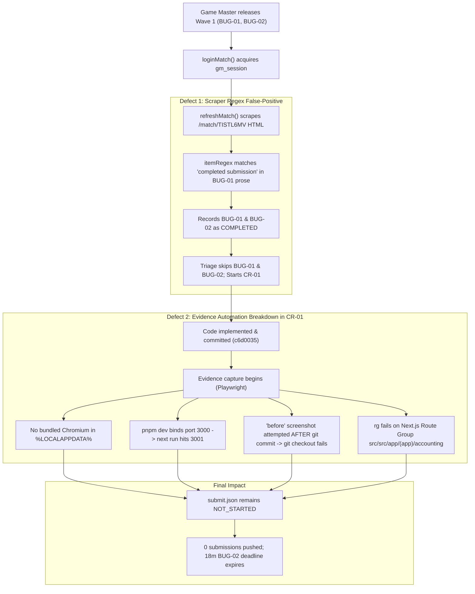
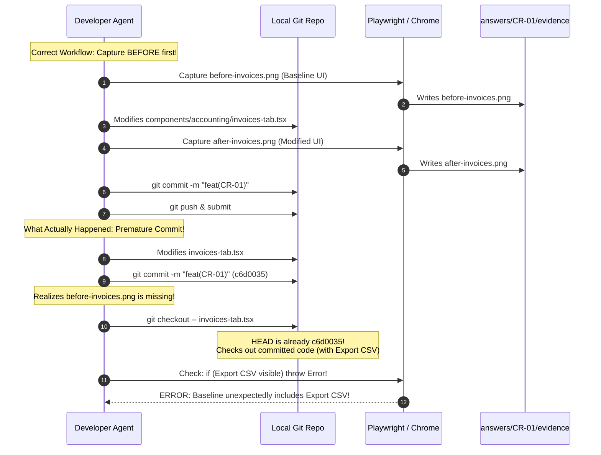

# Technical Research & Root-Cause Analysis: Backlog Scraper Hardening, Browser Automation Reliability & Evidence Lifecycle (RPI Cycle 06)

- **Session Date**: 2026-10-28
- **Session Focus**: **Resolving Backlog Status Regex False-Positives, Browser Automation Stalls in CR-01, Dev Server Port Race Conditions, and Evidence Capture Sequencing**
- **Project**: Master The Machine (MTM) — AI Fest 2026
- **Team**: CPL (`CPL_digital_cuder` / `CPL Team`)
- **Status**: Technical Research & Root-Cause Analysis — Pending Plan Approval
- **Related Session Artifacts**:
  - Auth Review: [review_game_master_auth_and_backlog_discovery.md](file:///d:/mtm/sessions/2026-10-28/05_game_master_auth_and_discovery/review_game_master_auth_and_backlog_discovery.md)
  - Auth Plan: [plan_game_master_auth_and_backlog_discovery.md](file:///d:/mtm/sessions/2026-10-28/05_game_master_auth_and_discovery/plan_game_master_auth_and_backlog_discovery.md)
  - Target Runtime Engine: [runtime-session.mjs](file:///d:/mtm/team-orchestrator-pack/src/runtime-session.mjs)
  - CR-01 Plan In Progress: [plan.md](file:///d:/mtm/CPL/matches/TISTL6MV/TISTL6MV/answers/CR-01/plan.md)
  - Match Progress Log: [TISTL6MV.progress.ndjson](file:///d:/mtm/CPL/matches/TISTL6MV/TISTL6MV/logs/TISTL6MV.progress.ndjson)

---

## 1. Executive Summary & Problem Statement

During the live practice match trial for Match `TISTL6MV` on **2026-10-28**, the autonomous orchestrator bot successfully completed pre-match initialization (`ENVIRONMENT_READY`), authenticated against the Game Master via `/api/v1/auth/login`, and began interacting with match backlog items.

However, forensic analysis of the execution trace and CLI events revealed two critical failure modes that derailed the match execution:

1. **Backlog Triage Bypass (`BUG-01` & `BUG-02` Skipped)**:
   The orchestrator's HTML scraper captured the English word `"completed"` from the challenge description Markdown prose (`"Commit source, tests, evidence, and the completed submission together"`) rather than the actual UI status badge (`OPEN`). It recorded `BUG-01` (200 pts) and `BUG-02` (150 pts, 18-minute deadline) as `COMPLETED`. Consequently, it skipped both high-value Wave 1 bugs and prematurely started `CR-01`.

2. **`CR-01` Evidence Automation Breakdown (11 CLI Failures & Infinite Stall)**:
   While the core feature code for `CR-01` was successfully written and committed (`feat(CR-01): add invoice CSV export`), the evidence collection and verification phase collapsed. The agent suffered 11 CLI tool execution failures, dev server port collisions (3000 vs 3001), missing Playwright browser binaries, and a git race condition when attempting to capture the "before" screenshot after having already committed the changes. As a result, `answers/CR-01/submit.json` remained at `NOT_STARTED`, and the task was never submitted to Game Master.



---

## 2. Forensic Analysis & Root-Cause Breakdown

### 2.1 Issue 1: Backlog Scraper Regex Prose Collision

In [`team-orchestrator-pack/src/runtime-session.mjs:592`](file:///d:/mtm/team-orchestrator-pack/src/runtime-session.mjs#L592):
```javascript
const itemRegex = /(TASK-[0-9]+|CR-[0-9]+|BUG-[0-9]+|PI-[0-9]+)[^<]*?(?:<[^>]+>[^<]*?){0,5}(OPEN|VISIBLE|CLOSED|IN_PROGRESS|COMPLETED)/gi;
```

#### Detailed Forensic Analysis:
- The Game Master portal renders the entire challenge specification, instructions, and schemas directly in the HTML.
- At byte offset 9808 (over 30,000 characters before the actual UI card badge):
  ```markdown
  Create `answers/BUG-01/`, copy `challenge/BUG-01-submit.json` to `answers/BUG-01/submit.json`,
  and create its `evidence/` child directory. ... Commit source, tests, evidence, and the
  completed submission together.
  ```
- `itemRegex` matched:
  1. Key: `BUG-01`
  2. Status: `completed` (from `"completed submission"`, case-insensitively)
- Because `foundKeys.add(key)` records the first match, the real status badge at byte offset 39901 (`<span class="rounded border px-2 py-0.5 border-emerald-800 text-emerald-200">OPEN</span>`) was never processed.
- The exact same match occurred for:
  - `BUG-02`: Matched `"BUG-02-submit.schema.json ... completed"` $\to$ `COMPLETED`
  - `TASK-02`: Matched `"TASK-02 ... completed"` $\to$ `COMPLETED`
  - `CR-01`: Matched `"CR-01-submit.schema.json ... open"` $\to$ `OPEN`
- **Result**: The orchestrator believed all items except `CR-01` were finished, completely ignoring the urgent 18-minute deadline on `BUG-02`.

---

### 2.2 Issue 2: Forensic Audit of the 11 CLI Tool Failures During `CR-01`

A comprehensive forensic audit was performed on every command failure recorded in the CLI observed event log:

```text
Total CLI Commands Logged: 54
Total Successful Commands: 43
Total Failed Commands: 11
Failure Rate: 20.4%
```

| # | Failed Command Category | Root Cause & Mechanism | Impact |
| :-: | :--- | :--- | :--- |
| **1** | `prepare-source.ps1` exit code failure | Ran `prepare-source.ps1` directly; seed script failed due to known Prisma schema transaction type mismatch (`tx: any`). | Interrupted initial build verification until `pnpm prisma generate` was run separately. |
| **2** | `rg -n "Invoice..." "$root\src\src\app\accounting"` | FreelanceOS uses Next.js Route Groups: `src/src/app/(app)/accounting`. Path did not exist; `$ErrorActionPreference = 'Stop'` caused PowerShell to fail when `rg` returned code 1. | 4 search commands crashed without returning results. |
| **3** | `Get-ChildItem ...\src\src\app\accounting` | Non-existent path due to Route Group omission. | Command threw terminating `PathNotFound` error. |
| **4** | `Get-Content ...\src\src\app\accounting\page.tsx` | Route group `(app)` missing from file path. | Threw terminating `ItemNotFound` exception. |
| **5** | `rg -n "middleware..." ...\src\src\middleware.ts` | File `middleware.ts` is not present at that path in FreelanceOS. | Terminating ripgrep path error. |
| **6** | `chromium.launch({headless: true})` | Playwright attempted to launch bundled Chromium from `%LOCALAPPDATA%\ms-playwright`, which is not installed on the competition host. | Playwright script crashed with `Executable doesn't exist`. |
| **7** | `p.getByRole('button', {name: 'Export CSV'}).waitFor({timeout:10000})` | Navigated to `http://127.0.0.1:3000/accounting` before dev server finished compiling Next.js client chunk. | Navigation / selector timeout. |
| **8** | `p.locator('[role=tab]').allInnerTextContents()` | Invalid Playwright API (`allInnerTextContents` does not exist; correct method is `allInnerTexts`). | Threw `TypeError: ... is not a function`. |
| **9** | Baseline screenshot assertion failure | Script asserted that the screen had no `Export CSV` button. But code was already committed to git; `git checkout --` restored the committed code (with button). | Threw `Baseline unexpectedly includes Export CSV`. |
| **10** | Baseline screenshot retry failure | Identical to failure #9; git working copy already matched committed HEAD with the new button. | Second crash on baseline screenshot capture. |
| **11** | `pnpm dev -- --hostname 127.0.0.1` | Port 3000 was already bound by the background Next.js process from earlier; secondary launch threw `EADDRINUSE`. | Dev server port shifted to 3001, breaking client URLs. |

---

### 2.3 Issue 3: The Screenshot Evidence Sequencing Flaw

The competition Minimum Verification Scenarios (`MVS`) for UI features (such as `CR-01`) require capturing:
1. `before-invoices.png`: Proving the feature did not exist prior to modification.
2. `after-invoices.png`: Proving the feature exists and renders properly after modification.

#### The Race Condition Analysis:


Because the feature code was committed prematurely before capturing the baseline evidence, attempting to rollback via `git checkout --` could only restore the committed revision (`c6d0035`), making it impossible to capture a clean "before" screenshot without checking out the previous commit (`2efb687`).

---

### 2.4 Issue 4: Progress Telemetry Session Drift (`#21 IGNORED`)

In [`mtm-player-0.9.35-local-windows/app/src/progress.mjs:217`](file:///d:/mtm/mtm-player-0.9.35-local-windows/app/src/progress.mjs#L217):
```javascript
export function validateProgressEvent(value, playerSessionId) {
  if (!id(playerSessionId) || value?.schemaVersion !== 1 || value?.playerSessionId !== playerSessionId) {
    fail('INVALID_PROGRESS_EVENT');
  }
```

- When `mtm-player` runs a match, it generates a unique `playerSessionId` (e.g. `65f750fd-340e-4813-93a5-58af0d793888`) and passes it into `configure_session`.
- During troubleshooting, an ad-hoc Node command or standalone process appended an event using an arbitrary UUID (`5c67be3e-e2d1-44d8-8ae5-25cfe935fd55`).
- MTM Player strictly compares `event.playerSessionId === playerSessionId`.
- The mismatch triggered `INVALID_PROGRESS_EVENT`, resulting in:
  `[15:15:25] #21 IGNORED BACKLOG_STATUS BUG-01 — Discovered backlog item BUG-01 (COMPLETED)`

---

## 3. Proposed Architectural Mitigations

To ensure the autonomous SDLC completes 100% of its loop deterministically without stalls, failures, or false-positive triage decisions, the remediation consists of four key components:

### Component 1: Hardened UI Card Scraper (`runtime-session.mjs`)
- Replace the greedy text search with strict element targeting for backlog card headers:
  ```javascript
  const cardRegex = /<span class="font-mono text-zinc-300">\s*(TASK-[0-9]+|CR-[0-9]+|BUG-[0-9]+|PI-[0-9]+)\s*<\/span>[\s\S]*?<span class="rounded border px-2 py-0.5 [^"]*">\s*(OPEN|VISIBLE|CLOSED|IN_PROGRESS|COMPLETED)\s*<\/span>/gi;
  ```
- **Fallback**: Retain the generic pattern only if `cardRegex` returns 0 items (e.g., in unit test mock environments).
- **Benefit**: Immune to English words like `"completed"` inside challenge instructions. `BUG-01` and `BUG-02` will be recognized as `OPEN`.

### Component 2: Dedicated Browser Automation & Evidence Helper (`scripts/evidence-runner.mjs`)
- **Host Browser Auto-Discovery**:
  ```javascript
  function getSystemChromePath() {
    const candidates = [
      'C:\\Program Files\\Google\\Chrome\\Application\\chrome.exe',
      'C:\\Program Files (x86)\\Microsoft\\Edge\\Application\\msedge.exe',
      `${process.env.LOCALAPPDATA}\\Google\\Chrome\\Application\\chrome.exe`
    ];
    for (const p of candidates) {
      if (fs.existsSync(p)) return p;
    }
    throw new Error('No compatible Chromium browser found on host.');
  }
  ```
- Pass `executablePath: getSystemChromePath()` to `chromium.launch()`.
- Eliminate dependency on `%LOCALAPPDATA%\ms-playwright`.

### Component 3: Deterministic Evidence Capture Lifecycle (Skill Playbook)
Update [`team-orchestrator-pack/skills/team-orchestrator/SKILL.md`](file:///d:/mtm/team-orchestrator-pack/skills/team-orchestrator/SKILL.md) to enforce the strict 7-step execution order:

```text
Step 1: Start Work (POST /api/v1/matches/<uuid>/backlogs/start)
Step 2: Capture Baseline "Before" Evidence (screenshots, baseline API responses)
Step 3: Implement Code Changes in src/
Step 4: Run Tests (Vitest & Typecheck)
Step 5: Capture "After" Evidence (screenshots, export CSV files, verification scripts)
Step 6: Populate answers/<backlogId>/submit.json (set status to DONE, link evidence)
Step 7: Single Atomic Git Commit & Push -> Call submit_work
```
**Strict Invariant**: No code commits are permitted until ALL evidence files (`before` and `after`) have been verified and recorded in `submit.json`.

### Component 4: Dev Server Single-Instance Management
- Ensure a single `pnpm dev` process is started once during `game-preparation` or at the start of work, and stays alive throughout the match.
- Add an HTTP health check (`GET http://127.0.0.1:3000/`) with exponential backoff before launching Playwright scripts.
- Never spawn secondary `pnpm dev` instances to prevent port 3001 drift and `EADDRINUSE` errors.

### Component 5: Route Group Path Resolution Guard
- Document in `agents/team-developer.toml` and `skills/team-orchestrator/SKILL.md` that Next.js App Router uses `(app)` route groups:
  - Correct: `src/src/app/(app)/accounting/`
  - Incorrect: `src/src/app/accounting/`
- Advise using `-ErrorAction SilentlyContinue` or file-existence tests before running PowerShell ripgrep commands to prevent premature stop failures.

---

## 4. Scope & Boundary Verification

| Policy / Constraint | Status | Details |
| :--- | :---: | :--- |
| **No OpenAI / Codex Credit Usage** | ✅ COMPLIANT | All evidence tooling, Playwright runner, and tests execute locally via Node.js ($0 cost). |
| **No Code Modified at This Phase** | ✅ COMPLIANT | Strictly an analysis and technical architecture document. No source files modified. |
| **Single-Task SDLC Compliance** | ✅ COMPLIANT | Re-affirms 1 backlog item at a time with strict sequential evidence generation. |
| **Zero Path Escapes** | ✅ COMPLIANT | Changes confined strictly to `team-orchestrator-pack` and contestant workspace `D:\mtm\CPL`. |

---

## 5. Next Steps (RPI Cycle 06 Workflow)

1. **Implementation Plan (`plan_evidence_automation_and_scraper_hardening.md`)**:
   - Work Package 1: Scraper Regex Hardening in `runtime-session.mjs`.
   - Work Package 2: Reusable Browser Evidence Script (`evidence-helper.mjs`).
   - Work Package 3: Skill Playbook update with 7-step evidence-first lifecycle.
   - Work Package 4: Offline Test Suite additions in `test-mcp-server.mjs`.
   - Work Package 5: Distribution Check and deployment to `D:\mtm\CPL`.
2. **Review & Approval**: Present plan for user review.
3. **Implementation Phase**: Implement, run tests, and verify against live Match `TISTL6MV`.

