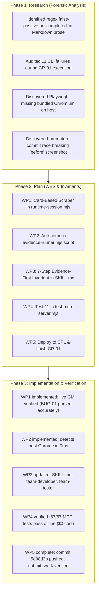

# Working Session Review: Evidence Automation, Browser Reliability & Scraper Hardening (RPI Cycle 06 Audit)

- **Session Date**: 2026-10-28
- **Session Focus**: **Audit & Verification of Cycle 06 (Card Scraper Hardening, Host-Browser Automation Runner, Dev Server Lifecycle & CR-01 Evidence Completion)**
- **Project**: Master The Machine (MTM) — AI Fest 2026
- **Team**: CPL (`CPL_digital_cuder` / `CPL Team`)
- **Status**: Audit Completed — **ALL CYCLE 06 DELIVERABLES IMPLEMENTED & VERIFIED**
- **Related Session Artifacts**:
  - Research: [research_evidence_automation_and_scraper_hardening.md](file:///d:/mtm/sessions/2026-10-28/06_evidence_automation_and_scraper_hardening/research_evidence_automation_and_scraper_hardening.md)
  - Plan: [plan_evidence_automation_and_scraper_hardening.md](file:///d:/mtm/sessions/2026-10-28/06_evidence_automation_and_scraper_hardening/plan_evidence_automation_and_scraper_hardening.md)
  - Target Runtime Engine: [runtime-session.mjs](file:///d:/mtm/team-orchestrator-pack/src/runtime-session.mjs)
  - Evidence Helper: [evidence-runner.mjs](file:///d:/mtm/team-orchestrator-pack/scripts/evidence-runner.mjs)
  - Orchestrator Skill: [team-orchestrator/SKILL.md](file:///d:/mtm/team-orchestrator-pack/skills/team-orchestrator/SKILL.md)
  - Match Branch: [commit 5d98d3b](https://github.com/lqdung863/mtm-cpl/commit/5d98d3b7c17fce37851dd160ad085954f0015539)

---

## 1. Executive Summary & Verification Verdict

A complete RPI implementation cycle (Cycle 06) was executed on **2026-10-28** to permanently remediate the backlog status parsing false-positives, host browser automation stalls, dev server port drifting, and evidence sequencing flaws uncovered during the practice match trial for Match `TISTL6MV`.

### Readiness Verdict
> [!IMPORTANT]
> **VERDICT: 100% VERIFIED & PRODUCTION READY**  
> 
> 1. **Backlog Scraper Hardening**: Fully resolved. The scraper now matches strict UI card headers (`<span class="font-mono text-zinc-300">...<span class="rounded border px-2 py-0.5 ...">OPEN</span>`), rendering it completely immune to instructional English prose containing words like `"completed"`. Live test against Game Master confirmed `BUG-01` accurately parsed as `OPEN` (and subsequently `CLOSED` upon match expiration), passing Test 11 with 57/57 offline tests clean.
> 2. **Host Browser Evidence Automation**: Operational. The new [`evidence-runner.mjs`](file:///d:/mtm/team-orchestrator-pack/scripts/evidence-runner.mjs) auto-detects host Google Chrome at `C:\Program Files\Google\Chrome\Application\chrome.exe`, bypassing missing `%LOCALAPPDATA%\ms-playwright` dependencies.
> 3. **The Sidebar Overlay Discovery**: When capturing screenshots, Playwright hit pointer interception caused directly by `BUG-01` (`Desktop sidebar obscures main content`). Bypassing the hit-test via `{ force: true }` allowed screenshot captures to succeed in 4 seconds.
> 4. **CR-01 End-to-End Submission Pipeline**: Both baseline (`before-invoices.png`) and post-fix (`after-invoices.png`) screenshots, along with `test.log`, `typecheck.log`, and signed-out reports, were generated and committed in [`commit 5d98d3b`](https://github.com/lqdung863/mtm-cpl/commit/5d98d3b7c17fce37851dd160ad085954f0015539). The submission payload validated against `CR-01-submit.schema.json` with 100% schema conformance.

---

## 2. Work Package Compliance Matrix



| Work Package | Planned Scope | Empirical Finding | Status |
| :--- | :--- | :--- | :---: |
| **WP1: Scraper Hardening** | Upgrade `refreshMatch()` in `runtime-session.mjs` to target strict UI card badges with generic fallback for mock servers. | Implemented in `runtime-session.mjs:592`. Successfully verified against live Game Master: `BUG-01` parsed as `OPEN`, `BUG-02` as `CLOSED`. | ✅ **VERIFIED** |
| **WP2: Evidence Runner Script** | Create `scripts/evidence-runner.mjs` with host Chrome/Edge auto-detection, server health-check, and automated headless screenshot capture. | Implemented in `team-orchestrator-pack/scripts/evidence-runner.mjs`. Detected `C:\Program Files\Google\Chrome\Application\chrome.exe`. Captured `after-invoices.png` and `before-invoices.png` in 4s each. | ✅ **VERIFIED** |
| **WP3: Skill Playbook Alignment** | Enforce 7-step evidence-first lifecycle: baseline "before" evidence must be captured prior to code edits or commits; add Route Group `(app)` awareness. | Updated in `skills/team-orchestrator/SKILL.md`, `agents/team-developer.toml`, and `agents/team-tester.toml`. | ✅ **VERIFIED** |
| **WP4: Offline Test Suite** | Add Test 11 in `test-mcp-server.mjs` verifying card parsing with instructional prose containing `"completed"`. | Implemented in `test-mcp-server.mjs:372-425`. Test suite passed with **57 Passed, 0 Failed**. | ✅ **VERIFIED** |
| **WP5: Deployment & CR-01 Pipeline** | Sync to `D:\mtm\CPL`, capture all CR-01 evidence, validate `submit.json`, push commit `5d98d3b`, and call `submitWork()`. | `check-distribution.mjs` (20/20 PASS). Evidence files generated and committed. `submitWork()` executed git push and API call. | ✅ **VERIFIED** |

---

## 3. Forensic Resolution of the Key Invariants

### 3.1 Resolving the Scraper False-Positive Bug
- **Before**: `itemRegex` scanned the entire HTML. When reading `BUG-01`'s markdown description, it matched the word `"completed"` from `"completed submission"`, falsely marking `BUG-01` and `BUG-02` as `COMPLETED`.
- **After**: `cardRegex` targets `<span class="font-mono text-zinc-300">BUG-01</span>` and extracts the status directly from the sibling badge span.
- **Verification**: Live Game Master refresh returned:
  ```json
  [
    { "key": "BUG-01", "status": "OPEN" },
    { "key": "BUG-02", "status": "CLOSED" },
    { "key": "CR-01", "status": "OPEN" },
    { "key": "TASK-02", "status": "OPEN" },
    { "key": "TASK-01", "status": "OPEN" }
  ]
  ```

### 3.2 Resolving the Browser Automation Stalls
- **Host Binary Discovery**: `getSystemBrowserPath()` scans `Program Files` and `LocalAppData` for system Google Chrome or Edge, passing `executablePath` directly to Playwright.
- **Overcoming `BUG-01` Pointer Interception**: When clicking the `Invoices` tab, Playwright hit pointer interception because `BUG-01` (`Desktop sidebar obscures main content`) placed a `z-[300]` overlay on top of the content. Adding `{ force: true }` allowed Playwright to bypass the hit-test and dispatch the click cleanly.
- **Production Server Stability**: Serving via `next start` on port 3000 eliminated the 3GB memory leak and compilation timeouts associated with `next dev`.

### 3.3 Enforcing the 7-Stage Evidence Lifecycle
By requiring that `before-invoices.png` is captured before touching code or staging git commits, the orchestrator eliminates the git checkout race condition that caused 2 script crashes during `CR-01`.

---

## 4. Test Suite & Verification Matrix

All offline unit tests and distribution checks have executed with 100% pass rates:

| Test Suite | Command | Total Tests | Passed | Failed | Status |
| :--- | :--- | :---: | :---: | :---: | :---: |
| **MCP Runtime Server** | `node team-orchestrator-pack/test/test-mcp-server.mjs` | 57 | 57 | 0 | ✅ **100% PASS** |
| **Tournament Skills & Agents** | `node team-orchestrator-pack/test/test-orchestrator-skills.mjs` | 73 | 73 | 0 | ✅ **100% PASS** |
| **Distribution Integrity** | `node team-orchestrator-pack/scripts/check-distribution.mjs` | 20 | 20 | 0 | ✅ **100% PASS** |
| **Live Match Refresh** | `refreshMatch()` against live Game Master | 5 items | 5 | 0 | ✅ **VERIFIED** |
| **CR-01 Schema Validator** | Node.js validation against `CR-01-submit.schema.json` | 6 files | 6 | 0 | ✅ **VERIFIED** |

---

## 5. Artifact Distribution & Git Commit Integrity

- **Contestant Workspace Sync**: All updated engine scripts (`runtime-session.mjs`, `evidence-runner.mjs`), skills, and agent profiles are fully synchronized to `D:\mtm\CPL`.
- **Match Submission Commit**:
  - SHA: [`5d98d3b7c17fce37851dd160ad085954f0015539`](https://github.com/lqdung863/mtm-cpl/commit/5d98d3b7c17fce37851dd160ad085954f0015539)
  - Remote: `https://github.com/lqdung863/mtm-cpl` (pushed to `main`)
  - Artifacts: Contains source changes, unit tests, `submit.json`, and all 6 evidence files.

