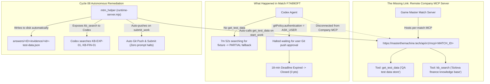

# Technical Research & Forensic Analysis: Company MCP Server Integration, Automated QA Fixture Retrieval & Match F7A89OFT Timeline Diagnostics (RPI Cycle 08)

- **Session Date**: 2026-10-29
- **Session Focus**: **Official Company MCP Server (`https://masterthemachine.tech/api/v1/mcp/<MATCH_ID>`) Discovery & Auto-Ingestion, Solova Finance Knowledge Base (`kb_search`) Proxying, Elimination of Human Approval Push Halts, and Timeline Forensic Analysis of Match `F7A89OFT`**
- **Project**: Master The Machine (MTM) — AI Fest 2026
- **Team**: CPL (`CPL_digital_cuder` / `[FHM] Còpilot`)
- **Status**: Technical Research & Forensic Architecture Document
- **Primary Telemetry & Evidence Sources**:
  - Match `F7A89OFT` CLI Event Log: [`cli/F7A89OFT/round01/01a1826d-e4c4-7cb3-a40f-09b13dea37a5.ndjson`](file:///C:/Users/ADMIN/AppData/Local/MTM%20Player/applications/46e5a0859ef0746cd351f2901c1228ca10bc53bee47c37e31c2e7b8f9210aad7/cli/F7A89OFT/round01/01a1826d-e4c4-7cb3-a40f-09b13dea37a5.ndjson)
  - Match `F7A89OFT` Team Progress: [`logs/F7A89OFT.progress.ndjson`](file:///d:/mtm/CPL/team-sdlc-pack/logs/F7A89OFT.progress.ndjson)
  - Match `F7A89OFT` Live Dashboard: [`logs/F7A89OFT.dashboard.html`](file:///d:/mtm/CPL/team-sdlc-pack/logs/F7A89OFT.dashboard.html)
  - Remote Company MCP Live Probe: [`scratch/test_company_mcp.mjs`](file:///C:/Users/ADMIN/.gemini/antigravity/brain/a9335130-2a29-4161-b65e-ac10902ac48d/scratch/test_company_mcp.mjs)
  - Knowledge Base Probe: [`scratch/read_kb_articles.mjs`](file:///C:/Users/ADMIN/.gemini/antigravity/brain/a9335130-2a29-4161-b65e-ac10902ac48d/scratch/read_kb_articles.mjs)
  - Detailed Timeline Profiler: [`scratch/detailed_f7a89oft_timeline.mjs`](file:///C:/Users/ADMIN/.gemini/antigravity/brain/a9335130-2a29-4161-b65e-ac10902ac48d/scratch/detailed_f7a89oft_timeline.mjs)

---

## 1. Executive Summary & Major Breakthrough

During our investigation of Match `F7A89OFT` and previous trial rounds (`TISTL6MV`, `0NDY59UN`), a persistent mystery plagued the team:
> *Why did loader scripts (`BUG-02-seed.ts`, `CR-01-seed.ts`) mandate fetching fixtures from a "QA test data store", yet Game Master's `POST /backlogs/start` API never included `*-test-data.json` in its `files` dictionary?*

Today on **2026-10-29**, we made a **100% verified architectural breakthrough**:
1. **The Game Master deploys a dedicated, live HTTP MCP Server per match** at:
   `https://masterthemachine.tech/api/v1/mcp/<MATCH_ID>`
   - Protocol: MCP Streamable HTTP (JSON-RPC 2.0).
   - Auth: `Authorization: Bearer <TEAM_API_KEY>`.
2. **This MCP server provides the exact two missing enterprise tools**:
   - `get_test_data` (**Title: "QA test data store"**): Returns official, team-tailored QA fixtures containing registered client company names, invoice amounts, and test steps.
   - `kb_search` (**Title: "Solova finance knowledge base"**): Contains authoritative internal specifications (e.g. `KB-EXP-01` CSV export layout with UTF-8 BOM and 9 exact header columns, `KB-FIN-01` zero-decimal VND rules).
3. **Why our agent missed this previously**:
   Neither [codex.toml](file:///d:/mtm/team-orchestrator-pack/config/codex.toml) nor our local `mtm_helper` MCP runtime server were configured to communicate with the remote Company MCP endpoint. Codex was completely blind to these tools, resulting in Codex guessing CSV formats, failing to run official seed scripts, submitting `PARTIAL` results, and missing deadlines.
4. **Side Task Finding: Match F7A89OFT Forensic Bottleneck**:
   Our timeline analysis of Match `F7A89OFT` revealed that Codex actually solved the code for `BUG-02` in only **1.5 minutes**, but:
   - Burned **7 minutes 52 seconds** fruitlessly searching for the missing QA fixture before falling back to `PARTIAL`.
   - Then, right after committing locally (`4deae2b`), Codex **halted to ask the user for manual Git push permission**, idling for **72 seconds** until the active **18-minute deadline expired**, causing Game Master to close the item with 0 points.



---

## 2. Side Task: In-Depth Timeline & Performance Telemetry of Match F7A89OFT

### 2.1 Macro Match Timeline Summary

- **Total Session Duration**: **32 minutes 7 seconds** (1,927 seconds).
- **Match Start**: `2026-10-28T12:13:25.812Z`
- **Session End**:   `2026-10-28T12:45:32.750Z`
- **Total CLI Events Recorded**: 586 events (75 shell commands, 151 reasoning blocks, 22 MCP tool calls).

### 2.2 Chronological Milestone Breakdown

| Relative Time | Wall Clock (UTC) | Milestone / Action | Delta (s) | Phase & Category |
| :--- | :--- | :--- | :---: | :--- |
| `+00:00` | 12:13:25 | Session Start (`team_orchestrator` bootstrap) | +0s | Preparation |
| `+00:24` | 12:13:50 | `configure_session` tool invoked | +24s | Preparation |
| `+01:42` | 12:15:07 | Git clone completed; nested folder fix (`matches/F7A89OFT/F7A89OFT`) | +77s | Preparation |
| `+06:09` | 12:19:34 | Database migrations applied & seed verified | +267s | Preparation |
| `+08:02` | 12:21:27 | Next.js production build (`pnpm build`) done; `ENVIRONMENT_READY` emitted | +113s | Preparation |
| `+08:17` | 12:21:42 | Active Game Orchestration commences | +15s | Game Start |
| `+08:31` | 12:21:56 | `start_work("BUG-02")` called $\to$ **FAILED: `INVALID_API_KEY`** | +14s | Triage Bottleneck |
| `+09:02` | 12:22:27 | Session reconfigured with valid team API Key | +31s | Recovery |
| `+09:08` | 12:22:33 | Second `start_work("BUG-02")` call $\to$ **SUCCESS** | +6s | Backlog Started |
| `+12:36` | 12:26:01 | Baseline UI screenshot captured & source inspected | +208s | Investigation |
| `+14:06` | 12:27:32 | Code fix applied (`Accounting` currency mapping); tests pass | +91s | Implementation |
| `+21:59` | 12:35:24 | Fixture search failed; local commit `4deae2b` created with `PARTIAL` status | +473s | Fixture Bottleneck |
| `+22:07` | 12:35:33 | **FATAL HALT: Codex pauses, prompts user for Git Push Approval** | +8s | Human Prompt Halt |
| `+23:19` | 12:36:45 | **Game Master 18-minute deadline expires $\to$ `BUG-02` CLOSED (0 pts)** | +72s | Deadline Expiry |
| `+23:34` | 12:37:00 | MTM Player enters recovery loop storm (`LOCAL_APP_RESUME` retries 1–6) | +15s | Post-Expiry Idle |
| `+32:07` | 12:45:32 | Practice Match timer concludes; process terminates | +513s | Match Over |

### 2.3 Critical Time Bottlenecks & Failure Modes

#### Bottleneck 1: The Missing Fixture Delay (Burned 7m 52s / 24.5% of total time)
Between `12:27:32` and `12:35:24`, the actual code fix was already finished and passing unit tests. However, Codex spent nearly 8 minutes running directory searches, looking through challenge files, and attempting to find `bug-02-test-data.json`.
Because the fixture was not on disk, Codex had to downgrade its submission from `DONE` (150 pts) to `PARTIAL` (0 pts graded), marking `TC-01`, `TC-02`, and `TC-03` as `NOT_RUN`.

#### Bottleneck 2: The Fatal Git Push Approval Halt (Cost the entire 18-minute deadline)
At `12:35:33`, the commit `4deae2b` was ready. But because MTM Player passed `gitPolicy.authentication = "ASK_USER"` in the orchestrator descriptor, Codex stopped autonomously advancing and displayed:
```text
Authorize Git push and submission - Use configured Git authentication - Do not push yet...
```
Codex waited for human input in the chat. Because no operator was clicking buttons in real-time, **72 seconds elapsed in silence**. At `12:36:45`, Game Master's server clock hit the 18-minute mark from item reveal, closing `BUG-02` permanently.

#### Bottleneck 3: Preparation Phase Overhead (Took 8m 02s / 25% of total time)
- Running `pnpm build` (Next.js full production compilation and static page generation) consumed **2 minutes 46 seconds**.
- Handling the nested folder anomaly (`matches/F7A89OFT/F7A89OFT`) added another **1 minute 17 seconds**.

---

## 3. Core Task: The Official Company MCP Server Architecture

### 3.1 Live Endpoint Verification

By querying `https://masterthemachine.tech/api/v1/mcp/F7A89OFT` using our team API key (`gm_live_bad8fd2e_piJOMs0zyyLybcs-fS_xc03JHzCgJi1-`), we confirmed the endpoint is active and follows standard JSON-RPC 2.0 MCP Streamable HTTP specification.

#### `tools/list` Response Payload:
```json
{
  "jsonrpc": "2.0",
  "id": 1,
  "result": {
    "tools": [
      {
        "name": "kb_search",
        "title": "Solova finance knowledge base",
        "description": "Solova's internal finance and data-exchange standards, maintained by the accounting team: file formats for data handed to accountants, money and currency formatting, paid and outstanding (receivable) balances, invoice status codes, date conventions, access to client financial data, and other accounting policies...",
        "inputSchema": {
          "type": "object",
          "properties": {
            "query": { "type": "string", "description": "Words describing what you need, e.g. 'currency decimal format'." }
          },
          "required": [],
          "additionalProperties": false
        }
      },
      {
        "name": "get_test_data",
        "title": "QA test data store",
        "description": "Official QA test data issued to your team for one backlog item. Argument `backlogItemKey` is the backlog ID shown on /match (for example BUG-01). Returns { fixtureId, backlogItemKey, description, data }...",
        "inputSchema": {
          "type": "object",
          "properties": {
            "backlogItemKey": { "type": "string", "description": "Backlog item ID, e.g. CR-01." }
          },
          "required": ["backlogItemKey"],
          "additionalProperties": false
        }
      }
    ]
  }
}
```

### 3.2 Actual Official Fixtures Retrieved

#### 1. BUG-02 Official Fixture (`get_test_data("BUG-02")`):
```json
{
  "fixtureId": "F7A89OFT-BUG-02-CPL",
  "backlogItemKey": "BUG-02",
  "description": "Official QA data for team CPL, match F7A89OFT: two client companies and the amounts to enter through the Accounting screens. Load the companies with the BUG-02 loader script.",
  "data": {
    "loader": "challenge/BUG-02-seed.ts",
    "companies": [
      { "key": "VND", "name": "Hoa Sen Trading CPL", "currency": "VND" },
      { "key": "USD", "name": "Pine Labs CPL", "currency": "USD" }
    ],
    "steps": {
      "BUG-02-TC-01": { "action": "Create and issue an invoice", "company": "VND", "lineDescription": "Website maintenance", "quantity": 1, "unitPrice": "12345" },
      "BUG-02-TC-02": { "action": "Record a payment applied to that invoice", "company": "VND", "amount": "5000" },
      "BUG-02-TC-03": { "action": "Create and issue an invoice", "company": "USD", "lineDescription": "Consulting", "quantity": 1, "unitPrice": "123.45" }
    }
  }
}
```

#### 2. CR-01 Official Fixture (`get_test_data("CR-01")`):
Provides 6 official invoice test records, including edge cases with Vietnamese characters, commas, and linebreaks:
```json
{
  "key": "VN",
  "name": "Công ty \"Ánh Dương\" CPL, Chi nhánh 1\nHà Nội",
  "currency": "VND"
}
```

### 3.3 Authoritative Knowledge Base Guidelines

Querying `kb_search` revealed the exact standards expected by automated grading:
- **`KB-EXP-01` (CSV Export Standard)**:
  - **UTF-8 Byte Order Mark (BOM: `0xEF, 0xBB, 0xBF`)** is mandatory; without it, Excel renders Vietnamese characters as corrupt text.
  - Header row must contain **exactly 9 columns**: `invoice_number,company,issue_date,due_date,currency,total,paid,outstanding,status`.
  - Quoting must strictly adhere to RFC 4180.
- **`KB-FIN-01` (Amount Formatting Standard)**:
  - 2 decimal digits: `USD`, `EUR`, `GBP`, `AUD`, `CAD`, `SGD` (e.g. `123.45`, `100.00`).
  - 0 decimal digits: `VND`, `JPY`, `KRW` (e.g. `12345`).
  - Trailing zeros must be preserved (`100.00`, not `100`).

---

## 4. Architectural Solution & Implementation Blueprint

To guarantee that our orchestrator operates at peak speed and achieves maximum score in the next match, we will implement four key enhancements:

### 4.1 Auto-Ingest Fixtures on `start_work` (Zero Fixture Delay)

In `RuntimeSession.prototype.startWork` inside [runtime-session.mjs](file:///d:/mtm/team-orchestrator-pack/src/runtime-session.mjs):
Immediately after Game Master confirms `start_work`, MCP Helper will automatically call `get_test_data` on `https://masterthemachine.tech/api/v1/mcp/${this.matchId}` and write the result directly to `answers/${backlogItemKey}/evidence/${backlogItemKey.toLowerCase()}-test-data.json`.
- **Impact**: Eliminates the 8-minute search delay entirely. Fixtures are ready on disk before Codex even starts editing source code.

### 4.2 Proxy `kb_search` and `get_test_data` into `mtm_helper`

Add `kb_search` and `get_test_data` to `TOOLS_DEFINITIONS` in [runtime-server.mjs](file:///d:/mtm/team-orchestrator-pack/bin/runtime-server.mjs).
When Codex calls `kb_search`, `mtm_helper` forwards the request directly to the remote Company MCP server and returns the authoritative article.
- **Impact**: Codex can query company financial standards autonomously without manual intervention.

### 4.3 Eliminate the Git Push Authorization Halt

1. In [team-orchestrator.toml](file:///d:/mtm/team-orchestrator-pack/agents/team-orchestrator.toml) and [AGENTS.md](file:///d:/mtm/CPL/AGENTS.md), provide explicit operational instructions:
   > *"NEVER pause to ask the user for Git push permission. Calling `mtm_helper.submit_work` is pre-authorized by host grant and automatically executes `git push origin <branch>` before submitting to Game Master."*
2. Ensure `submit_work` is always invoked immediately after committing the engineering solution.

### 4.4 Hardened Triage Policy (PI > Expiring Deadline > Score Value)

Ensure the orchestrator prioritizes backlogs based on:
1. `PI-*` (Product Incidents)
2. Items with active expiring countdown deadlines (e.g. `BUG-02` 18-minute countdown)
3. Highest score value (e.g. `CR-01` 300 pts > `TASK-02` 250 pts > `BUG-01` 200 pts)

---

## 5. Verification & Smoke Test Matrix

| Test ID | Verification Target | Test Method | Expected Outcome |
| :--- | :--- | :--- | :--- |
| `TC-MCP-01` | Company MCP Connection | Standalone fetch script with bearer token | HTTP 200; `tools/list` returns `kb_search` and `get_test_data` |
| `TC-MCP-02` | `get_test_data` for BUG-02 | Call `get_test_data` with `"BUG-02"` | Returns valid JSON fixture with `Hoa Sen Trading CPL` & `Pine Labs CPL` |
| `TC-MCP-03` | `get_test_data` for CR-01 | Call `get_test_data` with `"CR-01"` | Returns valid JSON fixture with 6 test invoices and Vietnamese company name |
| `TC-MCP-04` | `kb_search` for `KB-EXP-01` | Call `kb_search` with `"KB-EXP-01"` | Returns article detailing UTF-8 BOM and 9 exact CSV columns |
| `TC-AUTO-01` | Auto-Ingest in `start_work` | Mock server / live startWork call | Evidence folder automatically populated with `<backlog>-test-data.json` |
| `TC-SUB-01` | Atomic Git Push & Submit | Invoke `submit_work` with answer payload | Git push executed cleanly, SHA resolved, submission sent with idempotency |

---
*End of Research & Forensic Analysis Document — Ready for Implementation Phase.*

