# Technical Research & Forensic Analysis: Speed Optimization, Deadline Expiration Diagnostics (Match JKYY7G0C) & Infinite Recovery Loop Elimination (RPI Cycle 09)

- **Session Date**: 2026-10-29
- **Session Focus**: **Forensic Latency Diagnostics of Match `JKYY7G0C` (BUG-02), Identification of Fatal Speed Bottlenecks (Heavy Next.js Production Build, Multi-Instance Playwright Overhead, Dual-Agent Security Review Latency), and Architectural Elimination of the Infinite MTM Player Recovery Loop**
- **Project**: Master The Machine (MTM) — AI Fest 2026
- **Team**: CPL (`CPL_digital_cuder` / `[FHM] Còpilot`)
- **Status**: Technical Research & Forensic Architecture Document
- **Primary Telemetry & Evidence Sources**:
  - Match `JKYY7G0C` Codex Session Log: [`C:\Users\ADMIN\.codex\sessions\2026\10\29\rollout-2026-10-29T10-11-06-01a185a3-cad7-73f3-8814-621f0bccda57.jsonl`](file:///C:/Users/ADMIN/.codex/sessions/2026/10/29/rollout-2026-10-29T10-11-06-01a185a3-cad7-73f3-8814-621f0bccda57.jsonl)
  - Match `JKYY7G0C` Reviewer Session Log: [`C:\Users\ADMIN\.codex\sessions\2026\10\29\rollout-2026-10-29T10-11-06-01a185a3-cc1e-7bd1-9044-58613d550d21.jsonl`](file:///C:/Users/ADMIN/.codex/sessions/2026/10/29/rollout-2026-10-29T10-11-06-01a185a3-cc1e-7bd1-9044-58613d550d21.jsonl)
  - Match `JKYY7G0C` Progress Log: [`d:\mtm\CPL_2\team-sdlc-pack\logs\JKYY7G0C.progress.ndjson`](file:///d:/mtm/CPL_2/team-sdlc-pack/logs/JKYY7G0C.progress.ndjson)
  - Match `JKYY7G0C` Completed Answers: [`d:\mtm\CPL_2\matches\JKYY7G0C\JKYY7G0C\answers\BUG-02\submit.json`](file:///d:/mtm/CPL_2/matches/JKYY7G0C/JKYY7G0C/answers/BUG-02/submit.json)
  - MTM Player Session Control Engine: [`d:\mtm\mtm-player-0.9.35-local-windows\app\src\session-control.mjs`](file:///d:/mtm/mtm-player-0.9.35-local-windows/app/src/session-control.mjs)
  - MTM Player CLI Supervisor: [`d:\mtm\mtm-player-0.9.35-local-windows\app\src\cli-supervisor.mjs`](file:///d:/mtm/mtm-player-0.9.35-local-windows/app/src/cli-supervisor.mjs)

---

## 1. Executive Summary & Problem Statement

In Match `JKYY7G0C` (today, 2026-10-29), the autonomous single-orchestrator team made major engineering progress:
1. **Official QA Fixture Auto-Ingested**: Unlike previous matches, the Company MCP integration worked seamlessly (`4c622c7f` fetched official test data `answers/BUG-02/evidence/bug-02-test-data.json`).
2. **100% Functional Quality**: All three currency scenarios (VND Invoice `tc-01`, VND Payment `tc-02`, USD Invoice `tc-03`), the database seed, and the existing Vitest suite (`test.log`) were fully implemented and passed.
3. **The Catastrophic Failure**: The submission arrived at the Game Master at **10:41:03** (~19 minutes 26 seconds into the task), but the strict countdown timer on `BUG-02` had an ~18-minute deadline. The Game Master rejected the submission with `BACKLOG_ITEM_CLOSED` (0 points awarded).
4. **The Secondary Breakdown (Infinite Recovery Loop)**: Following the rejection, the system was trapped in an infinite restart loop between `mtm-player` and `codex` across **10+ attempts**, idling the team while 600 points (`CR-01`: 300 pts, `BUG-01`: 200 pts, `TASK-02`: 100 pts) remained open and unworked.

**Core Research Question**: *How do we structurally compress task turnaround from ~19.5 minutes down to 5–7 minutes, and eliminate the post-failure recovery deadlock so the orchestrator never idles during a live match?*

---

## 2. Match JKYY7G0C Forensic Timeline (BUG-02)

```mermaid
gantt
    title Match JKYY7G0C: BUG-02 Latency Breakdown (Total 19m 26s vs 18m Deadline)
    dateFormat HH:mm:ss
    axisFormat %H:%M

    section Setup & Baseline
    Start Work & Fixture Ingest   :a1, 10:21:37, 10:22:15
    Baseline Screenshot (Ad-hoc)  :a2, 10:22:15, 10:23:06

    section Code Changes
    Inspect & Edit React Forms   :b1, 10:23:06, 10:30:00

    section UI Evidence Runs
    TC-01 VND Invoice Capture    :c1, 10:30:00, 10:32:38
    TC-02 VND Payment Capture    :c2, 10:32:38, 10:33:13
    TC-03 Failed Run & Debug     :c3, 10:33:13, 10:34:55
    TC-03 Retry & Currency Report:c4, 10:34:55, 10:36:25

    section Verification & Build
    Vitest Test Suite Run        :d1, 10:36:25, 10:37:25
    Full Next.js pnpm build      :crit, d2, 10:37:33, 10:38:47

    section Commit & Submit
    Ajv Validation & Git Commit  :e1, 10:38:47, 10:40:55
    submit_work MCP Call         :e2, 10:40:55, 10:41:03
    Game Master REJECTED (Closed):crit, 10:41:10, 10:41:10
```



### Exact Timestamp Table

| Start Time | Duration | Activity | Telemetry Source | Bottleneck Severity |
|---|---|---|---|---|
| 10:21:37 | 00m 38s | `start_work` accepted; Company MCP auto-ingested `bug-02-test-data.json` | `progress.ndjson` L6-L11 | **Optimal** |
| 10:22:15 | 00m 51s | Wrote & ran Playwright script for `before-accounting.png` | `cad7` Ordinal 180-210 | Moderate |
| 10:23:06 | 06m 54s | Analyzed `invoices-tab.tsx` & `payments-tab.tsx`; patched currency factors | `invoices-tab.tsx` mtime | Expected |
| 10:30:00 | 02m 38s | Seeded DB (`seed-bug02.ts`) & captured TC-01 (`tc-01-vnd-invoice.png`) | `cad7` Ordinal 420-470 | Moderate |
| 10:32:38 | 00m 35s | Captured TC-02 (`tc-02-vnd-payment.png`) | `cad7` Ordinal 480-510 | Fast |
| 10:33:13 | 01m 42s | Ran TC-03: crashed with `Error: USD invoice not issued at expected total` | `cad7` Ordinal 553 | **High (Flaky Tab)** |
| 10:34:55 | 01m 30s | Generated `currency-report.txt`; rewrote `.check-tc03.mjs` with retries; pass | `cad7` Ordinal 588 | High |
| 10:36:25 | 01m 00s | Ran `BUG-02-run-checks.mjs` (Vitest `pnpm test` exited 0) | `cad7` Ordinal 596 | Fast |
| **10:37:33** | **01m 14s** | **Ran full production build `pnpm build` (`next build`)** | `cad7` Ordinal 604-618 | **CRITICAL TRAP** |
| 10:38:47 | 02m 08s | Checked Ajv schema, inspected git diff, performed `git commit` | `cad7` Ordinal 625-660 | Moderate |
| 10:40:55 | 00m 08s | Invoked `tools.mcp__mtm_helper__submit_work({ backlogItemKey: 'BUG-02' })` | `cad7` Ordinal 666 | Normal |
| **10:41:10** | — | **Game Master responded with HTTP 400: `BACKLOG_ITEM_CLOSED`** | `progress.ndjson` L18 | **DEADLINE EXPIRED** |

---

## 3. The 4 Root Latency Drivers

### 3.1 Bottleneck 1: Next.js Production Build Trap (Cost: ~134 seconds)
At **10:37:33**, with the countdown clock already in the red zone ($< 3$ minutes remaining), Codex executed `& pnpm build`.
- On Windows, `next build` takes ~75s of pure compilation + ~30s of stdio polling and token processing.
- The build succeeded with 0 errors, but **consumed the exact margin of error** needed to beat the clock.
- **Rule Violation**: `team-orchestrator/SKILL.md` explicitly warns:
  > *"DO NOT run full pnpm build repeatedly during development iterations. Next.js production bundling takes 74s to 130s and burns critical match clock."*
  Executing it even once at pre-submission was lethal.

### 3.2 Bottleneck 2: Multi-Instance Ad-Hoc Playwright Scripts (Cost: ~5.2 minutes)
Instead of executing a consolidated test runner:
1. Codex spawned **3 separate Chromium processes**:
   - Instance 1: Baseline screenshot (`before-accounting.png`)
   - Instance 2: TC-01 & TC-02 (`tc-01-vnd-invoice.png`, `tc-02-vnd-payment.png`)
   - Instance 3: TC-03 (`tc-03-usd-invoice.png`)
2. Each Chrome spawn incurred a 10–15s cold start.
3. TC-03 failed because the Next.js tab transition did not emit a traditional page load event, requiring an interactive selector retry that cost an additional 2.5 minutes.

### 3.3 Bottleneck 3: Dual-Agent Turn Latency (Cost: ~4.0 minutes)
In `codex-app-server.mjs`:
```javascript
const config = { ... , approvalPolicy: 'on-request', approvalsReviewer: 'auto_review', sandbox: 'danger-full-access' };
```
Because `approvalsReviewer: 'auto_review'` was active:
- Every PowerShell command executed by Codex paused the main thread.
- The supervisor dispatched the command to a secondary thread (`01a185a3-cc1e...`) to perform safety evaluation.
- The reviewer generated `{"outcome": "allow"}` after ~5–7 seconds.
- Across **44 separate tool calls**, the orchestrator spent $\approx 240\text{ seconds}$ simply waiting for its own automated reviewer.

### 3.4 Bottleneck 4: The Infinite Recovery Loop Deadlock
Once the submission was rejected:
```
10:41:10 - Game Master: BACKLOG_ITEM_CLOSED
10:41:38 - Codex logs BLOCKED in progress.ndjson and exits turn (IDLE).
10:41:40 - MTM Player sees match IN_PROGRESS but agent IDLE -> Triggers RESUME_GAME (Attempt 1).
10:42:00 - Codex receives RESUME_GAME: Prompt says "Recover only the phase specified in this frame".
10:42:30 - Codex checks BUG-02 on portal -> still CLOSED -> Codex exits turn (IDLE).
10:42:32 - MTM Player triggers RESUME_GAME (Attempt 2)...
... Repeats endlessly through Attempt 10+
```
**The Missing Invariant**: `team-recovery/SKILL.md` lacked an explicit **Hand-off Rule**: When an item is confirmed permanently `CLOSED` or rejected, the agent must **never stop idle**. It must immediately transition to `team-orchestrator` active mode, call `refresh_match()`, and call `start_work("CR-01")`.

---

## 4. Past Match Benchmark: `F7A89OFT` vs `JKYY7G0C`

| Factor | Match `F7A89OFT` (2026-10-28) | Match `JKYY7G0C` (Today) |
|---|---|---|
| **Backlog Item** | `BUG-02` (200 pts) | `BUG-02` (200 pts) |
| **Duration** | **9 min 03 sec** | **19 min 26 sec** |
| **Quality Status** | `PARTIAL` | `DONE` (Full Pass) |
| **Submission Result** | **ACCEPTED (Points Earned)** | **REJECTED (0 Points)** |
| **Evidence Strategy** | Baseline + Accounting UI + `test.log` | Baseline + 3 UI Screenshots + Report + `test.log` |
| **Pre-submit Build** | Fast check | Heavy `pnpm build` (134s) |

**Key Scoring Insight**:
> In MTM competitive scoring, an 80% `PARTIAL` submission within the deadline earns points and preserves momentum. A 100% `DONE` submission that lands 10 seconds past the deadline scores **zero**.

---

## 5. Architectural Blueprint for 5–7 Minute SDLC

```
[Wave 1 Start: 00:00]
        │
        ▼ (30s)
[Single-Pass Baseline & Fixture Setup]
        │ (pnpm tsx prisma/seed-<id>.ts & fast baseline screenshot)
        ▼ (3m 00s)
[Minimal Diff Code Fix]
        │ (invoices-tab.tsx & payments-tab.tsx)
        ▼ (10s)
[Fast-Check Gate (STRICT: NO pnpm build)]
        │ (pnpm typecheck ~4s + pnpm vitest run ~3s = 7.2s)
        ▼ (1m 15s)
[Single-Pass Consolidated Evidence Runner]
        │ (1 Chrome process: Login once -> TC1 -> TC2 -> TC3 -> close)
        ▼ (45s)
[Atomic Compound Commit & Submit]
        │ (git add + git commit + submit_work in ONE compound call)
        ▼
[ACCEPTED: ~5m 40s Total Turnaround]
```

### The 4 High-Velocity Engineering Invariants:

1. **The Fast-Check Invariant**:
   - `pnpm typecheck` (4.2s) + targeted `vitest` (3.1s) verify syntax, types, and logic in **under 8 seconds**.
   - Running full `pnpm build` is **strictly prohibited** if remaining deadline is $\le 5$ minutes.

2. **The Single-Pass Evidence Invariant**:
   - Eliminate ad-hoc `.mjs` scripts.
   - Use a single, robust Playwright script with explicit `page.waitForSelector('[role="tab"][aria-selected="true"]')` and single browser lifecycle.

3. **Compound Execution Invariant**:
   - Chain Git commands into single compound executions:
     `git add ... && git commit -m ... && node submit.mjs`
   - Reduces LLM turns from 5 down to 1 (saves ~2.5 minutes of network round-trips).

4. **The Instant Recovery Pivot Invariant**:
   - In `team-recovery/SKILL.md`: If an item returns `BACKLOG_ITEM_CLOSED`, mark `BLOCKED` in `progress.ndjson` and **immediately** call `refresh_match()` and `start_work("CR-01")` in the **same turn**. Never go idle.

