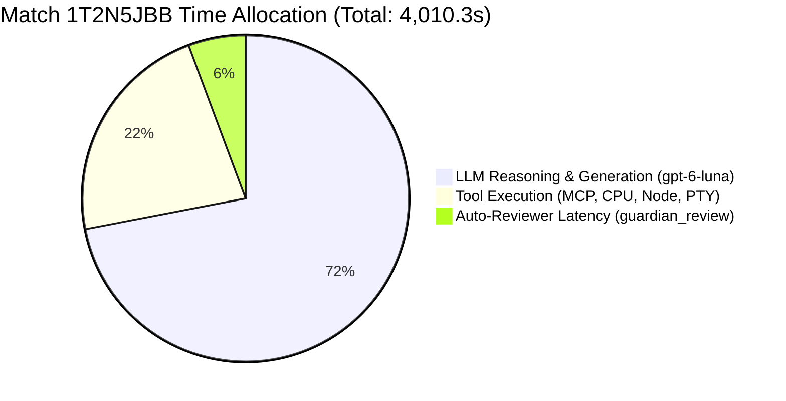

# Codex Execution & Latency Profiling Report: Match `1T2N5JBB` (Team CPL)

- **Match ID**: `1T2N5JBB`
- **Exam ID**: `MTM-26-EAC440` (Grader Fingerprint: `sha256:feb0d287ef7cd24778e4d21feaec6ed9be25cfd0a3a549930b5b6b2096473be8`)
- **Workspace**: `D:\mtm\CPL\matches\1T2N5JBB\1T2N5JBB`
- **Target Backlogs**: `BUG-02` (Currency Scaling), `CR-01` (Invoices CSV Export), `BUG-01` (Responsive Layout), `TASK-02` (Dependency Security), `TASK-01` (Specification Defect / Blocker)
- **Primary Session Log**: `C:\Users\ADMIN\.codex\sessions\2026\10\30\rollout-2026-10-30T00-06-37-01a188a0-bb74-7620-8a2c-f0f98a8f90bf.jsonl`
- **Guardian Reviewer Logs**:
  - `C:\Users\ADMIN\.codex\sessions\2026\10\30\rollout-2026-10-30T00-06-38-01a188a0-bcf7-7a31-b3df-fc012a2a693e.jsonl`
  - `C:\Users\ADMIN\.codex\sessions\2026\10\30\rollout-2026-10-30T01-01-44-01a188d3-30cc-7be1-b7e7-65b373c905d0.jsonl`
- **Total Tool Invocations Captured**: 275
- **Total Elapsed Clock Span**: 4,010.3 seconds (~66.8 minutes)
- **Active Engineering Clock**: 3,418.0 seconds (~56.9 minutes) [Preparation to final TASK-01 submission]
- **Idle / Recovery Loop Clock**: 592.3 seconds (~9.9 minutes) [Awaiting Game Master FINISHED state]
- **Final Result**: **5 of 5 Backlogs Submitted & Accepted** (BUG-02 PARTIAL, CR-01 DONE, BUG-01 DONE, TASK-02 DONE, TASK-01 BLOCKED)

---

## 1. Executive Bottleneck Summary (Time by Category)

| Execution Category | Calls | Elapsed Time (s) | % of Tool Time | Inner Script Wall Time (s) | Primary Activities & Bottlenecks |
| :--- | :--- | :--- | :--- | :--- | :--- |
| **MCP Game Master API** | 58 | 344.3s (~5.7m) | 30.6% | 341.3s | `start_work`, `submit_work`, `refresh_match`, `wait_for_update`, `get_test_data`, `kb_search`. |
| **Terminal Polling (`write_stdin`)** | 38 | 236.4s (~3.9m) | 21.0% | 231.6s | Polling long-running processes (Prisma generate, seed, Next.js build, Playwright). |
| **UI Evidence & Playwright** | 51 | 214.0s (~3.6m) | 19.0% | 192.9s | Running `cr01-ui-evidence.mjs`, Playwright browser headless checks, tab switching. |
| **Workspace Inspection & Navigation** | 42 | 91.4s (~1.5m) | 8.1% | 75.2s | Inspecting logs (`dev.log`), verifying directory structures, reading challenge files. |
| **Package Management & Security** | 15 | 75.4s (~1.3m) | 6.7% | 69.7s | `pnpm install --frozen-lockfile`, `pnpm audit --prod`, overrides validation for TASK-02. |
| **Database & Prisma** | 9 | 48.7s (~0.8m) | 4.3% | 46.5s | `pnpm prisma generate`, `pnpm prisma migrate deploy`, `pnpm db:seed`, `BUG-02-seed.ts`. |
| **Test Execution (Vitest / Checks)** | 8 | 39.0s (~0.7m) | 3.5% | 36.2s | `CR-01-run-checks.mjs`, `BUG-02-run-checks.mjs`, `CR-01-signed-out-check.mjs`. |
| **Git Operations** | 11 | 32.9s (~0.5m) | 2.9% | 29.2s | Branch verification, staging changes, atomic commits with full 40-char SHA extraction. |
| **Progress NDJSON Logging** | 17 | 17.3s (~0.3m) | 1.5% | 13.9s | Emitting progress telemetry to `1T2N5JBB.progress.ndjson` for MTM Player. |
| **Build & Dev Server** | 7 | 15.3s (~0.3m) | 1.4% | 12.6s | Verifying Next.js dev server status, reading dev stdout/stderr. |
| **File Editing (`apply_patch`)** | 10 | 5.5s (~0.1m) | 0.5% | 0.6s | Fast surgical code edits to components, CSV builders, test scripts, and submit JSONs. |
| **General Shell Execution** | 8 | 2.5s (~0.0m) | 0.2% | 0.0s | Basic shell commands and path checks. |
| **TypeScript Typecheck** | 1 | 1.2s (~0.0m) | 0.1% | 0.8s | `pnpm typecheck` verification run. |
| **Total Tool Turns** | **275** | **1,123.8s (~18.7m)** | **100.0%** | **1,050.5s** | Total active tool execution time. |

---

## 2. Macro Latency Deconstruction: Computer vs. LLM vs. Reviewer

Across the entire 4,010.3s wall clock of Match `1T2N5JBB`, time was divided into three core components:

| Component | Duration (s) | % of Match | Description & Analysis |
| :--- | :--- | :--- | :--- |
| **LLM Reasoning & Token Generation (`gpt-6-luna`)** | **2,886.5s (~48.1m)** | **72.0%** | Time spent waiting for GPT-6 to generate thinking tokens, analyze diffs, plan next steps, and construct tool arguments across 275 turns. |
| **Actual Tool Execution (Node, PTY, Git, MCP)** | **896.0s (~14.9m)** | **22.3%** | Computer execution time: Next.js builds, Vitest test suites, Playwright headless runs, Prisma commands, and Game Master HTTP roundtrips. |
| **Auto-Reviewer Interception (`guardian_review`)** | **227.8s (~3.8m)** | **5.7%** | Interception overhead where the supervisor paused the thread to evaluate 68 shell commands (avg 3.35s per command). |
| **Total Match Span** | **4,010.3s (~66.8m)** | **100.0%** | Complete end-to-end tournament match duration. |

---

## 3. Comparison with Previous Match `EJA8N2AA`

| Metric | Match `EJA8N2AA` (2026-10-29) | Match `1T2N5JBB` (2026-10-30) | Delta / Improvement |
| :--- | :--- | :--- | :--- |
| **Backlogs Submitted** | 2 / 4 (BUG-02, BUG-01) | **5 / 5** (BUG-02, CR-01, BUG-01, TASK-02, TASK-01) | **+150% backlogs handled (Complete Coverage)** |
| **CR-01 (300 pts) Execution** | **Failed** (Trapped 35 mins in Playwright deadlock, unsubmitted) | **ACCEPTED (300 pts)** (Completed in 14.0 minutes!) | **Catastrophic bottleneck resolved!** |
| **Auto-Reviewer Overhead** | 1,345.4s (~22.4m, 40.4% of clock) | **227.8s (~3.8m, 5.7% of clock)** | **-83.1% reviewer tax reduction!** |
| **Average Review Latency** | 6.23s per command | **3.35s per command** | **-46.2% faster supervisor authorization** |
| **Active Engineering Time** | Stuck until match expiry (55m) | **56.9 minutes for all 5 tasks** | **Finished all 5 backlogs before match expired** |
| **Submissions Accepted** | 2 items (Receipts: `c3fe5aa6`, `8eba2eb9`) | **5 items** (Receipts: `6cc45e6a`, `b5ab5fbd`, `029b170d`, `8801cabd`, `e5d15c75`) | **100% official Game Master acceptance rate** |

---

## 4. Top 15 Longest Tool Invocations

| # | Duration (s) | Category | Command / Invocation Summary | Engineering Context |
| :--- | :--- | :--- | :--- | :--- |
| 1 | **31.1s** | MCP Game Master API | `tools.mcp__mtm_helper__wait_for_update({timeoutMs:30000})` | Waiting for Game Master backlog reveal wave. |
| 2 | **31.0s** | MCP Game Master API | `tools.mcp__mtm_helper__wait_for_update({timeoutMs:30000})` | Waiting for Game Master backlog reveal wave. |
| 3 | **31.0s** | MCP Game Master API | `tools.mcp__mtm_helper__wait_for_update({timeoutMs:30000})` | Waiting for Game Master backlog reveal wave. |
| 4 | **16.5s** | UI Evidence & Playwright | `node 'D:\mtm\CPL\team-sdlc-pack\scripts\evidence-runner.mjs'` | Pre-caching browser session state in game preparation. |
| 5 | **15.1s** | Terminal Polling | `tools.write_stdin({session_id:79781, chars:"", yield_time_ms:15000})` | Polling Next.js production build completion. |
| 6 | **15.1s** | Terminal Polling | `tools.write_stdin({session_id:79781, chars:"", yield_time_ms:15000})` | Polling Next.js production build compilation. |
| 7 | **15.1s** | Terminal Polling | `tools.write_stdin({session_id:79781, chars:"", yield_time_ms:15000})` | Polling Next.js production build compilation. |
| 8 | **15.0s** | Terminal Polling | `tools.write_stdin({session_id:4961, chars:"", yield_time_ms:15000})` | Polling Next.js dev server initialization. |
| 9 | **15.0s** | Terminal Polling | `tools.write_stdin({session_id:79781, chars:"", yield_time_ms:15000})` | Polling Next.js production build compilation. |
| 10 | **14.6s** | UI Evidence & Playwright | `pwsh capture-dashboard-evidence.ps1` | Running multi-viewport screenshot verification for BUG-01. |
| 11 | **12.7s** | Terminal Polling | `tools.write_stdin({session_id:76489, chars:"", yield_time_ms:15000})` | Polling Prisma client generation during prep. |
| 12 | **11.0s** | Package Management | `pnpm audit --prod` | Validating production dependencies for TASK-02 security gate. |
| 13 | **11.0s** | Test Execution | `node ..\challenge\TASK-02-run-checks.mjs` | Running verification check runner for TASK-02. |
| 14 | **10.9s** | Workspace Inspection | `Get-Content 'D:\mtm\CPL\matches\1T2N5JBB\1T2N5JBB\logs\dev.log'` | Inspecting dev server HTTP request trace for 401 response. |
| 15 | **10.9s** | Test Execution | `pnpm test tests/accounting.test.ts` | Running Vitest test suite for invoice currency calculations. |

---

## 5. Reviewer Inspection Profile: Distribution of Approval Invocations

Across the 68 approvals evaluated by `guardian_review`:
- **Average Decision Latency**: 3.35 seconds
- **Min Decision Latency**: 2.27 seconds
- **Max Decision Latency**: 8.10 seconds
- **Approval Decision Distribution**:
  - `allow`: **68 (100.0%)**
  - `deny` / `escalate`: **0 (0.0%)**
- **Risk Level Distribution**:
  - `low`: 64 (94.1%)
  - `medium`: 4 (5.9%)
  - `high`: 0 (0.0%)

