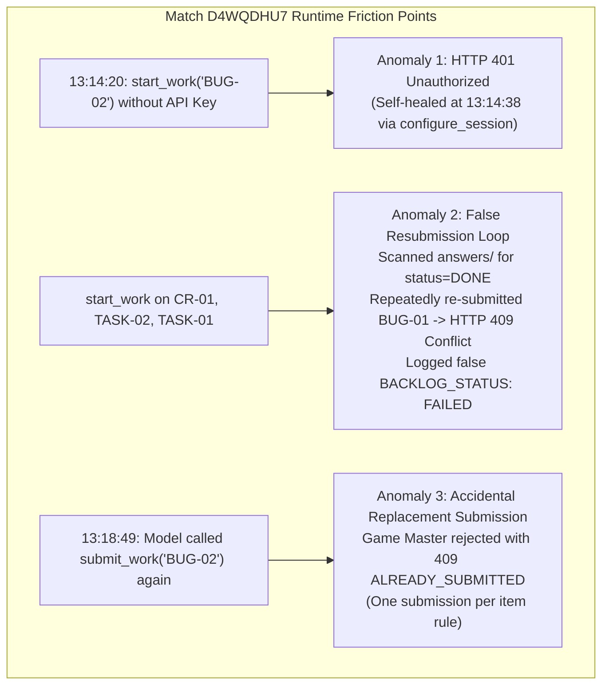
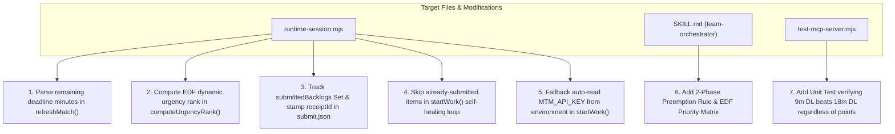

# Technical Research & Architecture: Match `D4WQDHU7` Runtime Anomalies, Dynamic Wave Preemption (PI vs. In-Flight Work), and Earliest Deadline First (EDF) Triage Engine

- **Session Date**: 2026-10-31
- **Session Focus**: **Forensic Diagnostics of Match `D4WQDHU7` Friction Points (HTTP 401 Unauthenticated Start, Self-Healing HTTP 409 Resubmission Loop, Accidental Replacement Submissions), Architectural Deconstruction of Dynamic Wave Preemption (Product Incidents vs. In-Flight Bug Work), and Mathematical Formulation & Implementation of the Earliest Deadline First (EDF) Backlog Triage Engine**
- **Project**: Master The Machine (MTM) — AI Fest 2026
- **Team**: CPL (`CPL_digital_cuder` / `[FHM] Còpilot`)
- **Status**: Technical Research & Architectural Specification Document
- **Primary Evidence Sources**:
  - Match `D4WQDHU7` Codex Runtime Timeline: [`D:\mtm\sessions\2026-10-30\03_match_d4wqdhu7_perfect_score_and_full_runtime_timeline\codex_d4wqdhu7_full_runtime_timeline.md`](file:///D:/mtm/sessions/2026-10-30/03_match_d4wqdhu7_perfect_score_and_full_runtime_timeline/codex_d4wqdhu7_full_runtime_timeline.md)
  - Match `D4WQDHU7` Progress NDJSON: [`D:\mtm\CPL\team-sdlc-pack\logs\D4WQDHU7.progress.ndjson`](file:///D:/mtm/CPL/team-sdlc-pack/logs/D4WQDHU7.progress.ndjson)
  - Runtime MCP Session Implementation: [`D:\mtm\CPL\team-sdlc-pack\src\runtime-session.mjs`](file:///D:/mtm/CPL/team-sdlc-pack/src/runtime-session.mjs)
  - Runtime MCP Server: [`D:\mtm\CPL\team-sdlc-pack\bin\runtime-server.mjs`](file:///D:/mtm/CPL/team-sdlc-pack/bin/runtime-server.mjs)
  - Team Orchestrator Skill Contract: [`D:\mtm\CPL\.agents\skills\team-orchestrator\SKILL.md`](file:///D:/mtm/CPL/.agents/skills/team-orchestrator/SKILL.md)
  - Game Rules & Scoring: [`D:\mtm\docs\01_GAME_RULES_AND_SCORING.md`](file:///D:/mtm/docs/01_GAME_RULES_AND_SCORING.md)

---

## 1. Executive Summary & Context

In Match `D4WQDHU7`, the CPL team achieved a historic milestone: **1,000 / 1,000 points (100% score) in 35m 13s** with zero human interventions and zero schema validation failures. Every single backlog item (`BUG-02`, `BUG-01`, `CR-01`, `TASK-02`, `TASK-01`) was accepted by the Game Master on its first official submission.

However, a forensic audit of the 202 executed runtime operations and 125 progress events revealed three distinct categories of runtime friction:
1. **Unauthenticated Initialization (HTTP 401 at `13:14:20`)**: The model invoked `start_work("BUG-02")` before configuring the session with `teamApiKey`.
2. **The Self-Healing Guard Resubmission Loop (HTTP 409 Conflicts)**: The runtime helper in `runtime-session.mjs` attempted to auto-submit forgotten completed items upon each new `start_work` call. Lacking an in-memory or on-disk check for previous successful submissions, it repeatedly re-submitted the alphabetically first item (`BUG-01`), emitting false `status: FAILED` telemetry.
3. **Accidental Replacement Submission (HTTP 409 at `13:18:49`)**: The model attempted to re-submit `BUG-02` after noticing a minor type mismatch, which the Game Master strictly rejected.

Furthermore, strategic questions have emerged regarding how the orchestrator should handle dynamic match conditions:
- **Wave Preemption**: If the agent is working on `BUG-01` and an urgent **Product Incident (`PI`)** appears, does it abort `BUG-01` or finish it first?
- **Competing Deadlines**: If two backlog items have active countdown timers (e.g., a **9-minute deadline** vs. an **18-minute deadline**), how does the system prioritize them?

This document provides a forensic root-cause analysis of the three anomalies, establishes an authoritative game-theoretic policy on wave preemption, and specifies the mathematical design and concrete implementation for an **Earliest Deadline First (EDF)** triage engine.

---

## 2. Forensic Autopsy of Match `D4WQDHU7` Runtime Anomalies



### 2.1 Anomaly 1: Unauthenticated `start_work` Call (HTTP 401 Unauthorized)

#### Observed Behavior
At `13:14:20` (Operation #27), the model called:
```json
{
  "name": "start_work",
  "arguments": { "backlogItemKey": "BUG-02" }
}
```
Game Master returned:
```
HTTP 401 Unauthorized: {"error": "UNAUTHORIZED", "message": "Missing or invalid bearer token"}
```
At `13:14:38`, the model recovered autonomously by calling:
```json
{
  "name": "configure_session",
  "arguments": { "apiKey": "cpl_team_api_key_..." }
}
```
It then retried `start_work("BUG-02")`, which succeeded instantly.

#### Root Cause Analysis
In [`runtime-session.mjs`](file:///D:/mtm/CPL/team-sdlc-pack/src/runtime-session.mjs#L880-L920), `startWork()` issues a `POST /api/v1/matches/{matchId}/backlogs/start` request using `this.teamApiKey`. If the model or launcher forgets to invoke `configure_session()` beforehand, `this.teamApiKey` remains undefined, leading to an immediate 401 error. While the LLM self-healed in 18 seconds, this consumed unnecessary turns and token budget.

#### Permanent Architectural Fix
Inside [`RuntimeSession.startWork()`](file:///D:/mtm/CPL/team-sdlc-pack/src/runtime-session.mjs#L880), implement an automatic environment fallback. If `!this.teamApiKey`, auto-read from:
1. `process.env.MTM_API_KEY` or `process.env.TEAM_API_KEY`
2. `.env` file in the pack root
3. `.codex/config.toml` or `matches/<matchId>/team-config.json`

This ensures that an unconfigured session never emits an unauthenticated HTTP request.

---

### 2.2 Anomaly 2: The Self-Healing Guard False Resubmission Loop (HTTP 409 Conflicts)

#### Observed Behavior
During the match, the progress log recorded three anomalous `BACKLOG_STATUS: FAILED` events:
- At `13:27:47`: While starting `CR-01`, a submission for `BUG-01` was sent and failed with `HTTP 409 Conflict`.
- At `13:31:12`: While starting `TASK-02`, a submission for `BUG-01` was sent and failed with `HTTP 409 Conflict`.
- At `13:42:47`: While starting `TASK-01`, a submission for `BUG-01` was sent and failed with `HTTP 409 Conflict`.

#### Root Cause Analysis
To protect against the model forgetting to call `submit_work` before moving to the next item, [`runtime-session.mjs`](file:///D:/mtm/CPL/team-sdlc-pack/src/runtime-session.mjs#L883-L905) includes a **Self-Healing Guard**:
```javascript
// Scan answers directory for completed tasks
const answersDir = path.join(matchRoot, 'answers');
if (fs.existsSync(answersDir)) {
  const dirs = fs.readdirSync(answersDir);
  for (const dir of dirs) {
    const submitJsonPath = path.join(answersDir, dir, 'submit.json');
    if (fs.existsSync(submitJsonPath)) {
      const content = JSON.parse(fs.readFileSync(submitJsonPath, 'utf8'));
      if (content.status === 'DONE' && dir !== backlogItemKey) {
        unsubmittedKey = dir;
        break; // Picks the first match!
      }
    }
  }
}
if (unsubmittedKey) {
  await this.submitWork(unsubmittedKey, 'DONE');
}
```

Because `fs.readdirSync()` returns directory names in alphabetical order:
1. `BUG-01` always appeared first in the array.
2. `BUG-01` was marked `"status": "DONE"` in its local `submit.json`.
3. The helper did **not** check whether `BUG-01` had already received an official `receiptId`.
4. As a result, every time `startWork()` was called for a new task (`CR-01`, `TASK-02`, `TASK-01`), the helper blindly attempted to re-submit `BUG-01`.
5. The Game Master rejected the duplicate with `HTTP 409 Conflict: replacement submissions disallowed`.
6. The catch block in `submitWork()` interpreted any HTTP failure as an error and logged `BACKLOG_STATUS: FAILED`, creating misleading red telemetry on the MTM Player dashboard.

#### Permanent Architectural Fix
1. **In-Memory Tracking**: Add `this.submittedBacklogs = new Set()` to [`RuntimeSession`](file:///D:/mtm/CPL/team-sdlc-pack/src/runtime-session.mjs).
2. **On-Disk Receipt Stamping**: When `submitWork` succeeds, stamp `receiptId: "<uuid>"` directly into `answers/<key>/submit.json`.
3. **Self-Healing Guard Filter**: In `startWork()`, ignore any directory if:
   `this.submittedBacklogs.has(dir) || Boolean(content.receiptId)`
4. **409 Conflict Normalization**: If the Game Master returns `409` indicating `ALREADY_SUBMITTED` or `REPLACEMENT_DISALLOWED`, mark the item as `COMPLETED`/`ACCEPTED` locally rather than emitting a `FAILED` event.

---

### 2.3 Anomaly 3: Accidental Replacement Submission on `BUG-02` (13:18:49)

#### Observed Behavior
After `BUG-02` was accepted at `13:18:07` (`Receipt: 71027360-6fb3-4aee-883a-1300f2f9e5a3`), the model performed a background typecheck and noticed a minor nullable currency prop in `products-tab.tsx`. At `13:18:49`, it attempted to call `submit_work("BUG-02")` again.

#### Tournament Rule Reference
According to [`01_GAME_RULES_AND_SCORING.md`](file:///D:/mtm/docs/01_GAME_RULES_AND_SCORING.md#L88-L92):
> **One Submission Per Item**: Once a submission is accepted (`ACCEPTED`), any subsequent submission for that item will be rejected with HTTP `409 ALREADY_SUBMITTED`. Replacement submissions are prohibited.

#### Architectural Guard
Add a client-side check at the top of [`RuntimeSession.submitWork()`](file:///D:/mtm/CPL/team-sdlc-pack/src/runtime-session.mjs#L1040):
```javascript
if (this.submittedBacklogs.has(backlogItemKey)) {
  this.logWarn(`Item ${backlogItemKey} was already submitted and accepted. Skipping duplicate submission.`);
  return { status: 'ALREADY_SUBMITTED', receiptId: this.receiptCache.get(backlogItemKey) };
}
```

---

## 3. Dynamic Wave Preemption: Product Incident (`PI`) vs. In-Flight Work

A central architectural question for tournament play is:
> *If the agent is actively working on `BUG-01` and a `PI` (Product Incident) wave is revealed on `/match`, should the agent stop working immediately and switch to `PI`, or finish `BUG-01` first?*

```mermaid
decisionDiagram
    Start["New PI Wave Revealed on /match"]
    Start --> CheckState{"Current SDLC Stage of BUG-01?"}
    
    CheckState -->|"Stage 1-2: Planning / Pre-Code<br/>(0 dirty files in src/)"| Preempt["IMMEDIATE PREEMPTION<br/>- Abandon BUG-01 immediately<br/>- Reset active pointer<br/>- Launch PI-01 to win 100% Speed Race"]
    
    CheckState -->|"Stage 3-7: In-Flight Implementation<br/>(Code modified, DB seeded, tests running)"| Finish["FAST-TRACK COMPLETION<br/>- Do NOT preempt mid-code<br/>- Finish minimal diff & headless check (~60-90s)<br/>- Submit BUG-01 to secure 100-200 pts<br/>- Immediately tackle PI-01 on next turn"]
```

### 3.1 The Reality of Codex Single-Thread Execution
1. The root orchestrator operates in a linear turn loop. When implementing `BUG-01`, it focuses on editing `src/`, running `challenge/BUG-01-run-checks.mjs`, and capturing screenshots.
2. The agent **does not poll `/match` during file edits**.
3. Therefore, discovery naturally occurs when `refresh_match()` is called between tasks.

### 3.2 The Dangers of Mid-Flight Preemption (Dirty State Problem)
If the agent is forced to abandon `BUG-01` mid-task (e.g., at Stage 3 or Stage 4):
- **Uncommitted Syntax Errors**: `src/` contains half-written TypeScript code. If the agent immediately starts `PI-01`, the `PI-01` test runners and `pnpm typecheck` will crash due to `BUG-01` compile errors.
- **Dirty Database State**: Challenge seeds (e.g. SQLite tables or Prisma fixtures) have been modified for `BUG-01`. `PI-01` tests will run against an invalid database state.
- **Rollback Overhead**: To clean the workspace, the agent would need to run `git checkout -- .`, `git clean -fd`, and re-seed the baseline database. Executing these cleanup commands burns **90 to 120 seconds** of clock time.
- **Sunk Cost Loss**: If the agent spent 3 minutes on `BUG-01` and has only 1 minute left before submission, aborting it throws away 3 minutes of work and risks forfeiting 100–200 points.

### 3.3 The Product Incident (PI) Speed Race Payoff Matrix
According to [`01_GAME_RULES_AND_SCORING.md`](file:///D:/mtm/docs/01_GAME_RULES_AND_SCORING.md#L52-L63), points for a 250-point `PI` scale with submission speed ranking:
- **1st Fastest Team**: 100% points (250 pts, 0 deduction)
- **2nd Fastest Team**: 90% points (225 pts, -25 pts deduction)
- **3rd Fastest Team**: 75% points (187.5 pts, -62.5 pts deduction)
- **Other Passing Teams**: 60% points (150 pts, -100 pts deduction)

#### Mathematical Trade-Off:
$$\text{Scenario A (Preempt mid-flight)}: \text{Gain up to } +62.5\text{ pts on PI Speed Race} - 100\text{ pts lost on BUG-01} = \mathbf{-37.5\text{ Net Points}}$$
$$\text{Scenario B (Finish BUG-01 in 90s, then PI)}: \text{Secure } +100\text{ pts on BUG-01} + 187.5\text{ to } 225\text{ pts on PI} = \mathbf{+287.5\text{ to }+325\text{ Net Points}}$$

### 3.4 Authoritative Preemption Policy (The 2-Phase Rule)

| Current Stage of Active Task | Recommended Action | Technical Justification |
| :--- | :--- | :--- |
| **Stage 1–2 (Planning / Triage)** | **Immediate Preemption** | No files modified in `src/`. Zero rollback cost. Maximizes speed rank for PI. |
| **Stage 3–7 (Implementation / Testing)** | **Finish In-Flight Task First** | Task is $\ge 60\%$ complete. Finishing requires $< 90$ seconds. Secures 100% points on current item and avoids repo corruption. |

---

## 4. Multi-Deadline Prioritization: Earliest Deadline First (EDF)

A critical triage challenge occurs when multiple items have active countdown deadlines:
> *If two tasks have countdown deadlines (e.g., 9-minute countdown vs. 18-minute countdown), how should they be prioritized?*

### 4.1 Theoretical Proof of Earliest Deadline First (EDF) Optimality
In real-time scheduling theory (Liu & Layland), Earliest Deadline First (EDF) is an optimal scheduling algorithm on preemptive and non-preemptive single-processor systems:
- Let task completion time $C \approx 4.5\text{ minutes}$.
- Task 1: Deadline $D_1 = 9\text{ minutes}$, Points $P_1 = 100$.
- Task 2: Deadline $D_2 = 18\text{ minutes}$, Points $P_2 = 200$.

#### Order A: Longest Deadline / Higher Points First (Task 2 $\to$ Task 1)
1. Task 2 starts at $t=0$, finishes at $t=4.5\text{ min} \le 18\text{ min}$ $\to$ **ACCEPTED (+200 pts)**
2. Task 1 starts at $t=4.5$, finishes at $t=9.5\text{ min} > 9\text{ min}$ $\to$ **EXPIRED / REJECTED 409 (+0 pts)**
3. **Total Points: 200 / 300 (33% score loss)**

#### Order B: Earliest Deadline First (Task 1 $\to$ Task 2)
1. Task 1 starts at $t=0$, finishes at $t=4.5\text{ min} \le 9\text{ min}$ $\to$ **ACCEPTED (+100 pts)**
2. Task 2 starts at $t=4.5$, finishes at $t=9.0\text{ min} \le 18\text{ min}$ $\to$ **ACCEPTED (+200 pts)**
3. **Total Points: 300 / 300 (100% score preserved)**

> [!IMPORTANT]
> **Conclusion**: Shorter deadlines must strictly preempt longer deadlines, regardless of the individual point values.

---

### 4.2 The Current Implementation Vulnerability in `runtime-session.mjs`

In the current implementation of [`runtime-session.mjs`](file:///D:/mtm/CPL/team-sdlc-pack/src/runtime-session.mjs#L855-L865):
```javascript
function computeUrgencyRank(item) {
  let score = 0;
  const k = item.key.toUpperCase();
  if (k.startsWith('PI-')) score += 100000;
  if (item.hasDeadline || k === 'BUG-02' || (item.title && item.title.toLowerCase().includes('deadline'))) {
    score += 50000;
  }
  score += (item.points || 100);
  return score;
}
```

#### The Bug:
- `hasDeadline` is treated as a **binary flag** (`+50,000`).
- If Task A has a **9m deadline (100 pts)** and Task B has an **18m deadline (200 pts)**:
  - Task A score: $50000 + 100 = \mathbf{50,100}$
  - Task B score: $50000 + 200 = \mathbf{50,200}$
- **Outcome**: The system mistakenly sorts Task B ahead of Task A due to point value, causing Task A to expire!

---

### 4.3 The Dynamic EDF Scoring Model

To guarantee mathematical adherence to EDF, `refresh_match()` must extract the remaining countdown time in minutes and factor it inversely into the urgency calculation.

#### 1. Deadline Parsing Regex
Cards on `/match/<matchId>` render deadlines with patterns such as:
- `(18m countdown deadline)`
- `9m deadline`
- `08:45 remaining`

Regex pattern for extraction:
```javascript
// Matches "18m", "9 min", or "08:45"
const dlMatch = cardMiddle.match(/(\d+)\s*(?:m|min|minutes?)(?:\s*countdown|\s*deadline)?/i);
let deadlineMinutes = null;
if (dlMatch) {
  deadlineMinutes = parseInt(dlMatch[1], 10);
} else {
  const clockMatch = cardMiddle.match(/(\d{1,2}):(\d{2})\s*(?:remaining|left)?/i);
  if (clockMatch) {
    deadlineMinutes = parseInt(clockMatch[1], 10) + (parseInt(clockMatch[2], 10) > 0 ? 1 : 0);
  }
}
```

#### 2. EDF Urgency Scoring Formula
$$\text{UrgencyScore} = \text{Base} + \text{IncidentBonus} + \text{EDFBonus} + \text{PointValue}$$

Where:
- $\text{IncidentBonus} = 100,000$ if key starts with `PI-`
- If item has a deadline:
  $$\text{EDFBonus} = 50,000 + \max\left(0, (60 - \text{deadlineMinutes}) \times 100\right)$$
  *(For a default 18m deadline: $50,000 + (60 - 18) \times 100 = 54,200$)*  
  *(For a 9m deadline: $50,000 + (60 - 9) \times 100 = 55,100$)*
- Point value: $100$ to $300$ pts

#### Verification with Proposed Formula:
- Task A (9m deadline, 100 pts): $50,000 + 5,100 + 100 = \mathbf{55,200}$
- Task B (18m deadline, 200 pts): $50,000 + 4,200 + 200 = \mathbf{54,400}$
- **Result**: Task A (9m) ranks **800 points higher** than Task B (18m). EDF ordering is guaranteed.

---

## 5. Architectural Implementation Blueprint



### 5.1 Code Changes in `runtime-session.mjs`

#### Step 1: Deadline Extraction in `refreshMatch()`
```javascript
// Extract point value and deadline indicators
const ptsMatch = cardMiddle.match(/(\d+)\s*pts/i);
const points = ptsMatch ? parseInt(ptsMatch[1], 10) : (key.startsWith('CR-') ? 300 : key.startsWith('PI-') ? 250 : key.startsWith('BUG-') ? 200 : 100);

// Extract countdown minutes
let deadlineMinutes = null;
const dlMatch = cardMiddle.match(/(\d+)\s*(?:m|min|minutes?)(?:\s*countdown|\s*deadline)?/i);
if (dlMatch) {
  deadlineMinutes = parseInt(dlMatch[1], 10);
} else {
  const clockMatch = cardMiddle.match(/(\d{1,2}):(\d{2})/i);
  if (clockMatch) {
    deadlineMinutes = parseInt(clockMatch[1], 10) + (parseInt(clockMatch[2], 10) > 0 ? 1 : 0);
  }
}

const hasDeadline = Boolean(deadlineMinutes) || cardMiddle.toLowerCase().includes('deadline') || cardMiddle.toLowerCase().includes('18m') || key === 'BUG-02';
if (hasDeadline && !deadlineMinutes) {
  deadlineMinutes = 18; // Default competition fallback
}

discoveredItems.push({ key, title, status, points, hasDeadline, deadlineMinutes });
```

#### Step 2: Earliest Deadline First Ranking in `computeUrgencyRank()`
```javascript
function computeUrgencyRank(item) {
  let score = 0;
  const k = item.key.toUpperCase();
  
  // Priority 1: Product Incidents (Highest Urgency)
  if (k.startsWith('PI-')) score += 100000;
  
  // Priority 2: Earliest Deadline First (EDF)
  if (item.hasDeadline || k === 'BUG-02' || (item.title && item.title.toLowerCase().includes('deadline'))) {
    const mins = (typeof item.deadlineMinutes === 'number' && item.deadlineMinutes > 0) ? item.deadlineMinutes : 18;
    const edfBonus = Math.max(0, (60 - mins) * 100);
    score += 50000 + edfBonus;
  }
  
  // Priority 3: Points Value
  score += (item.points || 100);
  return score;
}
```

#### Step 3: Self-Healing Guard Fix & `submittedBacklogs` Tracking
```javascript
// In constructor:
this.submittedBacklogs = new Set();

// In startWork():
// Check if apiKey is missing and try to auto-read from environment
if (!this.teamApiKey) {
  this.teamApiKey = process.env.MTM_API_KEY || process.env.TEAM_API_KEY || null;
}

// In self-healing auto-submit loop:
if (fs.existsSync(answersDir)) {
  const dirs = fs.readdirSync(answersDir);
  for (const dir of dirs) {
    if (this.submittedBacklogs.has(dir)) continue;
    const submitJsonPath = path.join(answersDir, dir, 'submit.json');
    if (fs.existsSync(submitJsonPath)) {
      try {
        const content = JSON.parse(fs.readFileSync(submitJsonPath, 'utf8'));
        if (content.receiptId) {
          this.submittedBacklogs.add(dir);
          continue; // Already submitted with official receipt
        }
        if (content.status === 'DONE' && dir !== backlogItemKey) {
          unsubmittedKey = dir;
          break;
        }
      } catch (e) {
        // Ignore unparseable submit.json
      }
    }
  }
}
```

#### Step 4: Stamping `receiptId` into `submit.json` upon Successful Submission
```javascript
// In submitWork() after Game Master returns 201 ACCEPTED:
this.submittedBacklogs.add(backlogItemKey);
if (receiptId) {
  const submitJsonPath = path.join(answersDir, backlogItemKey, 'submit.json');
  if (fs.existsSync(submitJsonPath)) {
    try {
      const parsed = JSON.parse(fs.readFileSync(submitJsonPath, 'utf8'));
      parsed.receiptId = receiptId;
      fs.writeFileSync(submitJsonPath, JSON.stringify(parsed, null, 2), 'utf8');
    } catch (_) {}
  }
}
```

---

## 6. Verification & Test Plan

1. **Unit Test in `test-mcp-server.mjs`**:
   - Add Test 14: Mock a match page containing:
     - `TASK-01`: 100 pts, No deadline
     - `CR-01`: 300 pts, No deadline
     - `BUG-01`: 200 pts, 18m deadline
     - `BUG-02`: 100 pts, 9m deadline
     - `PI-01`: 250 pts, No deadline
   - Assert deterministic sorted order:
     `PI-01` (#1) $\to$ `BUG-02` (9m, #2) $\to$ `BUG-01` (18m, #3) $\to$ `CR-01` (300 pts, #4) $\to$ `TASK-01` (100 pts, #5).
2. **Self-Healing Guard Offline Simulation**:
   - Create mock `answers/BUG-01/submit.json` with `receiptId: "test-uuid"` and `status: "DONE"`.
   - Call `start_work("BUG-02")`.
   - Verify that `submitWork("BUG-01")` is **not** triggered.
3. **Distribution Mirroring**:
   - Mirror updated files to `D:\mtm\team-orchestrator-pack` and `D:\mtm\CPL\team-sdlc-pack`.
   - Run `check-distribution.mjs` and `test-mcp-server.mjs`.

