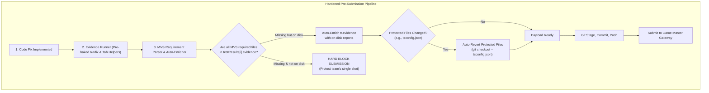

# Implementation Plan: Single-Shot Submission Hardening & Execution Speed Optimization

- **Session Date**: 2026-11-02
- **Related Research**: [`research.md`](file:///d:/mtm/sessions/2026-11-02/01_match_cmsc8va4_forensics_and_single_shot_submission_hardening/research.md)
- **Goal**: Eliminate zero-score submissions caused by evidence mapping omissions, eliminate execution time sinks in browser automation and dual-build verification, and guarantee local-vs-grader database migration parity.
- **Design Constraint**: In Master The Machine, **each backlog item can only be submitted once**. All validations, auto-enrichment, and test verifications must be 100% deterministic and enforced locally before the submission payload is transmitted to the Game Master gateway.
- **Scope Note**: Dynamic task suspension / priority preemption (Problem 4) is deferred per user decision. Resolving the 20-minute speed bottlenecks in Modules 2 and 3 provides ample headroom to complete all 10 backlog items comfortably within the 40-minute match clock.

---

## Architecture Overview



---

## Module 1: Pre-Submission MVS Evidence Gate & Auto-Enricher

### 1.1 Objective
Ensure that no submission can ever be transmitted to Game Master with missing report files in `testResults[i].evidence` (preventing the 0/100 failure seen on `BUG-01` and `BUG-02`).

### 1.2 Target Files
- [`d:\mtm\CPL\team-sdlc-pack\scripts\pack-and-submit.mjs`](file:///d:/mtm/CPL/team-sdlc-pack/scripts/pack-and-submit.mjs)
- [`d:\mtm\CPL\team-sdlc-pack\src\runtime-session.mjs`](file:///d:/mtm/CPL/team-sdlc-pack/src/runtime-session.mjs)

### 1.3 Concrete Implementation Steps

#### Step 1.3.1: Implement MVS Requirement Parser
Add `parseMvsRequirements(matchRoot, backlogId)`:
- Scans `challenge/<backlogId>-minimum-verification-scenarios.md` (and fallbacks in `src/`, `answers/`).
- Matches each test case heading (e.g. `## BUG-01-TC-01`) and extracts the `Required evidence: ...` line using regex:
  ```javascript
  function parseMvsRequirements(matchRoot, backlogId) {
    const candidates = [
      path.join(matchRoot, 'challenge', `${backlogId}-minimum-verification-scenarios.md`),
      path.join(matchRoot, 'src', `${backlogId}-minimum-verification-scenarios.md`)
    ];
    const requirements = {}; // { 'BUG-01-TC-01': ['layout-report-dev.json', 'tc-01-desktop-dashboard.png'] }

    for (const file of candidates) {
      if (!fs.existsSync(file)) continue;
      const content = fs.readFileSync(file, 'utf8');
      const sections = content.split(/^##\s+/m);
      for (const sec of sections) {
        const idMatch = sec.match(/^([A-Za-z0-9_-]+-TC-\d+)/);
        if (!idMatch) continue;
        const tcId = idMatch[1];
        const reqMatch = sec.match(/(?:Required evidence|Evidence):\s*`?([^\n\r]+)`?/i);
        if (reqMatch) {
          const files = reqMatch[1]
            .split(/[,;]+/)
            .map(s => s.replace(/[`'"]/g, '').trim())
            .map(s => path.basename(s))
            .filter(Boolean);
          requirements[tcId] = files;
        }
      }
      break;
    }
    return requirements;
  }
  ```

#### Step 1.3.2: Upgrade Auto-Enrichment in `packAndSanitizeSubmission`
In `runtime-session.mjs` and `pack-and-submit.mjs`:
- Replace the fragile `if (cleanEvidence.length === 0)` check.
- Query `parseMvsRequirements`: For every test case `tr`, ensure every required file that exists in `answers/<id>/evidence/` is present in `tr.evidence`.
- Auto-attach all non-image report files (`.json`, `.txt`, `.log`, `.csv`) present in `evidence/` to matching test cases or as shared verification evidence.
- Verify that every declared evidence path exists on disk and has non-zero byte size.

#### Step 1.3.3: Pre-Submission Blocking Gate
If a test case requires a report according to the MVS spec (e.g., `layout-report-dev.json`) and that file does not exist on disk in `evidence/`:
- **Throw an immediate fatal error** in `packAndSanitizeSubmission` / `submitWork`.
- Do not commit to git. Do not call the Game Master API.
- Output explicit diagnostic message to the orchestrator:
  `[PRE-SUBMIT BLOCKED] Cannot submit BUG-01: 'evidence/layout-report-dev.json' is required by BUG-01-TC-01 but missing from disk. Run layout check first.`

#### Step 1.3.4: Protected File Auto-Revert Guard
Before staging and committing changes for submission:
- Check `git status --porcelain` for protected files:
  - `src/tsconfig.json`
  - `src/package.json` (unless dependencies were authorized)
  - `exam-info.json`
- If `src/tsconfig.json` was modified (e.g., by Next.js compiler), automatically run:
  `git checkout -- src/tsconfig.json`
- Prevent any commit containing protected file modifications from being pushed.

---

## Module 2: Pre-Baked UI Automation Primitives

### 2.1 Objective
Eliminate the 5+ minute trial-and-error patching loop where the agent struggled to click Radix UI `<Select>` and `<Tabs>` components in `evidence-runner.mjs`.

### 2.2 Target Files
- [`d:\mtm\CPL\team-sdlc-pack\scripts\evidence-runner.mjs`](file:///d:/mtm/CPL/team-sdlc-pack/scripts/evidence-runner.mjs)
- [`d:\mtm\CPL\matches\CMSC8VA4\CMSC8VA4\scripts\evidence-runner.mjs`](file:///d:/mtm/CPL/matches/CMSC8VA4/CMSC8VA4/scripts/evidence-runner.mjs)

### 2.3 Concrete Implementation Steps

#### Step 2.3.1: Add Native Radix Select Component Handler
Add a dedicated action type `select-option` to `evidence-runner.mjs`:
```javascript
case 'select-option': {
  const { triggerSelector, optionText } = action;
  const trigger = page.locator(triggerSelector).first();
  await trigger.waitFor({ state: 'visible', timeout: 5000 });
  await trigger.click();
  
  // Radix mounts options in a portal at document body
  const option = page.locator('[role="option"]', { hasText: optionText }).first();
  await option.waitFor({ state: 'visible', timeout: 5000 });
  await option.click();
  await page.waitForTimeout(200); // Allow react state update
  break;
}
```

#### Step 2.3.2: Add Robust Tab Switching Handler
Add a dedicated action type `switch-tab`:
```javascript
case 'switch-tab': {
  const { tabName } = action;
  // Match either role="tab" with text, or tab query parameter
  const tab = page.locator(`[role="tab"]:has-text("${tabName}"), button:has-text("${tabName}")`).first();
  await tab.waitFor({ state: 'visible', timeout: 5000 });
  await tab.click();
  await page.waitForTimeout(300);
  break;
}
```

#### Step 2.3.3: Direct Database Seeding Preference
Add an instruction to the `team-orchestrator` skill:
- For data-state verification (e.g., creating VND/USD invoices in BUG-02), **prefer running the provided seed script directly** (`pnpm tsx prisma/seed-bug02.ts ...`) rather than automating form data entry through the browser.
- Use Playwright strictly for navigating to the page and capturing the final verification screenshot.

---

## Module 3: Isolated Next.js Verification Recipe

### 3.1 Objective
Eliminate the 11.5-minute time sink in BUG-01 caused by dev/prod build collisions, port lockups, stale route caching, and `tsconfig.json` modifications.

### 3.2 Target Files
- `d:\mtm\CPL\team-sdlc-pack\scripts\verify-layout.mjs` (New script)
- [`d:\mtm\CPL\team-sdlc-pack\scripts\install.mjs`](file:///d:/mtm/CPL/team-sdlc-pack/scripts/install.mjs)

### 3.3 Concrete Implementation Steps

#### Step 3.3.1: Create Sequential Layout Verification Runner
Implement `verify-layout.mjs` to execute the dual-environment check safely:
```javascript
#!/usr/bin/env node
import { execSync, spawn } from 'node:child_process';
import path from 'node:path';
import fs from 'node:fs';

// Phase 1: Development Check
console.log('[Layout Recipe] Phase 1: Running Development Check on port 3000...');
// 1. Ensure port 3000 is clean
killPort(3000);
// 2. Start dev server in background
const devProcess = spawn('pnpm', ['dev', '-p', '3000'], { cwd: srcDir, stdio: 'ignore', shell: true });
await waitForUrl('http://127.0.0.1:3000');
// 3. Execute layout check
execSync(`node "${layoutCheckScript}" http://127.0.0.1:3000 development "${outDevJson}"`, { cwd: srcDir, stdio: 'inherit' });
// 4. Terminate dev server cleanly
killProcess(devProcess);

// Phase 2: Production Check
console.log('[Layout Recipe] Phase 2: Building and Running Production Check on port 3001...');
killPort(3001);
// 1. Clean build
execSync('pnpm build', { cwd: srcDir, stdio: 'inherit' });
// 2. Revert any Next.js compiler modifications to tsconfig.json immediately!
execSync('git checkout -- tsconfig.json', { cwd: srcDir, stdio: 'ignore' });
// 3. Start production server on dedicated port 3001
const prodProcess = spawn('pnpm', ['start', '-p', '3001'], { cwd: srcDir, stdio: 'ignore', shell: true });
await waitForUrl('http://127.0.0.1:3001');
// 4. Execute layout check
execSync(`node "${layoutCheckScript}" http://127.0.0.1:3001 production "${outProdJson}"`, { cwd: srcDir, stdio: 'inherit' });
// 5. Terminate prod server cleanly
killProcess(prodProcess);

console.log('[Layout Recipe] Both layout reports generated successfully in ~90s.');
```

#### Step 3.3.2: Expected Gains
- Eliminates port clashes and zombie node processes.
- Eliminates stale route cache confusion.
- Automatically keeps `src/tsconfig.json` clean, eliminating the `[HIGH PROTECTED_FILES_CHANGED]` integrity penalty.
- Execution time drops from **12m 30s to ~90s**.

---

## Module 4: Database Clean-Slate & Migration Parity Guard

### 4.1 Objective
Eliminate the 50-point regression test loss across CR-01, CR-02, CR-03, and BUG-02 caused by local database migration drift.

### 4.2 Target Files
- [`d:\mtm\CPL\matches\CMSC8VA4\CMSC8VA4\env-require\doctor.ps1`](file:///d:/mtm/CPL/matches/CMSC8VA4/CMSC8VA4/env-require/doctor.ps1)
- [`d:\mtm\CPL\team-sdlc-pack\src\runtime-session.mjs`](file:///d:/mtm/CPL/team-sdlc-pack/src/runtime-session.mjs)

### 4.3 Concrete Implementation Steps

#### Step 4.3.1: Enforce Clean Database Reset in Preparation
Update preparation / doctor logic:
- Before running any tests or seeds, ensure `freelanceos_test` is recreated from scratch:
  ```powershell
  # Drop and recreate test database to purge any leftover migrations from previous matches
  & $psql -U postgres -p 5433 -c "DROP DATABASE IF EXISTS freelanceos_test;"
  & $psql -U postgres -p 5433 -c "CREATE DATABASE freelanceos_test OWNER freelanceos;"
  ```
- Run `pnpm prisma migrate deploy` strictly against this clean database.

#### Step 4.3.2: Add Migration Parity Assertion
Add a pre-match check comparing:
- Disk migrations: count directories in `src/prisma/schema/migrations/` (excluding non-migration files).
- Database migrations: `SELECT count(*) FROM _prisma_migrations WHERE rolled_back_at IS NULL;`.
- If `db_count !== disk_count`:
  `[FATAL] Local database has migration drift! DB count (${db_count}) != Disk count (${disk_count}). Reset database before continuing.`
- Run a baseline `pnpm test` during preparation. If `tests/cascade.test.ts` fails, the agent will see it immediately during pre-match setup rather than during graded commits.

---

## Verification & Rollout Plan

| Step | Action | Success Criteria |
| :---: | :--- | :--- |
| **1** | Patch `pack-and-submit.mjs` with MVS parser & auto-enricher. | Running `node pack-and-submit.mjs --backlog BUG-01 --dry-run` on match CMSC8VA4 automatically detects and attaches `layout-report-dev.json` and `layout-report-prod.json` to TC-01, TC-02, TC-03. |
| **2** | Patch `runtime-session.mjs` `packAndSanitizeSubmission`. | Unit test verifying that partial evidence arrays are merged with required MVS reports. |
| **3** | Add Radix UI Select helper to `evidence-runner.mjs`. | Test running `evidence-runner.mjs` on an accounting form: dropdown options select cleanly on first try without manual dispatch events. |
| **4** | Deploy `verify-layout.mjs` recipe. | Dev and prod layout checks complete sequentially in < 2 minutes with clean exit and untouched `tsconfig.json`. |
| **5** | Enforce database reset in preparation script. | Test DB contains exactly 7 migrations matching git repo; baseline test run produces 100% predictable results matching grader environment. |

