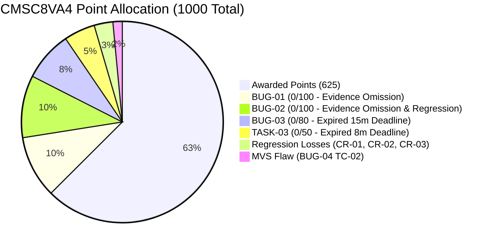

# Technical Research & Forensics: Match `CMSC8VA4` Autopsy, The Single-Shot Submission Trap, and Execution Speed Bottleneck Analysis

- **Session Date**: 2026-11-02
- **Session Focus**: **Forensic Autopsy of Match `CMSC8VA4` (625 / 1,000 pts), Detailed Breakdown of the Zero-Score Catastrophe on BUG-01 and BUG-02, Analysis of the 20-Minute Execution Bottleneck, Game Master Grader Verification Rules Under Single-Submission Constraints, and Strategic Attribution (Model vs. Harness)**
- **Project**: Master The Machine (MTM) — AI Fest 2026
- **Team**: CPL (`CPL_digital_cuder` / `[FHM] Còpilot`)
- **Status**: Official Technical Research & Forensic Document
- **Primary Evidence Sources**:
  - Game Master Spectator & Scoring Endpoint: [Game Master Spectator CMSC8VA4](https://masterthemachine.tech/spectator/CMSC8VA4)
  - Game Master Grader Submissions & Evaluations: [`d:/mtm/scratch/submission_details.json`](file:///d:/mtm/scratch/submission_details.json)
  - Codex Runtime Rollout (1,182 steps): [`C:\Users\ADMIN\.codex\sessions\2026\11\02\rollout-2026-11-02T09-58-38-01a19a31-cea8-7781-99f6-b7bddf7b89a1.jsonl`](file:///C:/Users/ADMIN/.codex/sessions/2026/11/02/rollout-2026-11-02T09-58-38-01a19a31-cea8-7781-99f6-b7bddf7b89a1.jsonl)
  - Match Git Repository & Revision Tree: [`d:\mtm\CPL\matches\CMSC8VA4\CMSC8VA4`](file:///d:/mtm/CPL/matches/CMSC8VA4/CMSC8VA4)
  - Team SDLC Runtime Helper: [`d:\mtm\CPL\team-sdlc-pack\src\runtime-session.mjs`](file:///d:/mtm/CPL/team-sdlc-pack/src/runtime-session.mjs)
  - Pack & Submit CLI Script: [`d:\mtm\CPL\team-sdlc-pack\scripts\pack-and-submit.mjs`](file:///d:/mtm/CPL/team-sdlc-pack/scripts/pack-and-submit.mjs)
  - Evidence Runner Automation Script: [`d:\mtm\CPL\matches\CMSC8VA4\CMSC8VA4\scripts\evidence-runner.mjs`](file:///d:/mtm/CPL/matches/CMSC8VA4/CMSC8VA4/scripts/evidence-runner.mjs)

---

## 1. Executive Summary & Match Scorecard

In practice match **`CMSC8VA4`** (Match Name: `[Practice] MTM-26-7UJVLX - H20,MST,CPL - 20261102095713`), team **CPL** placed **1st** among 3 competing teams (`CPL`: 625 pts, `H20`: 0 pts, `MST`: 0 pts). 

However, against the 1,000 available points, CPL scored **625 / 1,000 points**, forfeiting **375 points**.



### Official Match Scorecard Breakdown

| Backlog Item | Wave | Deadline | Max Pts | Awarded | Grader Status | Grader Verification Summary |
| :--- | :---: | :---: | :---: | :---: | :---: | :--- |
| **BUG-01** | Wave 1 (00:00) | None | 100 | **0** | `GRADED` | ❌ **0 PASS, 3 FAIL** (`testResults` omitted `layout-report-*.json`) |
| **BUG-02** | Wave 1 (00:00) | 18 min | 100 | **0** | `GRADED` | ❌ **0 PASS, 4 FAIL** (omitted `currency-report.txt` + `cascade.test.ts` failure) |
| **BUG-03** | Wave 2 (08:00) | 15 min | 80 | **0** | `NOT_STARTED` | ⏰ **Expired at 23:01 (10:27:10 local)**. Never submitted. |
| **CR-01** | Wave 2 (08:00) | None | 140 | **130** | `GRADED` | ⚠️ **6 PASS, 1 FAIL** (-10 pts: grader re-run of `cascade.test.ts` failed) |
| **PI-01** | Wave 3 (12:00) | 15 min | 160 | **160** | `GRADED` | ✅ **5 PASS, 0 FAIL** (100% full marks; root-cause diagnosis flawless) |
| **BUG-04** | Wave 3 (12:00) | None | 80 | **65** | `GRADED` | ⚠️ **5 PASS, 1 FAIL** (-15 pts: MVS TC-02 order check failed) |
| **CR-02** | Wave 3 (12:00) | None | 120 | **110** | `GRADED` | ⚠️ **7 PASS, 1 FAIL** (-10 pts: grader re-run of `cascade.test.ts` failed) |
| **TASK-03** | Wave 4 (20:00) | 8 min | 50 | **0** | `NOT_STARTED` | ⏰ **Expired at 28:01 (10:32:10 local)**. Never submitted. |
| **CR-03** | Wave 4 (20:00) | None | 100 | **90** | `GRADED` | ⚠️ **6 PASS, 1 FAIL** (-10 pts: grader re-run of `cascade.test.ts` failed) |
| **TASK-04** | Wave 4 (20:00) | None | 70 | **70** | `GRADED` | ✅ **5 PASS, 0 FAIL** (100% full marks; ledger math correct) |
| **TOTAL** | | | **1,000** | **625** | | **375 Points Lost** |

Integrity review verdict from Game Master Grader:
> `[HIGH PROTECTED_FILES_CHANGED] The team changed organizer tests or test configuration (src/tsconfig.json MODIFIED); the originals were restored before grading.`

---

## 2. The Core Dilemma: The Single-Shot Submission Rule

In Master The Machine, **each backlog item can only be submitted once per match**. 
When an agent calls `submit_work`:
1. The harness captures the commit SHA and sends the payload to Game Master.
2. Game Master records `attemptNo: 1` and marks the item `GRADED`.
3. Any subsequent attempt to submit the same backlog item returns HTTP 409 `ALREADY_SUBMITTED`.

### Why Reactive Feedback Is Irrelevant
Because of this single-attempt constraint:
- Knowing why a submission failed **after** it has been graded offers **zero opportunity for recovery** in the current match.
- Whether the harness reported `scoreStatus: ACCEPTED` or `FAILED` is a moot point—the match for that backlog item was already over the millisecond the HTTP request arrived at the Game Master gateway.
- **Conclusion**: **Every submission must be 100% flawless before it leaves the contestant machine.** The solution must be deterministic, automated pre-submission enforcement.

---

## 3. Deep Forensics: Why BUG-01 and BUG-02 Took 20 Minutes

The match duration is 40 minutes. The agent spent **20 minutes and 17 seconds** on the first two backlog items alone.

```mermaid
gantt
    title Match CMSC8VA4 Timeline Breakdown (Minutes 00 to 25)
    dateFormat  X
    axisFormat %s m

    section Wave 1 & 2
    BUG-02 Code Fix             :active, 0, 1.5
    BUG-02 Playwright Flailing  :crit, 1.5, 7.5
    BUG-02 Submitted (0 pts)    :milestone, 7.5, 7.5
    Wave 2 Released (BUG-03, 15m DL) :milestone, 8, 8
    BUG-01 CSS Layout Fix       :active, 8, 9
    BUG-01 Next.js Port/Cache Flailing :crit, 9, 20.5
    BUG-01 Submitted (0 pts)    :milestone, 20.5, 20.5
    Wave 3 Released (PI-01, 15m DL)  :milestone, 12, 12
    PI-01 Incident Analysis & Submit :active, 20.5, 23.5
    BUG-03 Deadline Expires     :crit, milestone, 23, 23
```

### 3.1 BUG-02 Forensics (Started 10:04:42, Submitted 10:12:28 — Elapsed: 7m 46s)

#### The Actual Fix: ~1.5 Minutes
The requirement was straightforward: Currency conversion in `invoices-tab.tsx` and `payments-tab.tsx` used the workspace default currency minor unit factor instead of the selected company's currency code (VND vs USD). The model diagnosed this immediately and patched the two TSX components within 90 seconds.

#### The 6-Minute Flail: Playwright Event Dispatching
The remaining 6 minutes were consumed entirely by attempts to capture browser evidence:
- To generate `tc-01-vnd-invoice.png` and `tc-02-vnd-payment.png`, the model attempted to automate invoice creation and payment recording via `scripts/evidence-runner.mjs`.
- The frontend UI uses Radix UI / shadcn `<Select>` dropdowns. Standard Playwright `locator.click()` failed to open the portal menu or select the option.
- Over the next 5 minutes, the model applied **seven consecutive patches** to `evidence-runner.mjs`:
  - `03:08:12Z`: Attempted `tabLocator.click({ force: true })`.
  - `03:08:34Z`: Switched to `dispatchEvent('click')`.
  - `03:08:51Z`: Switched to `waitUntil: 'domcontentloaded'`.
  - `03:09:09Z`: Switched to `dispatchEvent('pointerdown')`.
  - `03:09:50Z`: Added logging for select actions.
  - `03:10:16Z`: Injected custom option-role searching.
  - `03:11:18Z`: Adjusted option locator text filtering.
- **Tangential Side-Quest**: At `03:07:22Z`, the model noticed that an invoice paid in full had status `PARTIAL` because `deriveInvoiceStatus` used `paidMinor > totalMinor`. It diverted attention to patch `src/lib/invoice-status.ts`—accidentally solving BUG-03 inside BUG-02.

---

### 3.2 BUG-01 Forensics (Started 10:12:41, Submitted 10:25:12 — Elapsed: 12m 31s)

#### The Actual Fix: ~1 Minute
The desktop sidebar overlapped the main page content because an invalid/missing Tailwind spacing class was applied to `<main>` and `<header>`. Replacing it with `style={{ marginInlineStart: '240px' }}` on desktop viewports completely resolved the overlap.

#### The 11.5-Minute Flail: Build Directory, Port Collisions, and Cache Pollution
- **Simultaneous Dev/Prod Collisions**:
  The MVS required generating layout reports for both `development` (port 3000) and `production` (after `pnpm build`, running `pnpm start`). 
  The model ran `pnpm dev` and `pnpm build` in parallel inside `src/`. Both processes competed for the same `.next` cache directory, resulting in corrupted output.
- **Port Clashes & Process Zombie State**:
  The model tried to isolate builds by setting `$env:NEXT_DIST_DIR='.next-dev'` and `.next-prod`. This caused Next.js to inject extra include paths into `src/tsconfig.json`, permanently modifying a protected configuration file.
  Ports 3000, 3001, and 3002 became locked by orphaned background Node processes. The model spent minutes querying `Get-NetTCPConnection` and issuing `Stop-Process`.
- **Stale Route Cache Mystery**:
  At `03:23:28Z`, the layout check reported that `/dashboard` passed with the 240px offset, but `/accounting` still rendered the old layout! Next.js was serving a cached page bundle. The model believed its CSS fix was broken, so it injected inline `<style>` tags directly into `layout.tsx` and re-tested.
- **Unrelated Bug Distraction**:
  At `03:16:18Z`, the model noticed `/accounting` was hanging because `reports-tab.tsx` called a query hook with `new Date()`, triggering infinite re-renders. The model stopped layout testing to patch `reports-tab.tsx`.
- The model executed `BUG-01-layout-check.mjs` four separate times (each run taking 45–60 seconds across 3 pages × 3 viewports). By the time both dev and prod reports passed cleanly, **12 minutes and 31 seconds had elapsed**.

---

## 4. Why Both Scored Zero: The Grader Assertion Autopsy

Despite the 20 minutes spent fixing code and generating evidence, **both items scored exactly 0 points**.

### 4.1 BUG-01 Grader Breakdown (0 / 100 Points)

The Game Master grader executed 3 content assertions:

| Assertion | Max Pts | Awarded | Grader Result | Grader Explanation |
| :--- | :---: | :---: | :---: | :--- |
| **BUG-01-TC-01** (Desktop Dev) | 34 | **0** | `FAIL` | `BUG-01-TC-01 does not reference evidence/layout-report-dev.json` |
| **BUG-01-TC-02** (Desktop Prod) | 33 | **0** | `FAIL` | `BUG-01-TC-02 does not reference evidence/layout-report-prod.json` |
| **BUG-01-TC-03** (Mobile) | 33 | **0** | `FAIL` | `BUG-01-TC-03 does not reference evidence/layout-report-dev.json` |

#### The Fatal Error in `answers/BUG-01/submit.json`:
The model successfully ran `BUG-01-layout-check.mjs` and wrote `answers/BUG-01/evidence/layout-report-dev.json` and `layout-report-prod.json`. Both files were listed in top-level `evidenceFiles`.

However, in the individual `testResults` array, the model only wrote:
```json
"testResults": [
  {
    "id": "BUG-01-TC-01",
    "result": "PASS",
    "evidence": ["evidence/tc-01-desktop-dashboard.png"]   <-- MISSING layout-report-dev.json
  },
  {
    "id": "BUG-01-TC-02",
    "result": "PASS",
    "evidence": [
      "evidence/tc-02-production-boards.png",
      "evidence/tc-02-production-layout.png"              <-- MISSING layout-report-prod.json
    ]
  },
  {
    "id": "BUG-01-TC-03",
    "result": "PASS",
    "evidence": [
      "evidence/tc-03-mobile-accounting.png",
      "evidence/tc-03-mobile-dashboard.png"               <-- MISSING layout-report-dev.json
    ]
  }
]
```
The grader does not inspect screenshot pixels for layout offsets; it parses `layout-report-*.json`. Because the test cases failed to link the report files, the grader awarded 0 points for every assertion.

---

### 4.2 BUG-02 Grader Breakdown (0 / 100 Points)

The Game Master grader executed 4 assertions:

| Assertion | Max Pts | Awarded | Grader Result | Grader Explanation |
| :--- | :---: | :---: | :---: | :--- |
| **BUG-02-TC-01** (VND Invoice) | 40 | **0** | `FAIL` | `BUG-02-TC-01 does not reference evidence/currency-report.txt` |
| **BUG-02-TC-02** (VND Payment) | 25 | **0** | `FAIL` | `BUG-02-TC-02 does not reference evidence/currency-report.txt` |
| **BUG-02-TC-03** (USD Invoice) | 15 | **0** | `FAIL` | `BUG-02-TC-03 does not reference evidence/currency-report.txt` |
| **BUG-02-TC-04** (Regression) | 20 | **0** | `FAIL` | `Grader tự chạy test: 11 test đạt, 1 test hỏng. Test hỏng: tests/cascade.test.ts › deleting a company with invoices is RESTRICTED` |

#### The Fatal Errors:
1. **Omission of `currency-report.txt`**:
   The model generated `answers/BUG-02/evidence/currency-report.txt` via `report-bug02.ts`, but in `submit.json`, it attached only the screenshot (`tc-01-vnd-invoice.png`) to each TC, losing 80 points.
2. **The Database Migration Discrepancy**:
   For TC-04, the grader restores clean files and runs `vitest` against a freshly deployed Postgres instance.
   - The git repository contains **7 migrations**, ending at `..._company_delete_cascades_financials` (which set `ON DELETE CASCADE`).
   - The contestant's local machine had an untracked 8th migration (`20261028000000_invoice_company_delete_restrict`), which set `ON DELETE RESTRICT`.
   - Locally, `tests/cascade.test.ts` passed (12/12). On the grader, it failed because deleting a company cascaded instead of throwing `RESTRICTED`.

---

## 5. Architectural Attribution: Model vs. Harness

| Root Cause | Evidence / Manifestation | Fault Category |
| :--- | :--- | :---: |
| **Omitting Reports from `testResults[i].evidence`** | Model manually constructed `submit.json` and only put PNGs into individual test cases, ignoring the explicit "Required evidence" list in MVS markdown. | **Model** |
| **Harness Auto-Pack Blind Spot** | `runtime-session.mjs` and `pack-and-submit.mjs` only attached fallback evidence if `test.evidence.length === 0`. Because 1 PNG was present, the harness assumed the array was complete and allowed a fatal submission to pass. | **Harness** |
| **Brittle Browser Automation in Live Matches** | `evidence-runner.mjs` lacked Radix/shadcn select and tab primitives, forcing the model into a 7-step trial-and-error patching loop. | **Harness** |
| **Next.js Dev/Prod Build Collisions** | No automated, isolated dual-build script existed in the workspace, causing port locks and cache corruption. | **Harness** |
| **Database Migration Parity Drift** | `doctor.ps1` failed to detect that the local PostgreSQL database had untracked migrations not present in the git repository. | **Harness** |
| **Protected File Mutation** | Setting `$env:NEXT_DIST_DIR` caused Next.js to modify `src/tsconfig.json`, which was committed and flagged by the grader. | **Shared** |

---

## 6. Summary of Solutions to Implement

To guarantee that a team never falls into the single-shot submission trap again:
1. **Pre-Submission MVS Evidence Gate & Auto-Enricher**: Parse MVS markdown automatically and enforce that all required report files on disk are unioned into `testResults[i].evidence` before submission is permitted.
2. **Pre-Baked Browser UI Helpers**: Add battle-tested Radix Select, Tab, and Form helpers to `evidence-runner.mjs`.
3. **Isolated Layout Verification Recipe**: A dedicated script that handles dev vs prod Next.js lifecycle sequentially without port or cache collisions, automatically restoring `tsconfig.json`.
4. **Clean-Slate Database Isolation**: Enforce fresh DB reset and migration parity checking during match preparation.

*(Note: Dynamic task suspension and priority preemption are deferred, as resolving the execution speed and verification bottlenecks will prevent deadlines from expiring naturally.)*

