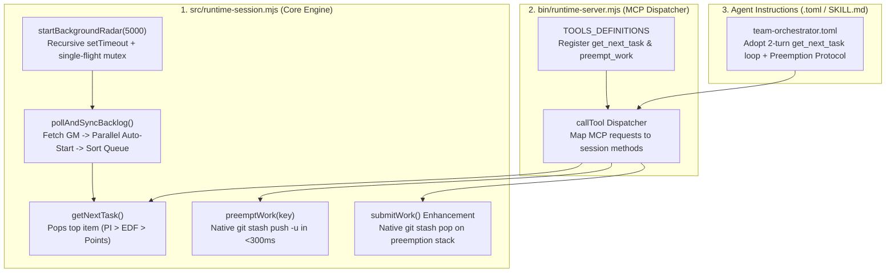

# Implementation Plan: Automated Background Fetch Radar & MCP Preemption Engine

- **Target Systems**: `D:\mtm\CPL\team-sdlc-pack` & `D:\mtm\CPL\.codex\agents`
- **Primary Goal**: Fully automate match wave discovery, parallel auto-start, backlog queue sorting, and instant PI preemption to guarantee Rank #1 in the PI Speed Race without LLM latency.
- **Estimated Execution Time**: ~25 minutes

---

## 1. Architectural Overview & Component Changes



---

## 2. Proposed Implementation Steps

### Step 1: Core Engine Implementation in `src/runtime-session.mjs`

1. **State Initialization**:
   Add to `constructor()`:
   ```javascript
   this.radarActive = false;
   this.radarTimer = null;
   this.isPolling = false;
   this.taskQueue = [];
   this.discoveredKeys = new Set();
   this.startedKeys = new Set();
   this.preemptionStack = [];
   this.urgentPreemption = null;
   ```

2. **5-Second Radar & Auto-Start Loop**:
   - Implement `startBackgroundRadar(intervalMs = 5000)`:
     - Uses recursive `setTimeout` with `isPolling` flag guard.
     - Uses `this.radarTimer.unref()` so Node can exit cleanly.
   - Implement `stopBackgroundRadar()`:
     - Clears timeout and stops poller on match end or shutdown.
   - Implement `pollAndSyncBacklog()`:
     - Fetches latest match state from Game Master.
     - For every item with `status === 'OPEN'`:
       * Emits `DISCOVERED` progress event (deduplicated via `discoveredKeys`).
       * Immediately fires `startWork(item.key)` (deduplicated via `startedKeys`).
       * Materializes seed fixtures and answer folders on disk.
     - Ranks all in-progress/uncompleted items using the urgency formula:
       $$\text{UrgencyScore} = (\text{isPI} \times 100,000) + (\text{hasDeadline} \times 50,000 + \text{EDFBonus}) + \text{Points}$$
     - Sorts `this.taskQueue` descending by score.
     - Detects newly dropped PIs and flags `this.urgentPreemption = { key: item.key, type: 'PI' }`.

3. **`getNextTask()` Implementation**:
   - If `this.taskQueue.length === 0`, awaits an immediate `pollAndSyncBacklog()`.
   - Pops the top task from `this.taskQueue`.
   - Returns task brief, materialized file paths, and current preemption state.

4. **`preemptWork({ preemptingKey })` Implementation**:
   - **Preemption Rule**: Only stash if the current active task is **NOT** a PI (`!this.isPI(this.currentActiveItem)`). If current active task is already a PI, reject preemption to protect the active speed race.
   - Runs `git status --porcelain` in `this.checkoutRoot`.
   - If dirty: executes `git stash push -u -m "preempt_for_${preemptingKey}"`.
   - Records `{ suspendedTaskKey: this.currentActiveItem, stashed: isDirty, timestamp: Date.now() }` in `this.preemptionStack`.
   - Switches `this.currentActiveItem = preemptingKey`.
   - Ensures work is started on Game Master and returns clean workspace confirmation.

5. **Deferred Stash Pop & Auto-Restore in `submitWork()`**:
   - After `submitWork` finishes posting submission to Game Master and receives receipt:
   - Checks if any other PIs remain in `this.taskQueue` (`find(item => item.isPI)`):
     * **If pending PI exists**: Retains the stash! Returns `nextTask: nextPI.key` so Codex moves directly to the next PI on a clean working tree.
     * **If 0 PIs remain**: Checks `if (this.preemptionStack.length > 0)`.
       * Pops top record.
       * If `record.stashed === true`: executes `git stash pop` natively via Node.js.
       * Restores `this.currentActiveItem = record.suspendedTaskKey`.
       * Adds `autoResume: { resumedTask, stashRestored: true }` to the return object.

---

### Step 2: Register MCP Tools in `bin/runtime-server.mjs`

1. **Add Tool Definitions to `TOOLS_DEFINITIONS`**:
   - `get_next_task`:
     ```json
     {
       "name": "get_next_task",
       "description": "Fetches the highest-priority backlog item (PI > Earliest Deadline > Points). Task is pre-started on Game Master and all challenge fixtures are already materialized on disk.",
       "inputSchema": { "type": "object", "properties": {} }
     }
     ```
   - `preempt_work`:
     ```json
     {
       "name": "preempt_work",
       "description": "Instantly preempts active non-PI work for an urgent task (e.g. any PI-*). Executes native git stash push -u in <300ms, restores working directory to clean HEAD, and delivers task brief.",
       "inputSchema": {
         "type": "object",
         "properties": {
           "preemptingKey": { "type": "string", "description": "The urgent backlog key (e.g. PI-01, PI-02)" }
         },
         "required": ["preemptingKey"]
       }
     }
     ```

2. **Add Call Handlers to `callTool(name, args)`**:
   - Wire `get_next_task` $\rightarrow$ `this.session.getNextTask()`.
   - Wire `preempt_work` $\rightarrow$ `this.session.preemptWork(args.preemptingKey)`.

---

### Step 3: Update Orchestrator Prompt Instructions

1. **Update `.codex/agents/team-orchestrator.toml` & `SKILL.md`**:
   - Replace the legacy 4-turn manual loop:
     ```markdown
     ### High-Velocity Execution Loop:
     1. Call `get_next_task()`.
     2. Review the task brief and pre-materialized files in `answers/<id>/`.
     3. If any tool call returns `[URGENT_PREEMPTION: <key>]`:
        - Immediately invoke `preempt_work({ preemptingKey: "<key>" })`.
        - Solve the incident, verify, and call `submit_work({ backlogItemKey: "<key>" })`.
        - If another PI is waiting, `submit_work` routes directly to it. Only when all PIs are cleared does it pop the stash and restore your previous task in 0 turns!
     4. Implement code/solution, run local tests, and call `submit_work()`.
     5. If `submit_work` returns `autoResume`, resume that task immediately; otherwise call `get_next_task()`.
     ```

---

## 3. Verification & Validation Plan

### Automated Dry Runs & Safety Checks:
1. **Radar Polling Unit Test**:
   - Create a scratch script `d:/mtm/scratch/test_radar_and_queue.mjs`.
   - Verify `startBackgroundRadar()` ticks on 5s cadence, stops cleanly on `stopBackgroundRadar()`, and handles mock HTTP 429 backoff.
2. **Urgency Sorting Test**:
   - Feed synthetic match backlogs with mixed types (PI, CR, BUG with 10m deadline, BUG without deadline).
   - Assert queue order: `PI-01` (Score ~100k) $\rightarrow$ `BUG-02` (Score ~59k) $\rightarrow$ `CR-01` (Score 60) $\rightarrow$ `TASK-03` (Score 20).
3. **Native Git Stash Preemption Test**:
   - In a test scratch git repo, dirty `src/file.ts` with uncommitted changes.
   - Run `preemptWork("PI-01")`: assert `git status --porcelain` is empty, changes are stashed, and `preemptionStack` has 1 item.
   - Run `submitWork("PI-01")`: assert `git stash pop` restores `src/file.ts` without errors.
4. **Schema Event Compliance**:
   - Validate that all progress events emitted to `LC2TR4Y2.progress.ndjson` match `contracts/progress-event.schema.json`.

---

## 4. User Review & Approval
Please click the **Proceed** button or let me know if you would like any adjustments to the plan before we begin implementation.