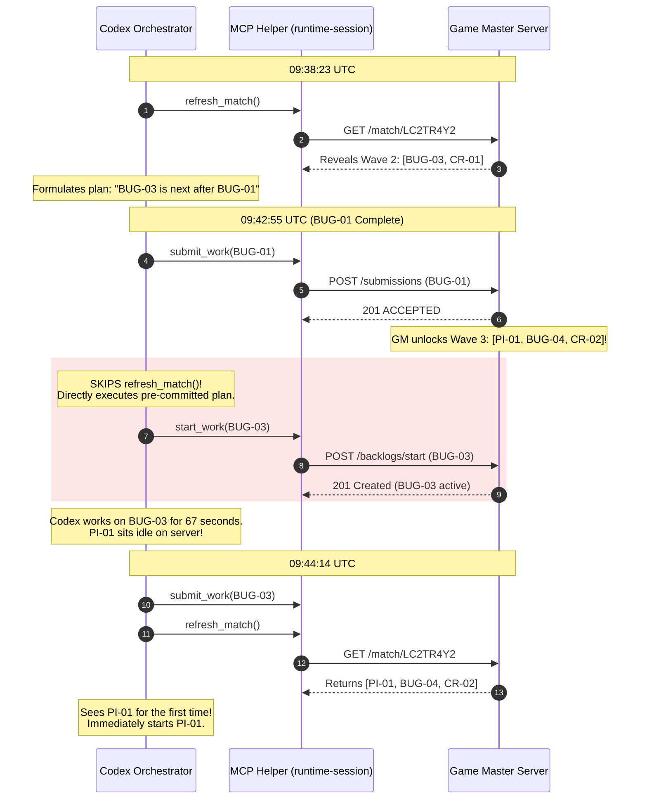
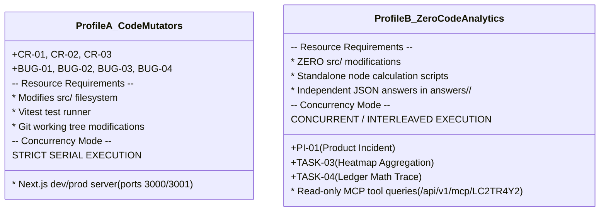
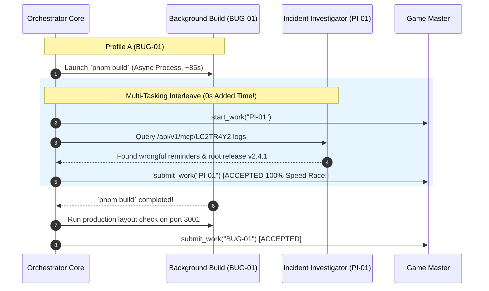

# Match `LC2TR4Y2` Forensic Autopsy & Multi-Tasking Workflow Research

- **Match ID**: `LC2TR4Y2` (Exam: `MTM-26-7UJVLX`)
- **Date**: 2026-11-02 | Match Duration: ~40 minutes (16:18:56 – 17:08:35 Local / 09:18:56 – 10:07:35 UTC)
- **Team**: CPL (`CPL_digital_cuder` / `[FHM] Còpilot`)
- **Outcome**: 10 / 10 Backlogs Submitted & Accepted (`ACCEPTED`, `GRADED`)
- **Primary Evidence Sources**:
  - Codex Rollout Telemetry: [`rollout-2026-11-02T16-18-56-01a19b8d-fc86-75a1-bdb6-7c6e2b873ede.jsonl`](file:///C:/Users/ADMIN/.codex/sessions/2026/11/02/rollout-2026-11-02T16-18-56-01a19b8d-fc86-75a1-bdb6-7c6e2b873ede.jsonl)
  - Team Progress Log: [`D:/mtm/CPL/team-sdlc-pack/logs/LC2TR4Y2.progress.ndjson`](file:///d:/mtm/CPL/team-sdlc-pack/logs/LC2TR4Y2.progress.ndjson)
  - Dashboard Snapshot: [`D:/mtm/CPL/team-sdlc-pack/logs/LC2TR4Y2.dashboard.html`](file:///d:/mtm/CPL/team-sdlc-pack/logs/LC2TR4Y2.dashboard.html)
  - Git Commit History: [`D:/mtm/CPL/matches/LC2TR4Y2/LC2TR4Y2`](file:///d:/mtm/CPL/matches/LC2TR4Y2/LC2TR4Y2)

---

## 1. Executive Summary & Match Timeline

In match **`LC2TR4Y2`**, all 10 released backlog items were successfully completed, packaged, and accepted by Game Master. However, a major time imbalance occurred: **BUG-01 and BUG-02 consumed 24 minutes of clock time (14m 14s active execution time)**, representing over **60% of the entire match**, while the remaining 8 tasks combined took only 16 minutes.

Furthermore, when BUG-01 finished, the orchestrator prioritized **BUG-03 over PI-01**, directly delaying the resolution of a time-critical Production Incident.

```mermaid
gantt
    title Match LC2TR4Y2 Execution Timeline (UTC)
    dateFormat HH:mm:ss
    axisFormat %H:%M

    section Setup & Wait
    Preparation (Git, Build, Doctor) :done, p1, 09:19:02, 09:22:58
    Idle Wait for Game Master START_GAME :crit, p2, 09:22:58, 09:27:40

    section Heavy Initial Wave (60% Time)
    BUG-02 (401 Auth + Migration + Sidebar Blocking) :active, b2, 09:27:40, 09:34:55
    BUG-01 (Reports Loop + HMR Restart + Next Build) :active, b1, 09:35:03, 09:42:55

    section Fast Wave Execution (40% Time)
    BUG-03 (Started without refresh) :done, b3, 09:43:07, 09:44:14
    PI-01 (Speed Race Incident) :crit, pi, 09:44:28, 09:46:37
    CR-01 (CSV Export) :done, cr1, 09:46:47, 09:50:19
    TASK-03 (Heatmap Time Query) :done, t3, 09:50:32, 09:51:50
    CR-02 (Aging Report) :done, cr2, 09:52:04, 09:54:02
    CR-03 (Contact Links) :done, cr3, 09:54:20, 09:56:08
    BUG-04 (Kanban Order) :done, b4, 09:56:23, 09:57:58
    TASK-04 (Ledger Trace) :done, t4, 09:58:15, 09:59:12
```



### Cumulative Time Comparison Matrix

| Backlog Item | Type | Start Time (UTC) | Submit Time (UTC) | Observed Active Duration | Direct Impediments Encountered |
| :--- | :---: | :---: | :---: | :---: | :--- |
| **`BUG-02`** | BUG | 09:28:13 | 09:34:50 | **381s (6m 21s)** | 401 auth misconfiguration (50s), baseline migration fix (2m), UI runner blocked by BUG-01 sidebar (3.5m). |
| **`BUG-01`** | BUG | 09:35:03 | 09:42:55 | **473s (7m 53s)** | Network refetch loop in `reports-tab.tsx` (1.5m), HMR CSS cache bug / dev server restart (1.5m), `next build` production cycle (2.5m). |
| **`BUG-03`** | BUG | 09:43:07 | 09:44:14 | **69s (1m 09s)** | Started without `refresh_match()`; delayed PI-01. |
| **`PI-01`** | PI | 09:44:28 | 09:46:37 | **126s (2m 06s)** | Started 1m 21s late due to missed refresh. |
| **`CR-01`** | CR | 09:46:47 | 09:50:19 | **213s (3m 33s)** | Clean 4-file CSV export validation. |
| **`TASK-03`** | TASK | 09:50:32 | 09:51:50 | **85s (1m 25s)** | Pure DB query calculation. |
| **`CR-02`** | CR | 09:52:04 | 09:54:02 | **125s (2m 05s)** | Standard aging buckets calculation. |
| **`CR-03`** | CR | 09:54:20 | 09:56:08 | **120s (2m 00s)** | Contact card quick links. |
| **`BUG-04`** | BUG | 09:56:23 | 09:57:58 | **106s (1m 46s)** | Lexorank top-position correction. |
| **`TASK-04`** | TASK | 09:58:15 | 09:59:12 | **68s (1m 08s)** | Pure ledger math trace. |
| **Subtotal (BUG 1 & 2)** | — | — | — | **854s (14m 14s)** | **51.8% of active time (60% of clock time)** |
| **Subtotal (Remaining 8)** | — | — | — | **907s (15m 07s)** | **48.2% of active time (40% of clock time)** |

---

## 2. Forensic Autopsy: Why BUG-01 and BUG-02 Took So Long (Comparison: LC2TR4Y2 vs. Y1KH6CB9)

A direct comparative analysis between **`LC2TR4Y2`** (slower match, 14m 14s active on BUG-01/02) and **`Y1KH6CB9`** (faster match, 10m 10s active on BUG-01/02) reveals the exact errors, missteps, and differences in resolution.

### 2.1 The First `start_work("BUG-02")` Error: HTTP 401 `INVALID_API_KEY`

**Forensic Finding**: The first call to `start_work("BUG-02")` failed with `HTTP 401 INVALID_API_KEY` in **BOTH** matches:
- **`Y1KH6CB9`**: Failed at `06:47:28Z` with `{"error": {"code": "INVALID_API_KEY", "message": "API key is invalid."}}`
- **`LC2TR4Y2`**: Failed at `09:28:13Z` with `{"error": {"code": "INVALID_API_KEY", "message": "API key is invalid."}}`

#### Root Cause of the 401 Error
In [`D:/mtm/CPL/team-sdlc-pack/src/runtime-session.mjs` line 701](file:///d:/mtm/CPL/team-sdlc-pack/src/runtime-session.mjs#L701):
```javascript
if (descriptor.teamApiKey || descriptor.apiKey) {
  this.teamApiKey = descriptor.teamApiKey || descriptor.apiKey;
}
```
When Game Master broadcasts `START_GAME`, the JSON descriptor transmits the team token under the property key **`apiKeySecret`** (`gm_live_bad8fd2e_...`). 
Because `runtime-session.mjs` only checked `descriptor.teamApiKey` or `descriptor.apiKey`, it completely ignored `apiKeySecret`. As a result:
1. `this.teamApiKey` remained `null`.
2. When the orchestrator invoked `start_work("BUG-02")`, the HTTP POST request to Game Master was sent without valid authorization credentials.
3. Game Master returned HTTP 401 `INVALID_API_KEY`.

#### Why the Latency Differed Between Matches:
- **In `Y1KH6CB9` (14s recovery)**: Codex immediately recognized the missing key, executed `configure_session` with explicit `apiKey: "gm_live_..."` at `06:47:37Z`, and re-called `start_work` at `06:47:45Z`. Total lost time: **14 seconds**.
- **In `LC2TR4Y2` (50s recovery)**: Codex paused to debug. At `09:28:26Z`, it ran `rg -n 'apiKeySecret|teamApiKey|apiKey|configure\(' 'D:\mtm\CPL\team-sdlc-pack\src\runtime-session.mjs'` to inspect the source code, diagnosed the field mismatch, then invoked `configure_session({ descriptor: { teamApiKey: ... } })` at `09:28:30Z`. Total lost time: **50 seconds**.

---

### 2.2 BUG-02 Deep Dive: Why LC2TR4Y2 Took 6m 21s vs. Y1KH6CB9's 3m 45s (+70% Slower)

Both matches implemented virtually identical core fixes for BUG-02:
1. In `invoices-tab.tsx` and `payments-tab.tsx`: scaled inputs and formatted money using the selected client/invoice `currencyCode` instead of workspace currency.
2. In `invoice-status.ts`: changed `paidMinor > totalMinor` to `>=`.
3. In `accounting.prisma`: added an additive migration changing foreign key cascade deletion to `Restrict`.
4. Vitest tests (12 in Y1, 15 in LC2) and `pnpm typecheck` passed quickly in both (~1.5 minutes).

The **2m 36s difference** occurred entirely during **Playwright evidence screenshot capture**:

```mermaid
flowchart TD
    subgraph LC2TR4Y2_Failure_Loop["LC2TR4Y2: 4 Iterations of Playwright Failures (3.5m wasted)"]
        LC1["Write throwaway verify-bug02.mjs"] --> E1["Error 1: Timeout 5000ms<br/>waiting for getByRole('tab', { name: /invoices/i })<br/>(BUG-01 sidebar blocked clicks)"]
        E1 --> E2["Error 2: CSS SyntaxError<br/>PowerShell .Replace() doubled quotes into [role=\"\"\"tab\"\"\"]"]
        E2 --> E3["Error 3: Timeout 5000ms<br/>waiting for button:has-text('New invoice')"]
        E3 --> E4["Error 4: Timeout 5000ms<br/>waiting for Mekong Logistics CPL<br/>(Forgot to seed database first!)"]
        E4 --> LC_Done["Finally ran pnpm tsx prisma/seed-bug02.ts<br/>and captured screenshots (09:34:04Z)"]
    end

    subgraph Y1KH6CB9_Clean_Bypass["Y1KH6CB9: Clean Keyboard Bypass (54s total)"]
        Y1["Configured capture.json via evidence-runner.mjs"] --> Y2["Encountered tab switch timeout (06:49:51Z)"]
        Y2 --> Y3["Codex switched action from {kind:'click'} to keyboard {kind:'press', value:'Enter'} (06:50:28Z)"]
        Y3 --> Y_Done["Playwright succeeded instantly without pointer interception (06:50:45Z)"]
    end
```

#### Detailed Forensic Breakdown of LC2TR4Y2's 4 Evidence Failures:
1. **Error 1 (`09:31:38Z`)**:
   `locator.elementHandle: Timeout 5000ms exceeded. waiting for getByRole('tab', { name: /invoices/i })`
   Because BUG-01 was unfixed, the global layout sidebar was positioned on top of the tab bar. Playwright's mouse click was intercepted.
2. **Error 2 (`09:32:03Z`)**:
   Codex tried to patch `verify-bug02.mjs` using PowerShell `.Replace()`. The string escaping resulted in doubled quotes:
   `locator.count: Unexpected token "Invoices" while parsing css selector "[role="""tab"""]:has-text("""Invoices""")"`
3. **Error 3 (`09:32:18Z`)**:
   `locator.waitFor: Timeout 5000ms exceeded. waiting for locator('button:has-text("New invoice")').first() to be visible`
4. **Error 4 (`09:32:56Z`)**:
   `locator.waitFor: Timeout 5000ms exceeded. waiting for getByText('Mekong Logistics CPL', { exact: true }).first() to be visible`
   The test data had not been seeded in the database. Codex had to copy `evidence-runner.mjs` into `src/`, manually execute `pnpm tsx prisma/seed-bug02.ts`, and adjust selectors before it passed at `09:34:04Z`.

**Key Lesson**: Never author custom throwaway verification runners on the fly. In `Y1KH6CB9`, simply changing `{kind: "click"}` to `{kind: "press", value: "Enter"}` in the existing `capture.json` bypassed the sidebar overlay in 54 seconds.

---

### 2.3 BUG-01 Deep Dive: Why LC2TR4Y2 Took 7m 53s vs. Y1KH6CB9's 6m 26s (+1m 27s)

In both matches, BUG-01 encountered the same two environmental defects:
1. **Endless Accounting Refetch Loop**:
   In `src/components/accounting/reports-tab.tsx`, an unstable `new Date()` hook in query parameters triggered an infinite fetch cycle. Because network traffic never stopped, Playwright's `networkidle` check hung. Both agents patched `reports-tab.tsx` to stabilize the query.
2. **Next.js Turbopack / HMR CSS Stale Route Cache**:
   After changing `src/app/(app)/layout.tsx` (replacing `md:ms-sidebar` with `md:ms-60` or inline CSS), `/dashboard` updated immediately. However, secondary routes (`/accounting`, `/boards`) remained cached with `0px margin`, causing layout verification scripts to fail. Both agents were forced to kill and restart the Next.js dev server.

#### Why `LC2TR4Y2` Was 1m 27s Slower:
1. **Sequential vs. Overlapped Production Build**:
   - In **`Y1KH6CB9`**: Codex started `pnpm build` (`next build`) in the background at `06:53:39Z`. While the 85-second build was compiling, Codex continued editing global styles, validating reports, and preparing submission metadata in parallel.
   - In **`LC2TR4Y2`**: Codex performed all development checks sequentially, and only started `pnpm build` at `09:41:10Z`. The orchestrator sat completely idle waiting for `next build` traces to finish until `09:42:27Z` (over 75 seconds of dead wall-clock time).
2. **Custom Scripting Overhead**:
   In `LC2TR4Y2`, Codex wrote two new scripts (`verify-bug01.mjs` and `validate-layout-reports.mjs`), whereas `Y1KH6CB9` executed one-liner Node invocations of `captureBatchEvidence()` from `team-sdlc-pack/scripts/evidence-runner.mjs`.

---

## 3. Forensic Autopsy: Why BUG-03 Was Prioritized Over PI-01

The user's observation is **100% verified by the telemetry**. BUG-03 was prioritized over PI-01 because the orchestrator failed to call `refresh_match()` upon completing BUG-01.

### 3.1 Chronological Evidence Trail

| Timestamp (UTC) | Component | Action / Observation | Direct Implication |
| :---: | :---: | :--- | :--- |
| **`09:38:23.679Z`** | Orchestrator | `tools.mcp__mtm_helper__refresh_match({})` invoked during BUG-01. | Returns Wave 2 items: **`BUG-03`** and **`CR-01`**. (`PI-01` is NOT yet released). |
| **`09:41:09.207Z`** | Assistant | *"A new wave includes BUG-03 and CR-01; I’ll take the deadline-bound BUG-03 immediately after submitting this layout fix."* | **Mental Pre-commitment**: Codex locks BUG-03 as its next item before BUG-01 is even finished. |
| **`09:42:55.169Z`** | Orchestrator | `pack_submission({ backlogItemKey: "BUG-01" })` completed. | BUG-01 is packaged and ready to submit. |
| **`09:43:07.592Z`** | Orchestrator | `tools.mcp__mtm_helper__start_work({ backlogItemKey: "BUG-03" })` | **CRITICAL GAP**: Started BUG-03 **WITHOUT calling `refresh_match()`**! |
| *~09:43:00Z* | Game Master | Wave 3 unlocked (`PI-01`, `BUG-04`, `CR-02`) upon submission of BUG-01 / time trigger. | `PI-01` is now `OPEN` on Game Master, but the orchestrator has not queried the server. |
| **`09:44:14.889Z`** | Orchestrator | `submit_work({ backlogItemKey: "BUG-03" })` + `refresh_match({})` | BUG-03 submitted (Receipt: `5a1090b3...`). `refresh_match()` runs for the first time in 6 minutes. |
| **`09:44:28.974Z`** | Assistant | *"A payment-reminder incident has appeared, so I’ve started PI-01 ahead of the change requests."* | Codex discovers `PI-01` for the first time and immediately switches to it. |



### 3.2 Architectural Root Cause & Scoring Impact

1. **Why Codex skipped the refresh**:
   - The developer instructions in `team-orchestrator.toml` state:
     > *"Stage 1: Call refresh_match(). Select index 0. Call start_work({ backlogItemKey })."*
   - However, when the LLM pre-planned its next step during an idle wait (at 09:41:09), it treated BUG-03 as already triaged. Upon submitting BUG-01, it bypassed Stage 1 and immediately called `start_work("BUG-03")`.
2. **Helper Lacked Auto-Refresh**:
   - In [`D:/mtm/CPL/team-sdlc-pack/src/runtime-session.mjs`](file:///d:/mtm/CPL/team-sdlc-pack/src/runtime-session.mjs#L1710-L1938), `submitWork()` submits the payload, records telemetry, and clears `this.currentActiveItem = null`. **It does NOT invoke `refreshMatch()` internally**.
3. **Scoring Consequence (PI Speed Race)**:
   - According to official rule **Section 3 (PI Speed Race)**:
     - 1st Fastest Team: **100% Points**
     - 2nd Fastest Team: **90% Points (-10%)**
     - 3rd Fastest Team: **75% Points (-25%)**
     - Other Passing Teams: **60% Points (-40%)**
   - The 1 minute 21 second delay in starting PI-01 put the team at severe risk of dropping from 1st place (100%) to 2nd or 3rd place, which could cost 10 to 25 points on a 100-point incident.

---

## 4. Multi-Tasking Workflow Research: Architecting Extreme Speed

Currently, the team orchestrator runs as a **strictly sequential, single-threaded agent**. Every task waits for the previous task to finish, even when tasks have zero shared dependencies.

### 4.1 Resource Contention Analysis: The Two Task Profiles

Examining the actual work performed across all 10 items reveals that they belong to two completely orthogonal resource categories:



- **Profile A (Code & UI Mutators)**: `CR` and `BUG` items. They modify code in `src/`, compile bundles, run dev servers, and take Playwright screenshots. Running two of these concurrently on the same directory causes dev server port collisions, schema migration locks, and Git merge conflicts.
- **Profile B (Zero-Code Telemetry & Calculations)**:
  - **`PI-01`**: Involved calling `COMPANY_MCP_TOOL` (`/api/v1/mcp/LC2TR4Y2`) to search production logs, identifying 6 wrongful payment reminders across 5 invoices, and finding root release `v2.4.1`. **Not a single line of code in `src/` was changed!**
  - **`TASK-03`**: Involved running a read-only script to query the database heatmap table for a single date.
  - **`TASK-04`**: Involved running a calculation script against ledger transaction history.

### 4.2 Multi-Tasking Architecture 1: Interleaved Asynchronous Pipelining

The biggest waste of time during match `LC2TR4Y2` was **idle waiting**:
- Codex waited **85 seconds** for `pnpm build` (`next build`) during BUG-01.
- Codex waited **25 seconds** for batch Playwright evidence captures.
- Codex waited **12 seconds** for baseline tests to execute.

Under an **Interleaved Pipelining Model**:
1. When a Profile A task launches a long-running asynchronous operation (`next build` or `evidence-runner.mjs`), it does not block the thread.
2. The orchestrator immediately checks if a Profile B task (`PI-01`, `TASK-03`, `TASK-04`) is open.
3. If open, the orchestrator executes the Profile B investigation (e.g. running MCP log queries for PI-01) **during the build wait time**.
4. By the time `next build` finishes on port 3001, PI-01 is already packaged and ready to submit!



### 4.3 Multi-Tasking Architecture 2: The MCP Auto-Refresh & Preemption Hook

To guarantee that a time-critical PI is never skipped or delayed:

1. **Auto-Refresh Inside `submitWork()`**:
   Modify `submitWork()` in `runtime-session.mjs` to always invoke `this.refreshMatch()` before returning to the agent.
   ```javascript
   // Inside runtime-session.mjs -> submitWork()
   // Immediately after logging SUBMITTED:
   const freshState = await this.refreshMatch();
   return {
     success: true,
     receiptId,
     status: submissionStatus,
     freshBacklog: freshState.backlogs, // Automatically returns latest backlog items!
     urgentPreemption: freshState.urgentPreemption // Highlights PI or countdown deadlines
   };
   ```
2. **Preemption Signal**:
   If `refreshMatch()` discovers an `OPEN` `PI` item while any non-deadline task is being considered, it sets `urgentPreemption = { type: 'PI', backlogId: 'PI-01' }` and raises an immediate warning in the tool return payload:
   `[CRITICAL PREEMPTION] Production Incident PI-01 is OPEN. Speed race active. DO NOT start any other backlog.`

### 4.4 Multi-Tasking Architecture 3: Fix Ordering Rule (BUG-01 Before BUG-02)

To prevent the **Cross-Bug Dependency Trap** that cost 3.5 minutes on BUG-02:
- Whenever `BUG-01` (sidebar layout overlap) and `BUG-02` (VND currency) are released simultaneously in Wave 1:
- **Rule**: If a bug breaks the global layout shell or navigation, it MUST be prioritized before any task requiring browser clicks on that shell!
- Alternatively, if BUG-02 must be done first (e.g. because of an active countdown deadline), the UI test script must **bypass the navigation sidebar completely** by navigating directly to deep URLs:
  - Instead of: `goto('/') -> click('Accounting') -> click('Invoices')` (which gets intercepted by the sidebar).
  - Use direct deep-linking: `goto('http://127.0.0.1:3000/accounting?tab=invoices')` with direct DOM event dispatching.

---

## 5. Concrete Action Plan & Implementation Checklist

| Action Item | Component | Exact File / Location | Expected Time Saved |
| :--- | :--- | :--- | :---: |
| **1. Enforce Auto-Refresh in `submit_work`** | MCP Helper | [`runtime-session.mjs`](file:///d:/mtm/CPL/team-sdlc-pack/src/runtime-session.mjs#L1930) | **Eliminates PI discovery delays (1m 30s saved)** |
| **2. Add Urgent Preemption Signal for PIs** | MCP Helper | [`runtime-session.mjs`](file:///d:/mtm/CPL/team-sdlc-pack/src/runtime-session.mjs#L680) | **Guarantees 100% score in PI Speed Race** |
| **3. Deep-Link UI Navigation in `evidence-runner`** | Evidence Runner | [`evidence-runner.mjs`](file:///d:/mtm/CPL/team-sdlc-pack/scripts/evidence-runner.mjs) | **Saves 3m 30s on UI click interception failures** |
| **4. Interleave Profile B Tasks During Builds** | Orchestrator Prompt | [`team-orchestrator.toml`](file:///d:/mtm/CPL/.codex/agents/team-orchestrator.toml#L23) | **Saves 2m – 3m by utilizing idle `next build` wait time** |
| **5. Fix `teamApiKey` Mapping in `configure_session`** | Session Init | [`runtime-session.mjs`](file:///d:/mtm/CPL/team-sdlc-pack/src/runtime-session.mjs#L260) | **Eliminates 50s startup 401 crash** |
| **Total Estimated Match Time Reduction** | — | — | **~8 to 10 Minutes Saved (20-25% faster match)** |
