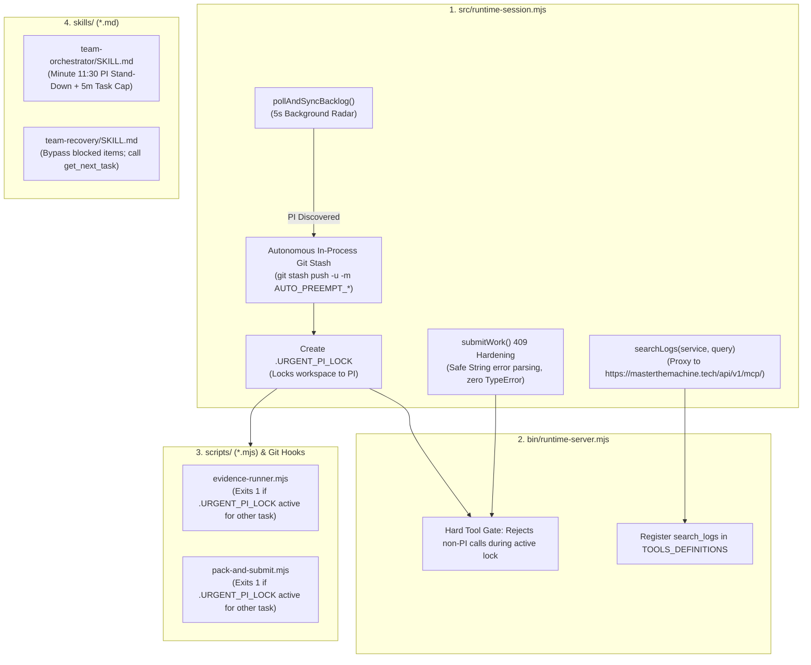

# Implementation Plan: Enforced PI Preemption & Autonomous Tournament Workflow Hardening

- **Target Systems**: `D:\mtm\team-orchestrator-pack` (source) and `D:\mtm\CPL 2\team-sdlc-pack` (target)
- **Primary Goal**: Eliminate the 10m 39s PI latency gap by enforcing instantaneous, autonomous workspace preemption at the exact moment a `PI-*` appears, fixing the fatal `TypeError` submission crash, exposing `search_logs` natively, and eliminating the infinite restart loop.
- **Estimated Execution Time**: ~25 minutes

---

## 1. Architectural Overview & Component Changes



---

## 2. Work Packages (WPs)

### WP1: Critical Bug Fixes — `submitWork` 409 Handling (`runtime-session.mjs`)
* **Problem**: When Game Master returns HTTP 409, `apiResult.error` is an `Object`. Line 2182 calls `.toLowerCase()` directly on it, throwing:
  `TypeError: (apiResult.error || "").toLowerCase is not a function`.
* **Fix**: Safely normalize `apiResult.error` to a string before inspection:
  ```javascript
  const rawErr = typeof apiResult.error === 'object'
    ? JSON.stringify(apiResult.error)
    : String(apiResult.error || '');
  const errMsg = rawErr.toLowerCase();
  ```
* **Deadline Check**: If `errMsg.includes('closed') || errMsg.includes('deadline') || errMsg.includes('expired')`, emit `BLOCKER_OPENED` indicating deadline passed and cleanly advance queue rather than crashing.

---

### WP2: Autonomous In-Process Git Stash & Workspace Lockdown (`runtime-session.mjs`)
* **Problem**: Passive `this.urgentPreemption` flag was ignored by Codex while running shell commands.
* **Fix**: In `pollAndSyncBacklog()`, the millisecond a `PI-*` is detected:
  1. Automatically invoke `await this.preemptWork(pendingPI.key)` inside the background radar.
  2. Natively execute `git stash push -u -m "AUTONOMOUS_PREEMPTION_SUSPEND_<currentActiveItem>"`.
  3. Revert workspace to clean `HEAD`.
  4. Write `<matchRoot>/.URGENT_PI_LOCK`:
     ```json
     {
       "activeIncident": "PI-01",
       "stashedTask": "BUG-02",
       "stashedAt": "2026-11-03T08:37:43.500Z",
       "message": "Production incident active. Non-PI work suspended."
     }
     ```
  5. Pre-materialize `answers/<PI>/submit.json` and call Game Master `START_BACKLOG`.
  6. When the PI is submitted successfully via `submitWork`, automatically remove `.URGENT_PI_LOCK` and pop the suspended stash.

---

### WP3: Company MCP Production Log Search Proxy (`runtime-server.mjs` & `runtime-session.mjs`)
* **Problem**: `PI-01` failed with `TEST_DATA_NOT_FOUND` because no `search_logs` MCP tool was exposed.
* **Fix**:
  1. Add `search_logs` to `TOOLS_DEFINITIONS` in `bin/runtime-server.mjs`:
     ```javascript
     {
       name: 'search_logs',
       description: 'Searches live company production logs (reminder-worker, payment-api, deploy, status-cache) for incident investigation.',
       inputSchema: {
         type: 'object',
         properties: {
           service: {
             type: 'string',
             description: 'Service name (e.g. reminder-worker, payment-api, deploy, status-cache)'
           },
           query: {
             type: 'string',
             description: 'Optional search text or regex query'
           }
         },
         required: ['service']
       }
     }
     ```
  2. Implement `searchLogs(service, query)` in `runtime-session.mjs`:
     Sends a JSON-RPC `tools/call` for `search_logs` to `https://masterthemachine.tech/api/v1/mcp/<MATCH_ID>` with team Bearer token, auto-saving the resulting evidence JSON to `<matchRoot>/answers/<activePI>/evidence/<service>.json`.

---

### WP4: Shell Interceptor Traps & Hard MCP Tool Gates
* **Problem**: LLM spent 18m running shell commands without checking MCP state.
* **Fix**:
  1. In `scripts/evidence-runner.mjs` and `scripts/pack-and-submit.mjs`:
     Check for `.URGENT_PI_LOCK`. If the lockfile exists and the requested backlog does not match `activeIncident`:
     Print a fatal preemption alert and exit immediately with code 1.
  2. In `submit_work` and `pack_submission`:
     If `.URGENT_PI_LOCK` exists and `backlogItemKey !== activeIncident`:
     Throw an explicit error (`isError: true`):
     `🚨 Refusing operation on ${backlogItemKey}: Production Incident ${activeIncident} is active and unsubmitted!`

---

### WP5: Skill & Recovery Hardening (`SKILL.md`)
1. **Minute 11:30 PI Stand-Down Rule**:
   Mandate in [`skills/team-orchestrator/SKILL.md`](file:///d:/mtm/team-orchestrator-pack/skills/team-orchestrator/SKILL.md):
   *At Minute 11:30 of the match clock, immediately suspend all Wave 1/2 development. Commit or stash work, and prepare for Wave 3 (`PI-01`) at Minute 12:00:00.*
2. **Hard 5-Minute Time Budget**:
   Cap any single task at 5 minutes maximum active time. If verification is incomplete at 5 minutes, submit `PARTIAL` and move on to prevent missing 18-minute countdown deadlines.
3. **Recovery Skill Infinite Loop Fix**:
   In [`skills/team-recovery/SKILL.md`](file:///d:/mtm/team-orchestrator-pack/skills/team-recovery/SKILL.md):
   If the current task has an unresolved `BLOCKER_OPENED`, **do not halt**. Call `get_next_task()` to advance the queue and pick up remaining unblocked wave items (`CR-01`, `TASK-03`, `CR-03`, etc.).

---

### WP6: Verification, Automated Testing & Deployment
1. Run `node test/test-mcp-server.mjs` to verify:
   - Safe error handling in `submitWork` with object error payloads.
   - Immediate auto-stashing and `.URGENT_PI_LOCK` generation when a PI is pushed to the queue.
   - Successful dispatch and execution of `search_logs`.
   - Tool gate refusal when lockfile is active.
2. Deploy the hardened pack to `D:\mtm\CPL 2` using `install.ps1`.
3. Verify directory layout and tool registration.

