# Match `VAO3MCWD` Forensic Autopsy & Enforced PI Preemption Architecture

- **Match ID**: `VAO3MCWD` (Exam: `MTM-26-7UJVLX`)
- **Date**: 2026-11-03 | Match Duration: 40 minutes (15:25:38 – 16:05:43 Local / 08:25:38 – 09:05:43 UTC)
- **Team**: CPL (`CPL_digital_cuder` / `[FHM] Còpilot`)
- **Outcome**: 0 / 10 Backlogs Submitted (`0 Points`)
- **Primary Telemetry Sources**:
  - Codex Rollout Telemetry: [`rollout-2026-11-03T15-05-55-01a1a071-7a9c-7572-8042-7cd2e8af7860.jsonl`](file:///C:/Users/ADMIN/.codex/sessions/2026/11/03/rollout-2026-11-03T15-05-55-01a1a071-7a9c-7572-8042-7cd2e8af7860.jsonl)
  - Team Progress Log: [`D:/mtm/CPL 2/team-sdlc-pack/logs/VAO3MCWD.progress.ndjson`](file:///d:/mtm/CPL%202/team-sdlc-pack/logs/VAO3MCWD.progress.ndjson)
  - Match Status Stream: [`D:/mtm/CPL 2/team-sdlc-pack/logs/VAO3MCWD.match-status.ndjson`](file:///d:/mtm/CPL%202/team-sdlc-pack/logs/VAO3MCWD.match-status.ndjson)
  - Workspace Answers & Git Tree: [`D:/mtm/CPL 2/matches/VAO3MCWD/VAO3MCWD`](file:///d:/mtm/CPL%202/matches/VAO3MCWD/VAO3MCWD)

---

## 1. Executive Summary

In match **`VAO3MCWD`**, the team experienced a catastrophic total failure resulting in 0 points awarded across all 10 backlog items. While the automated background polling radar successfully discovered all backlog waves within seconds of Game Master release, **the single-threaded LLM agent was completely decoupled from the background radar**:

1. **The PI Preemption Gap (10m 39s Latency)**: Wave 3 released `PI-01` at **Minute 12:05 (08:37:43 UTC)**. The radar detected and auto-started it on Game Master immediately, but the LLM was trapped in a deep execution loop on `BUG-02` and did not check or attempt to preempt for `PI-01` until **Minute 22:44 (08:48:22 UTC)**.
2. **BUG-02 Expired Its 18-Minute Deadline**: The LLM spent **18 minutes and 45 seconds** over-engineering `BUG-02` (writing database seeders, Playwright tab runners, and report scripts). When `submit_work("BUG-02")` was finally called at 08:44:23 UTC, the 18-minute deadline had already lapsed; Game Master returned `HTTP 409 Conflict: BACKLOG_ITEM_CLOSED`.
3. **Fatal `TypeError` Crash in `submitWork`**: In [`runtime-session.mjs` line 2182](file:///d:/mtm/CPL%202/team-sdlc-pack/src/runtime-session.mjs#L2182), `(apiResult.error || '').toLowerCase()` crashed with an unhandled `TypeError` because `apiResult.error` was a parsed JSON object. The MCP server crashed and blinded the LLM to the cause of failure.
4. **Missing `search_logs` Tool on `PI-01`**: When the LLM finally switched to `PI-01`, it called `get_test_data("PI-01")`, which returned `TEST_DATA_NOT_FOUND` (incidents do not have mock fixtures; they use live production logs). Because `runtime-server.mjs` omitted the Game Master `search_logs` tool, the agent declared a hard blocker (`BLOCKER_OPENED`) and stopped.
5. **The 14-Cycle Restart Loop**: Once the LLM went idle with an open blocker, the MTM-PLAYER supervisor triggered a restart. The `team-recovery` skill re-authenticated, saw the blocker, and immediately exited again, triggering a fatal 14-cycle restart storm until the 40-minute match clock expired.

---

## 2. Comprehensive Chronological Execution Timeline

```mermaid
gantt
    title Match VAO3MCWD Execution Timeline (UTC)
    dateFormat HH:mm:ss
    axisFormat %H:%M

    section Match Setup
    Preparation Gates (Git, Migrations, Seed, Typecheck) :done, p1, 08:05:52, 08:14:10
    Idle Wait for Game Master START_GAME :crit, p2, 08:14:10, 08:25:38

    section Monolithic BUG-02 Loop (18m 45s)
    BUG-02 Implementation, Seeds & UI Scripts :active, b2, 08:25:38, 08:43:38
    BUG-02 GM Deadline Passed (409 Conflict) :crit, b2_exp, 08:43:38, 08:44:23
    submitWork TypeError Crash (Line 2182) :crit, b2_crash, 08:44:23, 08:48:22

    section Delayed PI-01 Preemption (10m 39s Late)
    PI-01 Released on GM & Radar Started :done, pi_rel, 08:37:43, 08:37:48
    PI-01 Idle in Radar Queue (LLM Unaware) :crit, pi_idle, 08:37:48, 08:48:22
    LLM calls preempt_work(PI-01) :active, pi_act, 08:48:22, 08:50:19
    get_test_data NOT_FOUND -> BLOCKER_OPENED :crit, pi_block, 08:50:19, 08:50:42

    section Infinite Restart Death Loop
    Restarts 1 through 14 (MTM-PLAYER Watchdog) :crit, r_loop, 08:50:42, 09:05:43
    Match Finished (0 / 10 Submitted, 0 Pts) :crit, fin, 09:05:43, 09:05:44
```



### Cumulative Event & Latency Matrix

| Timestamp (UTC) | Match Clock | Component | Event Description | Latency / Impact |
| :---: | :---: | :---: | :--- | :--- |
| **`08:25:38.303Z`** | Min 00:00 | Game Master | `status: IN_PROGRESS`. 40-minute match clock begins. | Official start. |
| **`08:26:11.576Z`** | Min 00:33 | LLM Agent | Calls `get_next_task()`; receives `BUG-02` (points: 200, deadline: 18m). | Starts BUG-02. |
| **`08:33:38.000Z`** | Min 08:00 | Game Master | Wave 2 released: `BUG-03`, `CR-01`. | Radar auto-starts in background. |
| **`08:37:43.000Z`** | Min 12:05 | Game Master | Wave 3 released: **`PI-01`**, `BUG-04`, `CR-02`. | **PI Released by GM.** |
| **`08:37:43.500Z`** | Min 12:05 | Radar | Emits `BACKLOG_STATUS PI-01 DISCOVERED`, calls GM `START_BACKLOG` (`201 Created`). | Radar queues PI-01. |
| **`08:37:43 – 08:44:23`** | Min 12:05–18:45 | LLM Agent | Trapped in `BUG-02` Playwright/database script testing. **Calls ZERO MCP tools.** | **Blind to PI-01 for 6m 40s.** |
| **`08:43:38.000Z`** | Min 18:00 | Game Master | **BUG-02 18-minute deadline EXPIRES on server.** | BUG-02 closed by GM. |
| **`08:44:23.945Z`** | Min 18:45 | LLM Agent | Calls `submit_work("BUG-02")`. GM returns `HTTP 409 Conflict`. | Submission rejected. |
| **`08:44:34.353Z`** | Min 18:56 | MCP Server | Crash: `TypeError: (apiResult.error || "").toLowerCase is not a function`. | Tool error masked GM detail. |
| **`08:48:22.517Z`** | Min 22:44 | LLM Agent | Finally calls `preempt_work("PI-01")`. | **10m 39s total PI delay.** |
| **`08:48:42.367Z`** | Min 23:04 | LLM Agent | Calls `get_test_data("PI-01")`; receives `TEST_DATA_NOT_FOUND`. | No fixture exists for PIs. |
| **`08:49:18.713Z`** | Min 23:40 | LLM Agent | Searches for log tools; sees no `search_logs` MCP tool. | Missing company MCP tool. |
| **`08:50:19.618Z`** | Min 24:41 | LLM Agent | Emits `BLOCKER_OPENED` on `PI-01` and halts turn. | Turn terminates. |
| **`08:50:42 – 09:05:43`** | Min 25:04–40:05 | MTM Player | Watchdog injects `restart-*-1` through `restart-*-14`. Agent loops without action. | **15 minutes lost in dead loop.** |
| **`09:05:43.862Z`** | Min 40:05 | Game Master | `status: FINISHED`. Match closes. Final Score: 0 pts. | Total defeat. |

---

## 3. Deep-Dive Forensic Autopsy

### 3.1 The Passive Radar vs. Active LLM Execution Gap

In match `LC2TR4Y2`, the forensic finding was that Codex missed Wave 3 because it didn't call `refresh_match()`. In response, the team implemented an autonomous background radar (`startBackgroundRadar(5000)`) in `runtime-session.mjs`:
```javascript
// runtime-session.mjs lines 1452-1460
const pendingPI = this.taskQueue.find(item => this.isPI(item.key));
if (pendingPI && (!this.currentActiveItem || !this.isPI(this.currentActiveItem))) {
  this.urgentPreemption = {
    key: pendingPI.key,
    type: 'PI',
    title: pendingPI.title,
    points: pendingPI.points
  };
}
```

#### Why This Failed Completely:
1. **Passive State Flag**: `this.urgentPreemption` is an internal JavaScript object in the MCP server process. Setting it does not emit any signal to the OS or stdout.
2. **Standard MCP is Client-Initiated**: An MCP server cannot push unsolicited tokens into an LLM generation turn over stdio.
3. **The LLM Execution Pattern**: Codex was running a continuous loop of `tools.exec_command({ cmd: "..." })` directly against PowerShell:
   - Writing `prisma/seed-bug02.ts`
   - Running `pnpm tsx prisma/seed-bug02.ts`
   - Debugging `evidence-runner.mjs`
   - Running `pnpm typecheck`
4. Between `08:26:25` and `08:44:23`, Codex called **zero MCP tools**. It never called `get_next_task()`, `wait_for_update()`, or `report_progress()`.
5. Therefore, the background radar knew `PI-01` was waiting at `08:37:43`, but had **no mechanism to interrupt Codex**.

---

### 3.2 The BUG-02 Rabbit Hole & Deadline Expiration

Game Master rules dictate:
> *"Some items have their own short deadline from their release; Game Master closes them when it passes."*

- `BUG-02` had an **18-minute deadline** from release (`08:25:38 UTC`).
- Expiration time: `08:25:38 + 18:00 = 08:43:38 UTC`.
- Codex submitted at: `08:44:23 UTC` (18 minutes 45 seconds elapsed).
- Game Master strictly enforced the closing timer and rejected the submission with `HTTP 409 Conflict: BACKLOG_ITEM_CLOSED`.

#### Why Did Codex Spend 18m 45s on BUG-02?
In earlier matches (e.g. `Y1KH6CB9`), `BUG-02` was solved in **3 minutes 45 seconds**. In `VAO3MCWD`, Codex got bogged down by:
- Attempting to reproduce full Playwright browser tab navigation via `evidence-runner.mjs`.
- Creating custom database seeding scripts (`seed-bug02.ts`) and query reports (`report-bug02.ts`).
- Analyzing irrelevant files (`topbar.tsx`, `globals.css`, `reports-tab.tsx`).
- Lack of a hard task execution time budget (no 5-minute cap in `SKILL.md`).

---

### 3.3 The Fatal `TypeError` Crash in `submitWork`

When Game Master rejected `BUG-02` with HTTP 409, [`callGameMasterApi`](file:///d:/mtm/CPL%202/team-sdlc-pack/src/runtime-session.mjs#L556) returned:
```javascript
{ success: false, statusCode: 409, error: { code: 'BACKLOG_ITEM_CLOSED', message: 'Item deadline passed.' } }
```

In [`runtime-session.mjs` line 2182](file:///d:/mtm/CPL%202/team-sdlc-pack/src/runtime-session.mjs#L2182):
```javascript
if (!apiResult.success) {
  const errMsg = (apiResult.error || '').toLowerCase(); // <-- FATAL CRASH
  const isAlreadySubmitted = apiResult.statusCode === 409 && 
    (errMsg.includes('already submitted') || errMsg.includes('replacement') || errMsg.includes('disallowed'));
```

Because `apiResult.error` is an `Object`, calling `.toLowerCase()` threw:
```text
TypeError: (apiResult.error || "").toLowerCase is not a function
    at RuntimeSession.submitWork (runtime-session.mjs:2182:46)
    at handleToolCall (runtime-server.mjs:257:14)
```

Instead of handling the 409 and notifying Codex that the deadline had passed, the MCP server threw a runtime exception. Codex assumed a transient tooling crash had occurred and attempted to retry submission, wasting another 4 minutes.

---

### 3.4 Missing `search_logs` Tool and the `TEST_DATA_NOT_FOUND` Trap

At `08:48:22 UTC`, Codex finally initiated `preempt_work("PI-01")` and called `get_test_data("PI-01")`.
- `get_test_data` returned:
  ```json
  {"error": {"code": "TEST_DATA_NOT_FOUND", "message": "No official QA fixture found for PI-01"}}
  ```
- **Why?** PIs are live operational incidents. They do not have pre-canned QA test data fixtures; they require searching real production service logs (`reminder-worker`, `payment-api`, `deploy`).
- In match `LC2TR4Y2`, Codex had improvised an HTTP call using `Invoke-RestMethod` to Game Master's company MCP endpoint (`https://masterthemachine.tech/api/v1/mcp/<MATCH_ID>`) calling `search_logs`.
- In `VAO3MCWD`, Codex checked its registered MCP tools, saw only `kb_search` and `get_test_data`, found no log search tools, and concluded it lacked the required permissions/tools. It emitted `BLOCKER_OPENED` and halted.

---

### 3.5 The 14-Cycle MTM-PLAYER Watchdog Restart Loop

When Codex logged `BLOCKER_OPENED` and terminated its turn without initiating further commands, the external `mtm-player` harness observed an idle agent during an active match.
1. `mtm-player` injected `restart-*-1` into Codex CLI stdin:
   `[USER] Act as the installed MTM team orchestrator...`
2. Codex loaded [`team-recovery` skill](file:///d:/mtm/CPL%202/.agents/skills/team-recovery/SKILL.md), reconnected to Game Master, checked [`VAO3MCWD.progress.ndjson`](file:///d:/mtm/CPL%202/team-sdlc-pack/logs/VAO3MCWD.progress.ndjson), saw that `PI-01` had an active blocker, output *"Recovery complete; PI-01 remains blocked"*, and ended its turn.
3. Because Codex exited immediately, `mtm-player` detected the agent was still idle and injected `restart-*-2`.
4. This loop repeated **14 consecutive times** between `08:50:42` and `09:05:43 UTC`, totally freezing execution until Game Master declared the match `FINISHED`.

---

## 4. Comparative Match Matrix: VAO3MCWD vs. LC2TR4Y2 vs. Y1KH6CB9

| Metric / Dimension | `Y1KH6CB9` (Speed Match) | `LC2TR4Y2` (Recovery Match) | `VAO3MCWD` (Total Breakdown) |
| :--- | :---: | :---: | :---: |
| **Score / Accepted** | 10 / 10 (100%) | 10 / 10 (100%) | **0 / 10 (0%)** |
| **BUG-02 Duration** | 3m 45s | 6m 21s | **18m 45s (Expired 409)** |
| **PI-01 Latency to Start** | ~14s | 1m 21s late | **10m 39s late** |
| **PI-01 Resolution Time** | 2m 10s | 2m 06s | **Unresolved (Blocked)** |
| **Background Radar** | Manual `refresh_match` | Manual `refresh_match` | Autonomous 5s Polling |
| **Preemption Trigger** | LLM-driven | LLM-driven | **Failed (Passive flag)** |
| **`submitWork` 409 Handling** | Clean | Clean | **Crashed (TypeError line 2182)** |
| **PI Log Tooling** | Direct HTTP `search_logs` | Direct HTTP `search_logs` | **None (Stranded)** |
| **Post-Blocker Resilience** | Advanced to next item | Advanced to next item | **14-cycle restart death loop** |

---

## 5. Architectural Principles for Enforced Preemption

To guarantee that the LLM **must** pivot to a PI the moment it appears, we establish three mandatory architectural principles:

1. **Active In-Process Auto-Stash (Zero-Wait)**:
   The background radar must not wait for the LLM. The millisecond a `PI-*` is discovered, the radar autonomously executes `git stash push -u -m "AUTO_PREEMPT_<task>"` in the workspace and creates `.URGENT_PI_LOCK`.
2. **Command Interception Traps**:
   All execution tools (`evidence-runner.mjs`, `pack-and-submit.mjs`, `verify-layout.mjs`, and Git pre-commit hooks) must check for `.URGENT_PI_LOCK`. If active, any attempt to run tests or commits for non-PI items immediately aborts with exit code 1.
3. **Hard MCP Tool Gates**:
   If the LLM calls any MCP tool (`submit_work`, `get_test_data`, `kb_search`) for a non-PI backlog while a PI is unsubmitted, the tool returns `isError: true` with a loud fatal error directive.
4. **Deterministic Minute 11:30 Stand-Down Gate**:
   `SKILL.md` must enforce an unconditional cessation of all Wave 1/2 development at Minute 11:30 of the match clock to wait for Wave 3 (`PI-01`).
5. **Direct `search_logs` MCP Proxy**:
   Expose `search_logs` directly as a native MCP tool in `runtime-server.mjs` forwarding to Game Master's company tools endpoint.

