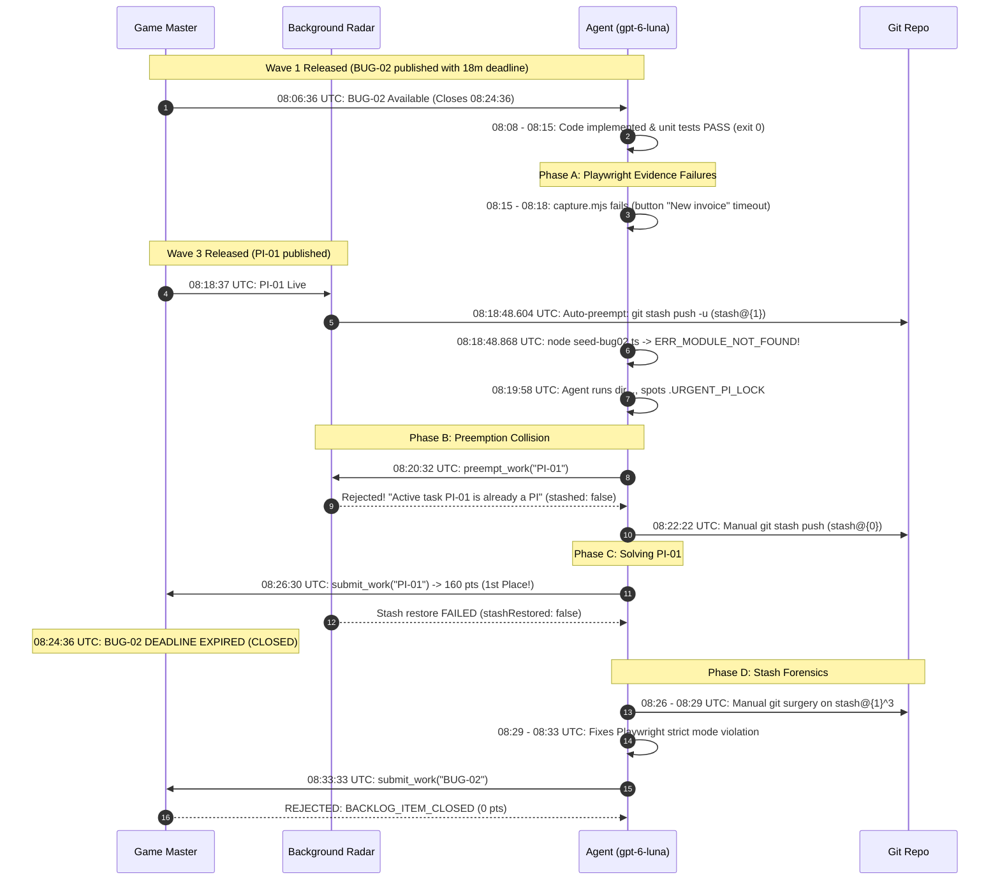

# Match `YTFHP47K` Forensic Autopsy: PI Preemption, Double-Stash Re-entry, and Playwright Reliability

- **Match ID**: `YTFHP47K` (Exam: `MTM-26-7UJVLX`)
- **Date**: 2026-11-04 | Match Duration: 40 minutes (Configured: 2,400s)
- **Active Window**: `14:56:24` to `15:36:24` Local Vietnam Time (UTC+7) / `07:56:24` to `08:36:24` UTC
- **Team**: CPL (`CPL_digital_cuder` / `[FHM] Còpilot`)
- **Model Used**: `gpt-6-luna` (Weaker model benchmark test)
- **Outcome**: **PI-01 Full Score (160 / 160 pts, 1st in Speed Race)** | **BUG-02 Expired / CLOSED (0 pts)**
- **Primary Telemetry & Evidence Sources**:
  - Live Spectator State: [`spectator_YTFHP47K_initialState.json`](file:///d:/mtm/scratch/spectator_YTFHP47K_initialState.json)
  - Game Master Portal Dump: [`spectator_YTFHP47K.html`](file:///d:/mtm/scratch/spectator_YTFHP47K.html)
  - Codex Rollout Telemetry: [`rollout-2026-11-04T14-56-24-*.jsonl`](file:///C:/Users/ADMIN/.codex/sessions/2026/11/04/)
  - Progress Log: [`YTFHP47K.progress.ndjson`](file:///D:/mtm/CPL/team-sdlc-pack/logs/YTFHP47K.progress.ndjson)
  - Parsed Command Log: [`ytfhp47k_commands.json`](file:///d:/mtm/scratch/ytfhp47k_commands.json)

---

## 1. Executive Summary & Match Narrative

In match **`YTFHP47K`**, testing team CPL with the weaker model `gpt-6-luna`, two contrasting events unfolded:

1. **Flawless Speed Race Scoring on `PI-01`**:
   - CPL captured **160 / 160 Points** (`piSubmitOrder: 1`, 0 deduction), beating all opposing teams to the first submission.
2. **The `BUG-02` Expiration Tragedy (0 / 100 Points)**:
   - Implementation logic in `src/src/server/api/routers/accounting.ts` and `src/src/lib/invoice-status.ts` was completed and passing all unit tests (`vitest` + `typecheck`) by **Minute 8 (`08:15:16 UTC`)**.
   - However, the task was submitted at **Minute 27 (`08:33:33 UTC`)** — 9 minutes after its 18-minute deadline expired at **`08:24:36 UTC`**.
   - Game Master rejected the submission: `BACKLOG_ITEM_CLOSED` (0 pts).

### The Root Cause Anatomy: Why 19 Minutes Were Lost on `BUG-02`

The 19-minute delay was driven by three compounding systemic issues:
- **Phase A: The 7-Iteration Playwright Evidence Loop (Burned 6m 30s)**: The model struggled to automate UI navigation for evidence capture due to blind locator timeouts on unselected tabs and table badge strict-mode collisions.
- **Phase B: The Background Radar "Rug-Pull" (Burned 1m 30s)**: Radar detected `PI-01` and stashed the git tree in the background, deleting `prisma/seed-bug02.ts` 264ms before execution. The resulting `ERR_MODULE_NOT_FOUND` crashed the agent into a 90-second panic debugging missing files.
- **Phase C: The Preemption Re-entrancy Collision & Stash Fragmentation (Burned 3m 00s)**: Radar updated in-memory state before the agent called `preempt_work`, causing `preempt_work` to reject the call (`stashed: false`). The agent then manually created a second stash. When `PI-01` completed, `submit_work` failed to pop the stash due to uncommitted `submit.json`, forcing the agent to spend 2.5 minutes doing manual git forensics (`stash@{1}^3`).

---

## 2. Chronological Timeline & Forensic Milestones

---

## 3. Deep-Dive Findings

### Finding 1: The "Rug-Pull" Crash & Accidental Discovery
Our previous assumption that the agent discovered `.URGENT_PI_LOCK` through random curiosity was disproven by the microsecond logs:
1. At `08:18:44.426 UTC` (Step #92), the agent patched `src/prisma/seed-bug02.ts`.
2. At `08:18:48.604 UTC`, the Background Radar detected `PI-01` and ran `git stash push -u`. Because `seed-bug02.ts` was untracked, Git instantly wiped it from disk.
3. At `08:18:48.868 UTC` (264ms later, Step #93), the agent executed `pnpm tsx prisma/seed-bug02.ts`. Node crashed with:
   `Error [ERR_MODULE_NOT_FOUND]: Cannot find module '.../prisma/seed-bug02.ts'`.
4. The agent panicked, searched `prisma/`, tried copying from `..\challenge\BUG-02-seed.ts` (also stashed!), and only found `.URGENT_PI_LOCK` at Step #97 because it was desperately listing the parent directory to find its missing files.

### Finding 2: The Agent Lives in the Shell
From Step #30 to Step #99 (over 60 turns), **nearly 100% of tool executions were PowerShell `exec_command`**. 
- The agent rarely calls MCP tools during active development.
- Relying on MCP response warnings alone will NOT alert an agent who is deep inside a PowerShell test/build loop.
- The notification must be capable of interrupting the agent **directly in terminal stdout/stderr**.

### Finding 3: The Preemption Re-entrancy Bug & Dual-Stash Disaster
- **The Split-Brain**: Radar asynchronously called `preemptWork('PI-01')`, mutating `currentActiveItem = 'PI-01'`.
- When the agent explicitly called `preempt_work({ preemptingKey: 'PI-01' })`, the guard `if (this.currentActiveItem && this.isPI(this.currentActiveItem))` triggered, returning `success: false, stashed: false`.
- Believing its workspace was unshielded, the agent manually stashed modified files (`stash@{0}`).
- When `submit_work` finished `PI-01`, `answers/PI-01/submit.json` was dirty on disk (from writing `receiptId`), causing `git stash pop` to fail.
- All untracked scripts (`capture.mjs`, `seed-bug02.ts`, `plan.md`) remained locked in `stash@{1}^3`. The agent lost 2.5 critical minutes restoring 17 files by hand.

### Finding 4: Why the Model Failed 7 Times on Playwright
The model's failure to capture UI evidence was caused by structural blindness:
1. **Blindness to Page State**: When `getByRole('button', { name: 'New invoice' })` timed out, Playwright gave no information about the rendered DOM. The model did not know that `/accounting` opens on the "Overview" tab and that "Invoices" had not been clicked.
2. **Strict-Mode Violations**: Locating status badges with `getByText('partial', { exact: true })` failed because multiple table rows contained the same text.
3. **Over-Engineering MVS Evidence**: The test database already contained the necessary invoice fixtures. Instead of simply taking a screenshot of the table row, the model attempted to script a 10-step invoice creation form through the UI.

---

## 4. Evaluation of Preemption Architecture Options

| Architecture | Mechanism | PI Context Switch Time ($T_{switch}$) | Stash Collision Risk | Process Crash Risk | Verdict |
| :--- | :--- | :---: | :---: | :---: | :--- |
| **Option 1: Dual Approach** (Status Quo) | Radar stashes + Agent calls `preempt_work` | ~180s (4 LLM turns) | 🔴 Extreme (2 stashes) | 🔴 High | **Rejected**: Fragile, causes split-brain state and stash fragmentation. |
| **Option 2: Radar Only** | Radar does everything; drop `preempt_work` | ~60s (if no crash) | 🟡 Medium | 🔴 Critical (Deletes files under running commands) | **Rejected**: "Rug-pull" crashes confuse the model into phantom debugging. |
| **Option 3: Unified Single Sovereign** | Radar flags + pre-crawls; `get_next_task` stashes cleanly in 1 turn | **< 15s (1 LLM turn)** | 🟢 **Zero** (1:1 clean stack) | 🟢 **Zero** (Stashes only at turn boundary) | **WINNER**: Fastest, cleanest, zero disk collisions. |

---

## 5. Architectural Recommendations

1. **Non-Destructive Background Radar**: Radar must pre-start the PI on Game Master and pre-crawl all microservice logs, but **NEVER touch Git in the background**.
2. **1-Turn Atomic Preemption in `get_next_task()`**: `get_next_task()` becomes the single sovereign entry point. It detects pending PIs, cleanly stashes non-PI work in < 200ms, and delivers pre-crawled logs in one turn.
3. **Fail-Fast Shell Circuit Breaker in `capture-client.mjs`**: When `.URGENT_PI_LOCK` exists, `createCapturePage()` immediately throws:
   `🚨 CRITICAL HALT: PI-01 is live! Evidence capture suspended. Call get_next_task() now!`
   This prevents the model from staying stuck in Playwright loops while a PI decays.
4. **Generic Playwright Diagnostic & Scoping Helpers**:
   - Add `dumpPageDiagnostics(page)` to dump active tabs, buttons, and headings upon locator timeout.
   - Add `getTableRow(page, identifier)` and `selectTab(page, tabName)` to `capture-client.mjs`.
   - Mandate the "Display, Don't Recreate" rule in `SKILL.md` for UI evidence.

